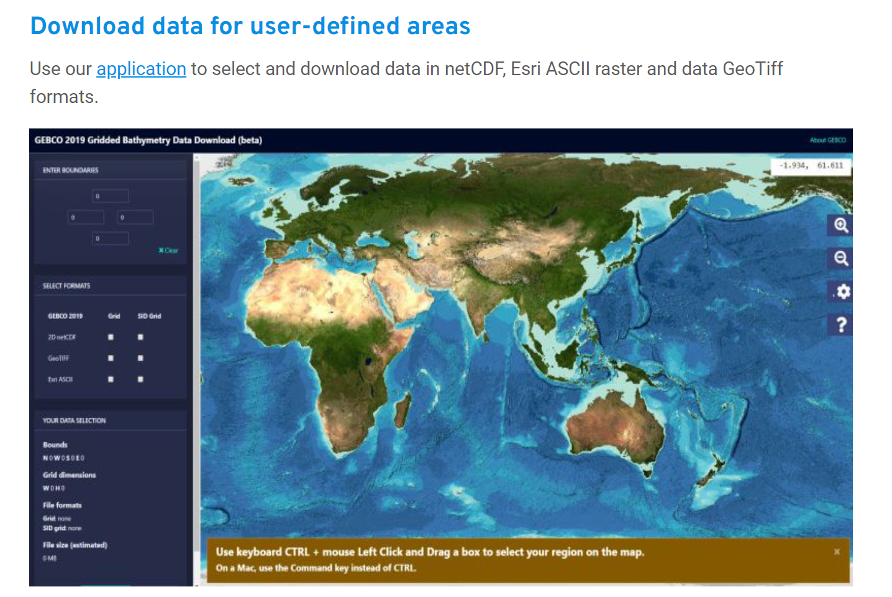
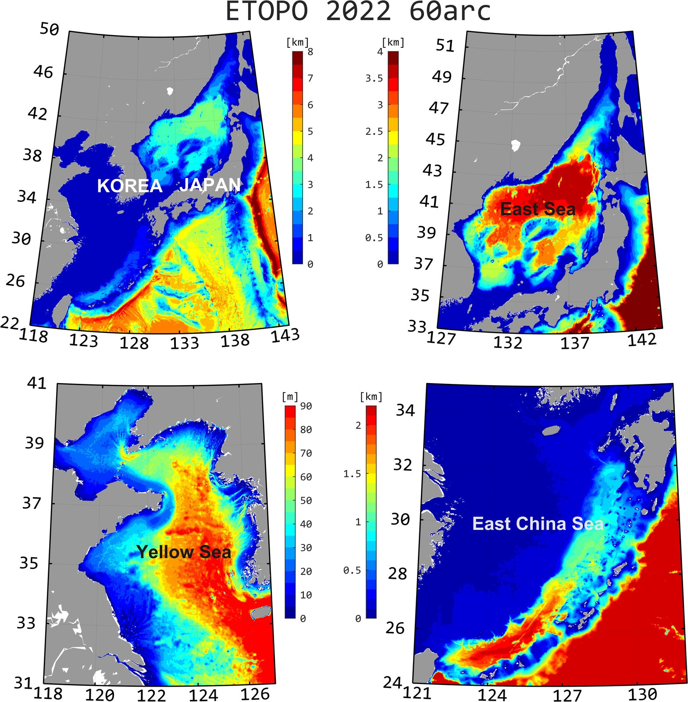
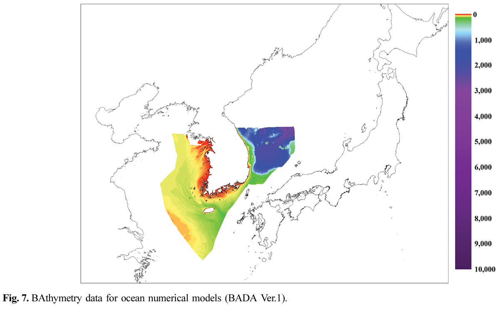
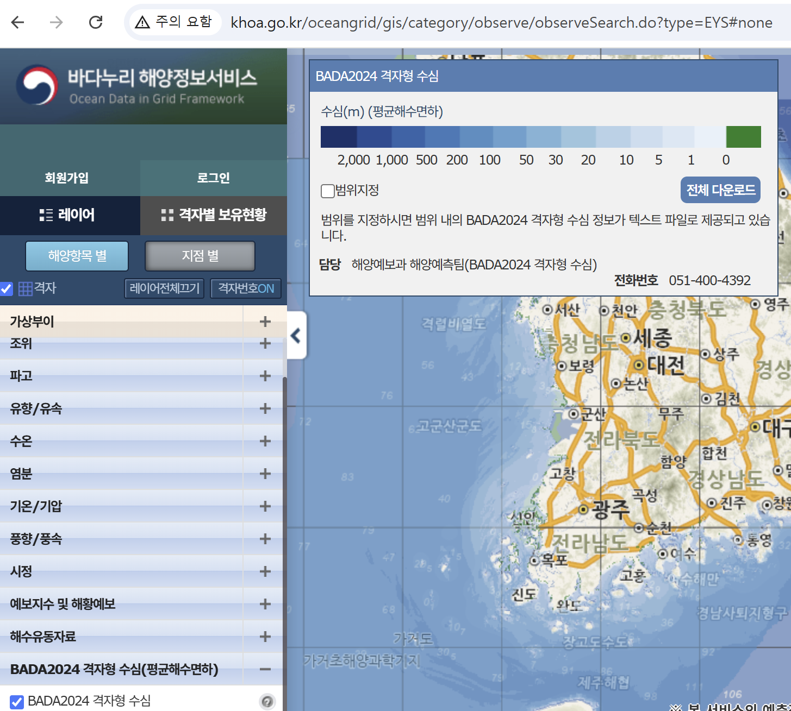
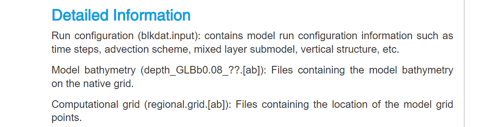

# :material-terrain: Bathymetry <span class="date">[2026.10.29]</span>

전 지구 및 지역 수심 자료와, 이를 다운로드하고 처리하는 코드입니다.

??? tip "시각화 팁"
    어느 자료이건 bathymetry가 완벽하게 정확하거나 흠결 없이 깔끔하게 나오지는 않습니다.
    `pcolor` 함수와 높은 colormap level을 쓰면 꽤 이질적인 직선 형태가 종종 나타나며, 이는 해저 지형도를 시각화할 때 애로 사항이 됩니다.
    시각화에 앞서 MATLAB의 `griddata` 혹은 `interp2` 함수로 자료의 해상도를 낮추는 것도 차선책이 될 수 있습니다.

## 전 지구 { #global }

<div class="grid cards" markdown>

-   **GEBCO**

    ---

    꾸준히 버전을 업데이트하여 제공. **가장 최신 버전은 2024입니다.**

    [:octicons-download-24: GEBCO Gridded Bathymetry Data Download](https://download.gebco.net/)

    <figure markdown="span">
      { loading=lazy }
      <figcaption>GEBCO 다운로드 화면</figcaption>
    </figure>

-   **ETOPO 2022** · 30, 60 arc-second

    ---

    NOAA NCEI global relief model (ETOPO 1, 2, 5는 구버전)

    [:octicons-link-external-24: ETOPO Global Relief Model (NOAA NCEI)](https://www.ncei.noaa.gov/products/etopo-global-relief-model)<br>
    [:octicons-download-24: MATLAB 다운로드 코드](#matlab-download-script)

-   **SRTM15+**

    ---

    아래 MATLAB 툴박스로 원하는 지역을 다운로드

    [:octicons-download-24: MATLAB 다운로드 코드](#matlab-download-script)

-   **GMRT**

    ---

    Global Multi-Resolution Topography Data Synthesis

    [:octicons-link-external-24: GMRT](https://www.gmrt.org/)

-   **S2Shores** · 1 km, coastal

    ---

    Sentinel-2 wave inversion 기반 전 지구 연안 수심. AVISO+ 계정 필요

    [:octicons-arrow-right-24: Data access & references](#s2shores)

</div>

### MATLAB 다운로드 스크립트 { #matlab-download-script }

ETOPO 2022, SRTM15+, S2Shores는 아래 MathWorks 툴박스를 설치하고 그 안에 있는 script를 사용하시면 됩니다.

- [:octicons-download-24: Bathymetry Download (ETOPO 2022, SRTM 15, S2Shores), MATLAB File Exchange](https://kr.mathworks.com/matlabcentral/fileexchange/173370-bathymetry-download-etopo-2022-srtm-15-s2shores)
- [:octicons-mark-github-16: GitHub: kamanberr/Ocean-Data-Download/Bathy_Down](https://github.com/kamanberr/Ocean-Data-Download/tree/main/Bathy_Down)

툴박스를 사용하시는 분들은 해당 MathWorks 페이지에서 **[Review → 별점]**을 달아 주시면 큰 보람이 될 것 같습니다. 감사합니다.

??? example "Bathymetry 예시"
    <figure markdown="span">
      { loading=lazy }
      <figcaption>ETOPO 2022 60 arc-second, 동아시아</figcaption>
    </figure>

### S2Shores { #s2shores }

??? info "Data access (AVISO+ credentials required)"
    - CNES AVISO FTP/SFTP access
        - FTP: `ftp-access.aviso.altimetry.fr:21`
        - SFTP: `ftp-access.aviso.altimetry.fr:2122`, path `/coastal_s2shores`
    - [CNES AVISO THREDDS Data Server](https://tds-odatis.aviso.altimetry.fr/thredds/catalog/L4P/dataset-s2shores-satellite-derived-shoreline-change.html)

??? info "References"
    - [Global 1-km Coastal Bathymetry from Sentinel-2 Wave Inversion using the Satellite-to-Shores (S2Shores) Toolbox (Scientific Data)](https://www.nature.com/articles/s41597-025-06402-w)
    - [S2Shores Documentation](https://s2shores.readthedocs.io/en/latest/)
    - [GitHub: CNES/S2Shores](https://github.com/CNES/S2Shores)
    - [Satellite-derived shoreline and nearshore bathymetry (Coastal Wiki)](https://www.coastalwiki.org/wiki/Satellite-derived_shoreline_and_nearshore_bathymetry)
    - [Hydroweb.next: Coastal Bathymetry](https://hydroweb.next.theia-land.fr/catalog/details/COASTAL_BATHYMETRY)

## 지역 { #regional }

<div class="grid cards" markdown>

-   **KHOA** (국립해양조사원)

    ---

    영해 경계 문제 때문에 대한민국 주변 해역에 대해서만 수심 자료를 처리한 것으로 보임

    [:octicons-link-external-24: KHOA 바다누리: 수심 자료](http://www.khoa.go.kr/oceangrid/gis/category/observe/observeSearch.do?type=EYS#none)<br>
    [:octicons-arrow-right-24: 읽기 코드 (MATLAB)](#khoa-bada)<br>
    [:octicons-book-24: 참고: 수심측량자료를 사용한 해양수치모델 전용 수심 데이터 제작 (한국해안·해양공학회논문집, 2019)](https://doi.org/10.9765/KSCOE.2019.31.3.146)

-   **JODC** · 500 m

    ---

    Japan Oceanographic Data Center gridded bathymetry. Japan Oceanographic Database의 JODC 페이지에서 정리합니다

    [:octicons-arrow-right-24: JODC data (Japan)](../regional/japan-jodc.md)

-   **JTOPO30**

    ---

    일본 주변 해역 수심 (MIRC)

    [:octicons-link-external-24: MIRC JTOPO30](http://www.mirc.jha.jp/products/finished/JTOPO30/)

-   **IBCAO**

    ---

    International Bathymetric Chart of the Arctic Ocean

    [:octicons-link-external-24: IBCAO (NOAA NGDC)](https://www.ngdc.noaa.gov/mgg/bathymetry/arctic/arctic.html)

</div>

### KHOA BADA { #khoa-bada }

<figure markdown="span">
  { loading=lazy }
  <figcaption>KHOA 수심 자료 화면 1</figcaption>
</figure>

<figure markdown="span">
  { loading=lazy }
  <figcaption>KHOA 수심 자료 화면 2</figcaption>
</figure>

??? example "Read BADA bathymetry (xyz) and grid it"

    ```matlab title="Read BADA bathymetry (xyz) and grid it"
    clc; clear; close all; % reset
    bathy = importdata("C:\Users\User\OneDrive\문서\MATLAB\BADA Ver.1.txt"); % load
    bedlat0 = bathy.data(:,1); bedlon0 = bathy.data(:,2); bed0 = bathy.data(:,3);

    lonlim = [129 133];   latlim = [35 38.5]; % set longitude, latitude range for interpolation
    bed = griddata(bedlon0, bedlat0, bed0, lonlim(1):0.01:lonlim(end),(latlim(1):0.01:latlim(end))'); bed=bed';
    bed=bed*(-1); bedlon = lonlim(1):0.01:lonlim(end); bedlat = latlim(1):0.01:latlim(end);
    save bathy_bada.mat bedlon bedlat bed; % save
    ```

## 모델 격자: HYCOM 3.1 topo { #model-grid-hycom-31-topo }

사용하는 HYCOM experiment 버전 디렉터리 안의 `topo` 폴더에 접근하여 `depth` 파일을 다운로드합니다.

- [:octicons-download-24: https://data.hycom.org/datasets/](https://data.hycom.org/datasets/)
- 예시: [GLBb0.08/expt_93.0/topo/](https://data.hycom.org/datasets/GLBb0.08/expt_93.0/topo/),
  [GLBy0.08/expt_93.0/topo/](https://data.hycom.org/datasets/GLBy0.08/expt_93.0/topo/)

!!! tip
    사용하는 HYCOM 버전(GLBb, GLBv, GLBy)에 맞는 depth 파일을 사용하세요.
    Layer thickness 정보도 같은 폴더의 `regional.grid` 파일에 있는 것으로 보입니다.

<figure markdown="span">
  { loading=lazy }
  <figcaption>HYCOM 격자(GLBb, GLBv, GLBy) 비교</figcaption>
</figure>

??? note "데이터 파일"
    아래 자료 파일은 용량이 커서 저장소에 넣지 않았습니다. 별도로 호스팅할 예정이며, 그 전까지는 원본 사이트에서 직접 받으시기 바랍니다.

    - GEBCO 2023 subsets: `gebco_2023_n41.0_s24.0_w118.0_e130.0_YECS.nc`, `gebco_2023_n41.0_s31.0_w117.0_e128.0_YS.nc`,
      `gebco_2023_n55.0_s30.0_w125.0_e145.0_EJS.nc`, `gebco_2023_n55.0_s20.0_w115.0_e145.0_KOREA.nc`
    - HYCOM depth: `depth_GLBb0.08_09m11.nc`, `depth_GLBv0.08_09m11.nc`, `depth_GLBy0.08_09m11.nc`
