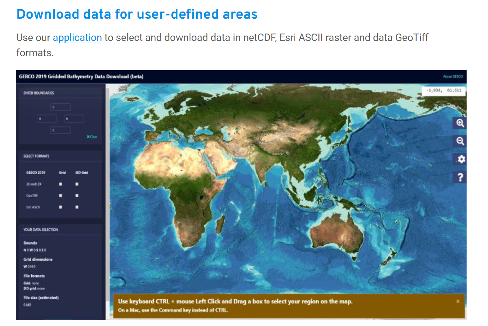
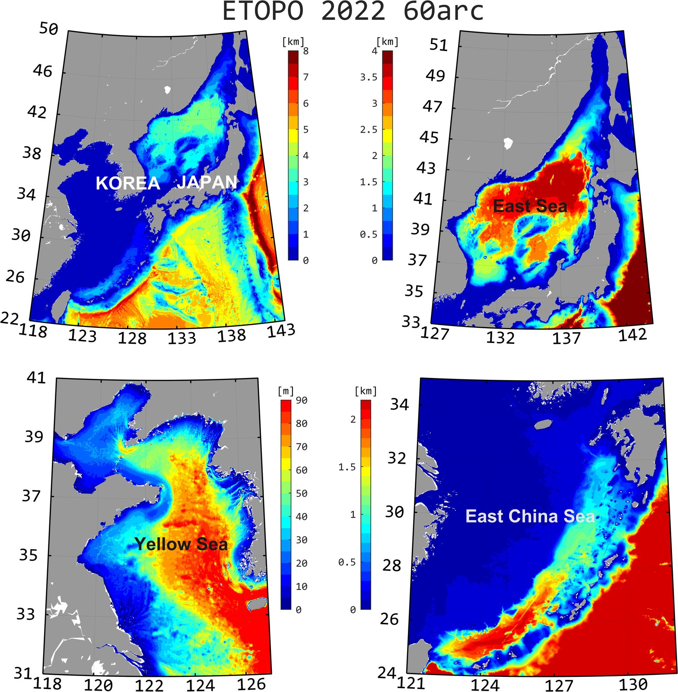
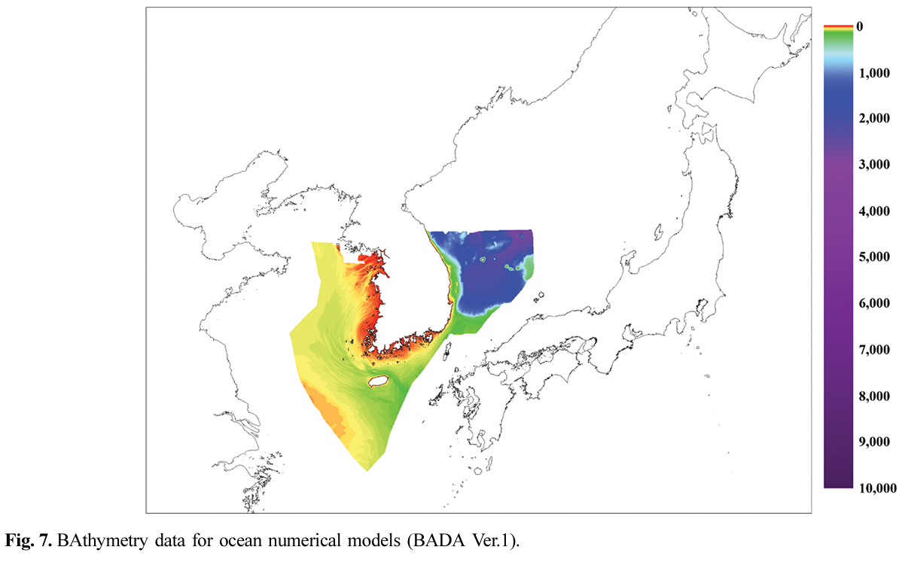
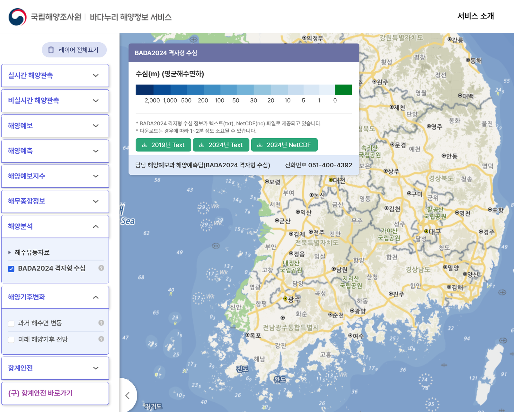
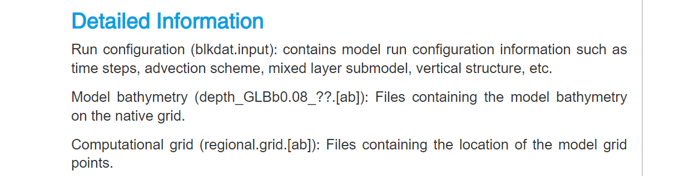

# :material-terrain: Bathymetry [2026.10.29]

Global and regional bathymetry datasets, with code to download and process them.

??? tip "Visualization tip"
    No bathymetry dataset is perfectly accurate or entirely free of artifacts. With `pcolor` and high colormap levels,
    spurious straight lines often appear, which complicates the visualization of seafloor topography.
    As a workaround, MATLAB's `griddata` or `interp2` can be used to coarsen the data before plotting.

## Global

-   **GEBCO**

    ---

    Global gridded bathymetry, updated with a new release every year

    [:octicons-download-24: GEBCO Gridded Bathymetry Data Download](https://download.gebco.net/)

    <figure markdown="span">
      { loading=lazy }
      <figcaption>GEBCO download page</figcaption>
    </figure>

-   **ETOPO 2022** · 30, 60 arc-second

    ---

    NOAA NCEI global relief model (ETOPO 1, 2, and 5 are older versions)

    [:octicons-link-external-24: ETOPO Global Relief Model (NOAA NCEI)](https://www.ncei.noaa.gov/products/etopo-global-relief-model) 
    [:octicons-download-24: MATLAB download script](#matlab-download-script)

-   **SRTM15+**

    ---

    Download any region with the MATLAB toolbox below

    [:octicons-download-24: MATLAB download script](#matlab-download-script)

-   **GMRT**

    ---

    Global Multi-Resolution Topography Data Synthesis

    [:octicons-link-external-24: GMRT](https://www.gmrt.org/)

-   **S2Shores** · 1 km, coastal

    ---

    Global coastal bathymetry from Sentinel-2 wave inversion. AVISO+ account required

    [:octicons-arrow-right-24: Data access & references](#s2shores) 
    [:octicons-download-24: MATLAB download script](#matlab-download-script)

### MATLAB download script

For ETOPO 2022, SRTM15+, and S2Shores, install the MathWorks toolbox below and run the script it contains.

- [:octicons-download-24: Bathymetry Download (ETOPO 2022, SRTM 15, S2Shores), MATLAB File Exchange](https://kr.mathworks.com/matlabcentral/fileexchange/173370-bathymetry-download-etopo-2022-srtm-15-s2shores)
- [:octicons-mark-github-16: GitHub: kamanberr/Ocean-Data-Download/Bathy_Down](https://github.com/kamanberr/Ocean-Data-Download/tree/main/Bathy_Down)

If you use the toolbox, a **rating under Review** on the MathWorks page would be much appreciated. Thank you.

??? example "Example of bathymetry"
    <figure markdown="span">
      { loading=lazy }
      <figcaption>ETOPO 2022 60 arc-second, East Asia</figcaption>
    </figure>

### S2Shores

??? info "Data access (AVISO+ credentials required)"
    - CNES AVISO FTP/SFTP access
        - FTP: `ftp-access.aviso.altimetry.fr:21`
        - SFTP: `ftp-access.aviso.altimetry.fr:2122`, path `/coastal_s2shores`
    - [CNES AVISO THREDDS Data Server](https://tds-odatis.aviso.altimetry.fr/thredds/catalog/L4P/dataset-s2shores-satellite-derived-shoreline-change.html)

??? info "References"
    - [Global 1-km Coastal Bathymetry from Sentinel-2 Wave Inversion using the Satellite-to-Shores (S2Shores) Toolbox (Scientific Data)](https://www.nature.com/articles/s41597-025-06402-w)
    - [S2Shores Documentation](https://s2shores.readthedocs.io/en/latest/)
    - [GitHub: CNES/S2Shores](https://github.com/CNES/S2Shores)
    - [Satellite-derived shoreline and nearshore bathymetry (Coastal Wiki)](https://www.coastalwiki.org/wiki/Satellite-derived_shoreline_and_nearshore_bathymetry)
    - [Hydroweb.next: Coastal Bathymetry](https://hydroweb.next.theia-land.fr/catalog/details/COASTAL_BATHYMETRY)

## Regional

-   **KHOA** (Korea Hydrographic and Oceanographic Agency)

    ---

    Bathymetry appears to be processed only for the seas around Korea, presumably because of territorial boundary issues

    [:octicons-link-external-24: KHOA Badanuri: bathymetry](https://khoa.go.kr/oceandata/oceaninfo/map.do) 
    [:octicons-book-24: Reference: Bathymetry data for ocean numerical models from survey data (JKSCOE, 2019, in Korean)](https://doi.org/10.9765/KSCOE.2019.31.3.146)

-   **JODC** · 500 m

    ---

    Japan Oceanographic Data Center gridded bathymetry. Covered on the JODC page of the Japan Oceanographic Database

    [:octicons-arrow-right-24: JODC data (Japan)](../regional/japan-jodc.md)

-   **JTOPO30**

    ---

    Bathymetry around Japan (MIRC)

    [:octicons-link-external-24: MIRC JTOPO30](http://www.mirc.jha.jp/products/finished/JTOPO30/)

-   **IBCAO**

    ---

    International Bathymetric Chart of the Arctic Ocean

    [:octicons-link-external-24: IBCAO (NOAA NGDC)](https://www.ngdc.noaa.gov/mgg/bathymetry/arctic/arctic.html)

### KHOA BADA

<figure markdown="span">
  { loading=lazy }
  <figcaption>KHOA bathymetry, screen 1</figcaption>
</figure>

<figure markdown="span">
  { loading=lazy }
  <figcaption>Badanuri ocean information service: BADA2024 gridded bathymetry (TXT and NetCDF download)</figcaption>
</figure>

## Model grid: HYCOM 3.1 topo

Open the `topo` folder inside the directory of the HYCOM experiment you use and download the `depth` file.

- [:octicons-download-24: https://data.hycom.org/datasets/](https://data.hycom.org/datasets/)
- Examples: [GLBb0.08/expt_93.0/topo/](https://data.hycom.org/datasets/GLBb0.08/expt_93.0/topo/),
  [GLBy0.08/expt_93.0/topo/](https://data.hycom.org/datasets/GLBy0.08/expt_93.0/topo/)

!!! tip
    Use the depth file that matches your HYCOM version (GLBb, GLBv, GLBy).
    Layer thickness information also appears to be in the `regional.grid` file in the same folder.

<figure markdown="span">
  { loading=lazy }
  <figcaption>Comparison of HYCOM grids (GLBb, GLBv, GLBy)</figcaption>
</figure>
