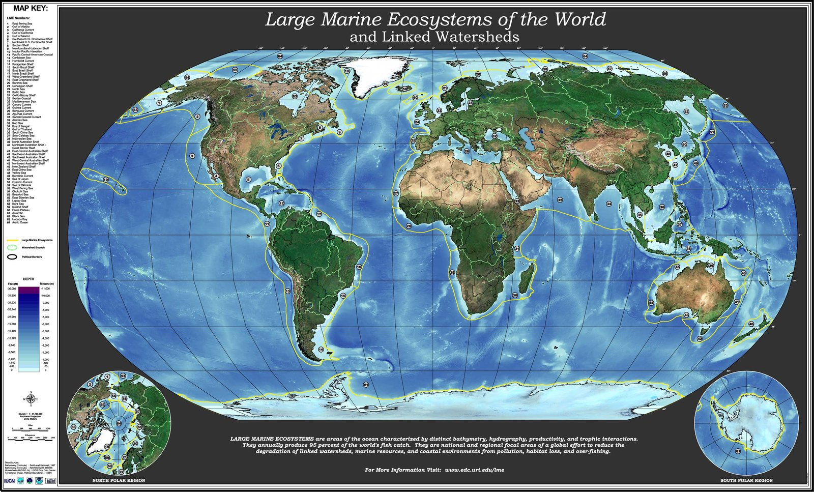
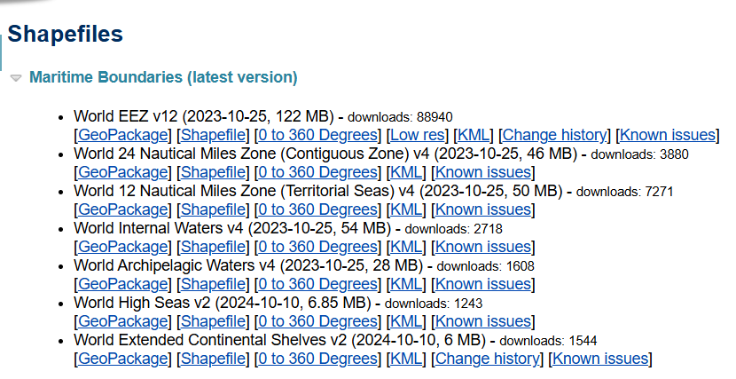

# :material-map-outline: Boundary <span class="date">[2026.04.02]</span>

배타적 경제수역(EEZ), 대해양생태계(LME) 등 해양 경계 자료와 해안선, 면적 계산 도구입니다.

## 경계 자료 { #boundary-datasets }

<figure markdown="span">
  { loading=lazy }
  <figcaption>Large Marine Ecosystems 지도 (출처: NOAA)</figcaption>
</figure>

<div class="grid cards" markdown>

-   **Marine Regions**

    ---

    EEZ, LME 등 해양 경계 shapefile

    [:octicons-download-24: Marine Regions](https://www.marineregions.org/)

-   **Large Marine Ecosystems (LME)**

    ---

    IW:LEARN GeoNode의 LME 레이어와 지도

    [:octicons-link-external-24: Global Large Marine Ecosystems](http://geonode.iwlearn.org/layers/geonode:lmes)<br>
    [:octicons-link-external-24: LME-66 Offshore](http://geonode.iwlearn.org/layers/geonode:lme66_offshore)<br>
    [:octicons-link-external-24: Large Marine Ecosystems (map)](http://geonode.iwlearn.org/maps/3869)

-   **Oceans of the World**

    ---

    해양 구분 폴리곤 (IW:LEARN GeoNode)

    [:octicons-link-external-24: Oceans of the World](http://geonode.iwlearn.org/layers/geonode:iwl_oceans_polygon)<br>
    [:octicons-link-external-24: World Oceans and Large Marine Ecosystems (map)](http://geonode.iwlearn.org/maps/3873)

-   **NOAA LME map**

    ---

    NOAA 200주년 기념 페이지의 LME 지도

    [:octicons-link-external-24: Large Marine Ecosystems map (NOAA)](https://celebrating200years.noaa.gov/breakthroughs/ecosystems/sup_lmes_map.html)

</div>

## 해안선·도구 { #coastline-tools }

<div class="grid cards" markdown>

-   **Global Coastline**

    ---

    해안선 자료 (GSHHS 등)

    [:octicons-link-external-24: Shoreline / Coastline Resources (NOAA NCEI)](https://www.ncei.noaa.gov/products/shoreline-coastline-resources)<br>
    [:octicons-download-24: GSHHS (NOAA NGDC)](https://www.ngdc.noaa.gov/mgg/shorelines/data/gshhs/)

-   **Area on sphere / ellipsoid**

    ---

    구면·타원체 좌표에서 폴리곤 면적 계산 (MATLAB Mapping Toolbox)

    [:octicons-link-external-24: `areaint` documentation](https://kr.mathworks.com/help/map/ref/areaint.html)

</div>

## MATLAB에서 EEZ 그리기 { #eez-in-matlab }

<figure markdown="span">
  { loading=lazy }
  <figcaption>Marine Regions EEZ 다운로드 화면</figcaption>
</figure>

[Marine Regions](https://www.marineregions.org/)에서 EEZ **Low res** 파일을 다운받은 후, `.dbf`, `.shp`, `.shx` 파일을 한 폴더에 넣습니다.
`shaperead`를 쓰려면 Mapping Toolbox 애드온 설치가 필요합니다.

??? example "Clip EEZ polygons to a region and draw them with m_map"

    ```matlab title="Clip EEZ shapefile and draw with m_map"
    S = shaperead('D:\eez_v12_lowres.shp'); % mapping toolbox 에드온 설치 필요

    lat_min = mla(1);
    lat_max = mla(2);
    lon_min = mlo(1);
    lon_max = mlo(2);

    keep = false(1, numel(S));
    for k = 1:numel(S)
        X = S(k).X;
        Y = S(k).Y;
        mask_valid = ~isnan(X) & ~isnan(Y);
        % 지정된 범위에 일부라도 걸치는 폴리곤만 선택
        keep(k) = any(X(mask_valid) >= lon_min & X(mask_valid) <= lon_max & ...
                      Y(mask_valid) >= lat_min & Y(mask_valid) <= lat_max);
    end
    S_clip = S(keep);


    % m map 켠 후

        for k = 1:numel(S_clip)
            xCoord = S_clip(k).X;
            yCoord = S_clip(k).Y;

            % NaN으로 끊어진 세그먼트 경계 찾기 (선 하나하나 그리기 위해)
            nanPos = find(isnan(xCoord) | isnan(yCoord));
            edges  = [0, nanPos, numel(xCoord)+1];

            for s = 1:numel(edges)-1;
                i1 = edges(s)+1;
                i2 = edges(s+1)-1;
                if i2 < i1, continue; end

                xs = xCoord(i1:i2);
                ys = yCoord(i1:i2);


                % 지도 범위 밖 세그먼트 건너뛰기
                if all(xs < lon_min | xs > lon_max | ys < lat_min | ys > lat_max)
                    continue
                end

                % reducem은 열벡터 기대 → 열로 변환
                xs = xs(:);
                ys = ys(:);

                mask = true(size(xs));   % 기본: 모두 사용

                % 여기에 필터링을 추가하면 원하는 선만 그릴 수 있음
                d = diff([false; mask; false]);
                iStart = find(d == 1);
                iEnd   = find(d == -1) - 1;

                for jj = 1:numel(iStart)
                    segx = xs(iStart(jj):iEnd(jj));
                    segy = ys(iStart(jj):iEnd(jj));
                    if numel(segx) < 2, continue; end

                    % 단순화 후 그리기
                    [segyR, segxR] = reducem(segy, segx, 0.05);
                    if numel(segxR) < 2, continue; end

                    m_line(segxR, segyR, 'color',[0 0.6 0], 'linestyle','--', 'linewidth',1.2);
                end

            end
        end
    ```
