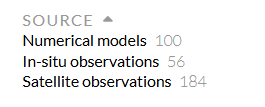

# :material-fish: CMEMS / Copernicus [2026.09.21]

Copernicus Marine Service(CMEMS) 카탈로그에서 자료를 검색하는 방법과 사용 시 주의 사항입니다.

## 자료 다운로드

자료를 검색할 때 사이드바의 옵션을 적극적으로 사용하실 것을 권합니다.

<figure markdown="span">
  { loading=lazy }
  <figcaption>CMEMS 자료 카탈로그의 사이드바 필터</figcaption>
</figure>

본격적인 검색을 하기 전에 위 옵션에서 원하는 자료의 유형을 선택한 다음, 그 뒤에 특정 product를 고르시기를 권합니다.
**CMEMS에서 제공하는 자료가 무조건 "맞다"고 생각하시면 절대 안 됩니다.**

In situ 자료라면 몰라도, **numerical model과 satellite 자료는 주의해서 사용하셔야** 합니다.
특히 numerical model과 satellite 중 3, 7, 8-day running 형태의 자료는 사용 전에 실측 자료와 비교검증이 필요합니다
(비교검증 = comparison = validation = evaluation).

-   **Copernicus Marine Service**

    ---

    해양 자료: 관측, 재분석, 분석·예보

    [:octicons-link-external-24: marine.copernicus.eu](https://marine.copernicus.eu/)

-   **Climate Data Store**

    ---

    ERA5를 포함한 Copernicus 기후 자료

    [:octicons-link-external-24: CDS datasets](https://cds.climate.copernicus.eu/datasets)

## Viewer

- [:octicons-link-external-24: Copernicus Marine MyOcean Viewer](https://data.marine.copernicus.eu/viewer/expert) (expert 모드)
