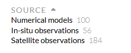

# :material-fish: CMEMS / Copernicus [2026.09.21]

How to search the Copernicus Marine Service (CMEMS) catalogue, and a caution about using its products.

## Data download

Use the filters in the sidebar when searching for data.

<figure markdown="span">
  { loading=lazy }
  <figcaption>Sidebar filters of the CMEMS data catalogue</figcaption>
</figure>

Before searching in earnest, select the type of data you need in those filters and only then pick a specific product.
**Do not assume that a CMEMS product is automatically "correct".**

In situ data are one thing, but **numerical model and satellite products must be used with care**.
In particular, model and satellite products labelled as 3-, 7- or 8-day running means need to be compared against observations
before use (comparison = validation = evaluation).

-   **Copernicus Marine Service**

    ---

    Ocean products: observations, reanalyses, analyses and forecasts

    [:octicons-link-external-24: marine.copernicus.eu](https://marine.copernicus.eu/)

-   **Climate Data Store**

    ---

    Copernicus climate datasets, including ERA5

    [:octicons-link-external-24: CDS datasets](https://cds.climate.copernicus.eu/datasets)

## Viewer

- [:octicons-link-external-24: Copernicus Marine MyOcean Viewer](https://data.marine.copernicus.eu/viewer/expert) (expert mode)
