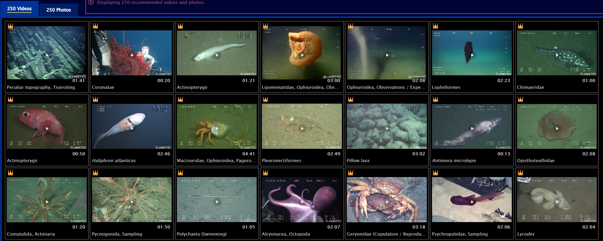

# :material-image-multiple-outline: Image of Ocean [2026.09.21]

Photo and video archives related to the ocean.

-   **NOAA PMEL**

    ---

    Earth-Ocean Interactions multimedia

    [:octicons-link-external-24: PMEL EOI Multimedia](https://www.pmel.noaa.gov/eoi/multimedia.html)

-   **Woods Hole Oceanographic Institution**

    ---

    WHOI image archive

    [:octicons-link-external-24: WHOI Images](https://images.whoi.edu/show-all?t=1&WINID=1733486608959)

-   **Ifremer**

    ---

    Ifremer image bank

    [:octicons-link-external-24: Ifremer Images](https://image.ifremer.fr/)

-   **JAMSTEC Deep-sea Debris Database**

    ---

    Database of deep-sea debris imagery

    [:octicons-link-external-24: Deep-sea Debris Database](https://www.godac.jamstec.go.jp/dsdebris/view/base?lang=en)

-   **JAMSTEC J-EDI**

    ---

    E-library of Deep-sea Images

    [:octicons-link-external-24: J-EDI](https://www.godac.jamstec.go.jp/jedi/shot_search_main.jsf?LANG=EN)

<figure markdown="span">
  { loading=lazy }
  <figcaption>Example of the J-EDI deep-sea image search</figcaption>
</figure>
