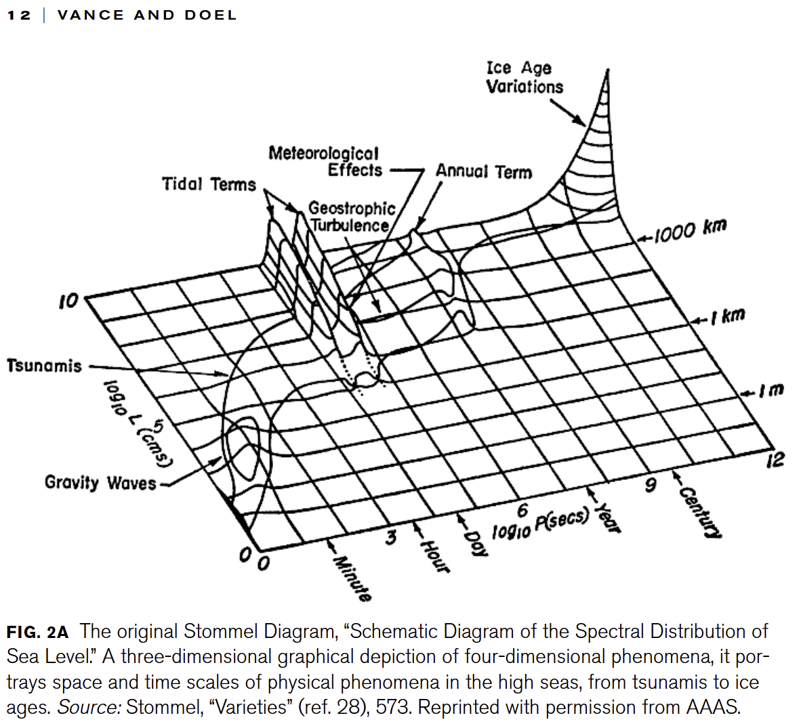
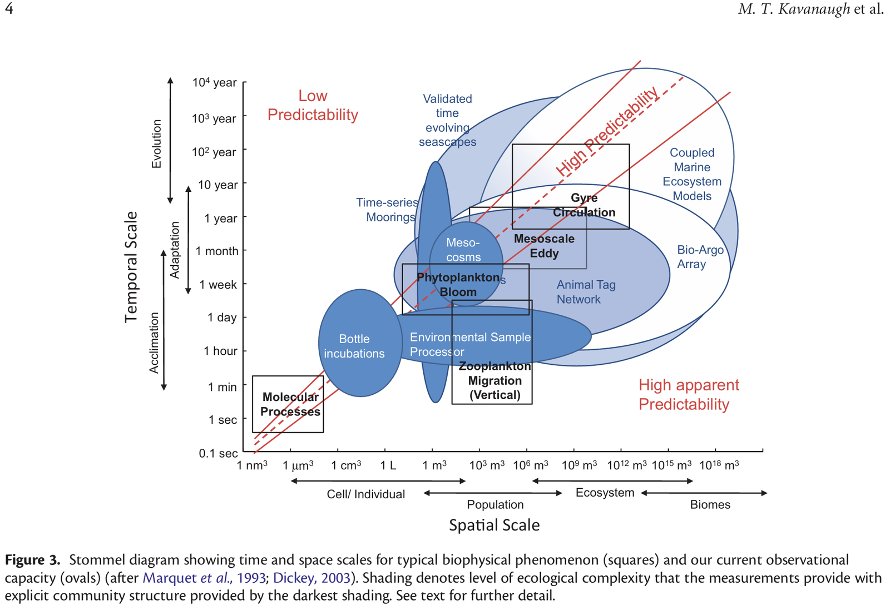
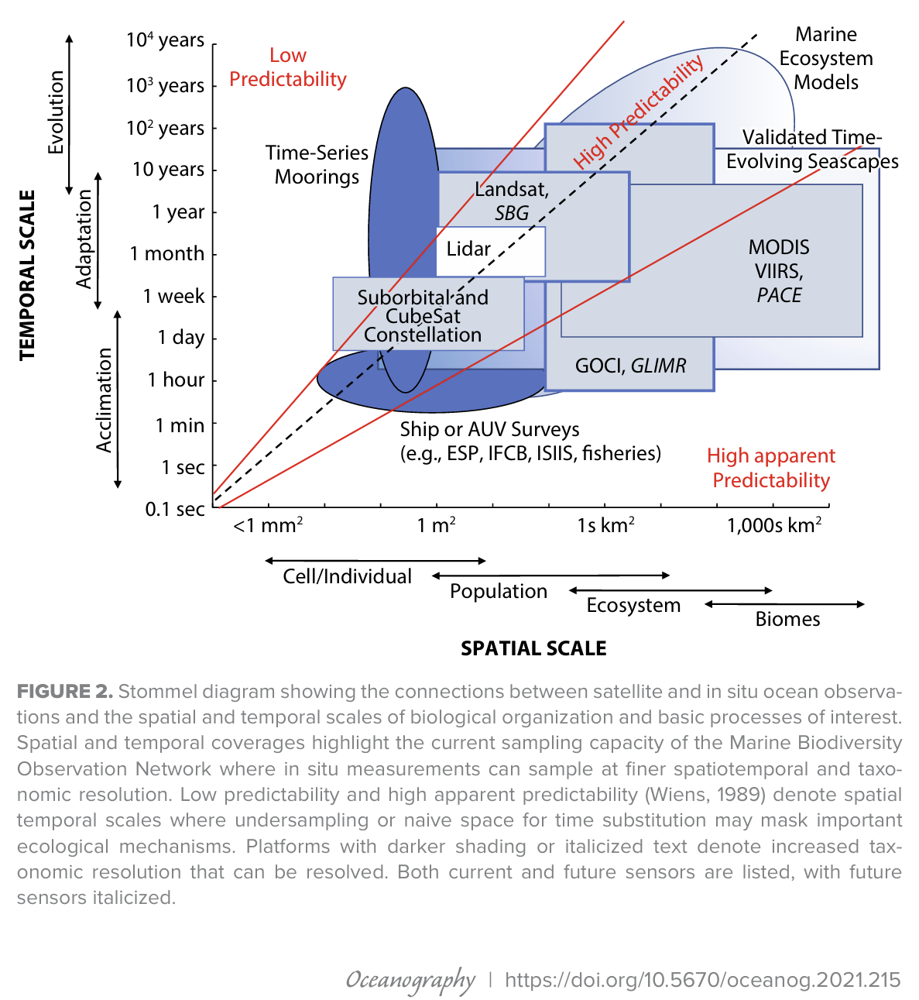

# :material-chart-scatter-plot: Stommel Diagram [2026.09.21]

!!! abstract "Ongoing page"
    Literature on the Stommel diagram, the space-time scale diagram of ocean phenomena. This page is still being organized.

### Historical Studies in the Natural Sciences (2010)

[:octicons-link-external-24: doi: 10.1525/hsns.2010.40.1.1](http://dx.doi.org/10.1525/hsns.2010.40.1.1)

<figure markdown="span">
  { loading=lazy }
  <figcaption>Stommel diagram from the paper (HSNS 2010)</figcaption>
</figure>

### ICES Journal of Marine Science

[:octicons-link-external-24: doi: 10.1093/icesjms/fsw086](http://dx.doi.org/10.1093/icesjms/fsw086)

<figure markdown="span">
  { loading=lazy }
  <figcaption>Stommel diagram from the paper (ICES JMS)</figcaption>
</figure>

### Oceanography (2021)

[:octicons-link-external-24: doi: 10.5670/oceanog.2021.215](http://dx.doi.org/10.5670/oceanog.2021.215)

<figure markdown="span">
  { loading=lazy }
  <figcaption>Stommel diagram from the paper (Oceanography 2021)</figcaption>
</figure>

