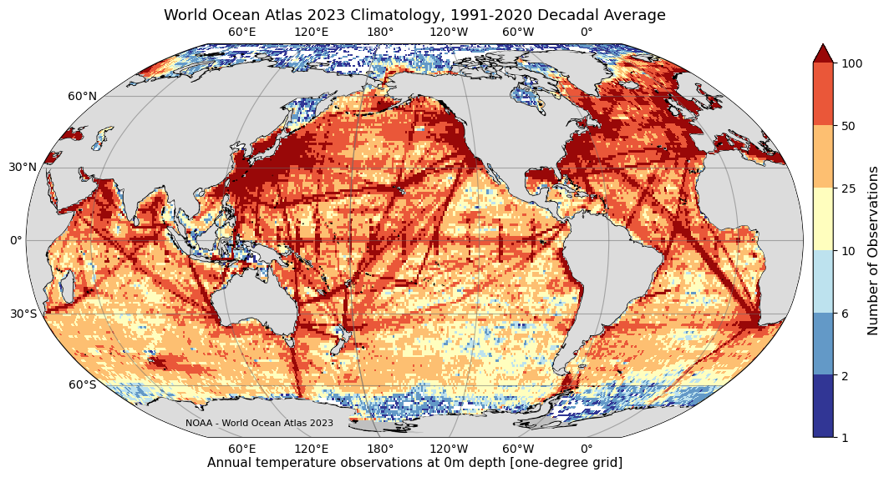
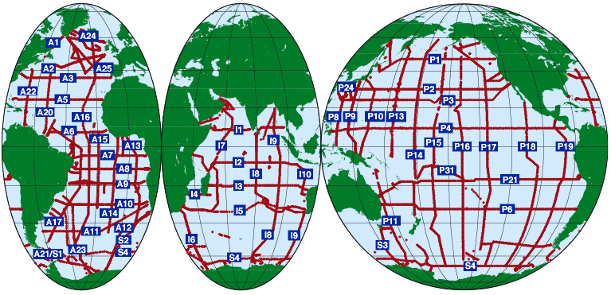
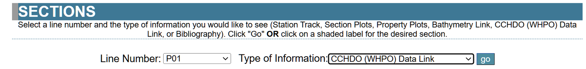
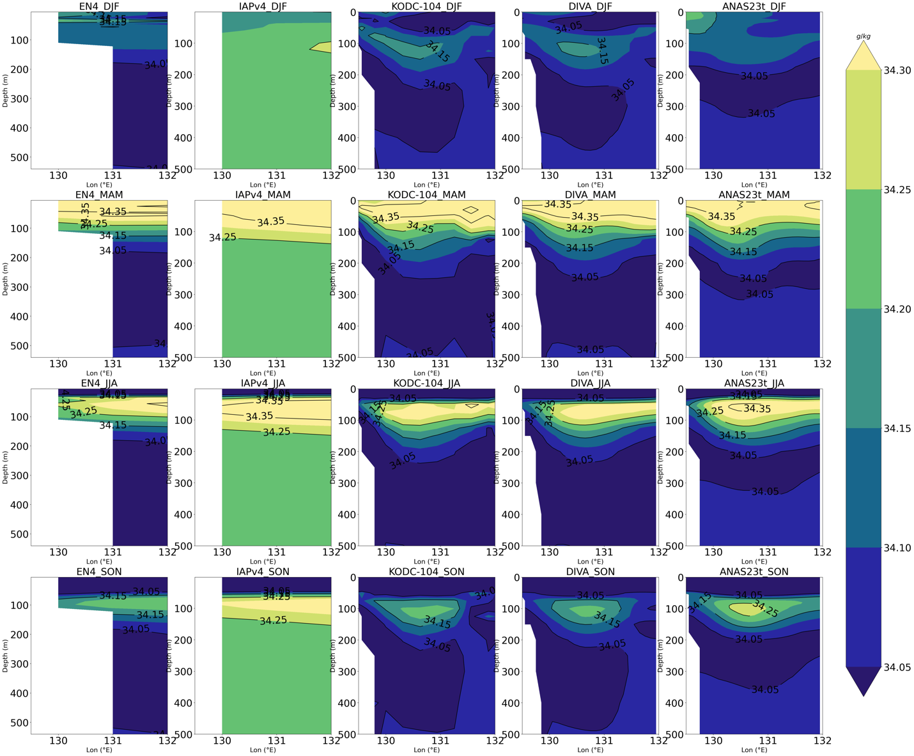
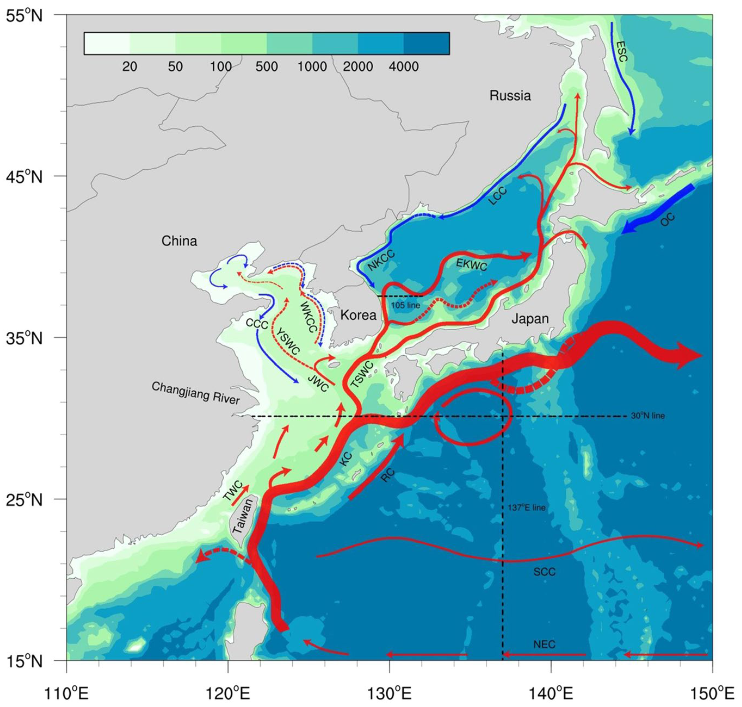
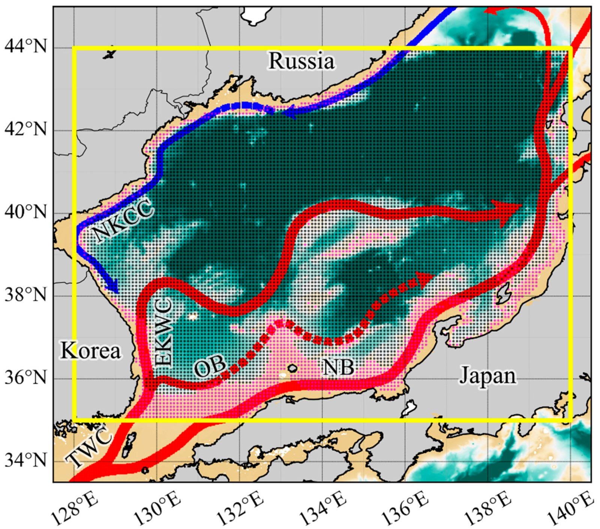
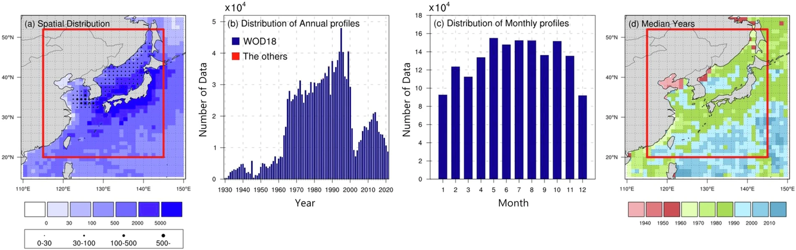

# :material-earth-box: Atlas & Climatology [2026.05.12]

Global and regional ocean climatologies (atlases) and gridded observation-based products.

??? quote "What is a climatology?"
    According to the [World Meteorological Organization](https://public.wmo.int/en), the term "climatology" defines long-term averages of a given variable,
    like sea surface temperature, over various time periods, usually 30 years. In oceanography, the term "ocean climate" is used to define ocean parameters
    averaged over a decade or longer. Ocean climatologies, global or regional, relate specifically to long-term averaged oceanic parameters
    (temperature or salinity, for example) in the entire world ocean or in selected ocean regions.
    *Source: [NCEI](https://www.ncei.noaa.gov/news/new-ocean-regional-climatology-added)*

## Global atlas & climatology

<figure markdown="span">
  { loading=lazy }
  <figcaption>WOA23 data access page</figcaption>
</figure>

-   **World Ocean Atlas (WOA23)** · 1° and 1/4°, 102 levels

    ---

    Objectively analyzed T, S, oxygen, and nutrient (phosphate, silicate, nitrate) means from WOD profiles

    [:octicons-arrow-right-24: WOA page](woa.md) 
    [:octicons-link-external-24: World Ocean Atlas](https://www.ncei.noaa.gov/products/world-ocean-atlas) 
    [:octicons-link-external-24: WOA23 data access (temperature)](https://www.ncei.noaa.gov/access/world-ocean-atlas-2023f/bin/woa23f.pl?parameterOption=t)

-   **EN4**

    ---

    Met Office Hadley Centre objective analyses of T/S

    [:octicons-arrow-right-24: EN4 page (In Situ)](../whole-ocean/in-situ/en4.md)

-   **WOCE Hydrographic Program Atlas** · 1990s

    ---

    Sections, horizontal maps, and property-property plots from the WOCE One-time survey (four basin volumes)

    [:octicons-link-external-24: WOCE Atlas Home](https://woceatlas.ucsd.edu/) 
    [:octicons-link-external-24: Research Vessel Surface Meteorology Data Center](https://www.coaps.fsu.edu/RVSMDC/html/data.shtml)

-   **WAGHC**

    ---

    WOCE/Argo Global Hydrographic Climatology

    [:octicons-link-external-24: WAGHC (ICDC, Univ. Hamburg)](https://www.cen.uni-hamburg.de/en/icdc/data/ocean/waghc.html)

-   **CMEMS ISAS** · 0.5°, monthly

    ---

    In Situ Analysis System. 2023.01.01 – 2025.12.01

    [:octicons-link-external-24: INSITU_GLO_PHY_TS_OA_NRT_013_002](https://data.marine.copernicus.eu/product/INSITU_GLO_PHY_TS_OA_NRT_013_002/description) 
    [:octicons-link-external-24: ISAS T, S, DO gridded fields (SEANOE)](https://www.seanoe.org/data/00412/52367/)

-   **CMEMS ARMOR3D L4**

    ---

    In situ based gridded product. The current component is reported to be computed from the thermal wind equation

    [:octicons-link-external-24: MULTIOBS_GLO_PHY_TSUV_3D_MYNRT_015_012](https://data.marine.copernicus.eu/product/MULTIOBS_GLO_PHY_TSUV_3D_MYNRT_015_012/description)

-   **SeaDataNet Climatologies**

    ---

    [:octicons-link-external-24: Climatologies](https://www.seadatanet.org/Products/Climatologies) 
    [:octicons-link-external-24: Products catalogue](https://www.seadatanet.org/Products#/metadata/98d22ac0-5398-4889-8f8e-8f28273b548b)

-   **IAPv4** · Ocean temperature & OHC gridded

    ---

    Cheng et al. (2024)

    [:octicons-link-external-24: ESSD paper](https://essd.copernicus.org/articles/16/3517/2024/) 
    [:octicons-download-24: Temperature (doi:10.12157/IOCAS.20240117.002)](https://doi.org/10.12157/IOCAS.20240117.002) 
    [:octicons-download-24: OHC (doi:10.12157/IOCAS.20240117.001)](https://doi.org/10.12157/IOCAS.20240117.001)

??? info "About WOA23"
    The World Ocean Atlas (WOA) is a collection of objectively analyzed, quality controlled temperature, salinity, oxygen, phosphate, silicate,
    and nitrate means **based on profile data from the World Ocean Database (WOD)**. It can be used to create boundary and/or initial conditions
    for ocean models, verify numerical simulations, and corroborate satellite data.

    The full WOA23 was released on February 14, 2024 and includes **temperature, salinity, oxygen (plus Apparent Oxygen Utilization and percent
    oxygen saturation) and inorganic nutrients (phosphate, silicate, and nitrate)**. It adds approximately 1.8 million new casts since WOA18,
    with renewed quality control. Data are given at **102 standard depth levels**.

    - **Temperature, salinity:** one-degree and quarter-degree grids, for 1955–1964, 1965–1974, 1975–1984, 1985–1994, 1995–2004, 2005–2014, 2015–2022,
      and three 30-year climate normals (1971–2000, 1981–2010, 1991–2020).
    - **Nutrients:** one-degree, 1965–2022.
    - **Oxygen, AOU, percent saturation:** one-degree, 1965–2022 and 1971–2000.
    - All-data five-degree statistics for each variable.

## WOCE Atlas by basin

<figure markdown="span">
  { loading=lazy }
  <figcaption>Stations occupied during the WOCE One-Time Survey</figcaption>
</figure>

=== "Southern Ocean"

    [:octicons-link-external-24: WOCE Southern Ocean Atlas](https://woceatlas.tamu.edu/index.html)

    - Section data: [Southern Ocean: Lines](https://woceatlas.tamu.edu/printed/SOA_LINES.html)
    - Mapped data: [Southern Ocean: Maps](https://woceatlas.tamu.edu/printed/SOA_MAPS.html)

=== "Pacific"

    [:octicons-link-external-24: WOCE Atlas Volume 2: Pacific Ocean](https://sam.ucsd.edu/whp_atlas/pacific_index.html)

    - Section data: [Pacific sections](https://sam.ucsd.edu/whp_atlas/pacific/sections.htm) → "**CCHDO (WHPO) Data Link**"

    <figure markdown="span">
      { loading=lazy }
      <figcaption>WOCE Pacific section selection page</figcaption>
    </figure>

=== "Atlantic"

    [:octicons-link-external-24: WOCE Atlas Volume 3: Atlantic Ocean](https://sam.ucsd.edu/whp_atlas/atlantic_index.html)

    - Section data: [Atlantic sections](https://sam.ucsd.edu/whp_atlas/atlantic/sections.htm) → "**CCHDO (WHPO) Data Link**"

=== "Indian"

    [:octicons-link-external-24: WOCE Atlas Volume 4: Indian Ocean](https://sam.ucsd.edu/whp_atlas/indian_index.html)

    - Section data: [Indian sections](https://sam.ucsd.edu/whp_atlas/indian/sections.htm) → "**CCHDO (WHPO) Data Link**"

??? info "About the WOCE Hydrographic Program"
    The Hydrographic Program of the international World Ocean Circulation Experiment (WOCE) was a comprehensive global hydrographic survey
    of physical and chemical properties, of unprecedented scope and quality, and represents the "state of the oceans" during the 1990s.
    Each of the 4 basin-oriented volumes includes vertical sections of the measured parameters for each One-time survey cruise,
    horizontal maps at standard depths and along isoneutral surfaces, and property-property plots for each section.

## Climatological gridded Argo products

-   **WOA** (incorporating Argo)

    ---

    See the [WOA page](woa.md) and the [global atlas](#global-atlas-climatology) section above

-   **MIMOC** · 1/2°, 81 levels to 1950 dbar

    ---

    NOAA-PMEL / University of East Anglia. **Argo plus others**, climatological year, emphasizing data since 2007

    [:octicons-link-external-24: MIMOC Gallery](https://www.pmel.noaa.gov/mimoc/) 
    [:octicons-link-external-24: Reference (JGR Oceans)](https://agupubs.onlinelibrary.wiley.com/doi/10.1002/jgrc.20122)

-   **RG Climatology** · 1°, 58 levels to 2000 dbar

    ---

    Scripps. **Argo only**, optimal interpolation. **2004–2018 is distributed as a climatology; from 2019 onward, monthly fields are provided**

    [:octicons-link-external-24: Roemmich-Gilson Argo Climatology](https://sio-argo.ucsd.edu/RG_Climatology.html) 
    [:octicons-link-external-24: Reference (Prog. Oceanogr.)](https://www.sciencedirect.com/science/article/abs/pii/S0079661109000160)

## Regional atlas

-   **NCEI Regional Ocean Climatologies** · 1/10° or finer

    ---

    High-resolution regional climatologies from the WOD (annual, seasonal, monthly means)

    [:octicons-link-external-24: Regional Ocean Climatologies](https://www.ncei.noaa.gov/products/regional-ocean-climatologies)

-   **Ocean climate normals around the Korean Peninsula**

    ---

    KODC (NIFS) ocean climate normals and a DIVA-based continuous gridded time series

    [:octicons-link-external-24: KODC Atlas](https://www.nifs.go.kr/kodc/ocean-info/atlas/overview) 
    [:octicons-download-24: Continuous gridded T/S time series around Korea (DIVA, v1)](https://www.seanoe.org/data/01006/111799/)

    <figure markdown="span">
      { loading=lazy }
      <figcaption>Ocean climate normals around the Korean Peninsula</figcaption>
    </figure>

-   **ANAS23** · 1/10°, 73 levels, monthly

    ---

    Monthly temperature and salinity climatology for the Northeast Asian Seas (20–52°N, 115–145°E), KIOST

    [:octicons-link-external-24: Scientific Data paper](https://doi.org/10.1038/s41597-025-04543-6) 
    [:octicons-download-24: KIOST repository](https://sciwatch.kiost.ac.kr/handle/2020.kiost/45363)

    <figure markdown="span">
      { loading=lazy }
      <figcaption>ANAS23 temperature and salinity atlas</figcaption>
    </figure>

-   **East/Japan Sea 3-D temperature reconstruction**

    ---

    Multidecadal reconstruction and nowcasting of coastal and offshore 3-D temperature fields from satellite observations

    [:octicons-link-external-24: Remote Sensing (MDPI)](https://www.mdpi.com/2072-4292/18/2/246)

    <figure markdown="span">
      { loading=lazy }
      <figcaption>Figure from the East/Japan Sea reconstruction paper</figcaption>
    </figure>

-   **Seas around Taiwan** · 1/4°, 1985–present

    ---

    105–135°E, 10–35°N. ODB (National Taiwan University)

    [:octicons-download-24: Data download (zip)](https://app05.odb.ntu.edu.tw/physv/phyfile/ctd_grid15moa.zip) 
    [:octicons-link-external-24: 資料下載](https://www.odb.ntu.edu.tw/ctd/ctd15moa/) 
    [:octicons-link-external-24: ODB](https://www.odb.ntu.edu.tw/)

??? info "About the NCEI Regional Ocean Climatologies"
    NCEI regional ocean climatologies are ocean climate analyses derived from the [World Ocean Database (WOD)](https://www.ncei.noaa.gov/products/world-ocean-database)
    for climatologically, economically, and ecologically important regions. They are high-resolution, quality-controlled, multidecadal climatologies
    with annual, seasonal, and monthly means for temperature, salinity, and other WOD variables.

    They are built by objective analysis of irregularly distributed data, which works only where data coverage supports a 1/10° or finer grid,
    so that mesoscale features (jet meanders, eddies, vortices, filaments) can be mapped accurately. Seidov et al. (2018, 2019) describe the method
    using the Northwest Atlantic as a case study.

??? info "ANAS23 details"
    The ANAS23t contains **monthly climatological temperature and salinity** and their error variance for the **Northeast Asian Seas (20–52°N, 115–145°E)**
    with **1/10° horizontal resolution and 73 vertical levels**. Over 1.6 million hydrographic profiles were analyzed, and interpolation was done by kriging.

    | Item | Value |
    |---|---|
    | Domain | 20–52°N (320 grids), 115–145°E (300 grids) |
    | Horizontal resolution | 1/10° |
    | Depth levels (73) | 0–100 m every 5 m, 125–500 m every 25 m, 550–1,500 m every 50 m, 1,500–5,500 m every 250 m |
    | Temporal interval | Monthly climatology for 0–1,500 m, annual climatology below 1,500 m |
    | Variables | `tmp` (temperature), `sal` (salinity), `tmp_errvar`, `sal_errvar` (error variances) |

    <figure markdown="span">
      { loading=lazy }
      <figcaption>(a) Number of WOD18 (shaded), KIOST, and CREAMS (dots) profiles per 1°×1° box. (b) Annual and (c) monthly profile distributions. (d) Median year of profiles per box. The red box marks the ANAS23 domain (115–145°E, 20–52°N).</figcaption>
    </figure>

??? info "How the Taiwan dataset is processed"
    Data collection has increased since 1985, and the downloadable products are statistics over various periods from 1985 to the present.
    All depth-profile data (temperature, salinity, etc.) are first binned to standard depths by latitude and longitude, then gridded at 15′×15′ (1/4°×1/4°),
    and the mean and standard deviation of each hydrographic parameter are computed per grid cell. Temperature and salinity are included
    only where a cell holds at least three records.
