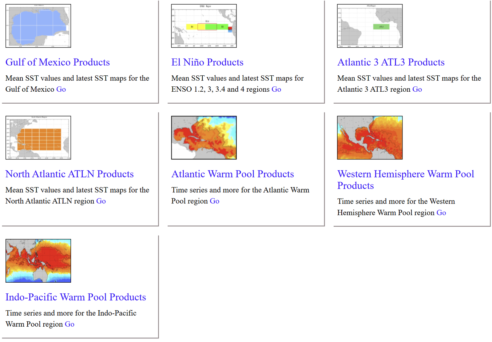
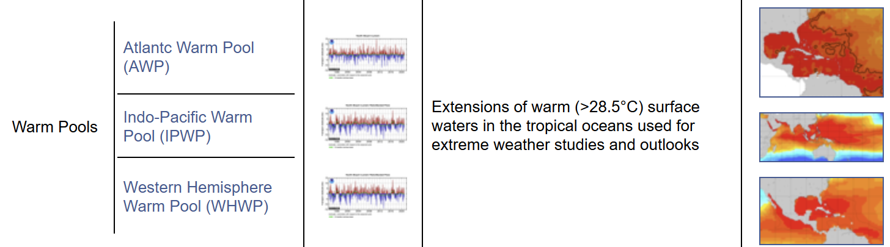

# :material-chart-bell-curve-cumulative: Ocean & Climate Index [2026.04.15]

Climate variability indices (ENSO, PDO, IOD, AMO, MJO, teleconnection patterns) and ocean indicator time series.

## General index portals

-   **NOAA PSL Climate Indices**

    ---

    List of monthly atmospheric and ocean time series; most indices can be downloaded from one place

    [:octicons-link-external-24: Climate Indices list](https://psl.noaa.gov/data/climateindices/list/) 
    [:octicons-link-external-24: Monthly Climate/Ocean Indices (Time-Series)](https://www.psl.noaa.gov/data/timeseries/month/) 
    [:octicons-link-external-24: PSL Site Index](https://psl.noaa.gov/site_index.html)

-   **PSL Easy Plotting Tool**

    ---

    Plot index time series directly in the browser

    [:octicons-link-external-24: Climate Indices: Monthly Atmospheric and Ocean Time Series](https://www.psl.noaa.gov/data/climateindices/)

-   **NOAA NCEI Climate Monitoring**

    ---

    ENSO, PDO, NAO, AO, PNA

    [:octicons-link-external-24: Weather patterns & indices](https://www.ncei.noaa.gov/access/monitoring/products/#wxpatterns)

-   **KNMI Climate Explorer**

    ---

    Climate indices served by the Climate Explorer

    [:octicons-link-external-24: Select index](https://climexp.knmi.nl/selectindex.cgi?id=someone@somewhere)

-   **AVISO Ocean Indicators**

    ---

    Altimetry-based ocean indicator products

    [:octicons-link-external-24: Ocean indicators products](https://www.aviso.altimetry.fr/en/data/products/ocean-indicators-products.html)

-   **OOPC State of the Ocean**

    ---

    Collection of ocean climate state indicators

    [:octicons-link-external-24: State of the ocean climate](https://stateoftheocean.osmc.noaa.gov/all/)

??? info "AVISO indicator list"
    - [El Niño bulletin](https://www.aviso.altimetry.fr/en/data/products/ocean-indicators-products/el-nino-bulletin.html)
    - [Mean Sea Level](https://www.aviso.altimetry.fr/en/data/products/ocean-indicators-products/mean-sea-level.html)
    - [Kuroshio](https://www.aviso.altimetry.fr/en/data/products/ocean-indicators-products/kuroshio.html)
    - [Ocean Heat Content and Earth Energy Imbalance](https://www.aviso.altimetry.fr/en/data/products/ocean-indicators-products/ocean-heat-content-and-earth-energy-imbalance.html)
    - [Barystatic and manometric sea level changes from satellite geodesy](https://www.aviso.altimetry.fr/en/data/products/ocean-indicators-products/barystatic-and-manometric-sea-level-changes-from-satellite-geodesy.html)
    - [Ionian Sea circulation](https://www.aviso.altimetry.fr/en/data/products/ocean-indicators-products/ionian-sea-circulation.html)

## Climate modes

-   **ENSO** · ONI, SOI, MEI, Niño SST

    ---

    El Niño–Southern Oscillation indices and real-time observations

    [:octicons-link-external-24: NCEI ENSO SST indices](https://www.ncei.noaa.gov/access/monitoring/enso/sst) 
    [:octicons-link-external-24: CPC monthly index values](https://www.cpc.ncep.noaa.gov/data/indices/) 
    [:octicons-link-external-24: Niño SST Indices (Climate Data Guide)](https://climatedataguide.ucar.edu/climate-data/nino-sst-indices-nino-12-3-34-4-oni-and-tni) 
    [:octicons-link-external-24: ENSO Indices (NWS)](https://www.weather.gov/fwd/indices) 
    [:octicons-link-external-24: PMEL realtime El Niño measurements](https://www.pmel.noaa.gov/elnino/realtime-data)

-   **PDO** · Pacific Decadal Oscillation

    ---

    [:octicons-download-24: PSL PDO time series](https://www.psl.noaa.gov/data/timeseries/month/DS/PDO/) 
    [:octicons-link-external-24: NCEI Climate Monitoring](https://www.ncei.noaa.gov/access/monitoring/products/#wxpatterns)

-   **DMI / IOD** · Dipole Mode Index

    ---

    [:octicons-download-24: PSL DMI time series](https://www.psl.noaa.gov/data/timeseries/month/DS/DMI/) 
    [:octicons-link-external-24: OOPC: DMI](https://stateoftheocean.osmc.noaa.gov/sur/ind/dmi.php)

-   **AMO** · Atlantic Multi-decadal Oscillation

    ---

    [:octicons-download-24: PSL AMO SST time series](https://psl.noaa.gov/data/timeseries/AMO/) 
    [:octicons-link-external-24: AMO and AMV (Climate Data Guide)](https://climatedataguide.ucar.edu/climate-data/atlantic-multi-decadal-oscillation-amo)

-   **MJO** · Madden-Julian Oscillation

    ---

    [:octicons-link-external-24: PSL MJO Research](https://psl.noaa.gov/mjo/) 
    [:octicons-link-external-24: CPC: MJO](https://www.cpc.ncep.noaa.gov/products/precip/CWlink/MJO/mjo.shtml) 
    [:octicons-link-external-24: Bureau of Meteorology: MJO](http://www.bom.gov.au/climate/mjo/)

-   **Teleconnection** · AO, NAO, AAO, PNA, etc.

    ---

    [:octicons-link-external-24: CPC: Teleconnections](https://www.cpc.ncep.noaa.gov/products/precip/CWlink/daily_ao_index/teleconnections.shtml) 
    [:octicons-link-external-24: CPC: Northern Hemisphere Teleconnection Patterns](https://www.cpc.ncep.noaa.gov/data/teledoc/telecontents.shtml) 
    [:octicons-link-external-24: NCEI Climate Monitoring](https://www.ncei.noaa.gov/access/monitoring/products/#wxpatterns)

??? info "More ENSO resources (Warm Water Volume, composites, figures and animations)"
    - **Warm Water Volume** → [Upper Ocean Heat Content and ENSO (PMEL)](https://www.pmel.noaa.gov/elnino/upper-ocean-heat-content-and-enso)
    - **ENSO response comparison plots** → [Composite ENSO Plots (PSL)](https://www.psl.noaa.gov/enso/compare/)
    - **Brief figures & animations**
        - [CPC: El Niño Southern Oscillation](https://www.cpc.ncep.noaa.gov/products/precip/CWlink/MJO/enso.shtml)
        - [AOML regional satellite products: ENSO](https://www.aoml.noaa.gov/phod/regsatprod/enso/)
        - [ENSO Index: Vital Signs (NASA Sea Level)](https://sealevel.jpl.nasa.gov/data/vital-signs/el-nino/)
        - [AOML ocean indexes](https://www.aoml.noaa.gov/phod/indexes/index.php)

## Ocean & carbon indicators

-   **Ocean Current**

    ---

    Current transport indices and the Kuroshio phase

    [:octicons-link-external-24: AOML ocean indexes](https://www.aoml.noaa.gov/phod/indexes/index.php) 
    [:octicons-arrow-right-24: Volume transport by Rick Lumpkin](volume-transport.md) 
    [:octicons-link-external-24: Kuroshio Phase from Observations Reprocessing (CMEMS)](https://marine.copernicus.eu/access-data/ocean-monitoring-indicators/kuroshio-phase-observations-reprocessing)

-   **Warm Pool**

    ---

    [:octicons-link-external-24: PSL Monthly Climate/Ocean Indices](https://www.psl.noaa.gov/data/timeseries/month/) 
    [:octicons-link-external-24: PSL Climate Indices list](https://psl.noaa.gov/data/climateindices/list/) 
    [:octicons-link-external-24: AOML regional satellite products](https://www.aoml.noaa.gov/phod/regsatprod/) 
    [:octicons-link-external-24: AOML ocean indexes](https://www.aoml.noaa.gov/phod/indexes/index.php)

-   **CO₂**

    ---

    Pacific mooring CO₂ time series and Mauna Loa (Hawaii) CO₂

    [:octicons-link-external-24: OCADS: CO2 Time-series and Moorings, Pacific](https://www.ncei.noaa.gov/access/ocean-carbon-acidification-data-system/oceans/Moorings/Pacific.html) 
    [:octicons-link-external-24: Trends in CO2 (NOAA GML, Mauna Loa)](https://gml.noaa.gov/ccgg/trends/mlo.html)

-   **Global Land-Ocean Temperature Index**

    ---

    NASA global surface temperature index

    [:octicons-link-external-24: Global Surface Temperature (NASA)](https://climate.nasa.gov/vital-signs/global-temperature/) 
    [:octicons-link-external-24: Global Land-Ocean Temperature Index Data Set](https://www.nasa.gov/stem-content/global-land-ocean-temperature-index-data-set/)

<figure markdown="span">
  { loading=lazy }
  <figcaption>AOML regional satellite products</figcaption>
</figure>

<figure markdown="span">
  { loading=lazy }
  <figcaption>AOML ocean indexes</figcaption>
</figure>
