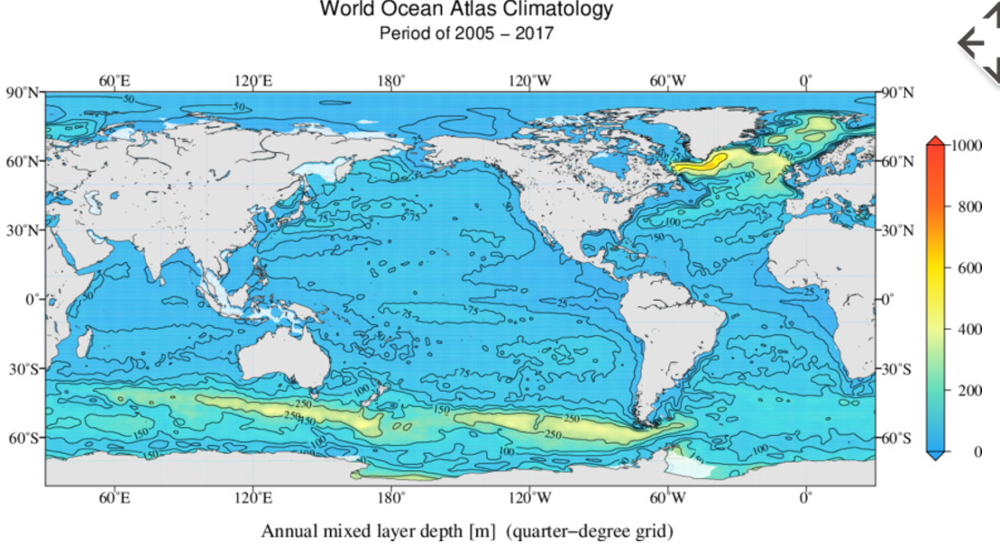
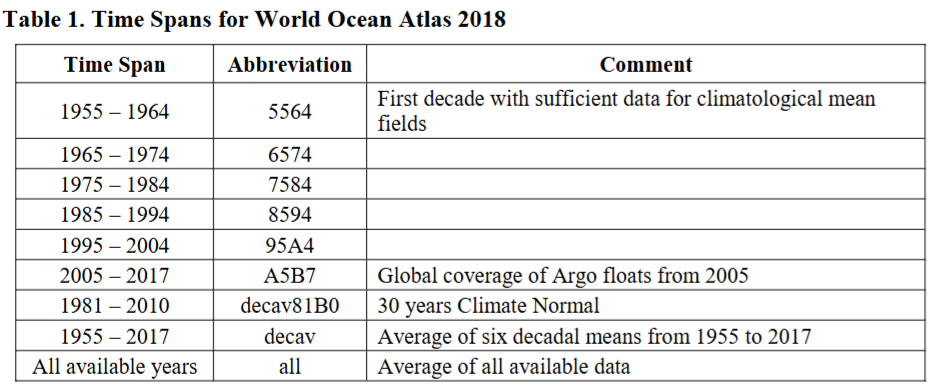
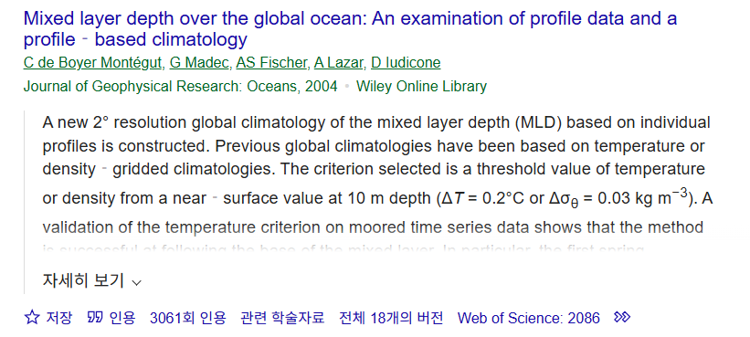

# :material-layers-triple-outline: Mixed Layer Depth [2025.03.22]

혼합층 깊이(MLD) 자료와 직접 계산할 수 있는 툴박스를 모았습니다.

## 기후값·관측 기반 { #climatology-observation-based }

### World Ocean Atlas 2018 MLD

1° and 1/4°
{ .spec }

Annual, seasonal, monthly. **A5B7 (2005–2017)**과 **decav81B0 (1981–2010)** 두 기간만 제공

[:octicons-download-24: WOA18 MLD netCDF](https://www.ncei.noaa.gov/data/oceans/woa/WOA18/DATA/mld/netcdf/) 
[:octicons-arrow-right-24: WOA (Atlas & Climatology)](atlas-climatology.md#world-ocean-atlas-woa23)

??? info "WOA18 MLD 폴더 이름의 의미"
    다운로드 링크에 들어가면 폴더가 2개 있는데 이름이 다소 낯섭니다. 의미는 아래와 같습니다.

    <figure markdown="span">
      { loading=lazy }
      <figcaption>WOA18 MLD 다운로드 폴더</figcaption>
    </figure>

    > Mixed Layer Depth fields are available on one-degree and quarter-degree grids, annual, seasonal, and monthly, ONLY for
    > **A5B7 (Time Span: 2005~2017)** and **decav81B0 (Time Span: 1981~2010)** time spans.

    <figure markdown="span">
      { loading=lazy }
      <figcaption>WOA18 MLD 제공 기간</figcaption>
    </figure>

### MILA GPV (JAMSTEC)

Argo
{ .spec }

Argo product 1

[:octicons-link-external-24: MILA GPV](https://www.jamstec.go.jp/argo_research/dataset/milagpv/mila_en.html) 
[:octicons-link-external-24: Reference (J. Oceanogr.)](https://link.springer.com/article/10.1007/s10872-010-0063-3)

### MIMOC

1/2°, Argo
{ .spec }

Argo product 2. 등밀도면·혼합층 수괴 특성 격자 자료 (front-finding, bathymetry-following 객관분석)

[:octicons-link-external-24: MIMOC](https://www.pmel.noaa.gov/mimoc/)

### Argo Mixed Layers (UCSD)

Argo
{ .spec }

Argo product 3 (툴박스 2도 참고)

[:octicons-link-external-24: mixedlayer.ucsd.edu](https://mixedlayer.ucsd.edu/)

### LOPS MLD Climatology (de Boyer Montégut)

MLD 계산하는 여러 reference를 소개. 5 m 기준 밀도 차 0.03 kg/m³ 기준 전지구 climatology

[:octicons-link-external-24: Surface Mixed Layer Depth (Ifremer)](https://cerweb.ifremer.fr/deboyer/mld/Surface_Mixed_Layer_Depth.php) 
[:octicons-download-24: MLD climatology, 0.03 kg/m³ criterion (SEANOE)](https://www.seanoe.org/data/00870/98226/)

### GOSML

Monthly statistical climatology
{ .spec }

A Global Ocean Surface Mixed Layer Statistical Monthly Climatology (NOAA PMEL)

[:octicons-link-external-24: GOSML](https://www.pmel.noaa.gov/gosml/) 
[:octicons-link-external-24: Reference (pdf)](https://www.pmel.noaa.gov/gosml/5294_Johnson_Lyman_GOSML_v4_clean_with_figures_ASACCEPTED_508.pdf)

### MLD in Polar Region

[:octicons-download-24: SEANOE 00870/98226](https://www.seanoe.org/data/00870/98226/) 
[:octicons-download-24: SEANOE 00806/91774](https://www.seanoe.org/data/00806/91774/)

## 모델·재분석 { #model-reanalysis }

### GLORYS12V1 (CMEMS)

변수명 `mlotst` (Ocean Mixed Layer Thickness)

[:octicons-link-external-24: GLOBAL_MULTIYEAR_PHY_001_030](https://data.marine.copernicus.eu/product/GLOBAL_MULTIYEAR_PHY_001_030/description) 
[:octicons-link-external-24: How is mlotst defined?](https://help.marine.copernicus.eu/en/articles/5676870-how-is-the-ocean-mixed-layer-thickness-mlotst-variable-defined)

### HYCOM GLBy0.08 expt 93.0 sur

2018–
{ .spec }

HYCOM surface product

[:octicons-link-external-24: THREDDS catalog](https://tds.hycom.org/thredds/catalogs/GLBy0.08/expt_93.0_sur.html)

### ECCO MLD

0.5°, monthly mean
{ .spec }

ECCO V4r4 (PO.DAAC)

[:octicons-link-external-24: ECCO_L4_MIXED_LAYER_DEPTH_05DEG_MONTHLY_V4R4](https://podaac.jpl.nasa.gov/dataset/ECCO_L4_MIXED_LAYER_DEPTH_05DEG_MONTHLY_V4R4)

## MLD 툴박스 { #mld-toolboxes }

### 툴박스 1

Chad Greene `mld.m`
{ .spec }

Climate Data Toolbox의 MLD 함수

[:octicons-link-external-24: mld documentation](https://www.chadagreene.com/CDT/mld_documentation.html) 
[:octicons-file-24: mld.m (Chad Greene)](../assets/files/processed/mld/mld.m)

### 툴박스 2

Subjective method (MATLAB)
{ .spec }

인용한 원본 논문(de Boyer Montégut et al., 2004)은 인용수 3000회 이상. 단, 툴박스를 논문 저자가 작성한 것은 아님

[:octicons-download-24: File Exchange: compute MLD based on subjective method](https://kr.mathworks.com/matlabcentral/fileexchange/53370-to-compute-mixed-layer-depth-based-on-subjective-method) 
[:octicons-book-24: de Boyer Montégut et al. (2004), JGR Oceans](https://doi.org/10.1029/2004JC002378)

<figure markdown="span">
  { loading=lazy }
  <figcaption>툴박스 2 예시</figcaption>
</figure>

### 툴박스 3

Holte & Talley algorithm
{ .spec }

[:octicons-link-external-24: GitHub: rsignell-usgs/mld_demo](https://github.com/rsignell-usgs/mld_demo) 
[:octicons-file-24: Holte MLD algorithm files (zip)](../assets/files/processed/mld/jaot09_holte_mld_algorithm_files.zip)

### 툴박스 4

Neutral surfaces (MATLAB)
{ .spec }

[:octicons-download-24: File Exchange: Neutral Surfaces](https://kr.mathworks.com/matlabcentral/fileexchange/124650-neutral-surfaces)

