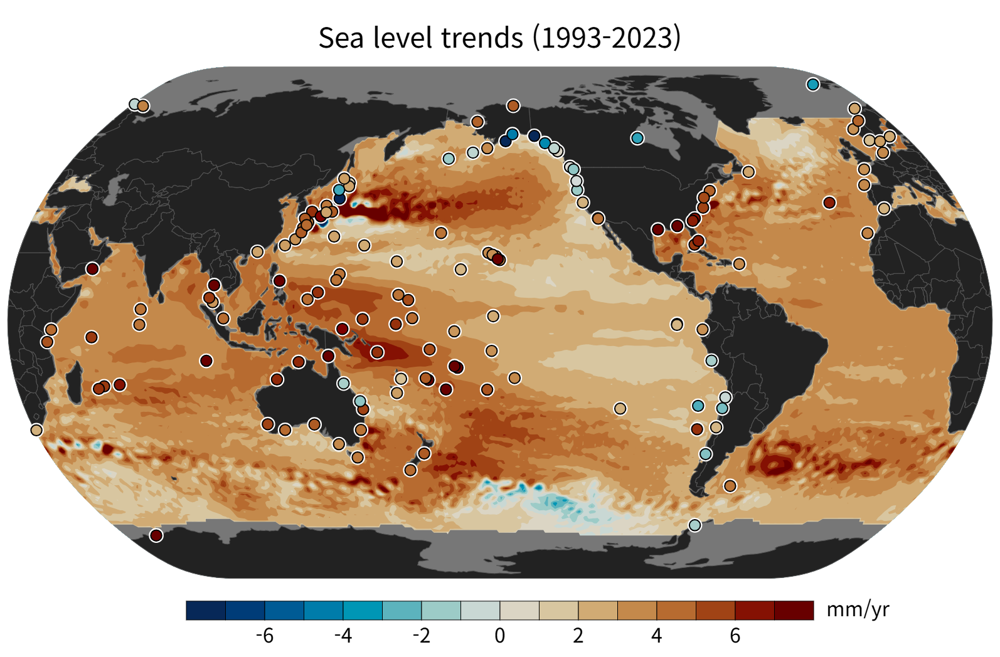
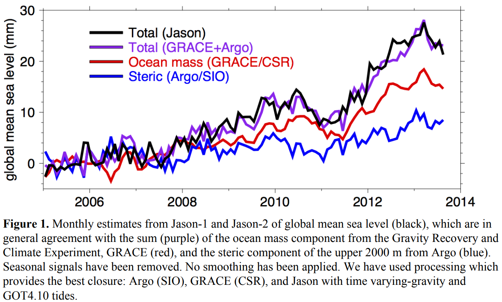
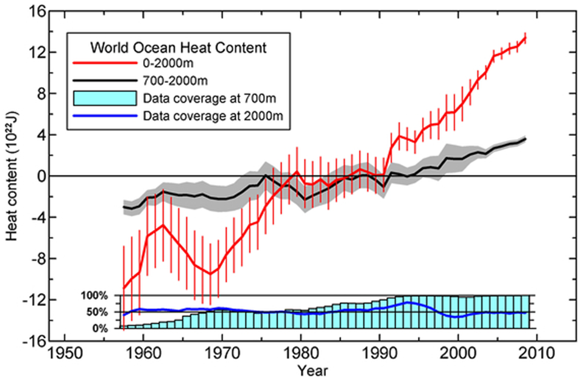

# :material-waves-arrow-up: Sea Level and Ocean Heat Content [2025.05.02]

Maps and time series of sea level and ocean heat content (OHC).

- [:octicons-link-external-24: NASA Sea Level Data Analysis Tool](https://sealevel.nasa.gov/data_tools/1/) ← visualize directly in the browser

<figure markdown="span">
  { loading=lazy }
  <figcaption>Sea level trend map (source: UHSLC)</figcaption>
</figure>

<figure markdown="span">
  { loading=lazy }
  <figcaption>Sea level rise budget (source: NOAA NESDIS Sea Level Rise Budget Report 2014)</figcaption>
</figure>

## Sea level

-   **UHSLC** · Tide gauge

    ---

    University of Hawaii Sea Level Center

    [:octicons-link-external-24: UHSLC Home](https://uhslc.soest.hawaii.edu/)

-   **GLOSS**

    ---

    Global Sea Level Observing System

    [:octicons-link-external-24: GLOSS](https://gloss-sealevel.org/)

-   **AVISO Mean Sea Level** · Map & Time series

    ---

    Altimetry-based global mean sea level (GMSL) rise indicator since 1993

    [:octicons-link-external-24: Mean Sea Level](https://www.aviso.altimetry.fr/en/data/products/ocean-indicators-products/mean-sea-level.html) 
    [:octicons-download-24: Data access](https://www.aviso.altimetry.fr/en/data/products/ocean-indicators-products/mean-sea-level/data-acces.html)

-   **AVISO Barystatic & Manometric SL** · Time series

    ---

    Barystatic and manometric sea level changes from satellite geodesy

    [:octicons-link-external-24: Product page](https://www.aviso.altimetry.fr/en/data/products/ocean-indicators-products/barystatic-and-manometric-sea-level-changes-from-satellite-geodesy.html) 
    [:octicons-download-24: HTTPS download](https://data.aviso.altimetry.fr/aviso-gateway/data/indicators/barystatic_manometric/)

-   **NOAA STAR Sea Level Rise** · Time series

    ---

    Altimetry-based sea level rise time series

    [:octicons-link-external-24: LSA SLR time series](https://www.star.nesdis.noaa.gov/socd/lsa/SeaLevelRise/LSA_SLR_timeseries.php)

-   **NASA** · Time series

    ---

    [:octicons-link-external-24: Sea Level (NASA Climate)](https://climate.nasa.gov/vital-signs/sea-level/) 
    [:octicons-link-external-24: Global Mean Sea Level](https://sealevel.nasa.gov/understanding-sea-level/key-indicators/global-mean-sea-level/)

-   **CMEMS Thermosteric Sea Level** · 0–700 m

    ---

    Thermosteric sea level anomaly from reanalysis and multi-observation reprocessing

    [:octicons-link-external-24: Area-averaged anomaly time series](https://data.marine.copernicus.eu/product/GLOBAL_OMI_SL_thsl_area_averaged_anomalies_0_700/description) 
    [:octicons-link-external-24: Trend map](https://data.marine.copernicus.eu/product/GLOBAL_OMI_SL_thsl_trend/description)

-   **Ocean Bottom Pressure** · GRACE

    ---

    GFZ Gravity Information Service

    [:octicons-link-external-24: GravIS: OBP](https://gravis.gfz.de/obp)

??? info "About AVISO Mean Sea Level"
    Continuous altimetry observations from 1993 to the present have made it possible to establish an important climate indicator:
    the rise in Global Mean Sea Level (GMSL). Two main factors related to the current global warming explain this GMSL rise:
    the expansion of the ocean volume and the influx of freshwater from melting ice and glaciers.

??? info "Barystatic vs. manometric sea level"
    Barystatic sea level changes are due to freshwater exchanges with the continents, including ice mass changes from Greenland,
    Antarctica and continental glaciers, as well as freshwater fluxes from continental areas (i.e. large river basins such as the Amazon).

    Manometric sea level changes are due to several processes, including the atmosphere-ocean circulation, sea level fingerprints
    and the global water cycle.

    The product (NetCDF) is open access via the [HTTPS server](https://data.aviso.altimetry.fr/aviso-gateway/data/indicators/barystatic_manometric/)
    or non-authenticated FTP (`ftp://ftp.aviso.altimetry.fr/pub/oceano/AVISO/indicators/barystatic_manometric/`),
    under the [AVISO licence agreement](https://www.aviso.altimetry.fr/fileadmin/documents/data/License_Aviso.pdf).

## Ocean heat content

<figure markdown="span">
  { loading=lazy }
  <figcaption>NOAA/NCEI ocean heat content (source: Levitus et al., 2012)</figcaption>
</figure>

-   **NOAA/NCEI OHC, Salt Content, Sea Level Anomalies** · Map & Time series

    ---

    Computed from in situ data (World Ocean Database) rather than satellites. 0–2000 m, updated quarterly

    [:octicons-link-external-24: Ocean Heat Content, Salt Content, and Sea Level Anomalies](https://www.ncei.noaa.gov/products/ocean-heat-salt-sea-level) 
    [:octicons-link-external-24: Levitus et al. (2012)](https://doi.org/10.1029/2012GL051106)

-   **NOAA/NCEI Global OHC CDR** · 1955–present

    ---

    Companion to the product above; OPeNDAP access. OHCA time series at 3-monthly, yearly, and pentadal scales

    [:octicons-link-external-24: Global Ocean Heat Content CDR](https://www.ncei.noaa.gov/products/climate-data-records/global-ocean-heat-content)

-   **AVISO OHC change & Earth Energy Imbalance** · Time series

    ---

    An alternative OHC-change estimate based on altimetry and gravimetry

    [:octicons-link-external-24: Product page](https://www.aviso.altimetry.fr/en/data/products/ocean-indicators-products/ocean-heat-content-and-earth-energy-imbalance/global-ocean-heat-content-change-and-earth-energy-imbalance.html) 
    [:octicons-download-24: HTTPS download](https://data.aviso.altimetry.fr/aviso-gateway/data/indicators/OHC_EEI/global_OHC_EEI/)

-   **IAPv4** · Ocean temperature & OHC gridded

    ---

    Cheng et al. (2024)

    [:octicons-link-external-24: ESSD paper](https://essd.copernicus.org/articles/16/3517/2024/) 
    [:octicons-download-24: Temperature (doi:10.12157/IOCAS.20240117.002)](https://doi.org/10.12157/IOCAS.20240117.002) 
    [:octicons-download-24: OHC (doi:10.12157/IOCAS.20240117.001)](https://doi.org/10.12157/IOCAS.20240117.001) 
    [:octicons-link-external-24: IAP Ocean](http://www.ocean.iap.ac.cn/)

-   **NASA** · Time series

    ---

    [:octicons-link-external-24: Ocean Heat Content (NASA Climate)](https://climate.nasa.gov/vital-signs/ocean-warming/)

-   **RFROM** · PMEL

    ---

    Ocean heat content anomaly (OHCA) maps produced from profile data with random-forest regression. Described on the In Situ page

    [:octicons-arrow-right-24: Other in situ datasets (In Situ)](../whole-ocean/in-situ/others.md)

??? info "About the NOAA/NCEI OHC product"
    These fields and time series are **calculated using in situ temperature and salinity data from the
    [World Ocean Database](https://www.ncei.noaa.gov/products/world-ocean-database)**. Calculations are performed as detailed in
    [Levitus et al. (2012)](https://doi.org/10.1029/2012GL051106) using the [World Ocean Atlas 2009](https://www.ncei.noaa.gov/products/world-ocean-atlas)
    mean climatological fields for 1955–2006 as a basis for anomaly calculations.

    Data distribution figures for temperature and salinity observations, temperature and salinity anomaly fields for depths 0–2000 m,
    heat content and steric sea level (thermosteric, halosteric, total) are updated quarterly. Temperature anomalies and heat content fields
    are detailed in *World Ocean Heat Content and Thermosteric Sea Level change (0–2000 m), 1955–2010*
    ([publication](https://www.ncei.noaa.gov/data/oceans/woa/PUBLICATIONS/grlheat12.pdf), pdf). Differences between published work and online values
    are explained in the [comments](https://www.ncei.noaa.gov/data/oceans/woa/DATA_ANALYSIS/3M_HEAT_CONTENT/PDF/heat_content_differences.pdf) (pdf),
    and erroneous values in the [notes](https://www.ncei.noaa.gov/access/global-ocean-heat-content/index.html#ShowNote).

    The ocean's thermal expansion due to OHC change directly affects sea level. Calculating OHC from in situ subsurface temperature changes
    allows researchers to create a corresponding time series, but this is limited by the uncertainty of temperature measurements and the
    geographic and temporal distribution of subsurface observations.

    Salinity anomaly fields indicate changes in the ocean's freshwater budget on shorter time scales (evaporation/precipitation, river discharge, etc.)
    and longer time scales (transfer of freshwater from continental glaciers). They also measure halosteric change, the saline contraction that affects sea level.

??? info "About the Global OHC CDR"
    The Ocean Heat Content Climate Data Record (CDR) is a set of ocean heat content anomaly (OHCA) time series for 1955–present on 3-monthly,
    yearly, and pentadal (five-yearly) scales. It provides time series for multiple depth ranges in the global ocean and each of the major basins
    (Atlantic, Pacific, and Indian) divided by hemisphere (Northern, Southern).

??? info "About AVISO OHC change & EEI"
    The OHC change can be estimated directly from net ocean surface heat fluxes measured by CERES, from in situ Argo data, or from ocean
    model reanalyses. **AVISO estimates the OHC change with an alternative method based on space altimetry and gravimetry**, which complements
    these approaches and is promising for reducing uncertainty.

    The NetCDF product is open access via the [HTTPS server](https://data.aviso.altimetry.fr/aviso-gateway/data/indicators/OHC_EEI/global_OHC_EEI/)
    or non-authenticated FTP (`ftp://ftp.aviso.altimetry.fr/pub/oceano/AVISO/indicators/OHC_EEI/global_OHC_EEI/`),
    under the [AVISO licence agreement](https://www.aviso.altimetry.fr/fileadmin/documents/data/License_Aviso.pdf).
    See also [Ocean Heat Content and Earth Energy Imbalance](https://www.aviso.altimetry.fr/en/data/products/ocean-indicators-products/ocean-heat-content-and-earth-energy-imbalance.html).
