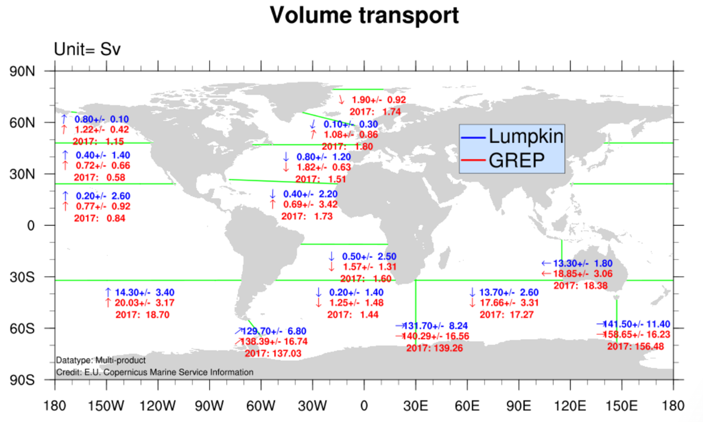
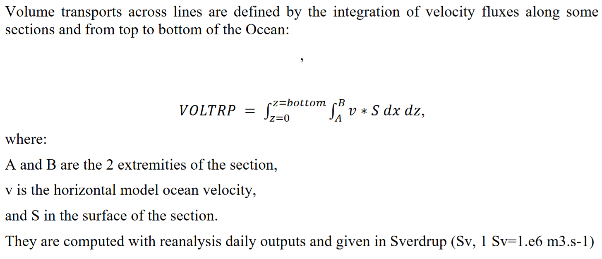

# :material-swap-vertical: Volume Transport [2026.04.02]

Rick Lumpkin(NOAA AOML)이 정리한 전 지구 해류 수송량(volume transport) 시계열과, 이에 대응하는 Copernicus Marine의 Ocean Monitoring Indicator입니다.

-   **Lumpkin & Speer (2007)**

    ---

    전 지구 자오면 순환과 수송량 추정의 근거가 되는 논문 (Journal of Physical Oceanography)

    [:octicons-book-24: Lumpkin & Speer (2007), JPO 37(10)](https://journals.ametsoc.org/view/journals/phoc/37/10/jpo3130.1.xml?tab_body=pdf)

-   **CMEMS OMI: Volume transport**

    ---

    주요 단면을 통과하는 수송량의 Global Ocean Monitoring Indicator (GLOBAL_OMI_WMHE_voltrp)

    [:octicons-download-24: GLOBAL_OMI_WMHE_voltrp](https://data.marine.copernicus.eu/product/GLOBAL_OMI_WMHE_voltrp/services)

<figure markdown="span">
  { loading=lazy }
  <figcaption>수송량 추정에 사용된 단면</figcaption>
</figure>

<figure markdown="span">
  { loading=lazy }
  <figcaption>수송량 시계열</figcaption>
</figure>

다른 해류 지수는 [Ocean & Climate Index](climate-index.md#ocean-carbon-indicators)를 참고하세요.
