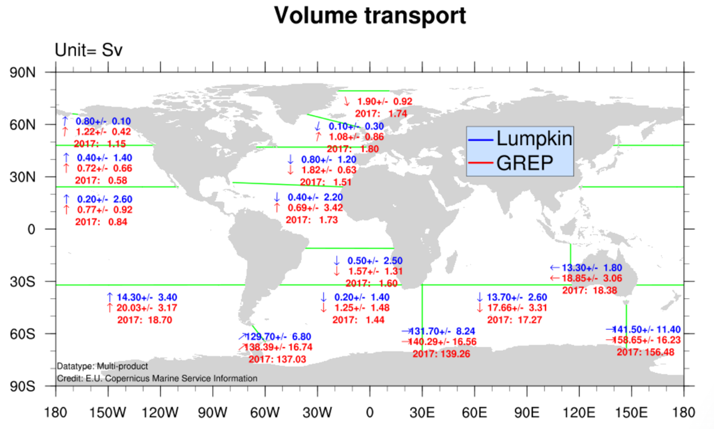
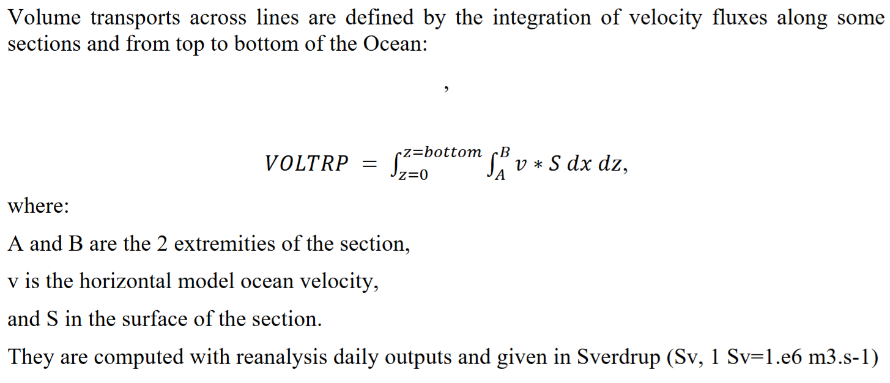

# :material-swap-vertical: Volume Transport [2026.04.02]

Global ocean volume transport time series compiled by Rick Lumpkin (NOAA AOML), and the corresponding Copernicus Marine Ocean Monitoring Indicator.

-   **Lumpkin & Speer (2007)**

    ---

    Global ocean meridional overturning and the transport estimates behind the time series (Journal of Physical Oceanography)

    [:octicons-book-24: Lumpkin & Speer (2007), JPO 37(10)](https://journals.ametsoc.org/view/journals/phoc/37/10/jpo3130.1.xml?tab_body=pdf)

-   **CMEMS OMI: Volume transport**

    ---

    Global Ocean Monitoring Indicator of volume transport across key sections (GLOBAL_OMI_WMHE_voltrp)

    [:octicons-download-24: GLOBAL_OMI_WMHE_voltrp](https://data.marine.copernicus.eu/product/GLOBAL_OMI_WMHE_voltrp/services)

<figure markdown="span">
  { loading=lazy }
  <figcaption>Sections used for the volume transport estimates</figcaption>
</figure>

<figure markdown="span">
  { loading=lazy }
  <figcaption>Volume transport time series</figcaption>
</figure>

See also [Ocean & Climate Index](climate-index.md#ocean-carbon-indicators) for other ocean current indices.
