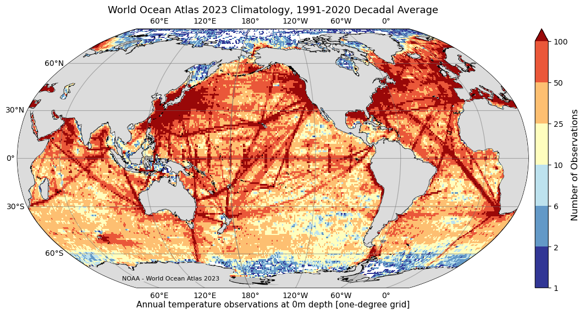

# :material-book-open-page-variant: World Ocean Atlas (WOA) [2026.05.12]

World Ocean Database(WOD)의 프로파일 자료를 바탕으로 객관분석한 수온, 염분, 산소, 영양염의 기후값 평균장입니다.
이 페이지는 최신 버전인 WOA23을 정리한 것이며, 관련 격자 자료는 [Atlas & Climatology](atlas-climatology.md) 페이지에 있습니다.

-   **WOA23** · 1°, 1/4° · 102 depth levels

    ---

    수온, 염분, 산소(AOU, 포화도 포함), 인산염, 규산염, 질산염 평균장

    [:octicons-link-external-24: World Ocean Atlas (NOAA NCEI)](https://www.ncei.noaa.gov/products/world-ocean-atlas) 
    [:octicons-download-24: WOA23 data access (temperature)](https://www.ncei.noaa.gov/access/world-ocean-atlas-2023f/bin/woa23f.pl?parameterOption=t)

-   **원자료: WOD**

    ---

    WOA 계산의 바탕이 되는 프로파일 아카이브. 다운로드 방법은 In Situ 페이지에 정리했습니다

    [:octicons-arrow-right-24: Multi-platform archives (In Situ)](../whole-ocean/in-situ/archives.md) 
    [:octicons-arrow-right-24: WOD 다운로드 방법](../whole-ocean/in-situ/wod-download.md)

<figure markdown="span">
  { loading=lazy }
  <figcaption>WOA23 자료 접근 페이지</figcaption>
</figure>

??? info "WOA23 상세"
    The World Ocean Atlas (WOA) is a collection of objectively analyzed, quality controlled temperature, salinity, oxygen, phosphate, silicate,
    and nitrate means **based on profile data from the World Ocean Database (WOD)**. It can be used to create boundary and/or initial conditions
    for ocean models, verify numerical simulations, and corroborate satellite data.

    The full WOA23 was released on February 14, 2024 and includes **temperature, salinity, oxygen (plus Apparent Oxygen Utilization and percent
    oxygen saturation) and inorganic nutrients (phosphate, silicate, and nitrate)**. It adds approximately 1.8 million new casts since WOA18,
    with renewed quality control. Data are given at **102 standard depth levels**.

    - **Temperature, salinity:** one-degree and quarter-degree grids, for 1955–1964, 1965–1974, 1975–1984, 1985–1994, 1995–2004, 2005–2014, 2015–2022,
      and three 30-year climate normals (1971–2000, 1981–2010, 1991–2020).
    - **Nutrients:** one-degree, 1965–2022.
    - **Oxygen, AOU, percent saturation:** one-degree, 1965–2022 and 1971–2000.
    - All-data five-degree statistics for each variable.

## 관련 자료

- **WOA18 혼합층 깊이** 자료는 [Mixed Layer Depth](mld.md) 페이지에 있습니다.
- WOD 기반 **지역 해양 기후값**(1/10° 이상)은 [Atlas & Climatology](atlas-climatology.md#regional-atlas) 페이지를 참고하세요.
- NOAA/NCEI의 해양 열용량 자료는 WOA 기후값을 아노말리 기준으로 사용합니다. [Sea Level & OHC](sea-level-ohc.md)를 참고하세요.
