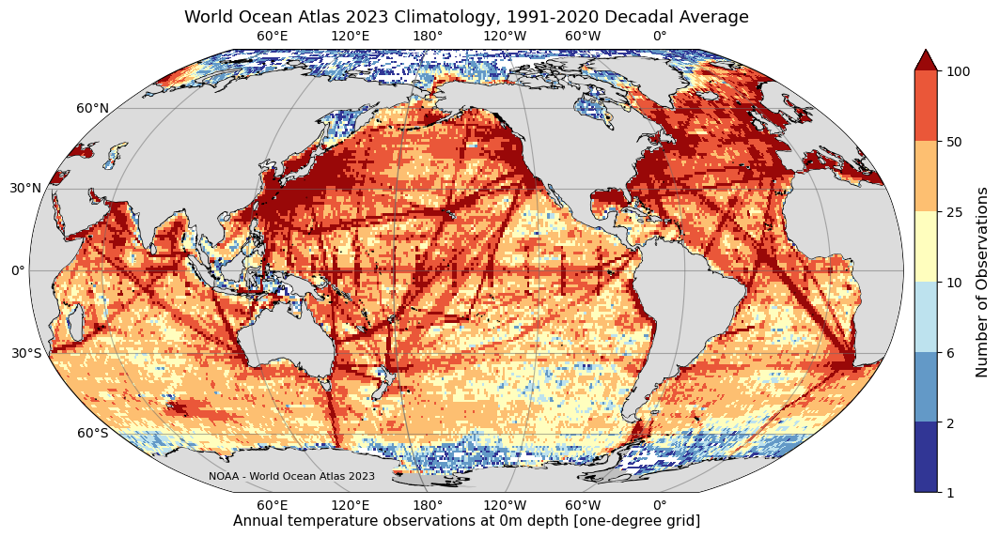

# :material-book-open-page-variant: World Ocean Atlas (WOA) [2026.05.12]

Objectively analyzed, quality-controlled climatological fields of temperature, salinity, oxygen, and nutrients, built from the profile data of the World Ocean Database (WOD).
This page summarizes the current release, WOA23; related gridded products are on the [Atlas & Climatology](atlas-climatology.md) page.

-   **WOA23** · 1° and 1/4° · 102 depth levels

    ---

    Temperature, salinity, oxygen (plus AOU and percent saturation), phosphate, silicate, and nitrate means

    [:octicons-link-external-24: World Ocean Atlas (NOAA NCEI)](https://www.ncei.noaa.gov/products/world-ocean-atlas) 
    [:octicons-download-24: WOA23 data access (temperature)](https://www.ncei.noaa.gov/access/world-ocean-atlas-2023f/bin/woa23f.pl?parameterOption=t)

-   **Source database: WOD**

    ---

    The profile archive from which WOA is computed. Download instructions are on the In Situ pages

    [:octicons-arrow-right-24: Multi-platform archives (In Situ)](../whole-ocean/in-situ/archives.md) 
    [:octicons-arrow-right-24: How to download WOD](../whole-ocean/in-situ/wod-download.md)

<figure markdown="span">
  { loading=lazy }
  <figcaption>WOA23 data access page</figcaption>
</figure>

??? info "About WOA23"
    The World Ocean Atlas (WOA) is a collection of objectively analyzed, quality controlled temperature, salinity, oxygen, phosphate, silicate,
    and nitrate means **based on profile data from the World Ocean Database (WOD)**. It can be used to create boundary and/or initial conditions
    for ocean models, verify numerical simulations, and corroborate satellite data.

    The full WOA23 was released on February 14, 2024 and includes **temperature, salinity, oxygen (plus Apparent Oxygen Utilization and percent
    oxygen saturation) and inorganic nutrients (phosphate, silicate, and nitrate)**. It adds approximately 1.8 million new casts since WOA18,
    with renewed quality control. Data are given at **102 standard depth levels**.

    - **Temperature, salinity:** one-degree and quarter-degree grids, for 1955–1964, 1965–1974, 1975–1984, 1985–1994, 1995–2004, 2005–2014, 2015–2022,
      and three 30-year climate normals (1971–2000, 1981–2010, 1991–2020).
    - **Nutrients:** one-degree, 1965–2022.
    - **Oxygen, AOU, percent saturation:** one-degree, 1965–2022 and 1971–2000.
    - All-data five-degree statistics for each variable.

## Related products

- **WOA18 mixed layer depth** fields are listed on the [Mixed Layer Depth](mld.md) page.
- **Regional ocean climatologies** derived from the WOD (1/10° or finer) are on the [Atlas & Climatology](atlas-climatology.md#regional-atlas) page.
- NOAA/NCEI ocean heat content products use WOA climatological fields as the anomaly baseline; see [Sea Level & OHC](sea-level-ohc.md).
