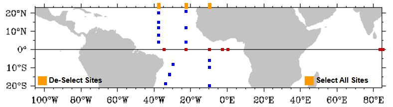
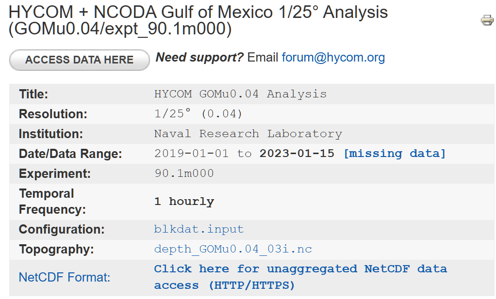
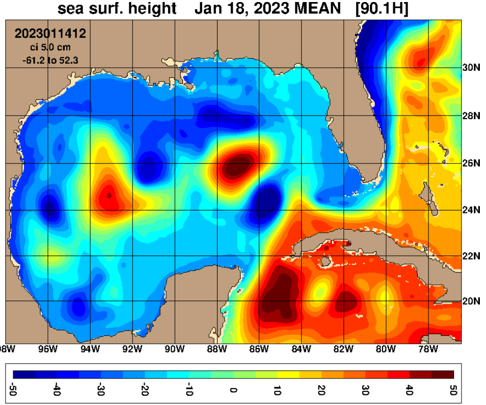
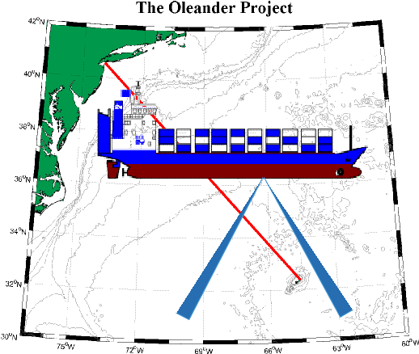
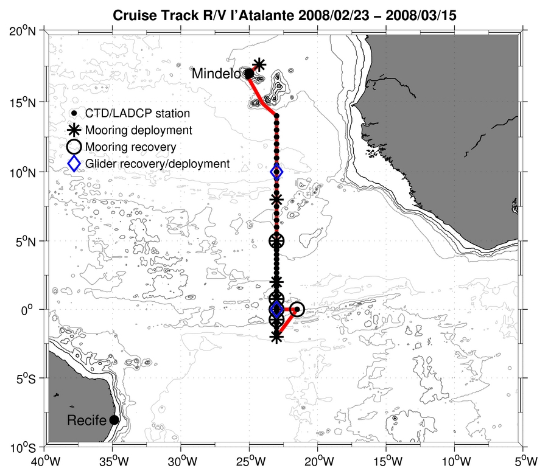
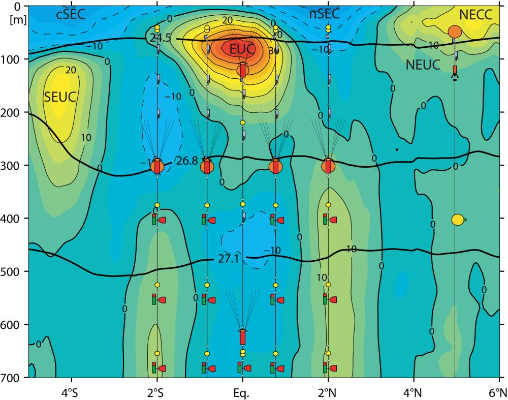

# :material-earth: Atlantic Ocean [2025.03.15]

대서양의 AMOC 모니터링, 계류 부이 배열, 반복 관측선 자료입니다.

## AMOC 모니터링

### RAPID

26.5°N
{ .spec }

Monitoring the Atlantic Meridional Overturning Circulation at 26.5°N

[:octicons-link-external-24: RAPID (Climate Data Guide)](https://climatedataguide.ucar.edu/climate-data/rapid-monitoring-atlantic-meridional-overturning-circulation-265%25C2%25B0n)

### OSNAP

Overturning in the Subpolar North Atlantic Program

[:octicons-link-external-24: OSNAP](https://www.o-snap.org/)

### CMEMS AMOC 지표

26°N, 재분석
{ .spec }

재분석 기반 AMOC 시계열과 연직 프로파일

[:octicons-link-external-24: 26°N AMOC 시계열](https://marine.copernicus.eu/access-data/ocean-monitoring-indicators/atlantic-meridional-overturning-circulation-amoc-timeseries) 
[:octicons-link-external-24: 26°N AMOC 프로파일](https://marine.copernicus.eu/access-data/ocean-monitoring-indicators/atlantic-meridional-overturning-circulation-amoc-profile)

## 계류 부이 배열

### PIRATA (Global Tropical Moored Buoy Array)

TAO / TRITON / **PIRATA** / RAMA 중 대서양 배열

[:octicons-download-24: Data Display and Delivery (PMEL)](https://www.pmel.noaa.gov/tao/drupal/disdel/) 
[:octicons-link-external-24: 프랑스 PIRATA 항해: 음향 자료 (SEANOE)](https://www.seanoe.org/data/00602/71379/)

<figure markdown="span">
  { loading=lazy }
  <figcaption>PIRATA 배열</figcaption>
</figure>

### OceanSITES

Data catalog: TRITON, RAMA, PIRATA, KEO 등

[:octicons-download-24: Coriolis OceanSITES GDAC (THREDDS)](http://tds0.ifremer.fr/thredds/CORIOLIS-OCEANSITES-GDAC-OBS/CORIOLIS-OCEANSITES-GDAC-OBS.html)

## 멕시코만

### GRIIDC

Gulf of Mexico Research Initiative Information and Data Cooperative

[:octicons-link-external-24: GRIIDC](https://www.griidc.org/)

<figure markdown="span">
  { loading=lazy }
  <figcaption>GRIIDC</figcaption>
</figure>

### HYCOM 멕시코만 (GOMu0.04)

수치 모형

[:octicons-link-external-24: HYCOM GOMu0.04 expt_90.1m000](https://www.hycom.org/data/gomu0pt04/expt-90pt1m000)

<figure markdown="span">
  { loading=lazy }
  <figcaption>HYCOM 멕시코만</figcaption>
</figure>

## 반복 관측선과 항해

### Oleander Project

[:octicons-link-external-24: Oleander (Stony Brook)](http://po.msrc.sunysb.edu/Oleander/) 
[:octicons-link-external-24: Oleander (URI)](http://www.po.gso.uri.edu/rafos/research/ole/index.html)

<figure markdown="span">
  { loading=lazy }
  <figcaption>Oleander 항로</figcaption>
</figure>

### L'ATALANTE 2008

[:octicons-link-external-24: SFB 754: L'Atalante](https://www.sfb754.de/l-atalante)

<figure markdown="span">
  { loading=lazy }
  <figcaption>L'ATALANTE 2008</figcaption>
</figure>

<figure markdown="span">
  { loading=lazy }
  <figcaption>L'ATALANTE 2008</figcaption>
</figure>

### ORSTOM XBT Network

[:octicons-link-external-24: ORSTOM XBT (IRD Brest)](https://www.brest.ird.fr/xbt/xbt_ors2.html)

