# :material-earth: Indian Ocean [2025.05.29]

Moored buoy arrays, strait transports, and INCOIS products for the Indian Ocean.

- [:octicons-graph-24: Current state of Indian Ocean climate indices (OOPC)](https://stateoftheocean.osmc.noaa.gov/sur/ind/)

## Moored buoy arrays

### RAMA (Global Tropical Moored Buoy Array)

The Indian Ocean component of TAO / TRITON / PIRATA / **RAMA**

[:octicons-download-24: Data Display and Delivery (PMEL)](https://www.pmel.noaa.gov/tao/drupal/disdel/)

<figure markdown="span">
  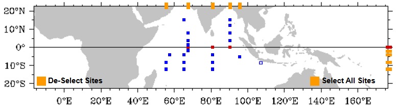{ loading=lazy }
  <figcaption>RAMA array</figcaption>
</figure>

### RAMA-K

Joint KIOST and NOAA RAMA moorings in the Indian Ocean

[:octicons-download-24: RAMA-K data (PMEL)](https://www.pmel.noaa.gov/tao/drupal/rama-k/) 
[:octicons-download-24: SEANOE dataset 1](https://www.seanoe.org/data/00993/110465/) 
[:octicons-download-24: SEANOE dataset 2](https://www.seanoe.org/data/00976/108782/) 
[:octicons-link-external-24: Joint KIOST-NOAA cruise establishes new RAMA mooring sites (PMEL news)](https://www.pmel.noaa.gov/news-story/joint-kiost-noaa-indian-ocean-cruise-establish-new-rama-mooring-sites)

[:octicons-file-24: KUDOS program plan (PDF)](../assets/files/regional/indian/KUDOS_Program_Plan_8Nov2018_Final.pdf)

<figure markdown="span">
  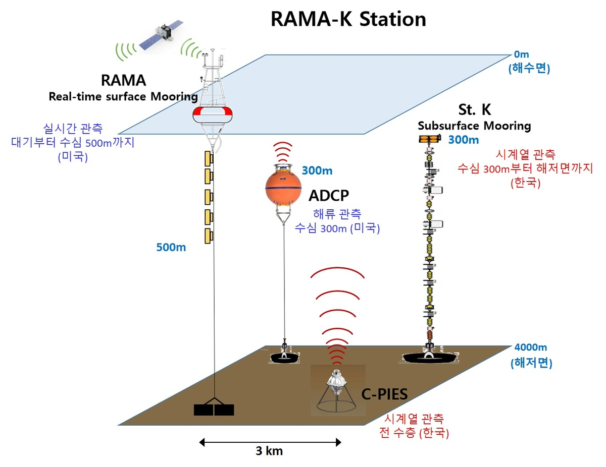{ loading=lazy }
  <figcaption>News on RAMA-K (Yonhap, https://www.yna.co.kr/view/AKR20241212089900017)</figcaption>
</figure>

### OceanSITES

Data catalog: TRITON, RAMA, PIRATA, KEO, and others

[:octicons-download-24: Coriolis OceanSITES GDAC (THREDDS)](http://tds0.ifremer.fr/thredds/CORIOLIS-OCEANSITES-GDAC-OBS/CORIOLIS-OCEANSITES-GDAC-OBS.html)

### JAMSTEC subsurface ADCP mooring

The eastern Indian Ocean ADCP moorings of the TOCS project

[:octicons-arrow-right-24: TOCS ADCP mooring on the Japan page](japan.md#subsurface-adcp-mooring-tocs)

## MJO field campaign

??? quote "CINDY2011 / DYNAMO / AMIE data archives"
    There are three data centers that archive the field data: the CINDY2011 data archive at JAMSTEC
    (~~www.jamstec.go.jp/iorgc/cindy/~~, no longer available), the DYNAMO data archive at NCAR EOL
    ([https://www.eol.ucar.edu/field_projects/dynamo](https://www.eol.ucar.edu/field_projects/dynamo)), and the AMIE data available at the
    ARM archive ([https://adc.arm.gov/discovery/#/](https://adc.arm.gov/discovery/#/)). Links between them allow for one-stop data searching.

    *Yoneyama, K., Zhang, C., Long, C.N., 2013. Tracking Pulses of the Madden–Julian Oscillation.*
    [https://doi.org/10.1175/BAMS-D-12-00157.1](https://doi.org/10.1175/BAMS-D-12-00157.1)

## ITF (Indonesian Throughflow) transport

| Dataset | Period | Reference |
|---|---|---|
| [INSTANT: International Nusantara Stratification And Transport](https://marlin.csiro.au/geonetwork/srv/eng/catalog.search#/metadata/2a08c690-2aef-408e-b551-4c9e4cdf6762) | 2003–2006 | [Direct estimates of the ITF entering the Indian Ocean: 2004–2006](https://agupubs.onlinelibrary.wiley.com/doi/full/10.1029/2008JC005257) |
| [Makassar Strait Mooring](https://ocp.ldeo.columbia.edu/res/div/ocp/projects/MITF/Makassar_Strait_Mooring.html) | 2004/01–2009/05 | [Variability of ITF within Makassar Strait, 2004–2009](https://agupubs.onlinelibrary.wiley.com/doi/full/10.1029/2012JC008096) |
| [ITF geostrophic transport from historical observations](https://msdc.qdio.ac.cn/data/metadata-special-detail?id=1602584419212836865&otherId=1602584419330277378) | 1984/01–2018/12 | [An Updated Estimate of the ITF Geostrophic Transport](https://agupubs.onlinelibrary.wiley.com/doi/full/10.1029/2023GL103748) |
| [ITF transport derived from the multi-island rule](https://msdc.qdio.ac.cn/data/metadata-special-detail?id=1734405967002578946&otherId=1734405967170351106) | 1988–2018 | [The island rule with multiple islands and its application to the ITF](https://www.frontiersin.org/journals/marine-science/articles/10.3389/fmars.2023.1145506/full) |
| [A Makassar Throughflow proxy based on satellite data](https://msdc.qdio.ac.cn/data/metadata-special-detail?id=1410278094496874498&otherId=1410278094580760578) | 1993/01–2018/12 | [ITF proxy from satellite altimeters and gravimeters](https://agupubs.onlinelibrary.wiley.com/doi/full/10.1002/2014JC010382) |
| [Salinity effects on seasonal Makassar Strait throughflow](https://msdc.qdio.ac.cn/data/metadata-special-detail?id=1734108627179933697&otherId=1734108627280596993) | 1993–2020 | [Quantifying the Contribution of Salinity Effect to the Makassar Strait Throughflow](https://agupubs.onlinelibrary.wiley.com/doi/full/10.1029/2023GL105991) |
| [Data of the ITF water pathways](https://msdc.qdio.ac.cn/data/metadata-special-detail?id=1734771056750673922&otherId=1734771056972972034) | | [Destinations and Pathways of the ITF Water in the Indian Ocean](https://journals.ametsoc.org/view/journals/clim/36/11/JCLI-D-22-0631.1.xml) |

## ESSO-INCOIS (Indian National Centre for Ocean Information Services)

[:octicons-link-external-24: INCOIS data holdings](https://incois.gov.in/portal/datainfo/dataholdings.jsp) ·
[:octicons-download-24: INCOIS ERDDAP](https://erddap.incois.gov.in/erddap/info/index.html?page=1&itemsPerPage=1000)

<figure markdown="span">
  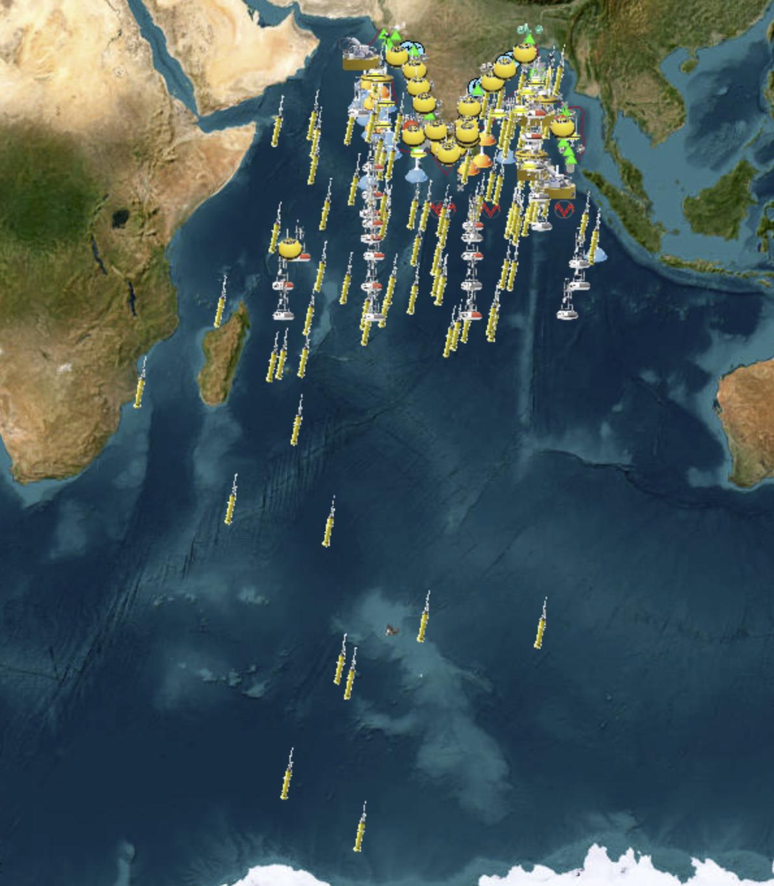{ loading=lazy }
  <figcaption>INCOIS data holdings</figcaption>
</figure>

### Indian Ocean gridded 1° Argo-only dataset (objective analysis)

monthly · since 2002-01-01 · 19 levels to 1000 dbar
{ .spec }

Argo only

[:octicons-book-24: Reference (argo.ucsd.edu)](https://argo.ucsd.edu/wp-content/uploads/sites/361/2020/05/Incois_Argo_ObjectiveAnalysis_Ver2.0.pdf) 
[:octicons-link-external-24: Figures (INCOIS)](https://incois.gov.in/argo/ARDCOAProducts.jsp) 
[:octicons-download-24: Data (INCOIS ERDDAP)](https://erddap.incois.gov.in/erddap/info/index.html?page=1&itemsPerPage=1000)

### Indian Ocean pCO2 maps

[:octicons-download-24: INCOIS LAS](https://las.incois.gov.in/las/UI.vm)

### ChloroGIN

Chlorophyll Global Integrated Network

[:octicons-book-24: Description](https://incois.gov.in/portal/ChloroGIN) 
[:octicons-download-24: Data](https://incois.gov.in/portal/ChloroGIN_SP.jsp)

### Algal Bloom Information Service (ABIS)

[:octicons-link-external-24: ABIS (INCOIS)](https://incois.gov.in/portal/hab.jsp)

### Ocean Mixing and Monsoon (OMM)

[:octicons-link-external-24: OMM cruises (INCOIS)](https://incois.gov.in/omm/cruises.jsp)

<figure markdown="span">
  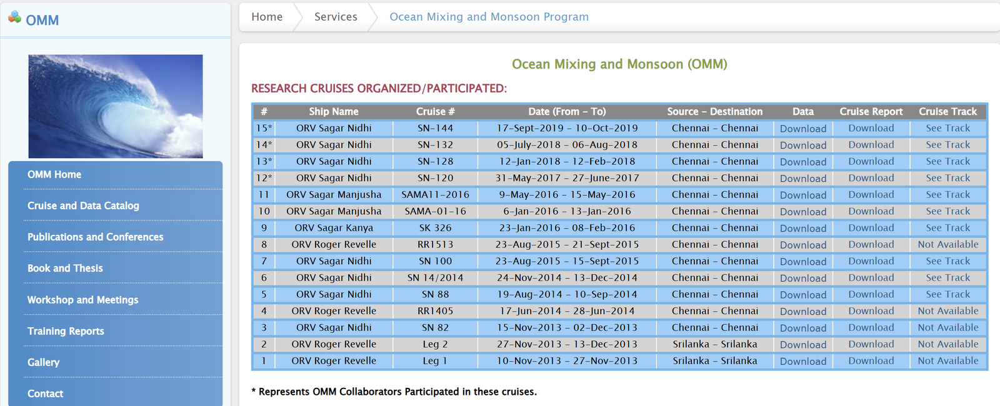{ loading=lazy }
  <figcaption>OMM cruises</figcaption>
</figure>

## SST products

### GHRSST L3C Indian Ocean sub-skin SST

SEVIRI on MSG, GDS2, produced by OSI SAF

[:octicons-download-24: PO.DAAC: SEVIRI_IO_SST-OSISAF-L3C-v1.0](https://podaac.jpl.nasa.gov/dataset/SEVIRI_IO_SST-OSISAF-L3C-v1.0)

### GHRSST L2P Indian Ocean regional skin SST

NOAA, SEVIRI on MSG-1

[:octicons-download-24: PO.DAAC: MSG01-OSPO-L2P-v1.0](https://podaac.jpl.nasa.gov/dataset/MSG01-OSPO-L2P-v1.0)

## Agulhas Current and South Atlantic

### Ocean Climate Stations: ARC

PMEL Ocean Climate Stations (KEO, Papa, **ARC**)

[:octicons-download-24: OCS mooring data](https://www.pmel.noaa.gov/ocs/data/disdel/) 
[:octicons-link-external-24: Agulhas Return Current (ARC) site](https://www.pmel.noaa.gov/ocs/ARC)

<figure markdown="span">
  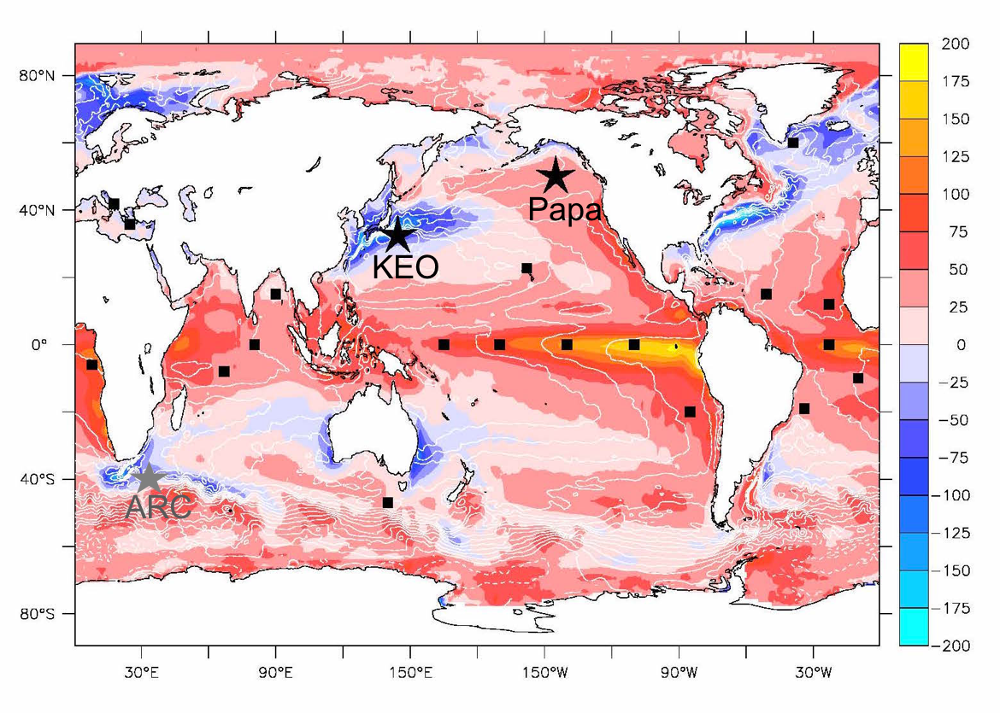{ loading=lazy }
  <figcaption>PMEL Ocean Climate Stations</figcaption>
</figure>

<figure markdown="span">
  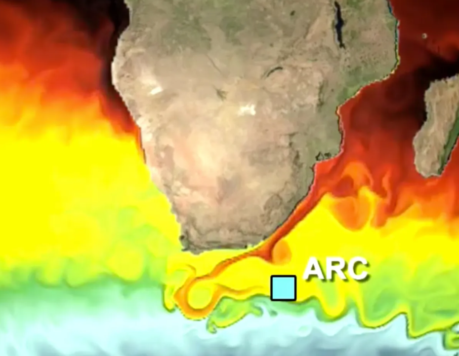{ loading=lazy }
  <figcaption>Agulhas Return Current site</figcaption>
</figure>

### Agulhas System Climate Array (ASCA)

Beal Lab, University of Miami

[:octicons-link-external-24: ASCA project](https://beal-agulhas.earth.miami.edu/research/projects/asca/index.html) 
[:octicons-download-24: Data & products](https://beal-agulhas.earth.miami.edu/data-and-products/index.html) 
[:octicons-book-24: Reference paper (JGR Oceans)](https://agupubs.onlinelibrary.wiley.com/doi/10.1029/2021JC018107)

<figure markdown="span">
  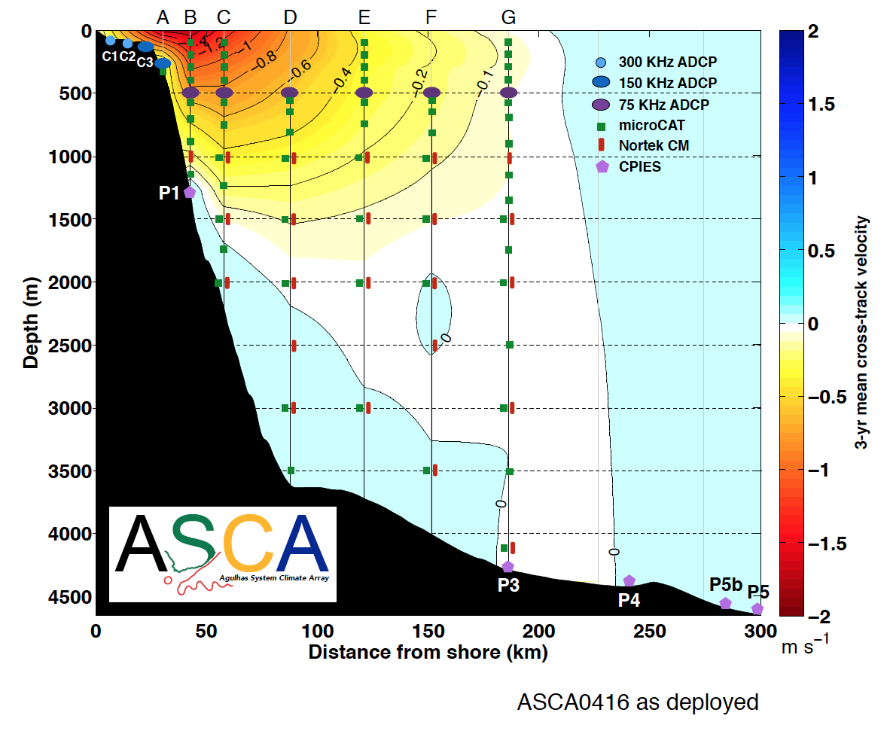{ loading=lazy }
  <figcaption>ASCA mooring array</figcaption>
</figure>

<figure markdown="span">
  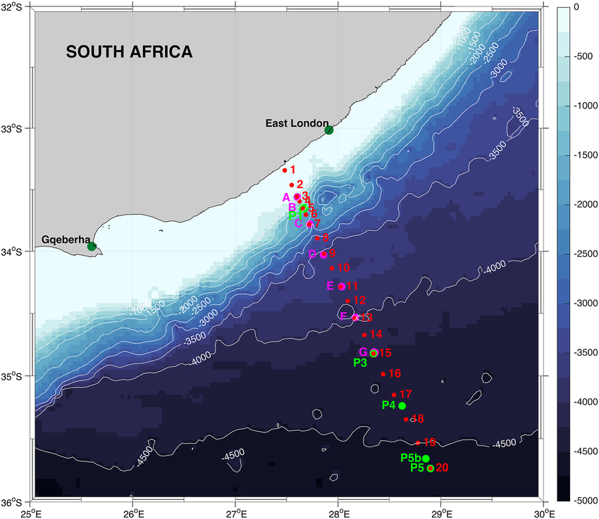{ loading=lazy }
  <figcaption>From the ASCA reference paper, https://agupubs.onlinelibrary.wiley.com/doi/10.1029/2021JC018107</figcaption>
</figure>

### Agulhas Current Time-series (ACT)

Beal Lab, University of Miami

[:octicons-link-external-24: ACT project](https://beal-agulhas.earth.miami.edu/research/projects/act/index.html) 
[:octicons-download-24: Data & products](https://beal-agulhas.earth.miami.edu/data-and-products/index.html)

<figure markdown="span">
  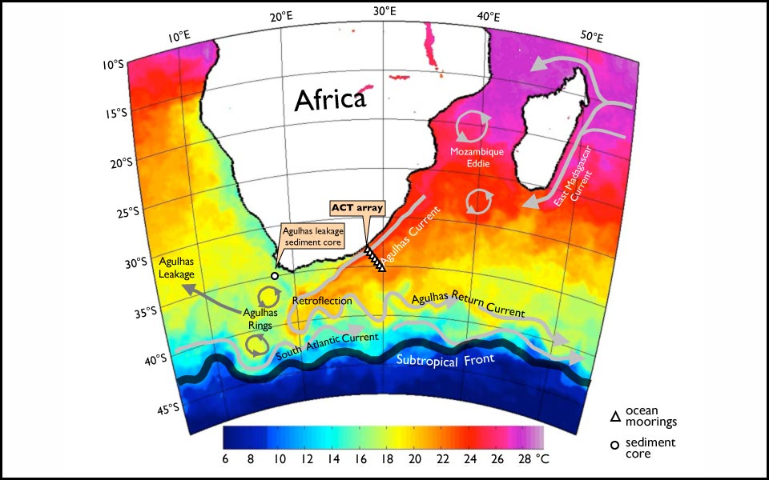{ loading=lazy }
  <figcaption>ACT mooring array</figcaption>
</figure>

### SAMBA (South Atlantic MOC Basin-wide Array)

[:octicons-book-24: Reference (doi:10.1016/0079-6611(80)90015-4)](https://doi.org/10.1016/0079-6611(80)90015-4) 
[:octicons-link-external-24: SAMOC cruises (NOAA AOML)](https://www.aoml.noaa.gov/phod/SAMOC_international/samoc_cruises.php) 
[:octicons-download-24: SEANOE dataset](https://www.seanoe.org/data/00592/70364/)

<figure markdown="span">
  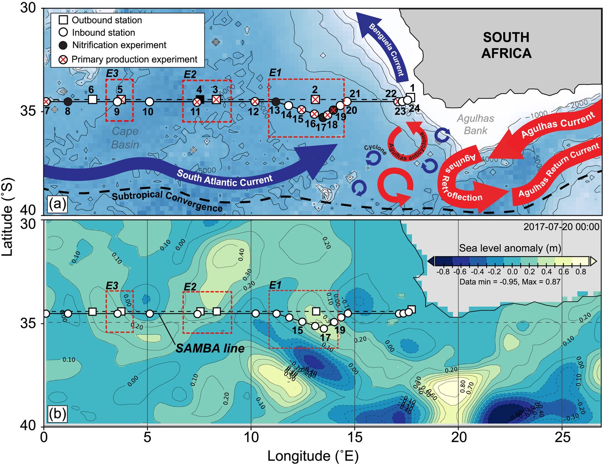{ loading=lazy }
  <figcaption>SAMBA array</figcaption>
</figure>

## Other sources

### Java Ocean Atlas (JOA)

[:octicons-link-external-24: JOA Indian Ocean data](https://joa.ucsd.edu/indiandata)

<figure markdown="span">
  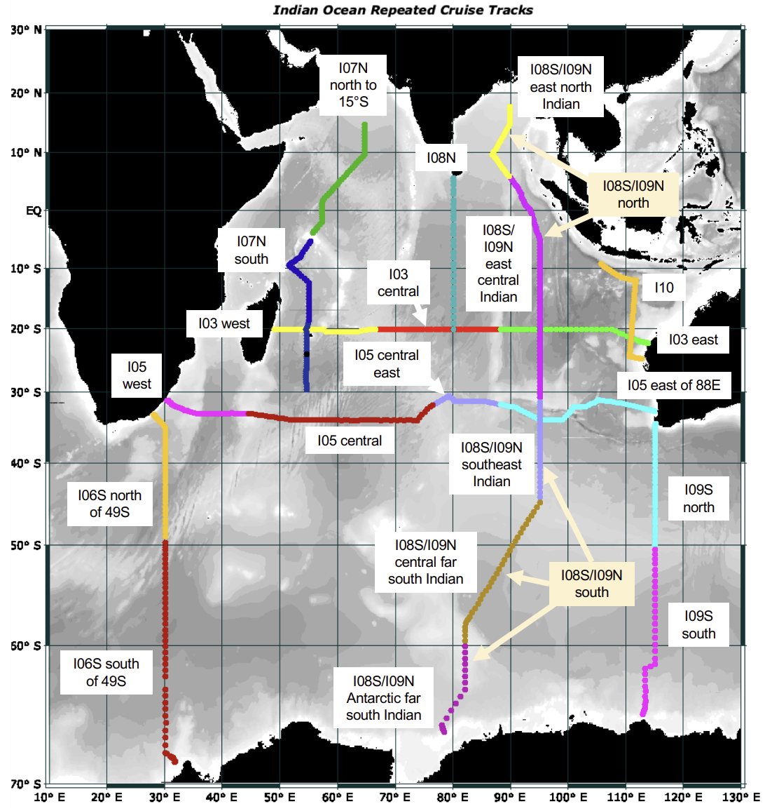{ loading=lazy }
  <figcaption>Java Ocean Atlas, Indian Ocean data</figcaption>
</figure>

### ORSTOM XBT Network

[:octicons-link-external-24: ORSTOM XBT (IRD Brest)](https://www.brest.ird.fr/xbt/xbt_ors2.html)

### Ocean front dataset

Mediterranean Sea and southwest Indian Ocean

[:octicons-book-24: Scientific Data paper](https://www.nature.com/articles/s41597-023-02615-z)

### IOCO Gateway

The Indian Ocean Climatology and Oceanography Gateway

[:octicons-link-external-24: IOCO](http://indianocean.free.fr/index.html)

### Australia (CSIRO)

[:octicons-search-24: CSIRO MarLIN catalog](https://marlin.csiro.au/geonetwork/srv/eng/catalog.search#/search?resultType=csiro&sortBy=changeDate&from=1&to=20) 
[:octicons-link-external-24: CSIRO marine data](https://www.cmar.csiro.au/data/index.cfm)

<figure markdown="span">
  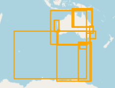{ loading=lazy }
  <figcaption>CSIRO MarLIN</figcaption>
</figure>

