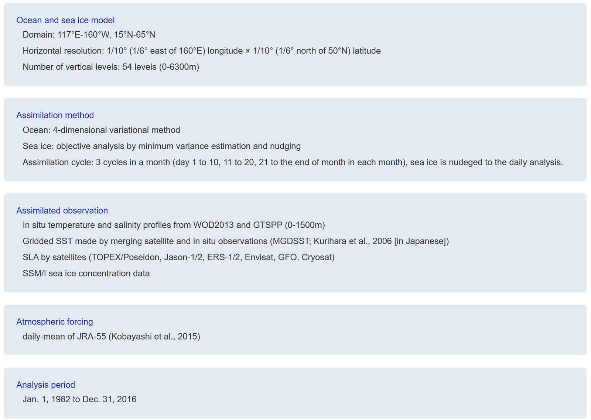

# :material-monitor: JAMSTEC Numerical Model Products [2026.04.02]

Model and reanalysis products distributed by JAMSTEC. For the global and regional models themselves, see also the [Model](../whole-ocean/model.md) page.

### OFES (OGCM for the Earth Simulator)

Quasi-global eddy-resolving simulation; decadal integrations run on the Earth Simulator

[:octicons-link-external-24: JAMSTEC OFES dataset (GODAC)](https://www.godac.jamstec.go.jp/data_catalog/view/metadata?key=JAMSTEC_OFES&lang=en)

??? quote "About OFES"
    OFES (OGCM for the Earth Simulator) and the Earth Simulator enable to perform decadal integrations of eddy resolving ocean simulations in the world ocean.
    The Earth Simulator Center (ESC) and Frontier Research Center for Global Change (FRCGC) in Japan Agency for Marine-Earth Science and Technology (JAMSTEC)
    promote OFES research project and collaborate with several research groups. The outputs from OFES quasi-global eddy-resolving simulation are available.

### ESTOC (Estimated State of Global Ocean for Climate Research)

1°, 36 levels · 4D-Var assimilation window 1991–2006
{ .spec }

4D-VAR ocean data assimilation product based on MOM3

[:octicons-link-external-24: ESTOC](https://www.godac.jamstec.go.jp/estoc/e/) 
[:octicons-link-external-24: Ocean reanalysis products (GODAC)](https://www.godac.jamstec.go.jp/data_catalog/view/metadata?key=OCEAN_REANALYSIS_PRODUCTS&lang=en)

??? quote "About the ESTOC assimilation system"
    Our 4D-VAR data assimilation system is developed by the MEXT K-7 project. The Ocean General Circulation Model is version 3 of the GFDL Modular Ocean Model (MOM3),
    which is equipped with several sophisticated schemes; e.g., the nonlocal K Profile Parameterization (KPP) for mixed layer physics, the Gent and McWilliams (GM) scheme
    for isopycnal mixing, and quicker advection scheme. The horizontal resolution is 1° in both latitude and longitude, with 36 vertical levels spaced from 10 m near the sea
    surface to 400 m at the bottom. The assimilated elements are temperature and salinity from the World Ocean Database 2001 (WOD01), Fleet Numerical Meteorology and
    Oceanography Center (FNMOC) dataset, Reynolds SST, OISST values, and Argo float data from the Coriolis Data Center, and sea-surface dynamic-height anomaly data derived
    from TOPEX/Poseidon altimetry. In addition, the climatologies of the World Ocean Database 1998 (WOD98) were used as background data for regions without observational
    coverage. All observational data were averaged onto 1° by 1° bins and then compiled as series of 10-day means for the surface data and monthly means for the subsurface
    data. The assimilation window is 16 years during 1991-2006.

### JCOPE (Japan Coastal Ocean Predictability Experiment)

JCOPE2M reanalysis and JCOPE-FGO reanalysis; see the JCOPE2M request procedure on the [Model](../whole-ocean/model.md#jcope2m) page

[:octicons-link-external-24: JCOPE consortium](https://www.jamstec.go.jp/jcope/htdocs/e/jcope_consortium.html)

### FORA-WNP30

1982–2016 · eddy-resolving
{ .spec }

Four-dimensional Variational Ocean ReAnalysis for the Western North Pacific over 30 years: the first dataset covering the western North Pacific over the last three decades at eddy-resolving resolution

[:octicons-link-external-24: FORA-WNP30](https://www.godac.jamstec.go.jp/fora/e/) 
[:octicons-book-24: Dataset description](https://www.godac.jamstec.go.jp/fora/e/dataset.html) 
[:octicons-link-external-24: GODAC metadata](https://www.godac.jamstec.go.jp/data_catalog/view/metadata?key=FORA-WNP30&lang=en)

<figure markdown="span">
  { loading=lazy }
  <figcaption>FORA-WNP30</figcaption>
</figure>

### Reanalysis Intercomparison Dataset (RID)

Atmospheric diagnostics computed from 20CRv2, 20CRv2c, 20CRv3, CFSR, CFSv2, ERA-20C, ERA5, ERA5.1, ERA-Interim, JRA-25, JRA-55, JRA-55C, MERRA, MERRA-2, NCEP-DOE (R2), and NCEP-NCAR (R1)

[:octicons-link-external-24: GODAC metadata](https://www.godac.jamstec.go.jp/data_catalog/view/metadata?key=Reanalysis_Intercomparison&lang=en)

??? quote "About RID"
    The reanalysis intercomparison dataset (RID) provides atmospheric diagnostics computed from various reanalysis datasets. The diagnostics are based on geopotential
    height, temperature, winds, and pressure and aim to facilitate the intercomparison of reanalyses for the end user. Most diagnostics are provided as zonal means on
    pressure levels (e.g., temperature, wind, eddy heat and momentum fluxes). Surface data (temperature, pressure), and single-level data (geopotential height at 500 and
    10 hPa) are also provided.

