# :material-database: JODC Data [2026.04.02]

일본 해양자료센터(JODC)가 J-DOSS로 제공하는 자료를 종류별로 정리했습니다.

!!! warning "J-DOSS 점검 안내"
    자료 설명(Description) 링크에서「ただいまメンテナンス中のため、ご覧いただけません。」라는 문구가 보일 때가 있습니다.
    "현재 점검 중이라 열람할 수 없습니다"라는 뜻으로, JODC 서버 측의 일시적인 점검이니 나중에 다시 시도해 주세요.

!!! info "메인 홈페이지"
    [J-DOSS: JODC Data On-line Service System](https://www.jodc.go.jp/jodcweb/JDOSS/index.html)

### 해양 조사 자료 (정점 자료)

Niskin 채수기, CTD, XBT 등으로 수행한 해양 조사의 수온·염분 등

[:octicons-download-24: 자료 다운로드](https://www.jodc.go.jp/vpage/scalar.html) 
[:octicons-book-24: 설명](https://www.jodc.go.jp/jodcweb/JDOSS/infoScalar.html)

??? quote "자료 설명"
    This is the data such as temperature, salinity obtained by the ocean survey using the Niskin bottle, CTD, XBT, etc. Some data at 1 station are divided into each
    measuring equipment while some data are incorporated into the identified station (depends upon the data providers). In addition, about CTD, XBT, etc. there are
    mainly the representative low resolution data with the observation depth and the high-resolution data with 5m or less and 20 layers or more with vertical density
    but as to the same observation, where data with different resolution is submitted, please note as they are treated as a separate station.

<figure markdown="span">
  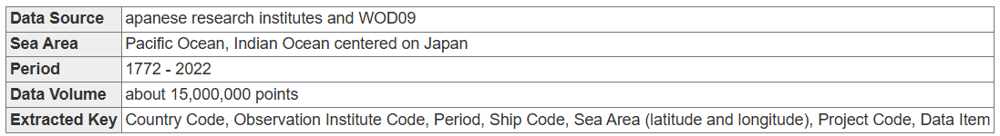{ loading=lazy }
  <figcaption>해양 조사 자료 검색</figcaption>
</figure>

<figure markdown="span">
  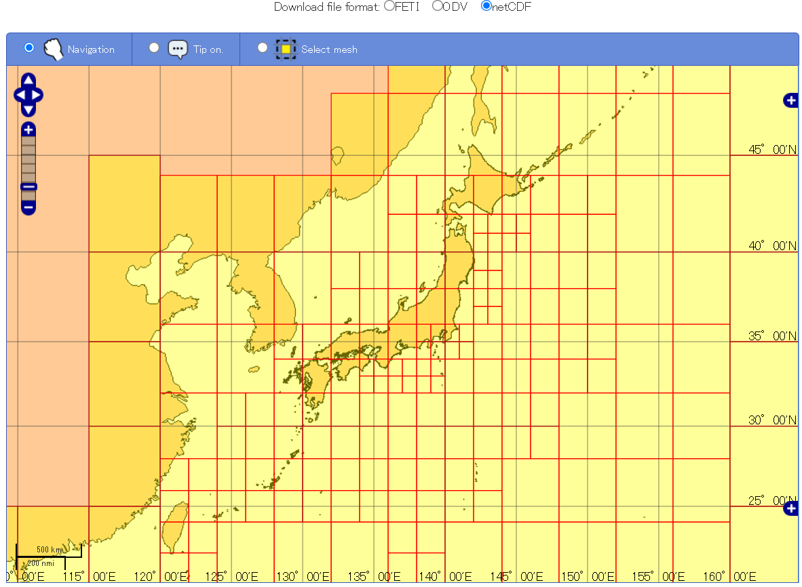{ loading=lazy }
  <figcaption>해양 조사 자료 검색</figcaption>
</figure>

### 항주 연속 관측 자료

2008~2023
{ .spec }

항해 중 연속 측정한 수온, 전기전도도 등. 선박 이동에 따라 위치가 바뀌고 측정 간격도 선박마다 다릅니다(1분, 5분 등). 연도별로 관측 자료를 검색하는 방식입니다.

[:octicons-download-24: 자료 다운로드](https://www.jodc.go.jp/vpage/ocean.html)

<figure markdown="span">
  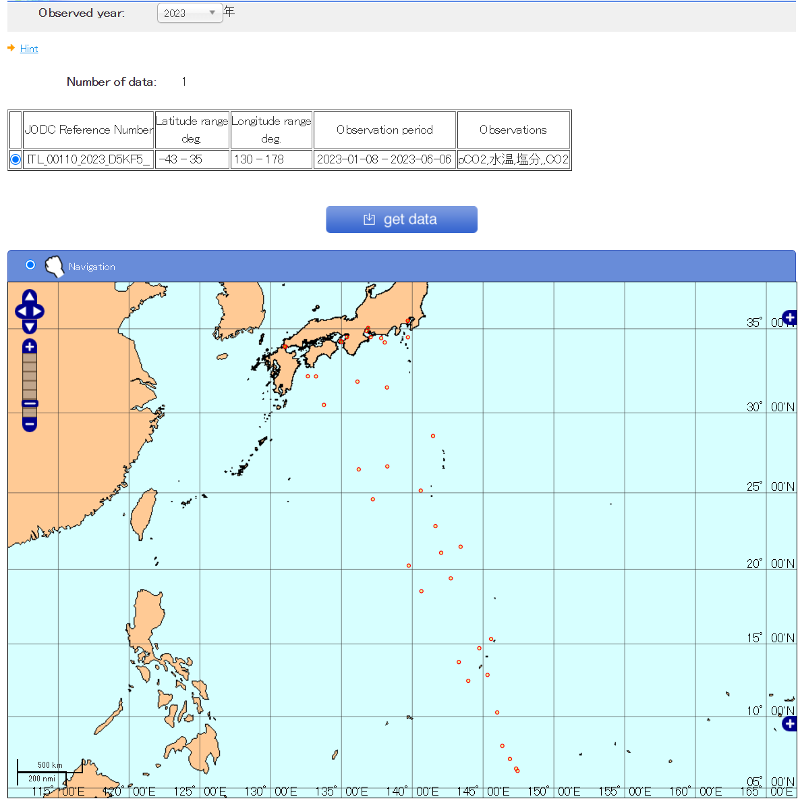{ loading=lazy }
  <figcaption>연도별로 검색하는 항주 연속 관측 자료</figcaption>
</figure>

### 계류 관측 자료

1940~2016 · 4232개 지점 · 일본 주변 해역
{ .spec }

며칠에서 수년간 계류한 유속계의 유향·유속, 수온, 전기전도도. 동해(Japan Sea)와 태평양 수천 m 깊이의 Aanderaa 유속계 자료 포함

[:octicons-download-24: 자료 다운로드](https://www.jodc.go.jp/vpage/moor.html)

<figure markdown="span">
  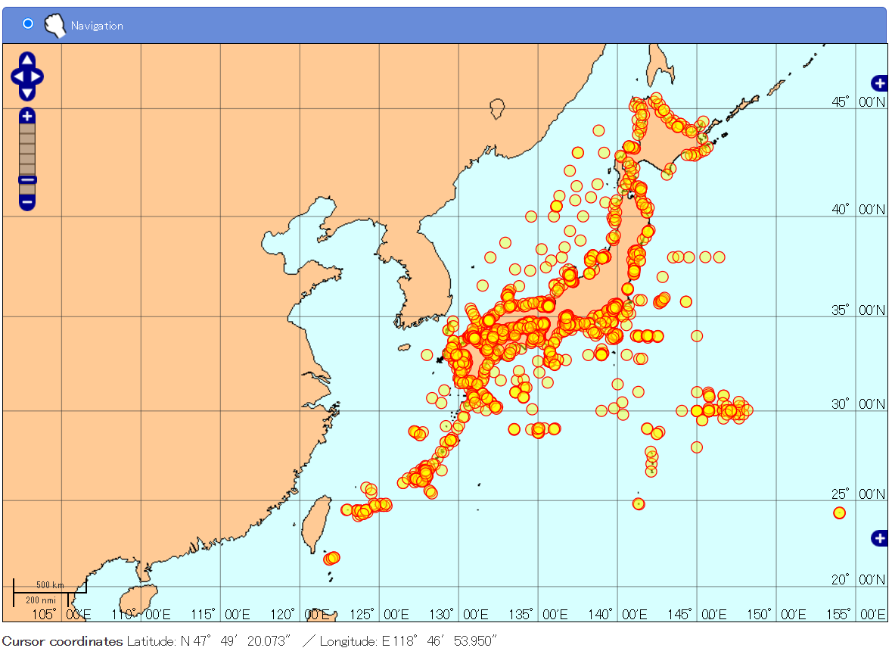{ loading=lazy }
  <figcaption>계류 관측 자료</figcaption>
</figure>

### 해류 자료

선박 표류, GEK·ADCP 관측, ARGOS 표층 부이 이동으로 얻은 해류 자료. 수온·염분은 ADCP 관측 시 취수한 해수의 값입니다.

[:octicons-download-24: 자료 다운로드](https://www.jodc.go.jp/vpage/vector.html)

<figure markdown="span">
  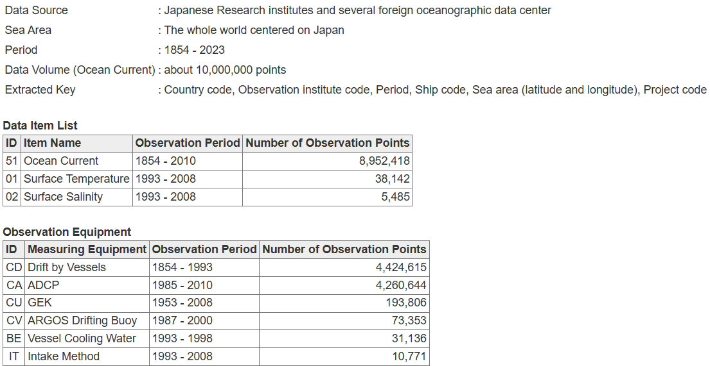{ loading=lazy }
  <figcaption>해류 자료 (2024.11.26 조회)</figcaption>
</figure>

<figure markdown="span">
  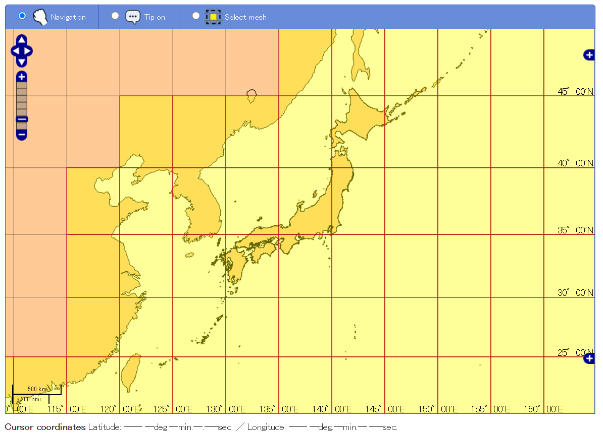{ loading=lazy }
  <figcaption>해류 자료</figcaption>
</figure>

### 연안 해상기상 자료

1974~2022 · 132개 지점 · 일본 연안
{ .spec }

일본 해상보안청의 등대, 해상교통센터, 신호소, 레이더 시설 등에서 관측한 날씨, 기압, 풍향·풍속, 풍랑 계급, 파고, 너울 계급, 시정. 지점마다 관측 기간이 다르고 장비 수리로 결측 기간이 있습니다.
실시간 해상기상 정보는 [MICS (Marine Information and Communication System)](http://www6.kaiho.mlit.go.jp/kisyou_en.html)를 참고하세요.

[:octicons-download-24: 자료 다운로드](https://www.jodc.go.jp/vpage/wave.html)

<figure markdown="span">
  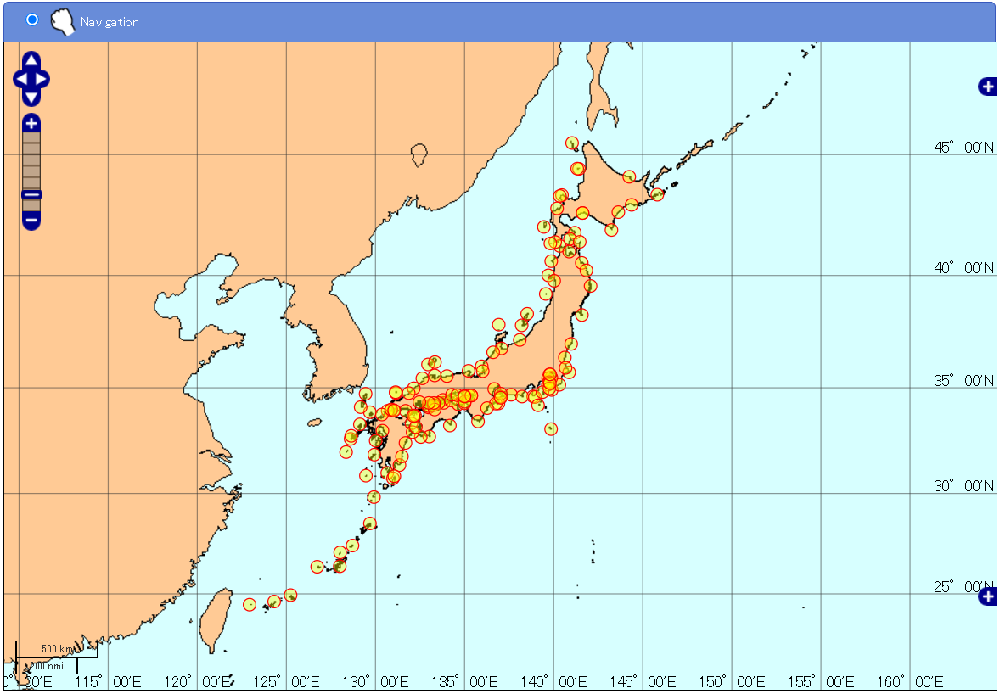{ loading=lazy }
  <figcaption>연안 해상기상 자료</figcaption>
</figure>

### 정점 수온 자료

[:octicons-download-24: 자료 다운로드](https://www.jodc.go.jp/vpage/coastal.html) 
[:octicons-book-24: 설명](https://www.jodc.go.jp/jodcweb/JDOSS/infoCoastalTemp.html)

<figure markdown="span">
  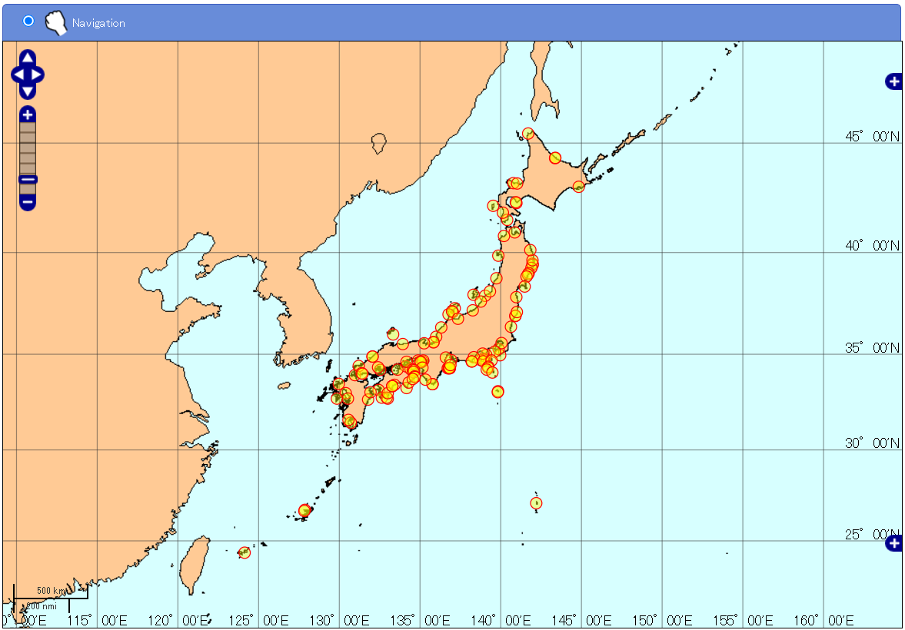{ loading=lazy }
  <figcaption>정점 수온 자료</figcaption>
</figure>

### 해양 생물 (플랑크톤) 관측 자료

1951~2006 · 48,659개 정점 · 주로 일본 주변 해역
{ .spec }

환경성, 수산청, 기상청, 지자체 등이 관측한 플랑크톤 자료를 JODC 포맷으로 정리. 생물 종은 "JODC marine organism code (plankton) 2001 Edition" 코드로 기록되며, [Marine Organism (Plankton) Classification Code](https://jdoss1.jodc.go.jp/vpage/taxonomic.html)로 학명을 확인할 수 있습니다.

[:octicons-download-24: 자료 다운로드](https://www.jodc.go.jp/vpage/organism.html)

<figure markdown="span">
  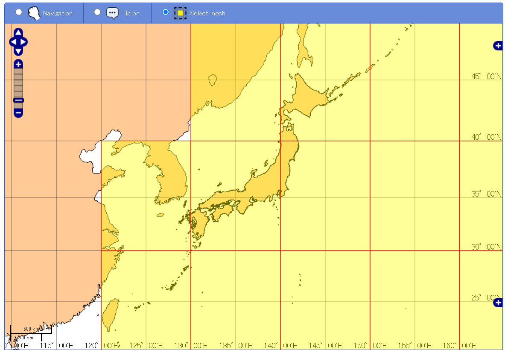{ loading=lazy }
  <figcaption>해양 생물 관측 자료</figcaption>
</figure>

### 조위 (시간별 조위) 자료

일본 해상보안청, 기상청, 국토지리원, 항만 당국의 조위관측소 시간별 조위 자료

[:octicons-download-24: 자료 다운로드](https://www.jodc.go.jp/vpage/tide.html)

<figure markdown="span">
  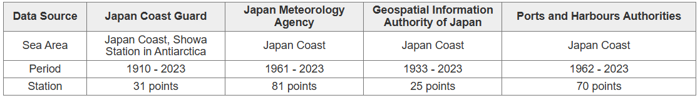{ loading=lazy }
  <figcaption>조위 자료 (2024.11.26 조회)</figcaption>
</figure>

<figure markdown="span">
  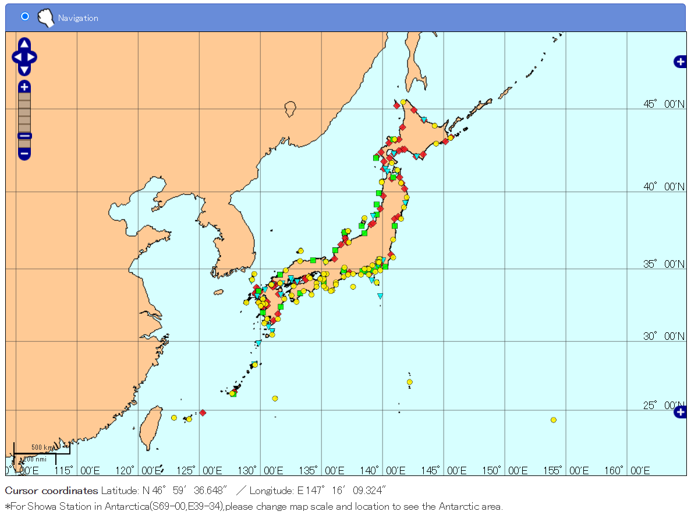{ loading=lazy }
  <figcaption>조위 자료</figcaption>
</figure>

### 500 m 격자 수심 (JEGG)

[:octicons-download-24: 자료 다운로드](https://www.jodc.go.jp/vpage/depth500_file.html) 
[:octicons-book-24: 설명](https://www.jodc.go.jp/jodcweb/JDOSS/infoJEGG.html)

<figure markdown="span">
  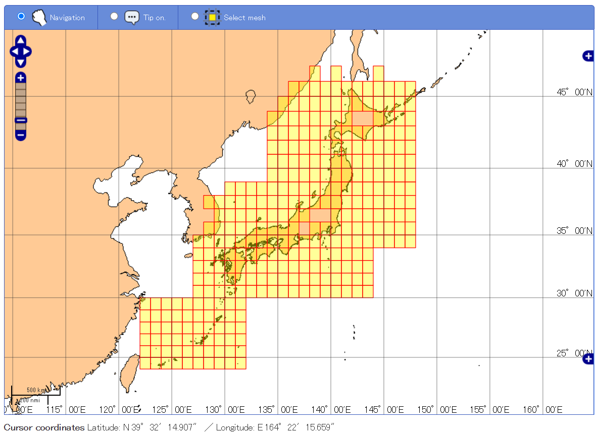{ loading=lazy }
  <figcaption>500 m 격자 수심</figcaption>
</figure>

<figure markdown="span">
  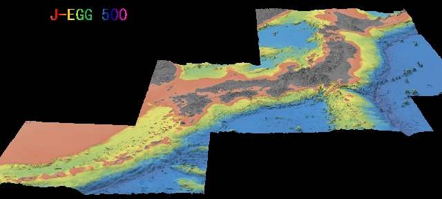{ loading=lazy }
  <figcaption>500 m 격자 수심</figcaption>
</figure>

