# :material-database: JODC Data [2026.04.02]

Datasets served by the Japan Oceanographic Data Center through J-DOSS, by data type.

!!! info "Main homepage"
    [J-DOSS: JODC Data On-line Service System](https://www.jodc.go.jp/jodcweb/JDOSS/index.html)

### Ocean survey data (station data)

Temperature, salinity, and other variables from ocean surveys using Niskin bottles, CTD, XBT, and similar instruments

[:octicons-download-24: Data download](https://www.jodc.go.jp/vpage/scalar.html) 
[:octicons-book-24: Description](https://www.jodc.go.jp/jodcweb/JDOSS/infoScalar.html)

??? quote "About this dataset"
    This is the data such as temperature, salinity obtained by the ocean survey using the Niskin bottle, CTD, XBT, etc. Some data at 1 station are divided into each
    measuring equipment while some data are incorporated into the identified station (depends upon the data providers). In addition, about CTD, XBT, etc. there are
    mainly the representative low resolution data with the observation depth and the high-resolution data with 5m or less and 20 layers or more with vertical density
    but as to the same observation, where data with different resolution is submitted, please note as they are treated as a separate station.

<figure markdown="span">
  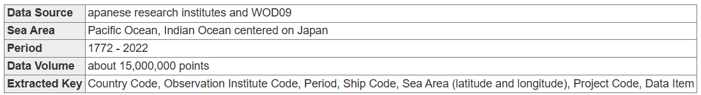{ loading=lazy }
  <figcaption>Ocean survey data search</figcaption>
</figure>

<figure markdown="span">
  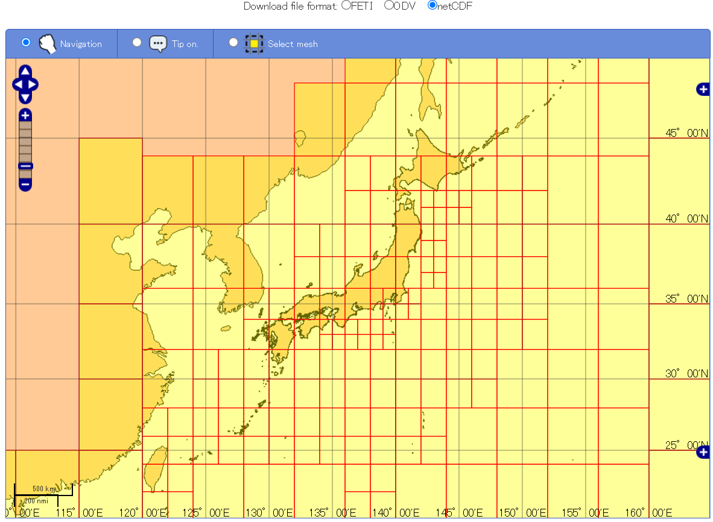{ loading=lazy }
  <figcaption>Ocean survey data search</figcaption>
</figure>

### Continuously measured ocean data (underway)

2008–2023
{ .spec }

Water temperature, conductivity, and other variables measured continuously while the ship is under way. Positions change with the ship and the sampling interval varies by vessel (1 min, 5 min, ...). Searched by year.

[:octicons-download-24: Data download](https://www.jodc.go.jp/vpage/ocean.html)

<figure markdown="span">
  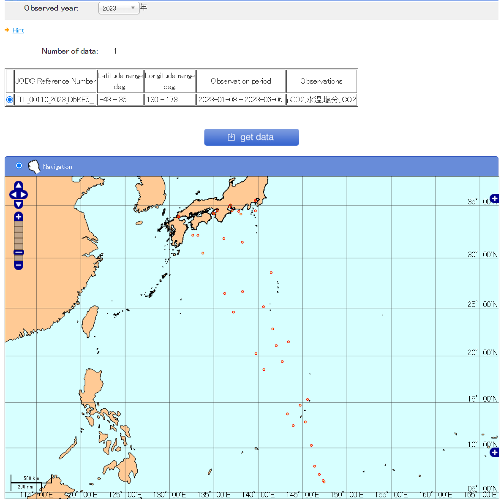{ loading=lazy }
  <figcaption>Continuously measured ocean data, searched by year</figcaption>
</figure>

### Mooring observation data

1940–2016 · 4232 points · Japan surrounding waters
{ .spec }

Current direction and speed, temperature, and conductivity from current meters deployed for a few days to several years, including Aanderaa meters at several thousand metres depth in the Japan Sea and the Pacific

[:octicons-download-24: Data download](https://www.jodc.go.jp/vpage/moor.html)

<figure markdown="span">
  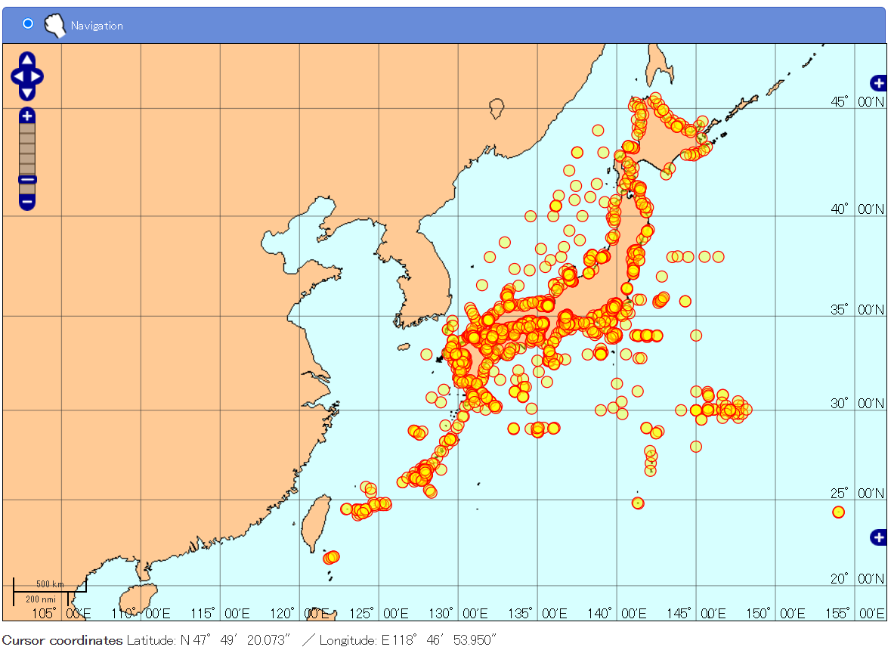{ loading=lazy }
  <figcaption>Mooring observation data</figcaption>
</figure>

### Ocean current data

Currents from ship drift, GEK and ADCP observations, and ARGOS surface buoy displacement. Temperature and salinity are from intake water sampled during ADCP observations.

[:octicons-download-24: Data download](https://www.jodc.go.jp/vpage/vector.html)

<figure markdown="span">
  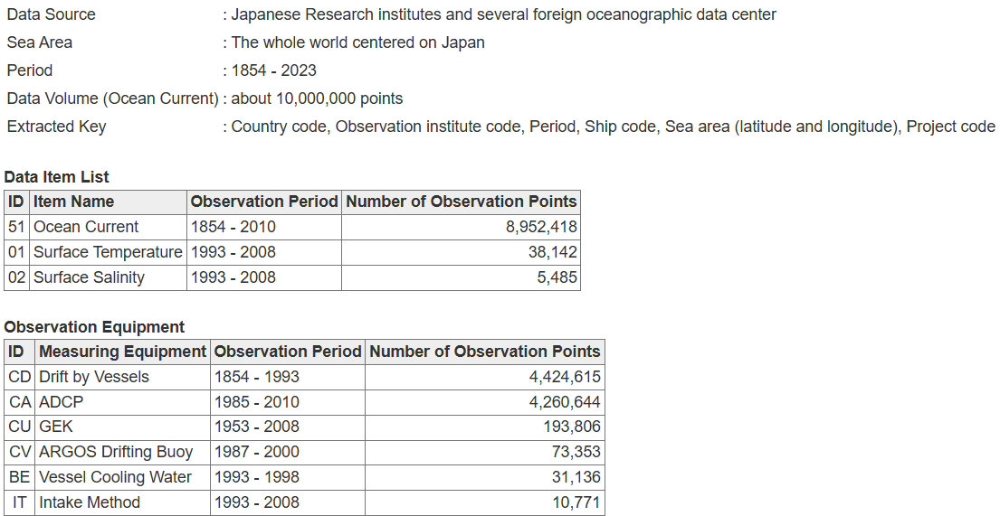{ loading=lazy }
  <figcaption>Ocean current data (retrieved 2024.11.26)</figcaption>
</figure>

<figure markdown="span">
  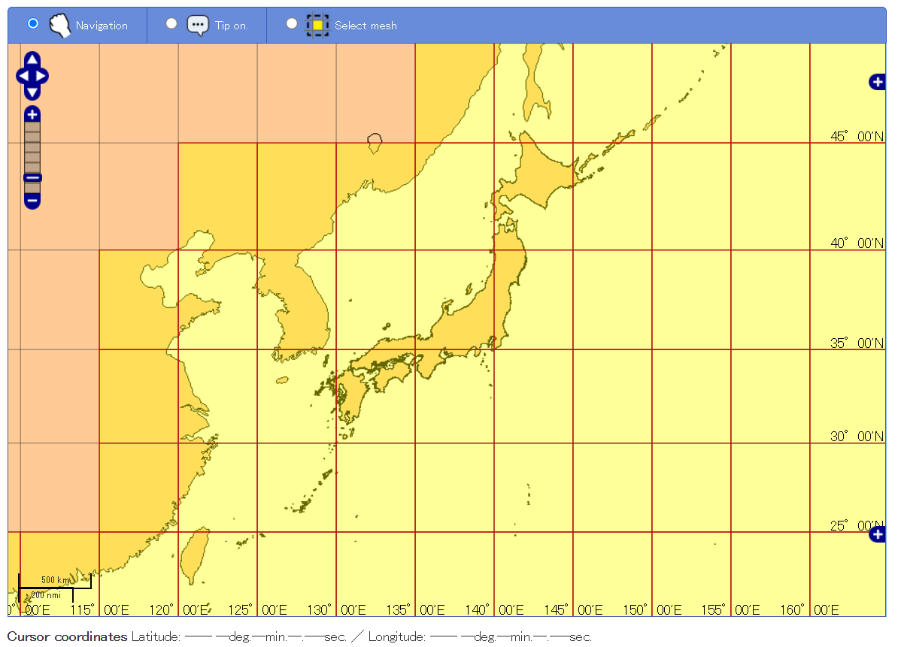{ loading=lazy }
  <figcaption>Ocean current data</figcaption>
</figure>

### Coastal maritime meteorology data

1974–2022 · 132 points · Japan coast
{ .spec }

Weather, pressure, wind, wind wave class, wave height, swell class, and visibility observed at lighthouses, marine traffic centers, signal stations, and radar facilities of the Japan Coast Guard. Observation periods vary by station, with gaps during equipment repairs.
For real-time maritime meteorology see [MICS (Marine Information and Communication System)](http://www6.kaiho.mlit.go.jp/kisyou_en.html).

[:octicons-download-24: Data download](https://www.jodc.go.jp/vpage/wave.html)

<figure markdown="span">
  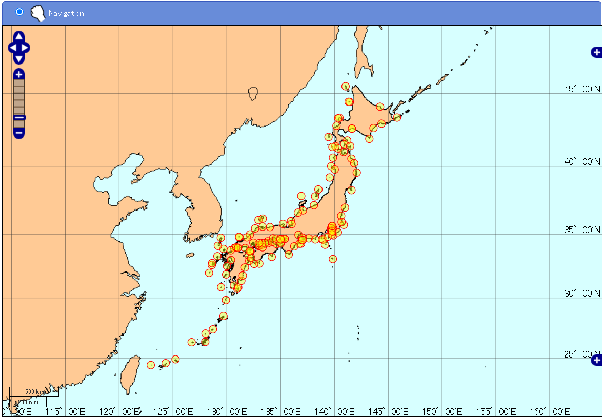{ loading=lazy }
  <figcaption>Coastal maritime meteorology data</figcaption>
</figure>

### Fixed station temperature data

[:octicons-download-24: Data download](https://www.jodc.go.jp/vpage/coastal.html) 
[:octicons-book-24: Description](https://www.jodc.go.jp/jodcweb/JDOSS/infoCoastalTemp.html)

<figure markdown="span">
  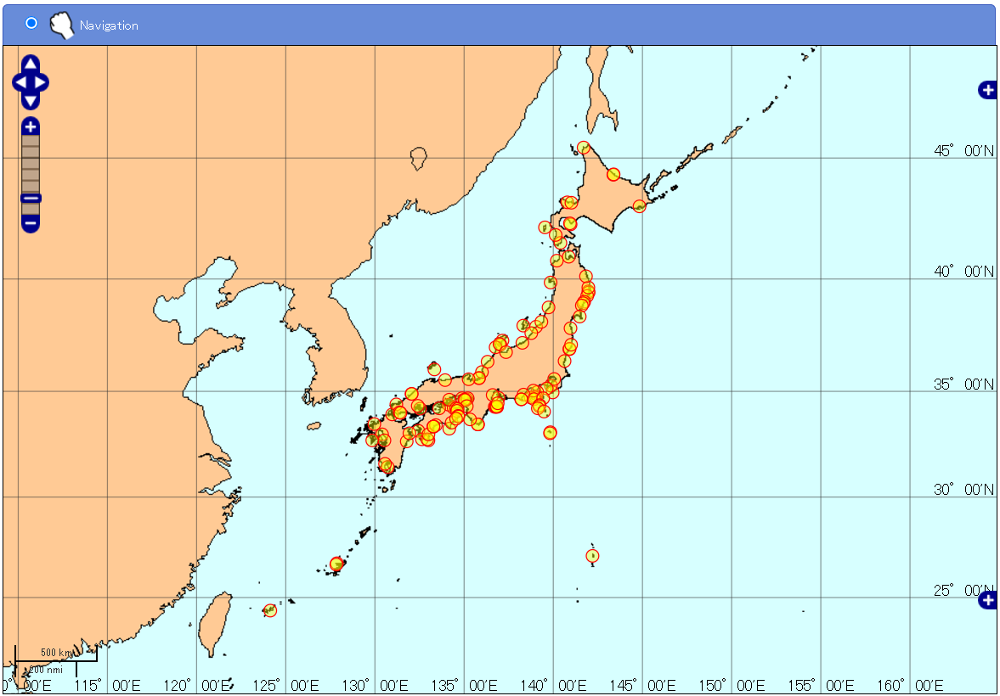{ loading=lazy }
  <figcaption>Fixed station temperature data</figcaption>
</figure>

### Marine organism (plankton) observation data

1951–2006 · 48,659 stations · mainly seas around Japan
{ .spec }

Plankton data from the Ministry of the Environment, the Fisheries Agency, JMA, local governments, and others, in JODC format. Species are coded by the "JODC marine organism code (plankton) 2001 Edition"; use the [Marine Organism (Plankton) Classification Code](https://jdoss1.jodc.go.jp/vpage/taxonomic.html) to look up names.

[:octicons-download-24: Data download](https://www.jodc.go.jp/vpage/organism.html)

<figure markdown="span">
  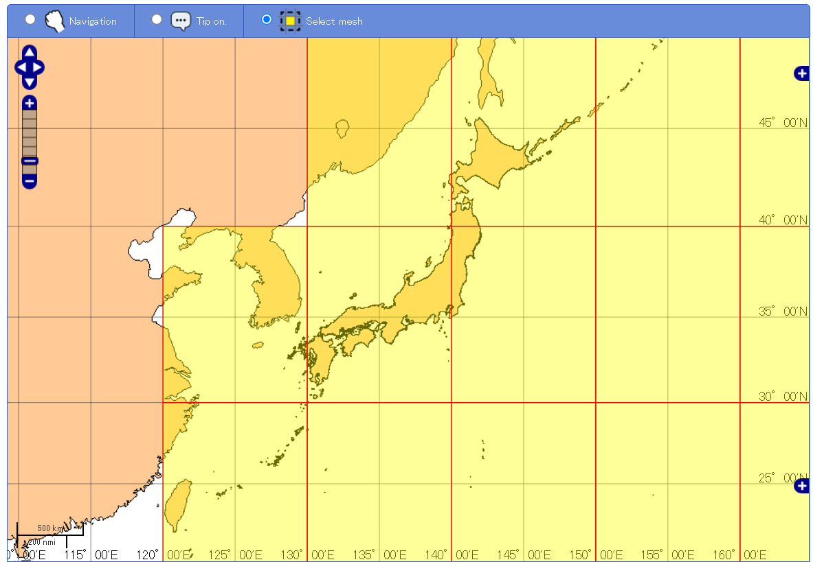{ loading=lazy }
  <figcaption>Marine organism observation data</figcaption>
</figure>

### Tide (hourly tidal height) data

Hourly tidal height from tide stations of the Japan Coast Guard, JMA, the Geospatial Information Authority of Japan, and port and harbor authorities

[:octicons-download-24: Data download](https://www.jodc.go.jp/vpage/tide.html)

<figure markdown="span">
  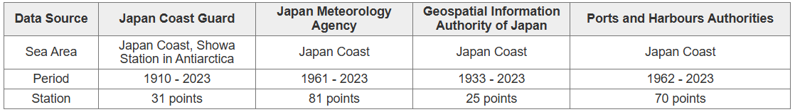{ loading=lazy }
  <figcaption>Tide data (retrieved 2024.11.26)</figcaption>
</figure>

<figure markdown="span">
  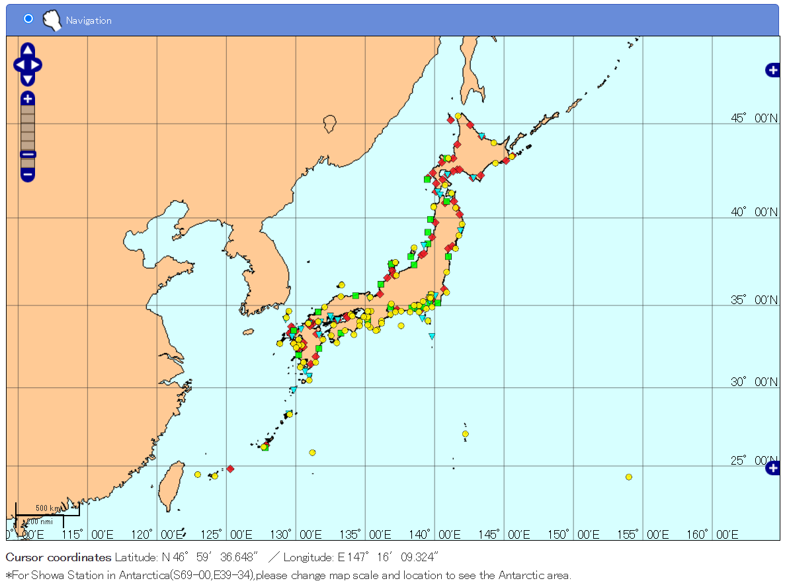{ loading=lazy }
  <figcaption>Tide data</figcaption>
</figure>

### 500 m gridded bathymetry (JEGG)

[:octicons-download-24: Data download](https://www.jodc.go.jp/vpage/depth500_file.html) 
[:octicons-book-24: Description](https://www.jodc.go.jp/jodcweb/JDOSS/infoJEGG.html)

<figure markdown="span">
  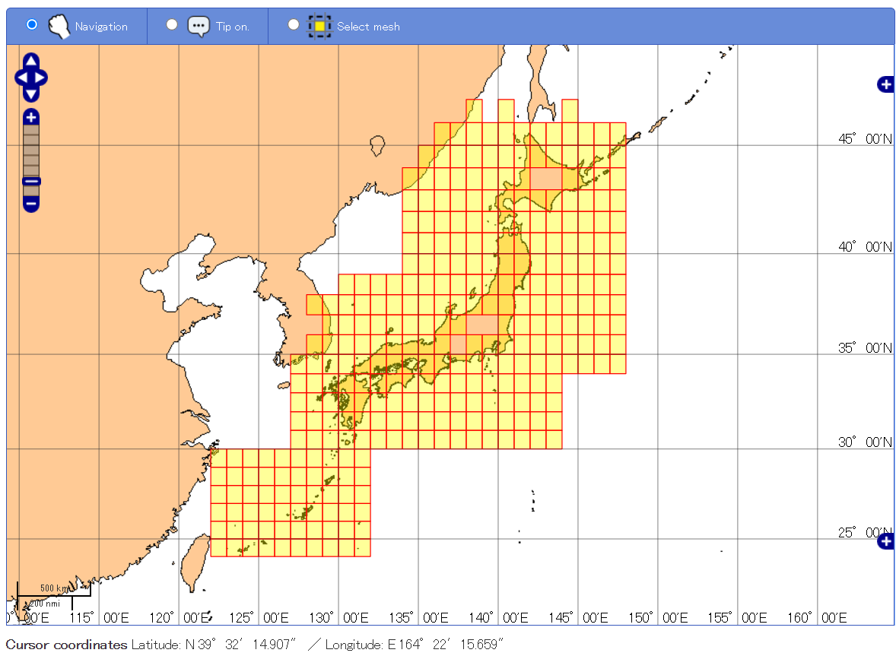{ loading=lazy }
  <figcaption>500 m gridded bathymetry</figcaption>
</figure>

<figure markdown="span">
  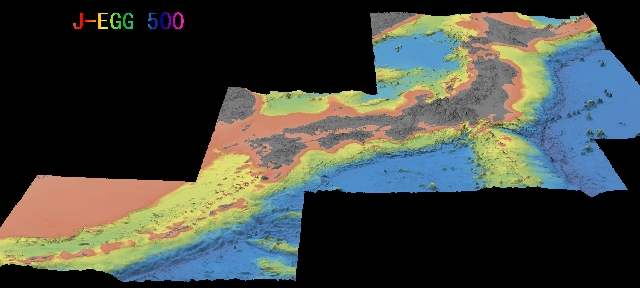{ loading=lazy }
  <figcaption>500 m gridded bathymetry</figcaption>
</figure>

