# :material-map-marker-radius: Japan Oceanographic Database [2025.03.03]

일본 기관(JMA, JODC, JAMSTEC, FRA 등)이 제공하는 관측·모델 자료입니다.

## 수치 모형

### DREAMS (RIAMOM)

규슈대학 RIAM에서 운영하는 수치 모형

[:octicons-link-external-24: DREAMS at RIAM](https://dreams-c1.riam.kyushu-u.ac.jp/vwp/index.html)

<figure markdown="span">
  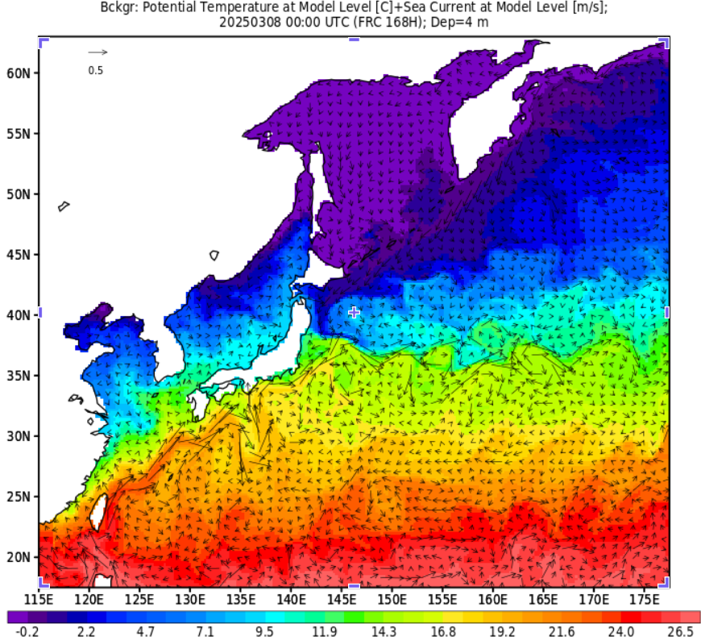{ loading=lazy }
  <figcaption>DREAMS at RIAM</figcaption>
</figure>

### JAMSTEC 수치 모형 산출물

OFES, ESTOC, JCOPE, FORA-WNP30, Reanalysis Intercomparison Dataset

[:octicons-arrow-right-24: 상세 보기](japan-jamstec-models.md)

### JRA-3Q

Japanese Reanalysis for Three Quarters of a Century (JMA)

[:octicons-link-external-24: JRA-3Q](https://jra.kishou.go.jp/JRA-3Q/index_en.html#REANALYSIS)

## JODC (Japan Oceanographic Data Center)

### JODC data

해양 조사 자료, 항주 연속 관측, 계류, 해류, 연안 해상기상, 정점 수온, 플랑크톤, 조위, 500 m 격자 수심

[:octicons-arrow-right-24: JODC 자료 종류별 정리](japan-jodc.md) 
[:octicons-link-external-24: J-DOSS (JODC Data On-line Service System)](https://www.jodc.go.jp/jodcweb/JDOSS/index.html)

<figure markdown="span">
  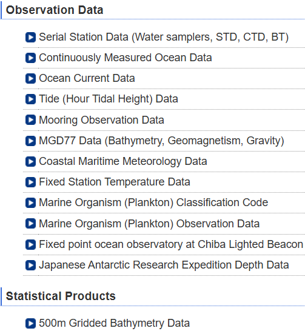{ loading=lazy }
  <figcaption>J-DOSS</figcaption>
</figure>

## JMA (Japan Meteorological Agency)

[:octicons-link-external-24: JMA (English)](https://www.jma.go.jp/jma/en/menu.html) ·
[:octicons-link-external-24: JMA 선박 관측 자료](https://www.data.jma.go.jp/kaiyou/db/vessel_obs/data-report/html/ship/ship.html)

### 연구선 관측 자료

1997~2023
{ .spec }

Oceanographic and Marine Meteorological Observations by Research Vessels. txt 등의 형식으로 제공되며, 관측 방식마다 포맷이 정해져 있으니 사이트에서 원하는 포맷을 찾아 참조하세요.

[:octicons-download-24: JMA 연구선 자료](https://www.data.jma.go.jp/kaiyou/db/vessel_obs/data-report/html/ship/ship_e.php)

[:octicons-file-24: 포맷 예시: JMA subsurface current 자료 (PDF)](../assets/files/regional/japan/JMA_subsurface_current_format.pdf)

<figure markdown="span">
  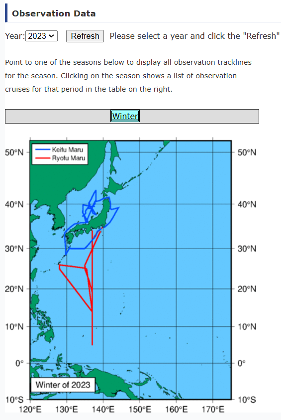{ loading=lazy }
  <figcaption>JMA 연구선 관측</figcaption>
</figure>

### 137°E 자오선 단면 시계열

Oceanographic Section Time-series Dataset for the 137°E Meridian

[:octicons-download-24: JMA 137°E dataset](https://www.data.jma.go.jp/gmd/kaiyou/db/mar_env/results/OI/137E_OI.html#data)

<figure markdown="span">
  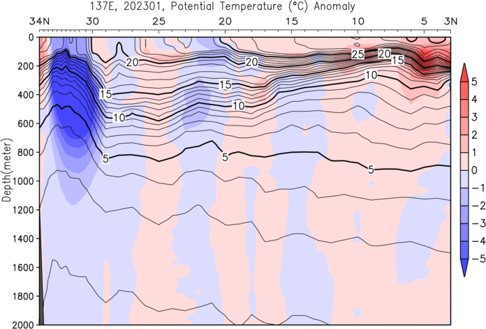{ loading=lazy }
  <figcaption>137°E 반복 관측선</figcaption>
</figure>

<figure markdown="span">
  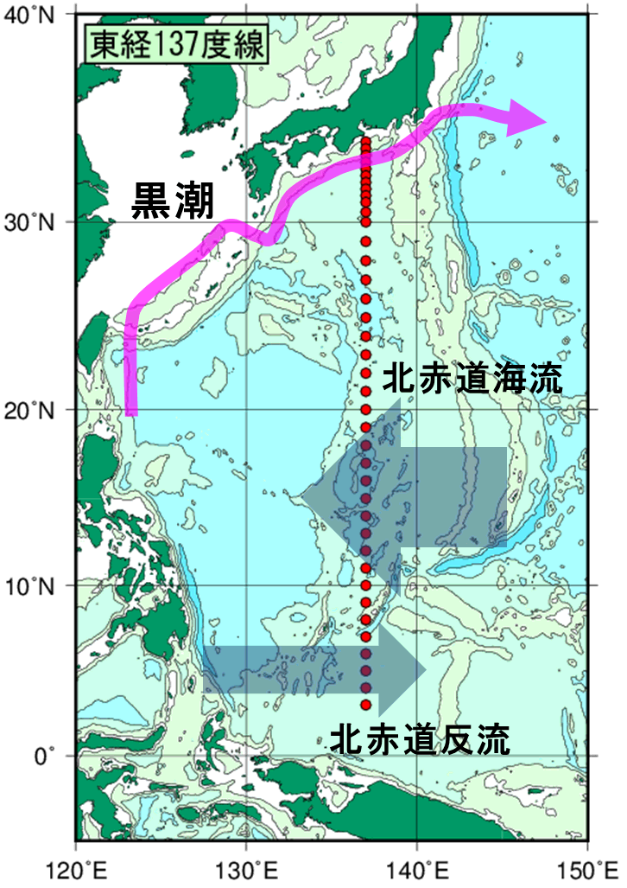{ loading=lazy }
  <figcaption>137°E 단면 자료</figcaption>
</figure>

### 해양 부이 관측

[:octicons-download-24: JMA 부이 자료](https://www.data.jma.go.jp/kaiyou/db/vessel_obs/data-report/html/buoy/buoy_e.php)

<figure markdown="span">
  { loading=lazy }
  <figcaption>JMA 해양 부이</figcaption>
</figure>

### 기상위성센터 (Meteorological Satellite Center)

[:octicons-link-external-24: JMA MSC](https://www.data.jma.go.jp/mscweb/en/index.html) 
[:octicons-link-external-24: JMA 위성](https://www.jma.go.jp/jma/jma-eng/satellite/index.html)

### State of the ocean climate

[:octicons-link-external-24: State of the ocean climate index](https://www.data.jma.go.jp/gmd/kaiyou/english/state_of_ocean_climate_index.html)

- [Sea surface temperature (global)](https://www.data.jma.go.jp/gmd/kaiyou/english/long_term_sst_global/glb_warm_e.html)
- [Sea surface temperature (around Japan)](https://www.data.jma.go.jp/gmd/kaiyou/english/long_term_sst_japan/sea_surface_temperature_around_japan.html)
- [Global ocean heat content](https://www.data.jma.go.jp/gmd/kaiyou/english/ohc/ohc_global_en.html)
- [Sea level (around Japan)](https://www.data.jma.go.jp/gmd/kaiyou/english/sl_trend/sea_level_around_japan.html)
- [Sea ice in the Arctic and Antarctic areas](https://www.data.jma.go.jp/gmd/kaiyou/english/seaice_global/series_global_e.html)
- [Sea ice in the Sea of Okhotsk](https://www.data.jma.go.jp/gmd/kaiyou/english/seaice_okhotsk/series_okhotsk_e.html)

## JAMSTEC

[:octicons-search-24: JAMSTEC 자료 검색 포털](https://www.jamstec.go.jp/e/database/) ·
[:octicons-search-24: GODAC 자료 카탈로그](https://www.godac.jamstec.go.jp/data_catalog/view/base?lang=en)

### 연구선 관측 데이터베이스

[:octicons-link-external-24: Cruise database (AORI, 도쿄대)](https://opensci.aori.u-tokyo.ac.jp/cruise-en.html)

### Subsurface ADCP mooring (TOCS)

서태평양과 동인도양의 ADCP 계류. hourly mean, 10 m bin

[:octicons-download-24: JAMSTEC ADCP 자료](https://www.jamstec.go.jp/ipobs/adcp/adcp_data.html) 
[:octicons-link-external-24: NASA Earthdata 등록 정보](https://access.earthdata.nasa.gov/collections/C1617571129-SCIOPS)

<figure markdown="span">
  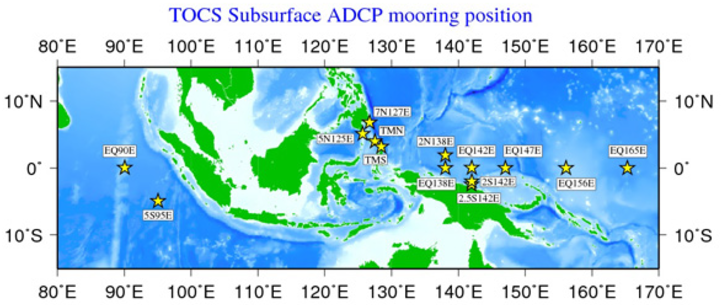{ loading=lazy }
  <figcaption>JAMSTEC subsurface ADCP 계류 지점</figcaption>
</figure>

??? info "TOCS ADCP mooring 상세"
    As the "TOCS (Tropical Ocean Climate Study)" project in JAMSTEC, variability of long-term surface and subsurface ocean current
    have been observed by the ADCP (Acoustic Doppler Current Profiler) mooring system in the western Pacific Ocean and in the eastern
    Indian Ocean. The ADCP used in this project is the RDI 150 kHz Broad-Band type for the western Pacific Ocean area, and the RDI 75 kHz
    Work Horse type for the eastern Indian Ocean area. After removing electric noise, the data were processed to the hourly mean and
    10 meters depth bin.

### 계류 관측 카탈로그

관측 자료가 있다는 여부까지는 확인할 수 있지만, 자료 제공은 확인되지 않았습니다.

[:octicons-link-external-24: GODAC 계류 카탈로그](https://www.godac.jamstec.go.jp/misce_obs/view/base?lang=en)

<figure markdown="span">
  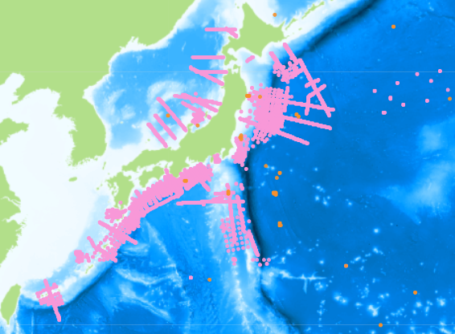{ loading=lazy }
  <figcaption>GODAC 계류 관측 카탈로그</figcaption>
</figure>

### TRITON

TAO/TRITON array 중 일본이 TRITON을 담당합니다.

[:octicons-link-external-24: TRITON 실시간 표출](https://www.jamstec.go.jp/jamstec/TRITON/real_time/display/) 
[:octicons-download-24: TAO/TRITON Data Display and Delivery (PMEL)](https://www.pmel.noaa.gov/tao/drupal/disdel/)

<figure markdown="span">
  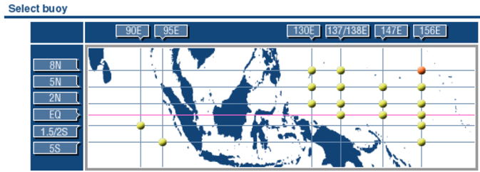{ loading=lazy }
  <figcaption>TRITON 실시간 표출 화면</figcaption>
</figure>

<figure markdown="span">
  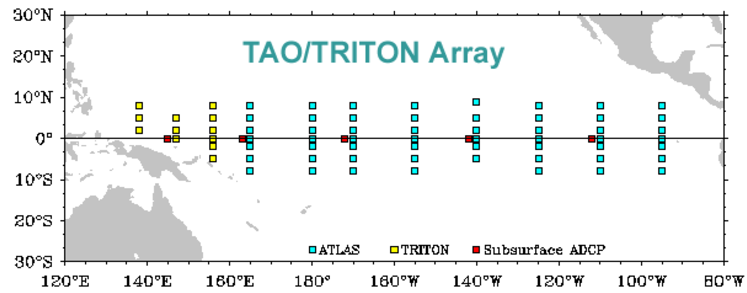{ loading=lazy }
  <figcaption>TAO/TRITON array 지도</figcaption>
</figure>

### 해양 음향 토모그래피

1997~2001
{ .spec }

Kuroshio Extension과 중앙 적도 태평양의 해양 음향 토모그래피 실험. 자료 이용은 [dmo@jamstec.go.jp](mailto:dmo@jamstec.go.jp)로 문의하세요.

[:octicons-link-external-24: GODAC metadata](https://www.godac.jamstec.go.jp/data_catalog/view/metadata?key=ACOUSTIC_TOMOGRAPHY&lang=en)

[:octicons-file-24: 설명 문서 압축 파일 (zip, 관측 자료는 포함되지 않음)](../assets/files/regional/japan/JAMSTEC_ACOUSTIC_TOMOGRAPHY.zip)

<figure markdown="span">
  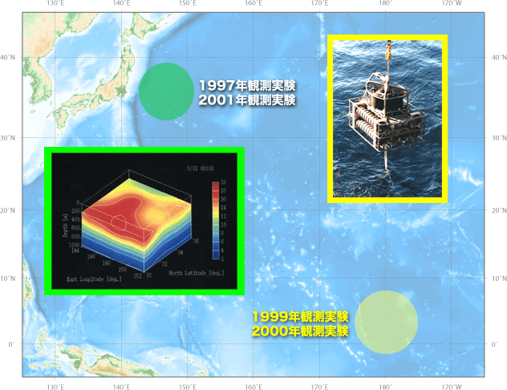{ loading=lazy }
  <figcaption>음향 토모그래피 실험 해역</figcaption>
</figure>

<figure markdown="span">
  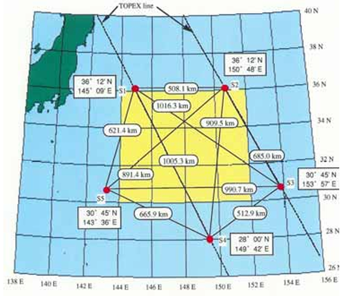{ loading=lazy }
  <figcaption>음향 토모그래피 metadata 페이지</figcaption>
</figure>

??? info "음향 토모그래피 자료 상세"
    JAMSTEC conducted ocean acoustic tomography experiments from 1997 to 2001 in the Kuroshio Extension region and central equatorial Pacific.
    For details, refer to `/ACOUSTIC_TOMOGRAPHY/index.html` (Japanese only) after extracting `ACOUSTIC_TOMOGRAPHY.zip`.
    The zip file contains no observation data. **If you wish to use the data, please contact [dmo@jamstec.go.jp](mailto:dmo@jamstec.go.jp).**

### 오키노토리시마 관측

1993~
{ .spec }

오키노토리시마의 기상·해양 관측 자료. 매년 4월경 최신 자료가 추가됩니다.

[:octicons-link-external-24: JAMSTEC Okinotorishima](https://www.jamstec.go.jp/j/database/okitori/index.html) 
[:octicons-link-external-24: GODAC metadata](https://www.godac.jamstec.go.jp/data_catalog/view/metadata?key=Okinotorishima_WebPage&lang=en)

<figure markdown="span">
  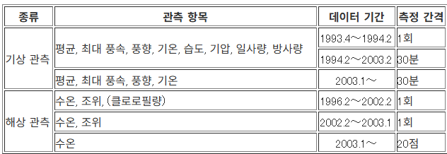{ loading=lazy }
  <figcaption>오키노토리시마 관측</figcaption>
</figure>

<figure markdown="span">
  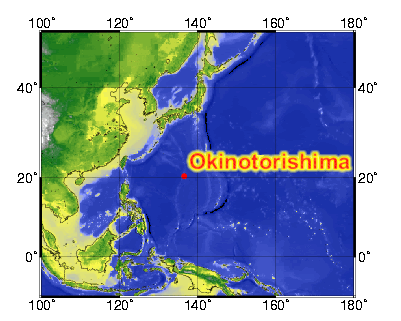{ loading=lazy }
  <figcaption>오키노토리시마 관측</figcaption>
</figure>

### 시계열 정점 K2, S1

K2: 47°N, 160°E (서부 아한대 순환), S1: 30°N, 145°E (아열대 순환). 2010년부터 R/V Mirai로 비교 시계열 관측

[:octicons-link-external-24: K2/S1 database](https://www.jamstec.go.jp/k2s1/en/index.html) 
[:octicons-link-external-24: GODAC metadata (KNOT K2)](https://www.godac.jamstec.go.jp/data_catalog/view/metadata?key=JAMSTEC_KNOT_K2&lang=en)

<figure markdown="span">
  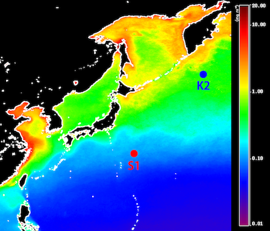{ loading=lazy }
  <figcaption>시계열 정점 K2, S1</figcaption>
</figure>

### 쓰가루 해협 선박 시계열

쓰가루 해협 횡단 CTD와 채수 (염분, DO, 영양염, DIC, TA, 18O, Chl-a). CTD 자료는 홋카이도대학, 채수 자료는 JAMSTEC 소유

[:octicons-link-external-24: GODAC metadata](https://www.godac.jamstec.go.jp/data_catalog/view/metadata?key=Tsugaru_Strait_Ship-based_Data&lang=en)

<figure markdown="span">
  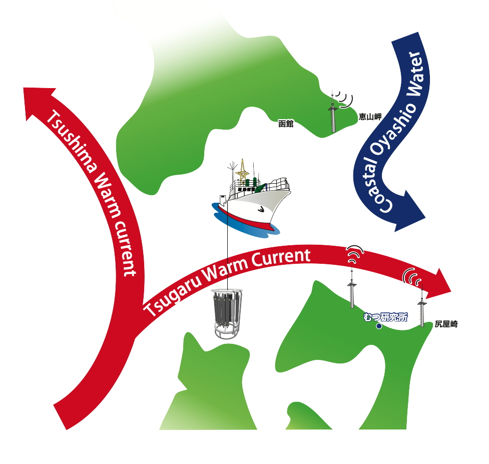{ loading=lazy }
  <figcaption>쓰가루 해협 관측선</figcaption>
</figure>

### MORSETS

2014.04~
{ .spec }

MIO Ocean Radar data Site for Eastern Tsugaru Strait. 준실시간 표층 해류도와 아카이브

[:octicons-link-external-24: MORSETS](https://www.godac.jamstec.go.jp/morsets/e/about/index.html)

## Fisheries Research Agency (FRA)

### A-line

홋카이도 앞 Oyashio 해역의 반복 관측선. CTD, 영양염·Chl-a, 플랑크톤 자료

[:octicons-download-24: A-line Database](https://ocean.fra.go.jp/a-line/a-line_DataPolisy2.html)

### N-line

홋카이도 앞 Okhotsk 해역의 반복 관측선. CTD, 영양염·Chl-a, 플랑크톤 자료

[:octicons-download-24: N-line Database](https://hnf.fra.affrc.go.jp/n-line/data/index_e.html)

<figure markdown="span">
  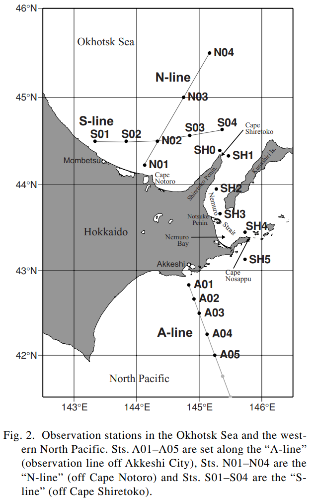{ loading=lazy }
  <figcaption>A-line과 N-line. Oguma, S., T. Ono, A. Kusaka, H. Kasai, Y. Kawasaki and T. Azumaya, Isotopic tracers for water masses in the coastal region of eastern Hokkaido, J. Oceanogr., 64, 2008</figcaption>
</figure>

## 기타 자료

### Japanese SOOP data

[:octicons-link-external-24: SOOP Japan](https://soop.jp/)

### Database of Climate Change Observation (NIES)

해양 관련 다양한 자료를 모아 둔 사이트입니다. 이 페이지를 구성할 때 참고했습니다.

[:octicons-link-external-24: NIES climate change observation database](https://occco.nies.go.jp/climate/dbo/dbo.html)

### 일본 주변 해류(쿠로시오 등)와 SST

일본 해상보안청 해양 속보

[:octicons-link-external-24: JCG Quick Bulletin of Ocean Conditions](https://www1.kaiho.mlit.go.jp/KANKYO/KAIYO/qboc/index_E.html)

<figure markdown="span">
  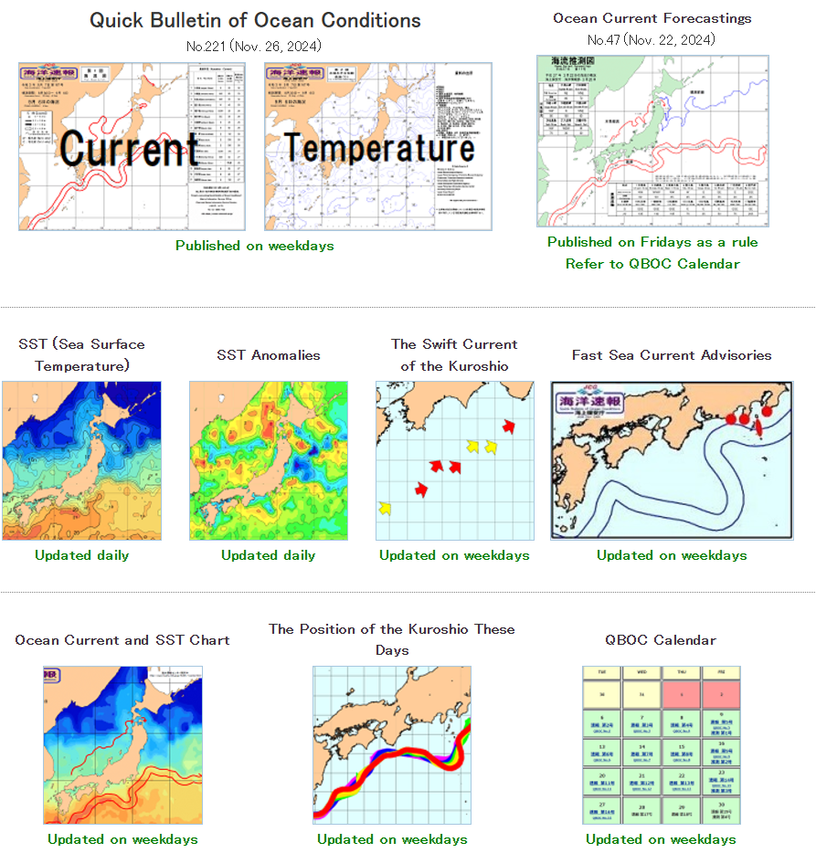{ loading=lazy }
  <figcaption>해상보안청 해양 속보</figcaption>
</figure>

### 조위 자료를 이용한 쿠로시오 모니터링

도쿄대 AORI (일본어만 제공)

[:octicons-link-external-24: Kuroshio monitoring (AORI)](https://ovd.aori.u-tokyo.ac.jp/tides/)

<figure markdown="span">
  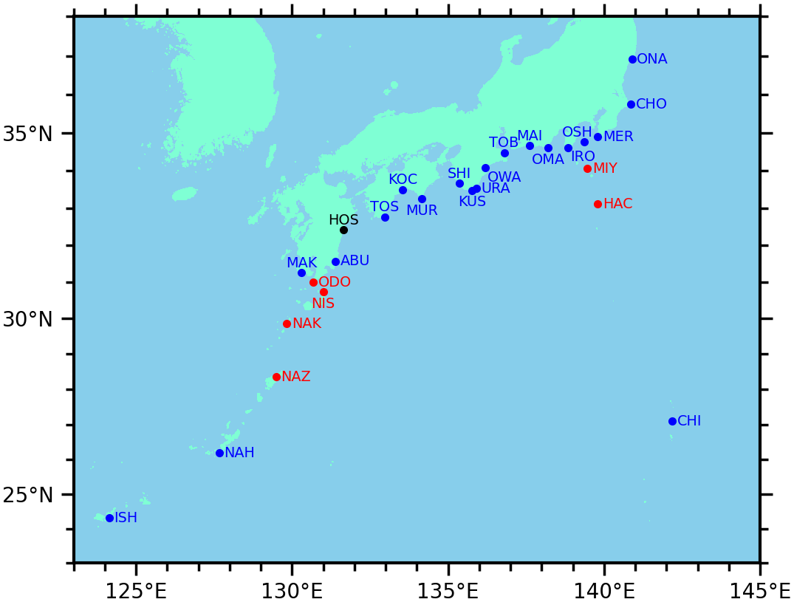{ loading=lazy }
  <figcaption>조위 자료 기반 쿠로시오 모니터링</figcaption>
</figure>

### NOWPAP 위성 산출물

Marine Environmental Protection of the Northwest Pacific Region

[:octicons-link-external-24: NOWPAP satellite products](https://ocean.nowpap3.go.jp/?page_id=862)

<figure markdown="span">
  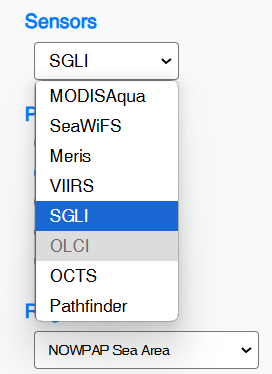{ loading=lazy }
  <figcaption>NOWPAP 위성 산출물</figcaption>
</figure>

### North Pacific surface nutrients

[:octicons-link-external-24: North Pacific surface nutrients](https://caos.sakura.ne.jp/sao/north-pacific-surface-nutrients/)

<figure markdown="span">
  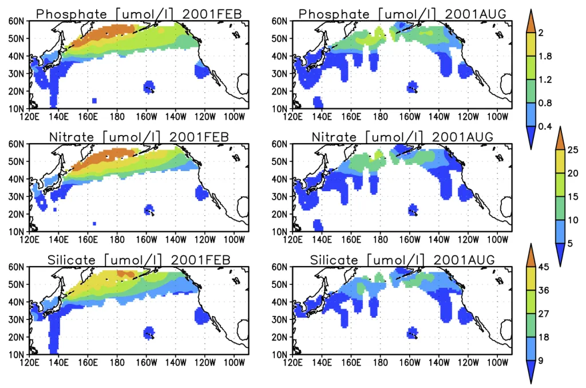{ loading=lazy }
  <figcaption>North Pacific surface nutrients</figcaption>
</figure>

## Michitaka Uda 논문 목록

- [:octicons-link-external-24: Uda Bunko 논문 목록 (도쿄해양대학)](https://lib.s.kaiyodai.ac.jp/library/maincollection/uda-bunko/pages/gyouseki.html)

??? info "한반도 주변 해류 연구에 자주 인용되는 Uda (1934)"
    - Uda, M., The results of simultaneous oceanographical investigations in the Japan Sea and its adjacent waters in May and June 1932
      (in Japanese), *J. Imperial Fish. Exp. Stn.*, 5, 138-190, 1934.
      위 문서가 한반도 주변 해역의 해류 시스템과 관련하여 자주 인용됩니다. 아래 링크가 같은 문서로 추정됩니다(일본어).
      [035.pdf](https://lib.s.kaiyodai.ac.jp/library/maincollection/uda-bunko/resources/pdfs/gyouseki/035.pdf)
    - [Hydrographical studies based on simultaneous oceanographical survey made in the Japan Sea and its adjacent waters during May and June, 1932](https://lib.s.kaiyodai.ac.jp/library/maincollection/uda-bunko/resources/pdfs/gyouseki/053.pdf)
      (영어). *Rec. Oceanogr. Wks. Japan*, 6(1), 19-107, 1934.

    [:octicons-file-24: Uda (1934) 영어판 (PDF)](../assets/files/regional/japan/Uda_1934.pdf)
