# :material-map-marker-radius: Japan Oceanographic Database [2025.03.03]

Observational and model datasets provided by Japanese institutions (JMA, JODC, JAMSTEC, FRA, and others).

## Numerical models

### DREAMS (RIAMOM)

Numerical model run at RIAM, Kyushu University

[:octicons-link-external-24: DREAMS at RIAM](https://dreams-c1.riam.kyushu-u.ac.jp/vwp/index.html)

<figure markdown="span">
  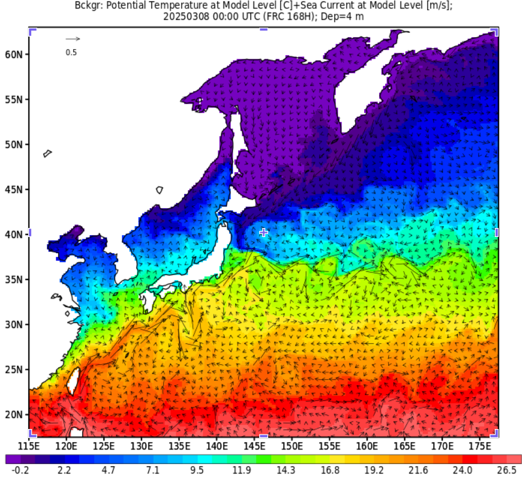{ loading=lazy }
  <figcaption>DREAMS at RIAM</figcaption>
</figure>

### JAMSTEC numerical model products

OFES, ESTOC, JCOPE, FORA-WNP30, and the Reanalysis Intercomparison Dataset

[:octicons-arrow-right-24: Open](japan-jamstec-models.md)

### JRA-3Q

Japanese Reanalysis for Three Quarters of a Century (JMA)

[:octicons-link-external-24: JRA-3Q](https://jra.kishou.go.jp/JRA-3Q/index_en.html#REANALYSIS)

## JODC (Japan Oceanographic Data Center)

### JODC data

Ocean survey data, continuous underway data, moorings, currents, coastal meteorology, fixed-station temperature, plankton, tides, and 500 m gridded bathymetry

[:octicons-arrow-right-24: JODC data, by dataset](japan-jodc.md) 
[:octicons-link-external-24: J-DOSS (JODC Data On-line Service System)](https://www.jodc.go.jp/jodcweb/JDOSS/index.html)

<figure markdown="span">
  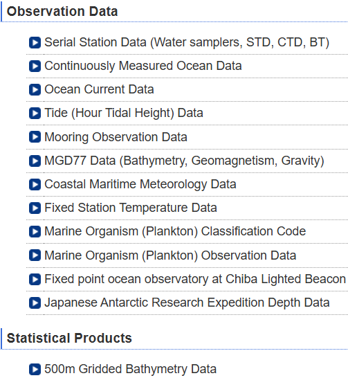{ loading=lazy }
  <figcaption>J-DOSS</figcaption>
</figure>

## JMA (Japan Meteorological Agency)

[:octicons-link-external-24: JMA (English)](https://www.jma.go.jp/jma/en/menu.html) ·
[:octicons-link-external-24: JMA ship observation data](https://www.data.jma.go.jp/kaiyou/db/vessel_obs/data-report/html/ship/ship.html)

### Research vessel observations

1997–2023
{ .spec }

Oceanographic and Marine Meteorological Observations by Research Vessels. Provided as text files; each observation type has its own fixed format, so look up the format you need on the site.

[:octicons-download-24: JMA research vessel data](https://www.data.jma.go.jp/kaiyou/db/vessel_obs/data-report/html/ship/ship_e.php)

[:octicons-file-24: Example format: JMA subsurface current data (PDF)](../assets/files/regional/japan/JMA_subsurface_current_format.pdf)

<figure markdown="span">
  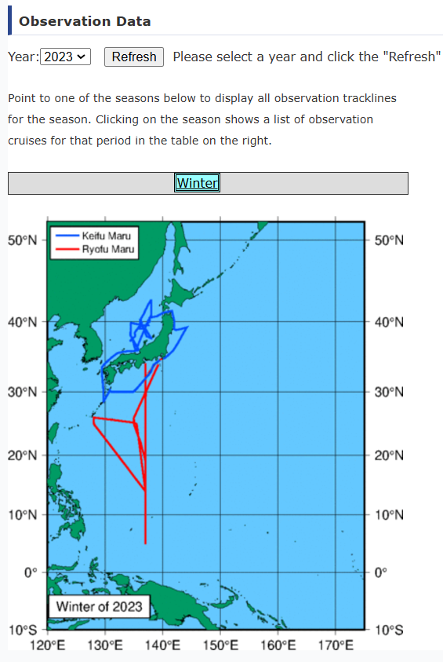{ loading=lazy }
  <figcaption>JMA research vessel observations</figcaption>
</figure>

### 137°E meridian section time series

Oceanographic Section Time-series Dataset for the 137°E Meridian

[:octicons-download-24: JMA 137°E dataset](https://www.data.jma.go.jp/gmd/kaiyou/db/mar_env/results/OI/137E_OI.html#data)

<figure markdown="span">
  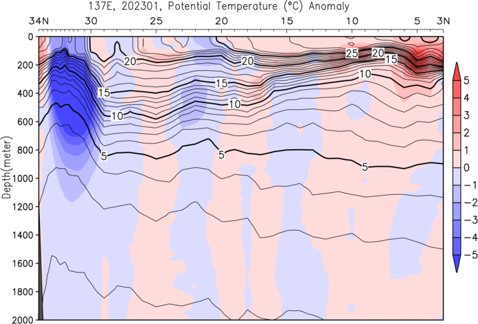{ loading=lazy }
  <figcaption>137°E repeat section</figcaption>
</figure>

<figure markdown="span">
  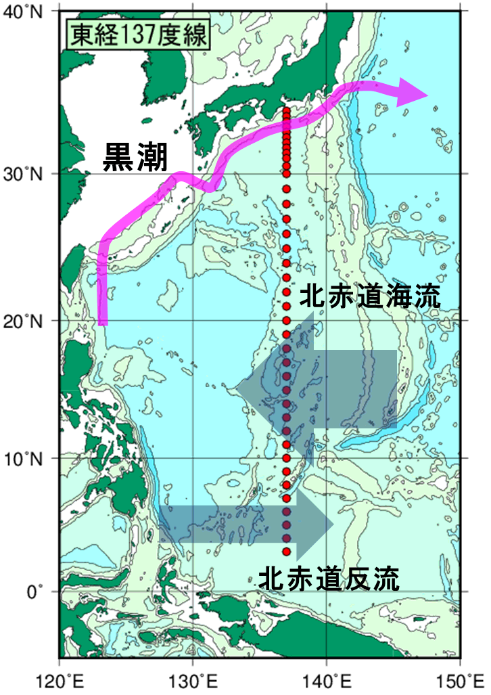{ loading=lazy }
  <figcaption>137°E section dataset</figcaption>
</figure>

### Ocean data buoy observations

[:octicons-download-24: JMA buoy data](https://www.data.jma.go.jp/kaiyou/db/vessel_obs/data-report/html/buoy/buoy_e.php)

<figure markdown="span">
  { loading=lazy }
  <figcaption>JMA ocean data buoys</figcaption>
</figure>

### Meteorological Satellite Center

[:octicons-link-external-24: JMA MSC](https://www.data.jma.go.jp/mscweb/en/index.html) 
[:octicons-link-external-24: JMA satellite](https://www.jma.go.jp/jma/jma-eng/satellite/index.html)

### State of the ocean climate

[:octicons-link-external-24: State of the ocean climate index](https://www.data.jma.go.jp/gmd/kaiyou/english/state_of_ocean_climate_index.html)

- [Sea surface temperature (global)](https://www.data.jma.go.jp/gmd/kaiyou/english/long_term_sst_global/glb_warm_e.html)
- [Sea surface temperature (around Japan)](https://www.data.jma.go.jp/gmd/kaiyou/english/long_term_sst_japan/sea_surface_temperature_around_japan.html)
- [Global ocean heat content](https://www.data.jma.go.jp/gmd/kaiyou/english/ohc/ohc_global_en.html)
- [Sea level (around Japan)](https://www.data.jma.go.jp/gmd/kaiyou/english/sl_trend/sea_level_around_japan.html)
- [Sea ice in the Arctic and Antarctic areas](https://www.data.jma.go.jp/gmd/kaiyou/english/seaice_global/series_global_e.html)
- [Sea ice in the Sea of Okhotsk](https://www.data.jma.go.jp/gmd/kaiyou/english/seaice_okhotsk/series_okhotsk_e.html)

## JAMSTEC

[:octicons-search-24: JAMSTEC data search portal](https://www.jamstec.go.jp/e/database/) ·
[:octicons-search-24: GODAC data catalog](https://www.godac.jamstec.go.jp/data_catalog/view/base?lang=en)

### Research vessel observation database

[:octicons-link-external-24: Cruise database (AORI, Univ. of Tokyo)](https://opensci.aori.u-tokyo.ac.jp/cruise-en.html)

### Subsurface ADCP mooring (TOCS)

ADCP moorings in the western Pacific and eastern Indian Ocean; hourly means in 10 m bins

[:octicons-download-24: JAMSTEC ADCP data](https://www.jamstec.go.jp/ipobs/adcp/adcp_data.html) 
[:octicons-link-external-24: NASA Earthdata record](https://access.earthdata.nasa.gov/collections/C1617571129-SCIOPS)

<figure markdown="span">
  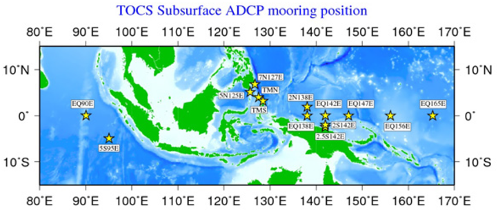{ loading=lazy }
  <figcaption>JAMSTEC subsurface ADCP mooring sites</figcaption>
</figure>

??? info "About the TOCS ADCP moorings"
    As the "TOCS (Tropical Ocean Climate Study)" project in JAMSTEC, variability of long-term surface and subsurface ocean current
    have been observed by the ADCP (Acoustic Doppler Current Profiler) mooring system in the western Pacific Ocean and in the eastern
    Indian Ocean. The ADCP used in this project is the RDI 150 kHz Broad-Band type for the western Pacific Ocean area, and the RDI 75 kHz
    Work Horse type for the eastern Indian Ocean area. After removing electric noise, the data were processed to the hourly mean and
    10 meters depth bin.

### Mooring observation catalog

Shows which moorings exist, but data access could not be confirmed

[:octicons-link-external-24: GODAC mooring catalog](https://www.godac.jamstec.go.jp/misce_obs/view/base?lang=en)

<figure markdown="span">
  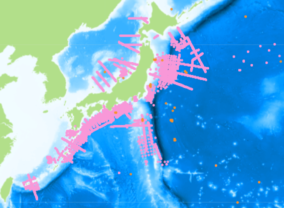{ loading=lazy }
  <figcaption>GODAC mooring observation catalog</figcaption>
</figure>

### TRITON

Japan operates the TRITON part of the TAO/TRITON array

[:octicons-link-external-24: TRITON real-time display](https://www.jamstec.go.jp/jamstec/TRITON/real_time/display/) 
[:octicons-download-24: TAO/TRITON Data Display and Delivery (PMEL)](https://www.pmel.noaa.gov/tao/drupal/disdel/)

<figure markdown="span">
  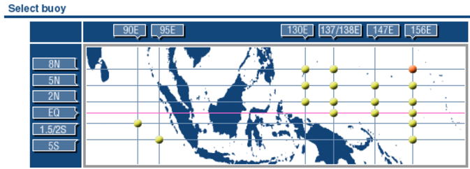{ loading=lazy }
  <figcaption>TRITON real-time display</figcaption>
</figure>

<figure markdown="span">
  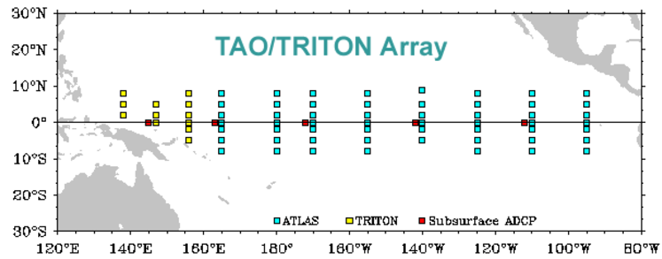{ loading=lazy }
  <figcaption>TAO/TRITON array map</figcaption>
</figure>

### Ocean acoustic tomography

1997–2001
{ .spec }

Tomography experiments in the Kuroshio Extension and the central equatorial Pacific. Contact [dmo@jamstec.go.jp](mailto:dmo@jamstec.go.jp) to use the data.

[:octicons-link-external-24: GODAC metadata](https://www.godac.jamstec.go.jp/data_catalog/view/metadata?key=ACOUSTIC_TOMOGRAPHY&lang=en)

[:octicons-file-24: Documentation archive (zip, contains no observation data)](../assets/files/regional/japan/JAMSTEC_ACOUSTIC_TOMOGRAPHY.zip)

<figure markdown="span">
  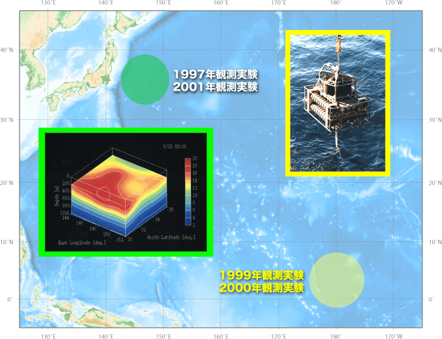{ loading=lazy }
  <figcaption>Acoustic tomography experiment area</figcaption>
</figure>

<figure markdown="span">
  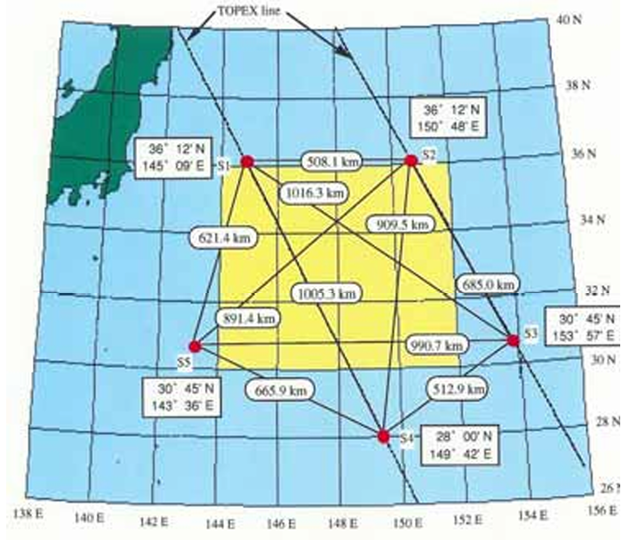{ loading=lazy }
  <figcaption>Acoustic tomography metadata page</figcaption>
</figure>

??? info "About the acoustic tomography data"
    JAMSTEC conducted ocean acoustic tomography experiments from 1997 to 2001 in the Kuroshio Extension region and central equatorial Pacific.
    For details, refer to `/ACOUSTIC_TOMOGRAPHY/index.html` (Japanese only) after extracting `ACOUSTIC_TOMOGRAPHY.zip`.
    The zip file contains no observation data. **If you wish to use the data, please contact [dmo@jamstec.go.jp](mailto:dmo@jamstec.go.jp).**

### Okinotorishima Island observations

1993–
{ .spec }

Meteorological and oceanographic observations at Okinotorishima; the latest data are added around April each year

[:octicons-link-external-24: JAMSTEC Okinotorishima](https://www.jamstec.go.jp/j/database/okitori/index.html) 
[:octicons-link-external-24: GODAC metadata](https://www.godac.jamstec.go.jp/data_catalog/view/metadata?key=Okinotorishima_WebPage&lang=en)

<figure markdown="span">
  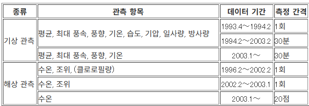{ loading=lazy }
  <figcaption>Okinotorishima observations</figcaption>
</figure>

<figure markdown="span">
  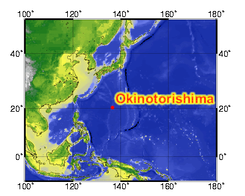{ loading=lazy }
  <figcaption>Okinotorishima observations</figcaption>
</figure>

### Time-series stations K2 and S1

K2: 47°N, 160°E (western subarctic gyre); S1: 30°N, 145°E (subtropical gyre). Comparative time-series observations with R/V Mirai since 2010

[:octicons-link-external-24: K2/S1 database](https://www.jamstec.go.jp/k2s1/en/index.html) 
[:octicons-link-external-24: GODAC metadata (KNOT K2)](https://www.godac.jamstec.go.jp/data_catalog/view/metadata?key=JAMSTEC_KNOT_K2&lang=en)

<figure markdown="span">
  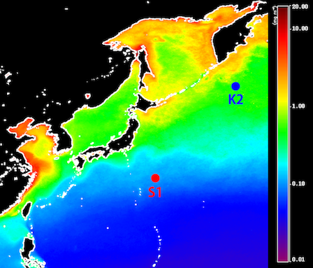{ loading=lazy }
  <figcaption>Time-series stations K2 and S1</figcaption>
</figure>

### Tsugaru Strait ship-based time series

CTD and bottle sampling across the Tsugaru Strait (salinity, DO, nutrients, DIC, TA, 18O, Chl-a). CTD data belong to Hokkaido University, bottle data to JAMSTEC

[:octicons-link-external-24: GODAC metadata](https://www.godac.jamstec.go.jp/data_catalog/view/metadata?key=Tsugaru_Strait_Ship-based_Data&lang=en)

<figure markdown="span">
  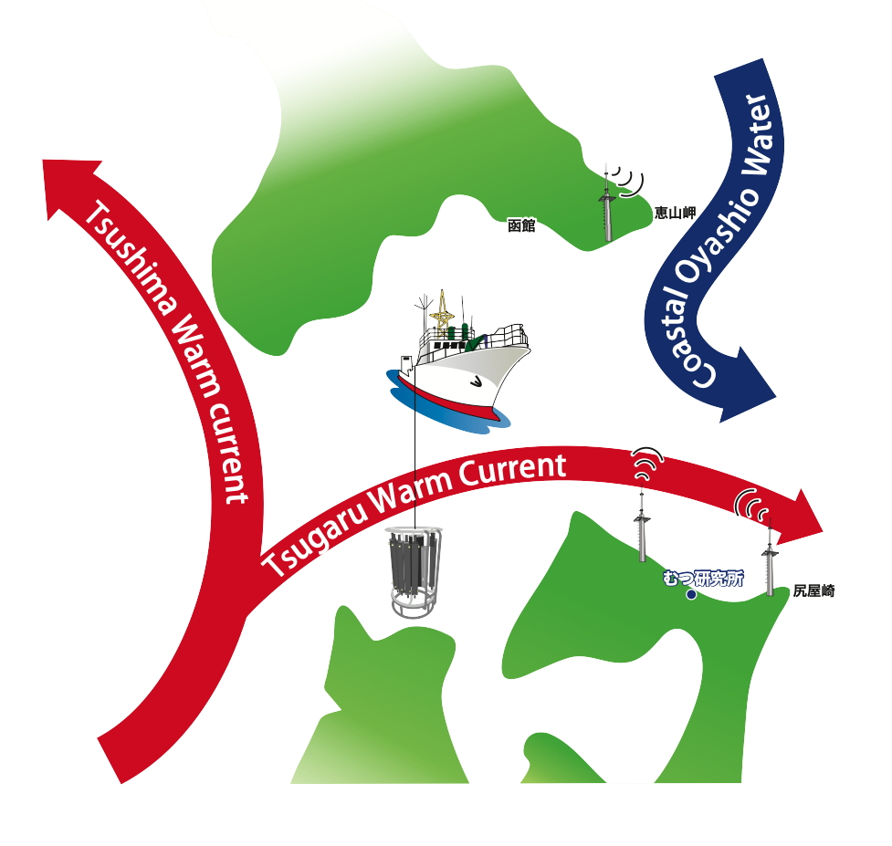{ loading=lazy }
  <figcaption>Tsugaru Strait observation line</figcaption>
</figure>

### MORSETS

2014.04–
{ .spec }

MIO Ocean Radar data Site for Eastern Tsugaru Strait: quasi-real-time surface current maps and an archive

[:octicons-link-external-24: MORSETS](https://www.godac.jamstec.go.jp/morsets/e/about/index.html)

## Fisheries Research Agency (FRA)

### A-line

Repeated hydrographic section across the Oyashio region off Hokkaido: CTD, nutrient and Chl-a, and plankton data

[:octicons-download-24: A-line database](https://ocean.fra.go.jp/a-line/a-line_DataPolisy2.html)

### N-line

Repeated hydrographic section across the Okhotsk region off Hokkaido: CTD, nutrient and Chl-a, and plankton data

[:octicons-download-24: N-line database](https://hnf.fra.affrc.go.jp/n-line/data/index_e.html)

<figure markdown="span">
  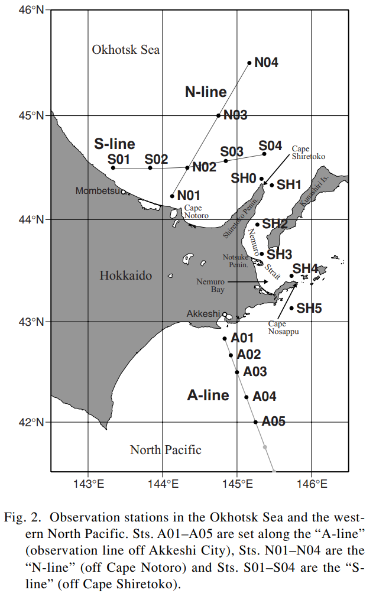{ loading=lazy }
  <figcaption>A-line and N-line. Oguma, S., T. Ono, A. Kusaka, H. Kasai, Y. Kawasaki and T. Azumaya, Isotopic tracers for water masses in the coastal region of eastern Hokkaido, J. Oceanogr., 64, 2008</figcaption>
</figure>

## Other sources

### Japanese SOOP data

[:octicons-link-external-24: SOOP Japan](https://soop.jp/)

### Database of Climate Change Observation (NIES)

A broad collection of ocean-related datasets; this page was compiled with reference to it

[:octicons-link-external-24: NIES climate change observation database](https://occco.nies.go.jp/climate/dbo/dbo.html)

### Ocean currents (Kuroshio etc.) and SST around Japan

Quick Bulletin of Ocean Conditions, Japan Coast Guard

[:octicons-link-external-24: JCG Quick Bulletin of Ocean Conditions](https://www1.kaiho.mlit.go.jp/KANKYO/KAIYO/qboc/index_E.html)

<figure markdown="span">
  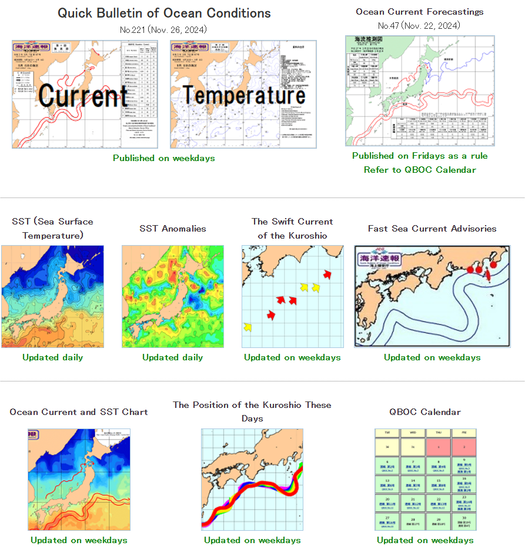{ loading=lazy }
  <figcaption>JCG Quick Bulletin of Ocean Conditions</figcaption>
</figure>

### Kuroshio monitoring with tidal elevation

AORI, University of Tokyo (Japanese only)

[:octicons-link-external-24: Kuroshio monitoring (AORI)](https://ovd.aori.u-tokyo.ac.jp/tides/)

<figure markdown="span">
  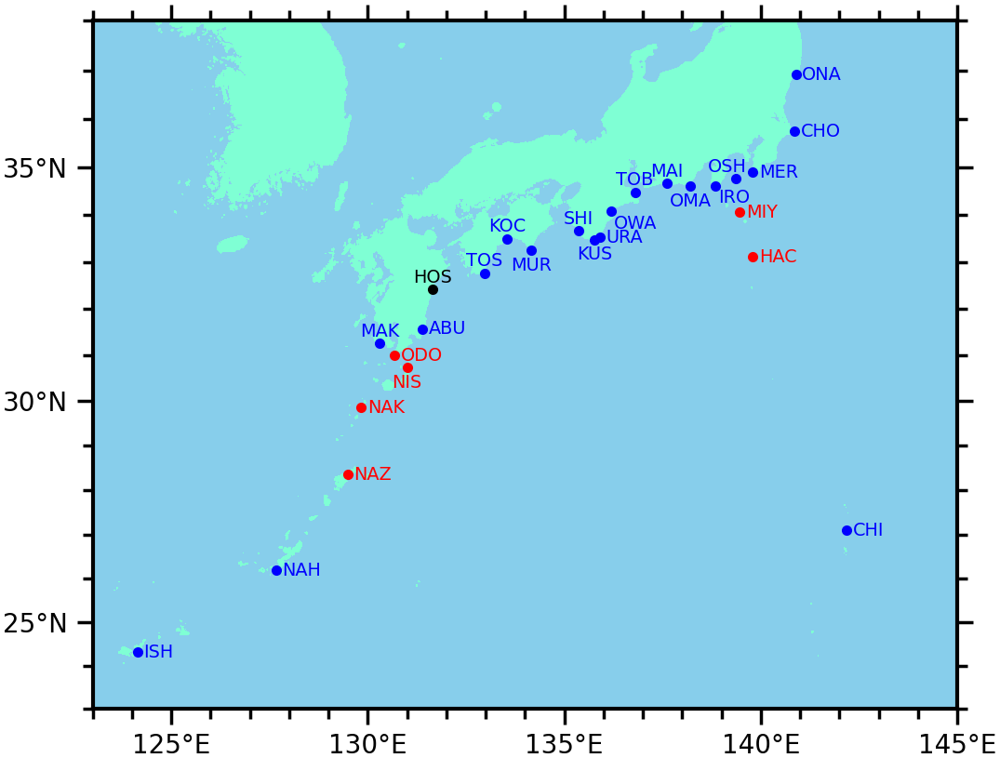{ loading=lazy }
  <figcaption>Kuroshio monitoring from tide gauge data</figcaption>
</figure>

### NOWPAP satellite products

Marine Environmental Protection of the Northwest Pacific Region

[:octicons-link-external-24: NOWPAP satellite products](https://ocean.nowpap3.go.jp/?page_id=862)

<figure markdown="span">
  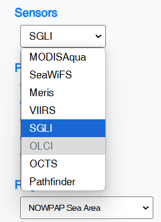{ loading=lazy }
  <figcaption>NOWPAP satellite products</figcaption>
</figure>

### North Pacific surface nutrients

[:octicons-link-external-24: North Pacific surface nutrients](https://caos.sakura.ne.jp/sao/north-pacific-surface-nutrients/)

<figure markdown="span">
  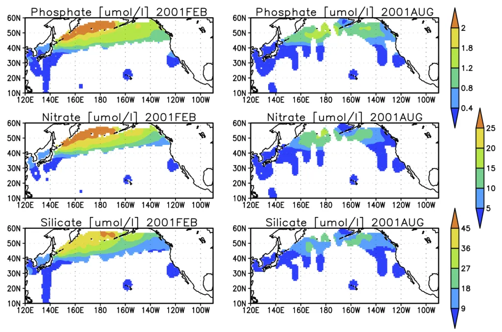{ loading=lazy }
  <figcaption>North Pacific surface nutrients</figcaption>
</figure>

## Michitaka Uda: publication list

- [:octicons-link-external-24: Uda Bunko: list of publications (Tokyo Univ. of Marine Science and Technology)](https://lib.s.kaiyodai.ac.jp/library/maincollection/uda-bunko/pages/gyouseki.html)

??? info "Uda (1934), often cited in studies of the currents around Korea"
    - Uda, M., The results of simultaneous oceanographical investigations in the Japan Sea and its adjacent waters in May and June 1932
      (in Japanese), *J. Imperial Fish. Exp. Stn.*, 5, 138-190, 1934.
      This paper is frequently cited in connection with the current system around the Korean Peninsula. The link below appears to be the same document (Japanese).
      [035.pdf](https://lib.s.kaiyodai.ac.jp/library/maincollection/uda-bunko/resources/pdfs/gyouseki/035.pdf)
    - [Hydrographical studies based on simultaneous oceanographical survey made in the Japan Sea and its adjacent waters during May and June, 1932](https://lib.s.kaiyodai.ac.jp/library/maincollection/uda-bunko/resources/pdfs/gyouseki/053.pdf)
      (English). *Rec. Oceanogr. Wks. Japan*, 6(1), 19-107, 1934.

    [:octicons-file-24: Uda (1934), English version (PDF)](../assets/files/regional/japan/Uda_1934.pdf)
