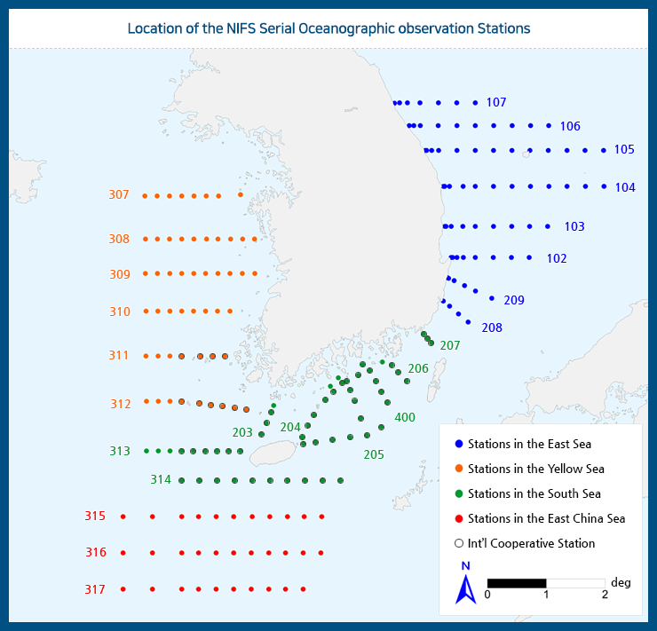

# :material-download-box-outline: NIFS 정선관측자료 다운로드 방법 [2025.05.27]

국립수산과학원(KODC) 정선해양관측자료의 다운로드 경로와, 직접 내려받아 모아 둔 파일입니다.

<figure markdown="span">
  { loading=lazy }
  <figcaption>KODC 정선해양관측자료 다운로드 페이지</figcaption>
</figure>

## 관측 자료 다운로드

[:octicons-download-24: 다운로드 링크 (KODC)](https://www.nifs.go.kr/kodc/eng/soo_list.kodc)

!!! quote
    2년 기간 정도는 한 번에 다운로드할 수 있습니다. 아래는 방장이 직접 노가다로 받은 자료입니다.

### 장기간 관측 자료 (2025.05.27 갱신)

`NIFS_KODC_ALL_1969_2024.zip`: 1969년부터 2024년까지의 정선관측자료를 하나로 모은 압축 파일

??? info "2년 단위 관측 자료"
    2년 단위 xlsx 파일: `정선해양_관측정보_YYYY_YYYY.xlsx` (1969, 1970–1971, 1972–1973, ... , 2022–2023, 2024)

## 관측 정점 위치

[:octicons-download-24: 정점 목록 (KODC)](https://www.nifs.go.kr/kodc/eng/soo_st_list.kodc)

??? info "장기간 관측 자료 (예전에 받아 둔 자료)"
    예전에는 2년씩이 아니라 더 긴 기간을 한 번에 다운로드할 수 있었는데, 지금은 그 방법이 막혔습니다.
    해역별 예전 파일: `정선해양관측정보_1993_2022_서해.xls`, `_1993_2022_남해.xls`, `_1993_2022_동중국해.xls`,
    `_2015_2022_동해.xls`, `_2000_2014_동해.xls`, `_1993_1999_동해.xls`
