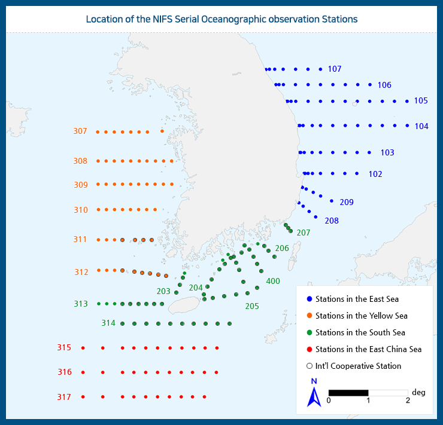

# :material-download-box-outline: How to Download NIFS Serial Oceanographic Observation Data [2025.05.27]

Download routes for the NIFS (KODC) serial oceanographic observations, plus compiled files I downloaded by hand.

<figure markdown="span">
  { loading=lazy }
  <figcaption>KODC serial oceanographic observation download page</figcaption>
</figure>

## Observation data download

[:octicons-download-24: Download link (KODC)](https://www.nifs.go.kr/kodc/eng/soo_list.kodc)

!!! quote
    About two years of data can be downloaded at a time. The files below are what I downloaded manually.

### Long-period observation data (updated 2025.05.27)

`NIFS_KODC_ALL_1969_2024.zip`: all serial observations from 1969 to 2024, compiled into one archive.

??? info "Bi-yearly observation data"
    One xlsx file per two-year period: `정선해양_관측정보_YYYY_YYYY.xlsx` for 1969, 1970–1971, 1972–1973, ... , 2022–2023, and 2024.

## Location of observation stations

[:octicons-download-24: Station list (KODC)](https://www.nifs.go.kr/kodc/eng/soo_st_list.kodc)

??? info "Long-period observation data (older download)"
    It used to be possible to download much longer periods at once instead of two years; that shortcut no longer works.
    Older files by sea area: `정선해양관측정보_1993_2022_서해.xls`, `_1993_2022_남해.xls`, `_1993_2022_동중국해.xls`,
    `_2015_2022_동해.xls`, `_2000_2014_동해.xls`, `_1993_1999_동해.xls`.

??? note "Data files"
    `NIFS_KODC_ALL_1969_2024.zip`, the bi-yearly `정선해양_관측정보_*.xlsx` files (31 files), and the older `정선해양관측정보_*.xls` files (6 files)
    will be hosted separately.
