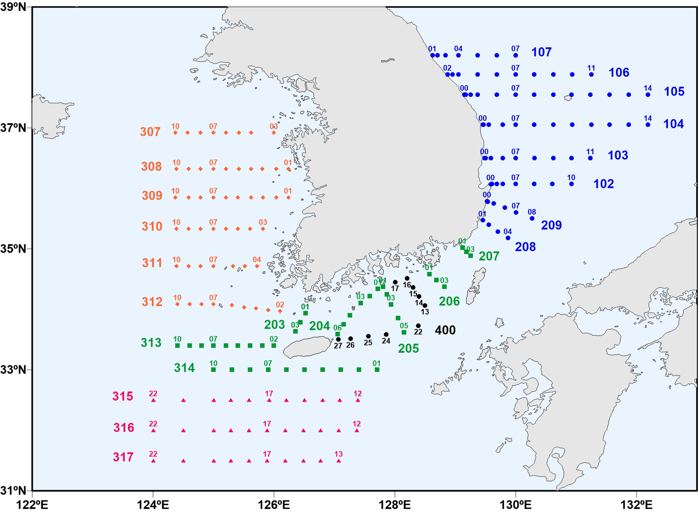
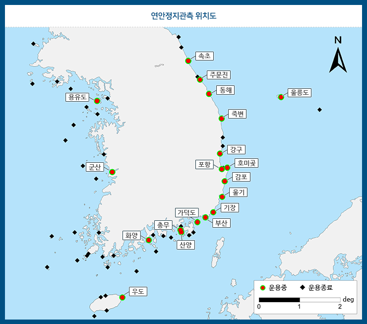
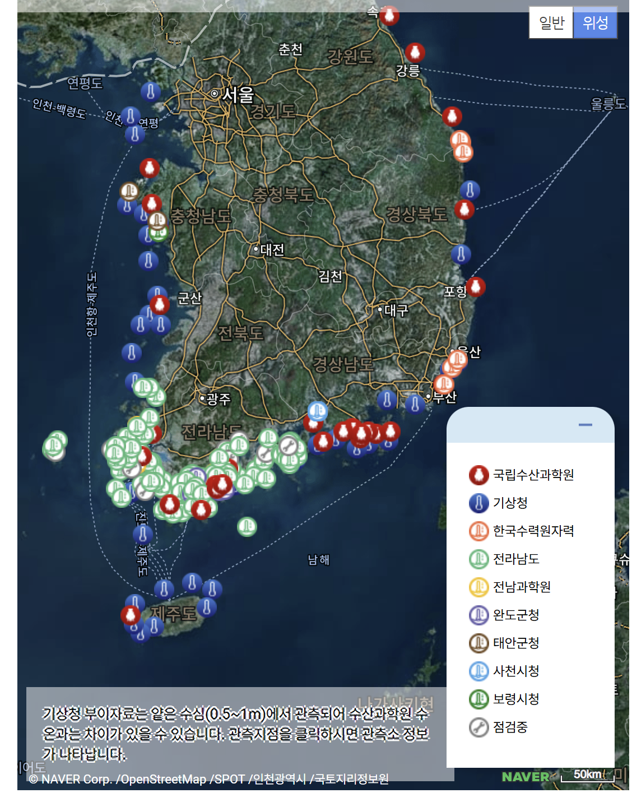

# :material-ferry: 한반도 연근해 실측 관측 자료 모음 [2026.04.02]

한반도 주변 해역의 실측 관측 자료를 찾는 곳입니다. 정선·연안정지 관측, 해양과학기지, 실시간 관측 시스템을 정리했습니다.

## 정선해양관측자료 & 연안정지관측자료

[:octicons-link-external-24: KODC 한국해양자료센터](https://www.nifs.go.kr/kodc/index.kodc) ·
[:octicons-book-24: NIFS 정선관측자료 다운로드 방법](korea-nifs-download.md)

<figure markdown="span">
  { loading=lazy }
  <figcaption>KODC 정선해양관측 정선도</figcaption>
</figure>

<figure markdown="span">
  { loading=lazy }
  <figcaption>KODC 연안정지관측</figcaption>
</figure>

## 해양과학기지

Link → [바다누리 해양정보 서비스](https://khoa.go.kr/oceandata/oceaninfo/map.do)

1. 바다누리에 접속합니다.
2. 상단의 "내려받기"를 클릭합니다.
3. 로그인합니다.
4. 자료구분: "관측자료"
5. 관측소 유형: "해양과학기지"

## 해양환경정보포털 (MEIS)

[:octicons-link-external-24: 해양환경 관측 & 조사 (해양환경정보포털)](https://meis.go.kr/mei/observe/port.do)

- 해수욕장 환경 정보
- 해양환경측정망 정보
- 수질자동측정망 정보
- 서해 연안환경측정망
- 유관기관 해양환경정보

## 실시간 해양수산환경 관측시스템 (RISA)

[:octicons-link-external-24: 실시간 해양수산환경 관측시스템](https://www.nifs.go.kr/risa/main.risa)

<figure markdown="span">
  { loading=lazy }
  <figcaption>실시간 해양수산환경 관측시스템 화면</figcaption>
</figure>
