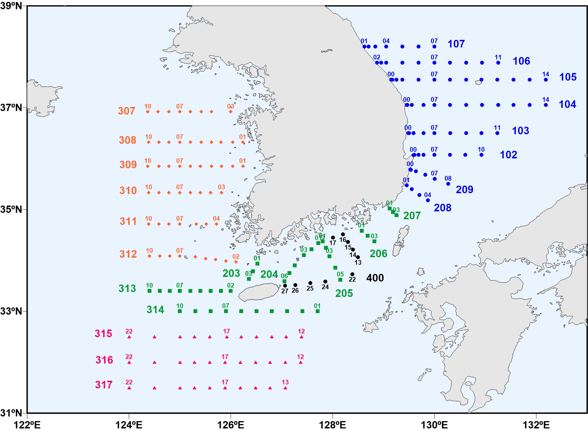
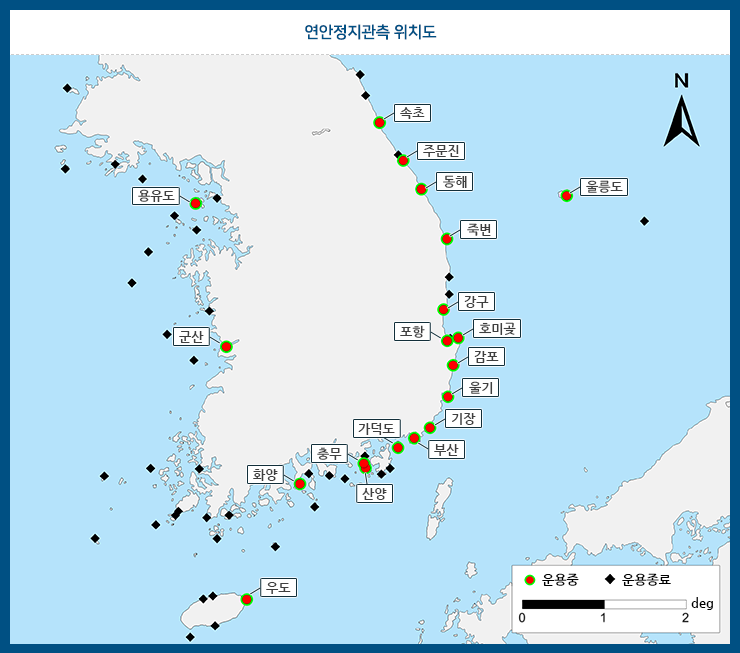
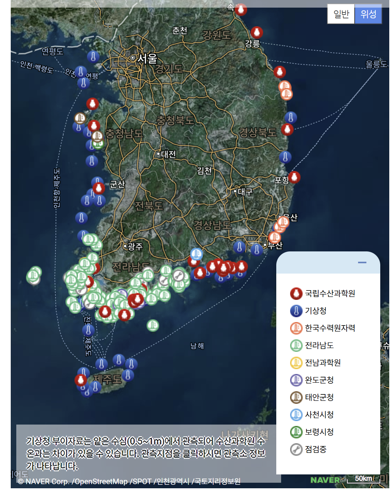

# :material-ferry: In Situ Observations around Korea [2026.04.02]

Where to find in situ observations for the seas around the Korean Peninsula: serial and coastal stations, ocean research stations, and real-time systems.

## Serial and coastal station observations

[:octicons-link-external-24: KODC (Korea Oceanographic Data Center)](https://www.nifs.go.kr/kodc/index.kodc) ·
[:octicons-book-24: How to download NIFS Serial Oceanographic Observation data](korea-nifs-download.md)

<figure markdown="span">
  { loading=lazy }
  <figcaption>KODC serial oceanographic observation lines</figcaption>
</figure>

<figure markdown="span">
  { loading=lazy }
  <figcaption>KODC coastal station observations</figcaption>
</figure>

## Ocean research stations (KORS)

Link → [Badanuri ocean information service](https://khoa.go.kr/oceandata/oceaninfo/map.do)

1. Open Badanuri.
2. Click "Download" at the top.
3. Log in.
4. Data type: "Observation data".
5. Station type: "Ocean research station".

## Marine Environment Information Portal (MEIS)

[:octicons-link-external-24: Marine environment observation and survey (MEIS)](https://meis.go.kr/mei/observe/port.do)

- Beach environment information
- Marine environment monitoring network
- Automatic water-quality monitoring network
- West coast environment monitoring network
- Marine environment information from related agencies

## Real-time Information System for Aquaculture environment (RISA)

[:octicons-link-external-24: RISA](https://www.nifs.go.kr/risa/main.risa)

<figure markdown="span">
  { loading=lazy }
  <figcaption>RISA real-time observation system</figcaption>
</figure>
