# :material-turtle: 바다거북 이동경로 [2026.10.08]

바다거북 이동 경로를 연구한 논문과 그 자료, 그리고 국립해양생물자원관(MBRIS)이 제공하는 자료를 공공데이터 포털에서 직접 내려받는 방법입니다.

## 논문 공개 자료

바다거북 이동 경로에 대해 연구한 논문과 해당 논문에 사용된 데이터입니다.

1. [Habitat use of loggerhead (Caretta caretta) and green (Chelonia mydas) turtles at the northern limit of their distribution range of the Northwest Pacific Ocean](https://journals.plos.org/plosone/article?id=10.1371/journal.pone.0290202)
   [:octicons-book-24: 논문 (PLOS ONE, 2023)](https://doi.org/10.1371/journal.pone.0290202)
2. [Sea turtle movebank file (figshare)](https://figshare.com/articles/dataset/Sea_turtle_movebank_file_/25543167?file=45455277)

Raw data를 사용할 때는 아래 citation을 함께 병기해 주세요.

> Kim, Il-Hun; Park, Il-Kook; Park, Daesik; Kim, Min-Seop; Cho, In-Young; Yang, Dongwoo; et al. (2024). Sea turtle movebank file. PLOS ONE. Dataset. [https://doi.org/10.1371/journal.pone.0290202.s003](https://doi.org/10.1371/journal.pone.0290202.s003)

## 공공데이터 포털에서 MBRIS 자료 받기

아래 과정은 위 논문과는 별개로, 국립해양생물자원관에서 제공하는 자료를 직접 다운로드하는 방법입니다.

1. [공공데이터 포털](https://www.data.go.kr/index.do)에 회원가입합니다.
2. [해양생물 공간정보 (MBRIS)](https://www.mbris.kr/gis/)의 바다거북 이동 경로 페이지에 접속해 공공데이터 포털 URL을 클릭합니다.
3. 활용신청을 합니다.

    <figure markdown="span">
      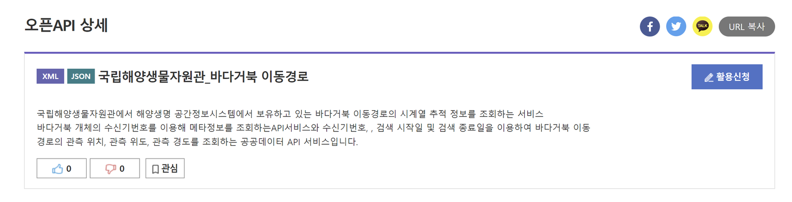{ loading=lazy }
      <figcaption>활용신청</figcaption>
    </figure>

4. 상단의 마이페이지에 들어갑니다.

    <figure markdown="span">
      { loading=lazy }
      <figcaption>마이페이지</figcaption>
    </figure>

5. 우측 툴바에서 활용신청 현황에 들어갑니다.

    <figure markdown="span">
      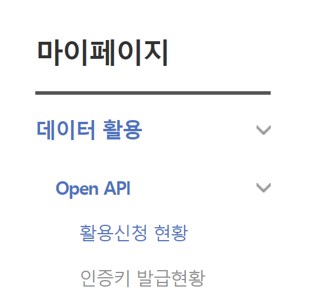{ loading=lazy }
      <figcaption>활용신청 현황</figcaption>
    </figure>

6. 신청과 승인 현황을 확인합니다. 아래 화면은 승인까지 완료된 상태라서 "활용 1건"으로 나타납니다. 승인이 되지 않았다면 "신청 1건"으로 표시됩니다.

    <figure markdown="span">
      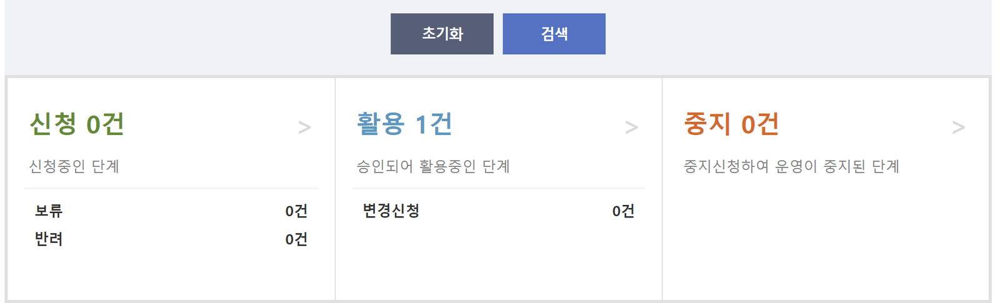{ loading=lazy }
      <figcaption>승인 현황</figcaption>
    </figure>

7. 행정 처리가 느리기 때문에 **041-950-0781**로 직접 전화를 걸어 승인을 받습니다.
8. 하단에 있는 항목을 클릭합니다.

    <figure markdown="span">
      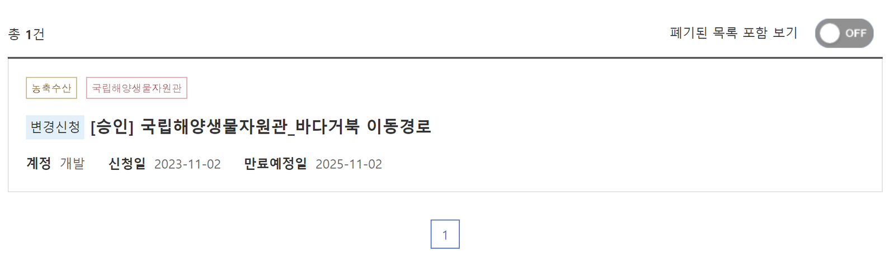{ loading=lazy }
      <figcaption>승인된 항목 열기</figcaption>
    </figure>

9. 정상적으로 승인을 받았다면, 아래 화면에서 스크롤을 내리면 API 키가 제공됩니다.

    <figure markdown="span">
      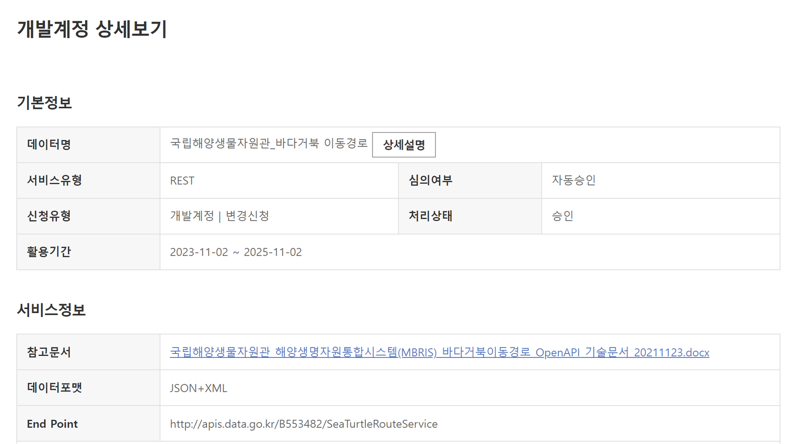{ loading=lazy }
      <figcaption>API 키</figcaption>
    </figure>

10. API 키가 정상적으로 나타나지 않는다면 "변경 신청"을 누릅니다. 공공데이터 포털에 직접 문의했더니 일시적인 문제인 것 같다는 답변을 받았고, "변경 신청"을 누르면 새 API 키가 발급됩니다.

    <figure markdown="span">
      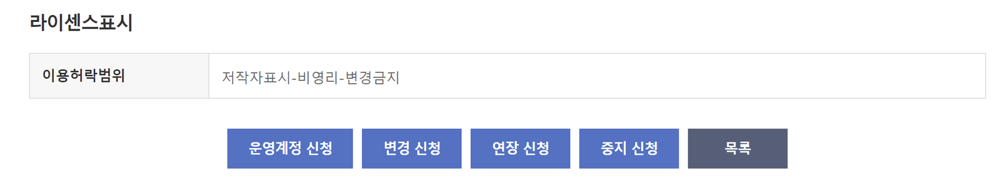{ loading=lazy }
      <figcaption>변경 신청</figcaption>
    </figure>

11. API 키를 받았으면 이제 데이터를 내려받습니다. 우선 첨부파일로 올라와 있는 기술문서를 다운로드합니다.

    <figure markdown="span">
      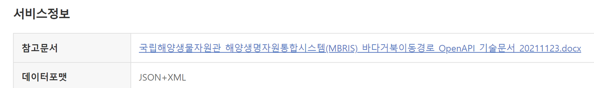{ loading=lazy }
      <figcaption>첨부파일</figcaption>
    </figure>

    [:octicons-file-24: MBRIS 바다거북 이동경로 OpenAPI 기술문서 (docx)](../assets/files/regional/korea-sea-turtle/국립해양생물자원관_해양생명자원통합시스템(MBRIS)_바다거북이동경로_OpenAPI_기술문서_20211123.docx)

12. 아래 화면에서 "상세 설명"을 클릭합니다.

    <figure markdown="span">
      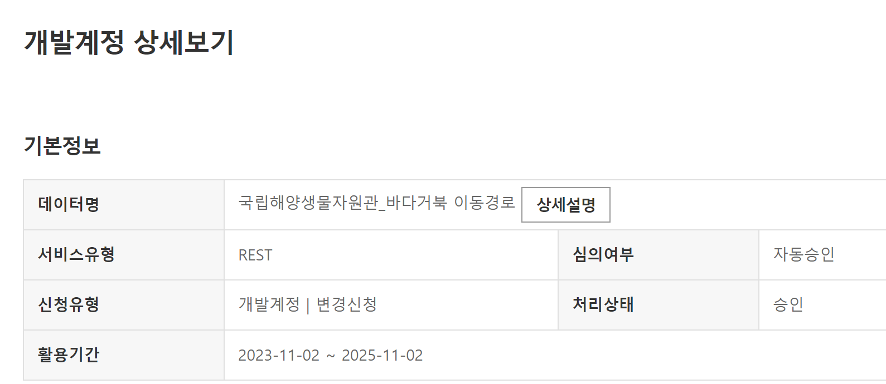{ loading=lazy }
      <figcaption>상세 설명</figcaption>
    </figure>

13. 아래 화면이 떴다면 맨 아래로 스크롤을 내립니다.

    <figure markdown="span">
      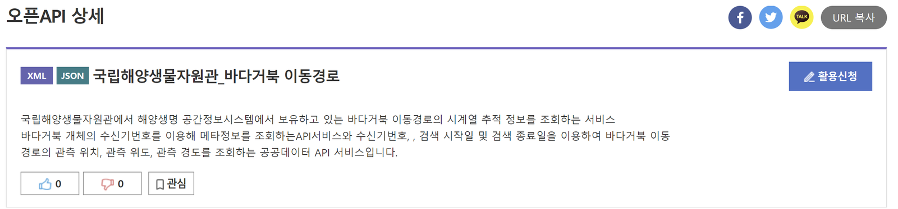{ loading=lazy }
      <figcaption>맨 아래로 스크롤</figcaption>
    </figure>

14. API로 데이터를 내려받는 예시 코드를 언어별로 제공합니다.

    <figure markdown="span">
      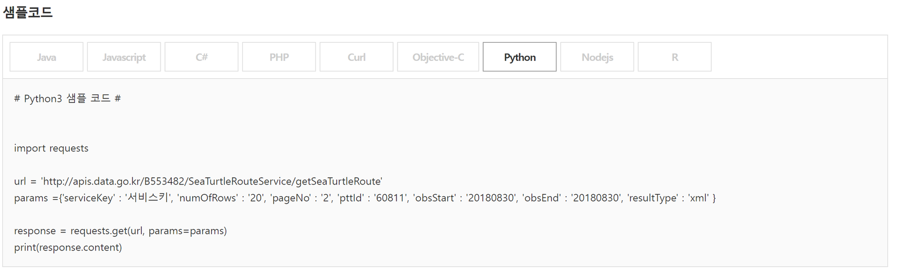{ loading=lazy }
      <figcaption>언어별 예시 코드</figcaption>
    </figure>

<figure markdown="span">
  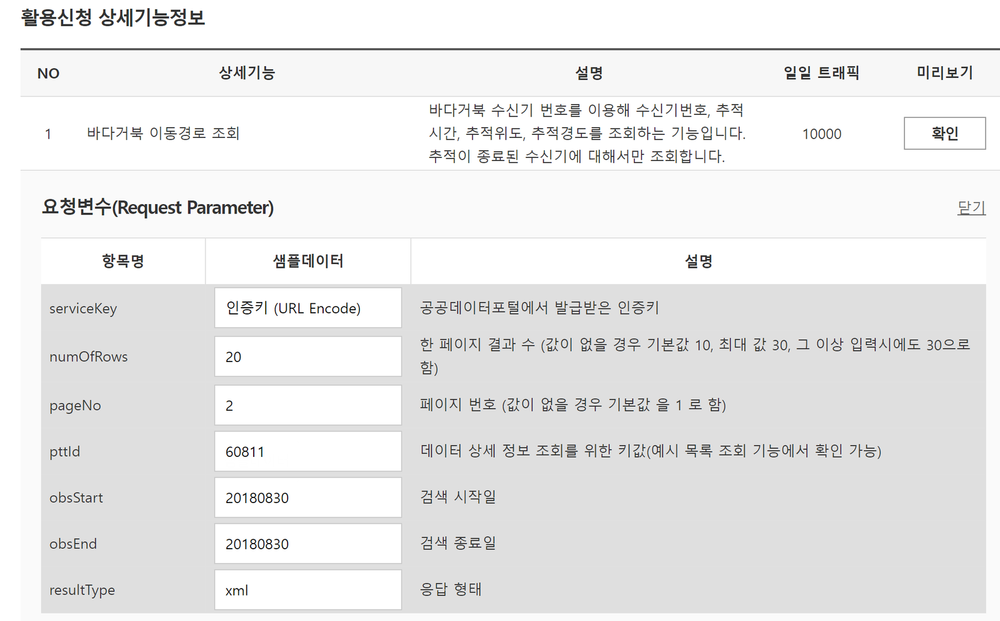{ loading=lazy }
  <figcaption>결과 예시</figcaption>
</figure>

<figure markdown="span">
  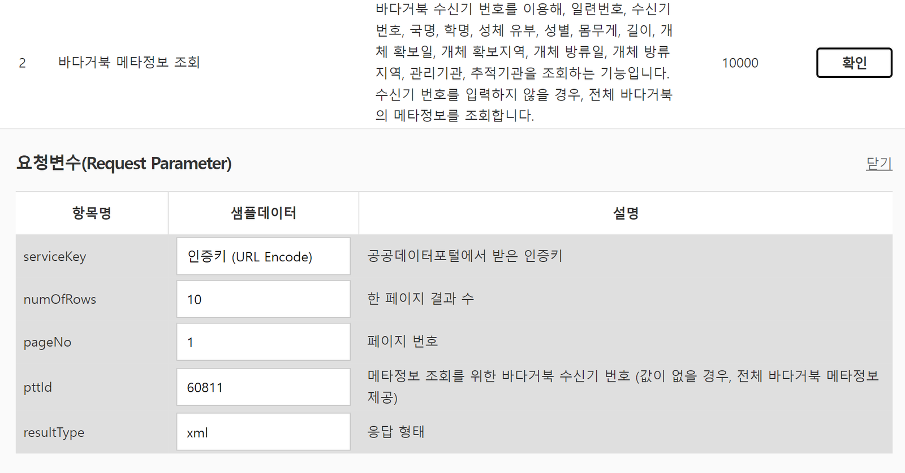{ loading=lazy }
  <figcaption>결과 예시</figcaption>
</figure>
