# :material-turtle: Sea Turtle Tracks [2026.10.08]

Published sea turtle tracking data around Korea, and how to obtain the raw tracks from the National Marine Biodiversity Institute of Korea (MBRIS) through the Public Data Portal.

## Published dataset

A study of sea turtle movement, with the data used in the paper.

1. [Habitat use of loggerhead (Caretta caretta) and green (Chelonia mydas) turtles at the northern limit of their distribution range of the Northwest Pacific Ocean](https://journals.plos.org/plosone/article?id=10.1371/journal.pone.0290202)
   [:octicons-book-24: Paper (PLOS ONE, 2023)](https://doi.org/10.1371/journal.pone.0290202)
2. [Sea turtle movebank file (figshare)](https://figshare.com/articles/dataset/Sea_turtle_movebank_file_/25543167?file=45455277)

Please cite the dataset when using the raw data:

> Kim, Il-Hun; Park, Il-Kook; Park, Daesik; Kim, Min-Seop; Cho, In-Young; Yang, Dongwoo; et al. (2024). Sea turtle movebank file. PLOS ONE. Dataset. [https://doi.org/10.1371/journal.pone.0290202.s003](https://doi.org/10.1371/journal.pone.0290202.s003)

## Downloading the MBRIS data through the Public Data Portal

The steps below are independent of the paper above. They describe how to download the data provided by the National Marine Biodiversity Institute of Korea directly.

1. Register on the [Public Data Portal (data.go.kr)](https://www.data.go.kr/index.do).
2. Open the [MBRIS marine life GIS](https://www.mbris.kr/gis/), go to the sea turtle track page, and click the Public Data Portal URL.
3. Submit a usage request.

    <figure markdown="span">
      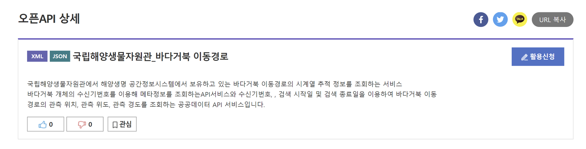{ loading=lazy }
      <figcaption>Submitting the usage request</figcaption>
    </figure>

4. Open "My Page" at the top.

    <figure markdown="span">
      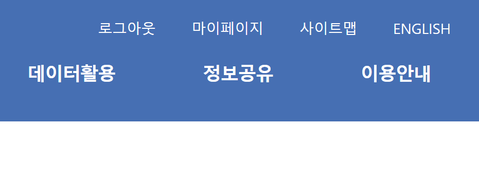{ loading=lazy }
      <figcaption>My Page</figcaption>
    </figure>

5. Use the toolbar on the right to open the usage request status.

    <figure markdown="span">
      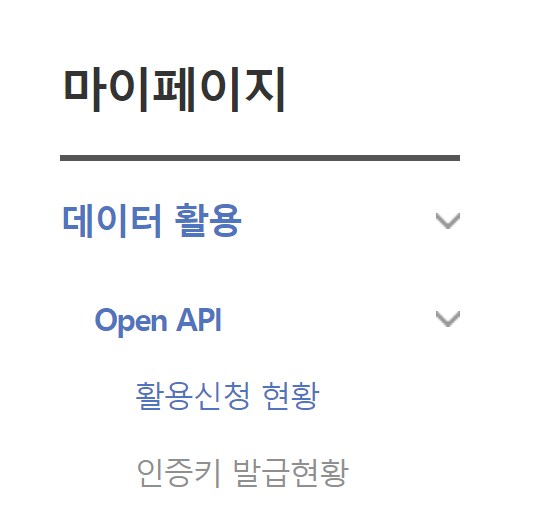{ loading=lazy }
      <figcaption>Usage request status</figcaption>
    </figure>

6. Check the request and approval status. In the screenshot below the request has already been approved, so it reads "1 in use". If it had not been approved yet, it would read "1 requested".

    <figure markdown="span">
      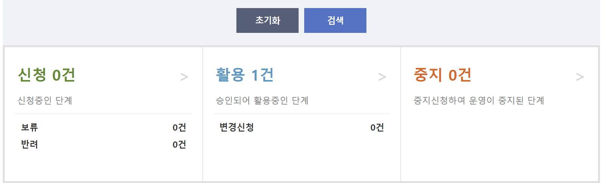{ loading=lazy }
      <figcaption>Approval status</figcaption>
    </figure>

7. Processing is slow, so call **041-950-0781** directly to get the request approved.
8. Click the entry at the bottom.

    <figure markdown="span">
      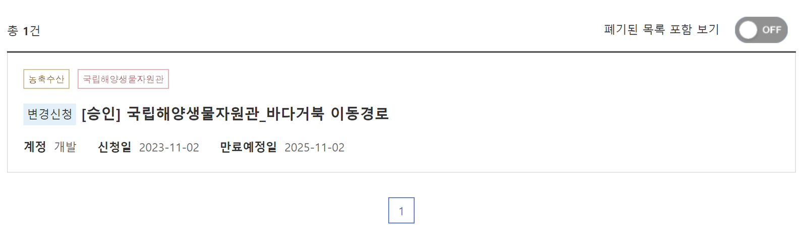{ loading=lazy }
      <figcaption>Opening the approved entry</figcaption>
    </figure>

9. If the request was approved, scroll down on the screen below and the API key is shown.

    <figure markdown="span">
      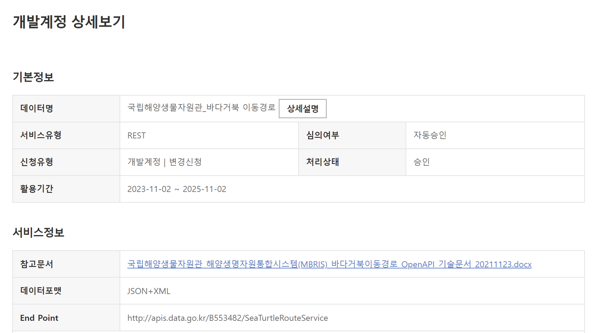{ loading=lazy }
      <figcaption>API key</figcaption>
    </figure>

10. If the API key does not appear, click "Request change". I asked the portal about this; they said it seemed to be a temporary problem, and clicking "Request change" issues a new key.

    <figure markdown="span">
      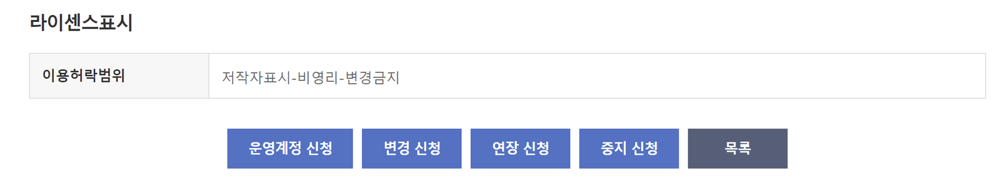{ loading=lazy }
      <figcaption>Request change</figcaption>
    </figure>

11. With the API key in hand, download the attached technical document first.

    <figure markdown="span">
      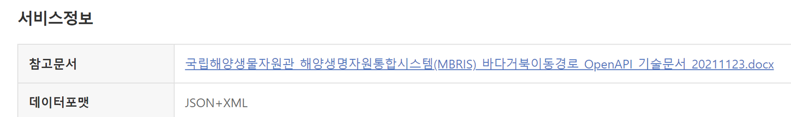{ loading=lazy }
      <figcaption>Attached document</figcaption>
    </figure>

    [:octicons-file-24: MBRIS sea turtle track OpenAPI technical document (docx)](../assets/files/regional/korea-sea-turtle/국립해양생물자원관_해양생명자원통합시스템(MBRIS)_바다거북이동경로_OpenAPI_기술문서_20211123.docx)

12. Click "Details" on the screen below.

    <figure markdown="span">
      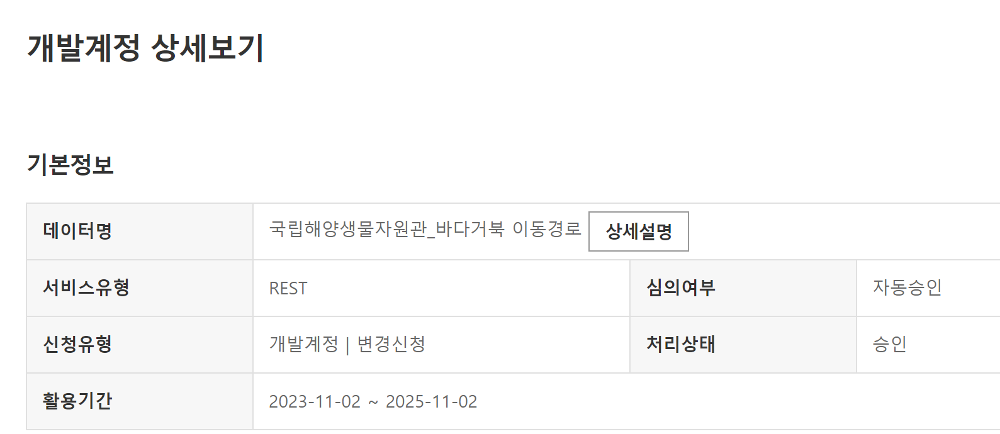{ loading=lazy }
      <figcaption>Details</figcaption>
    </figure>

13. When the screen below appears, scroll to the bottom.

    <figure markdown="span">
      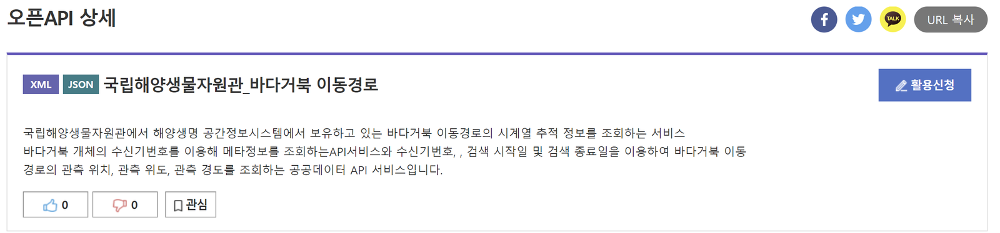{ loading=lazy }
      <figcaption>Scroll to the bottom</figcaption>
    </figure>

14. Example code for downloading the data through the API is provided for several languages.

    <figure markdown="span">
      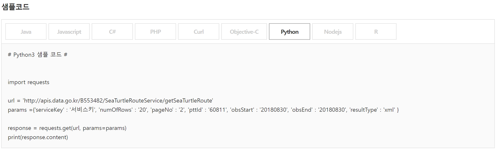{ loading=lazy }
      <figcaption>Example code by language</figcaption>
    </figure>

<figure markdown="span">
  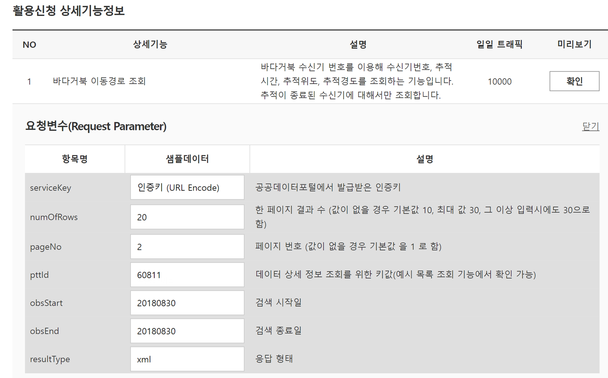{ loading=lazy }
  <figcaption>Example result</figcaption>
</figure>

<figure markdown="span">
  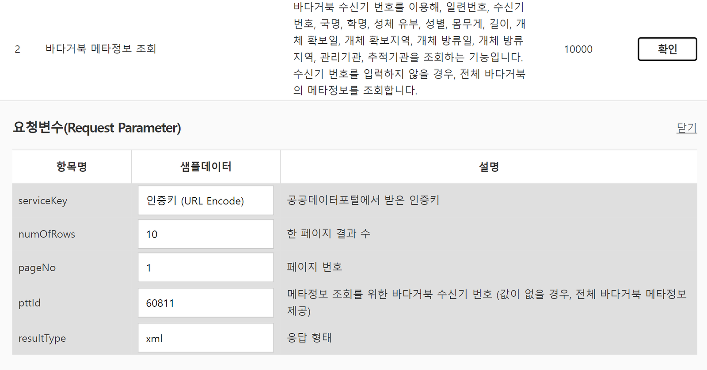{ loading=lazy }
  <figcaption>Example result</figcaption>
</figure>
