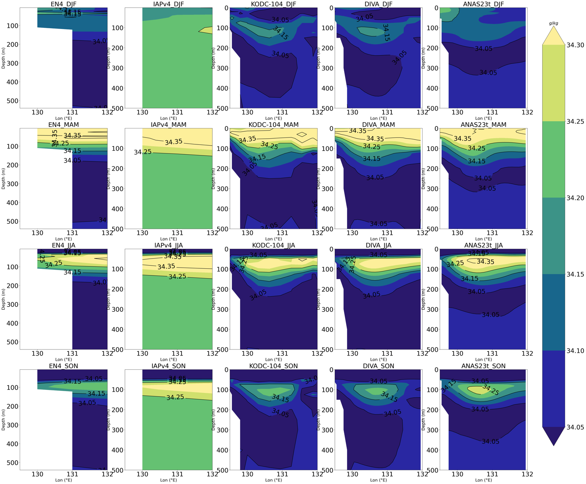
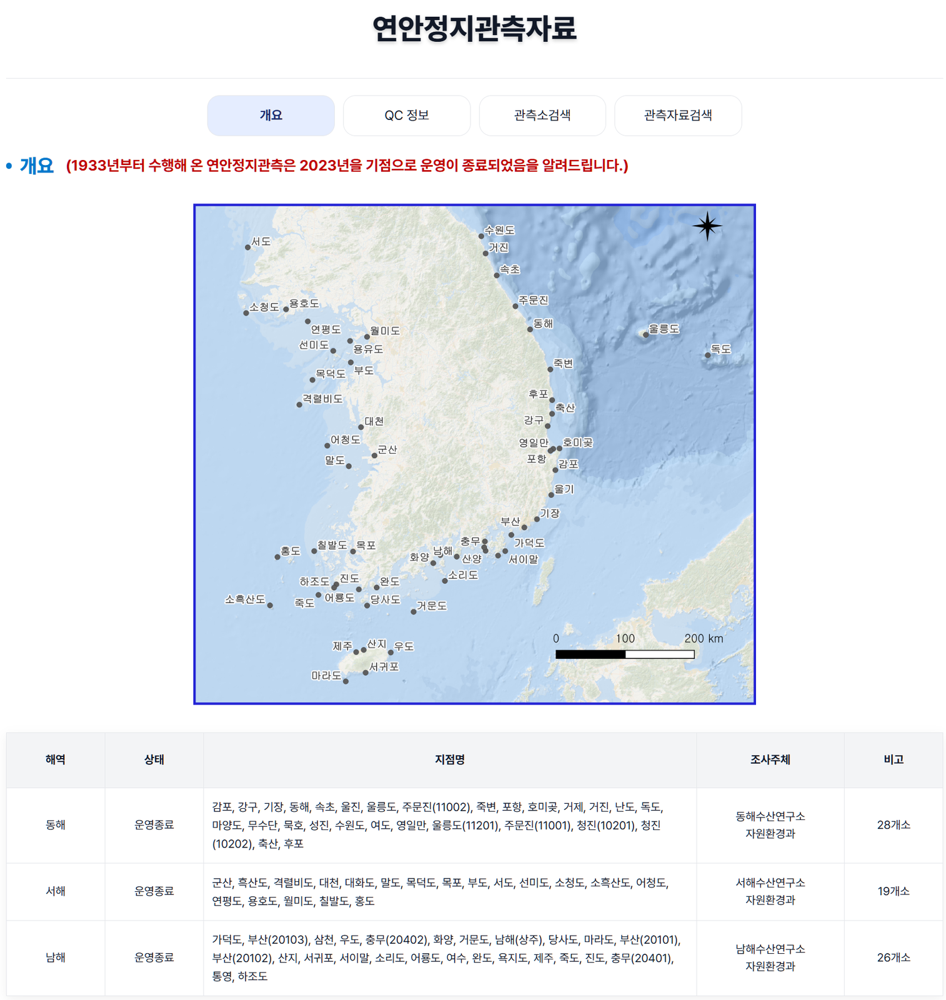
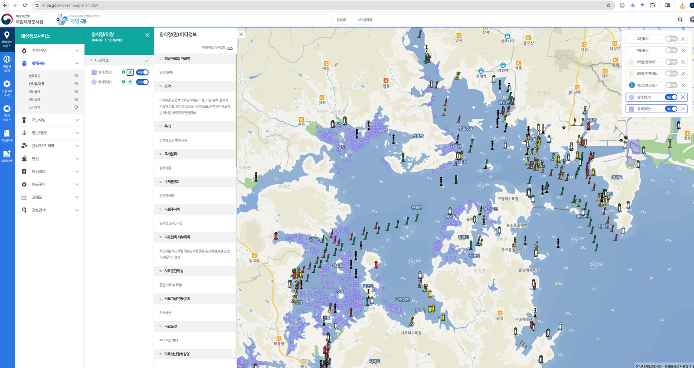
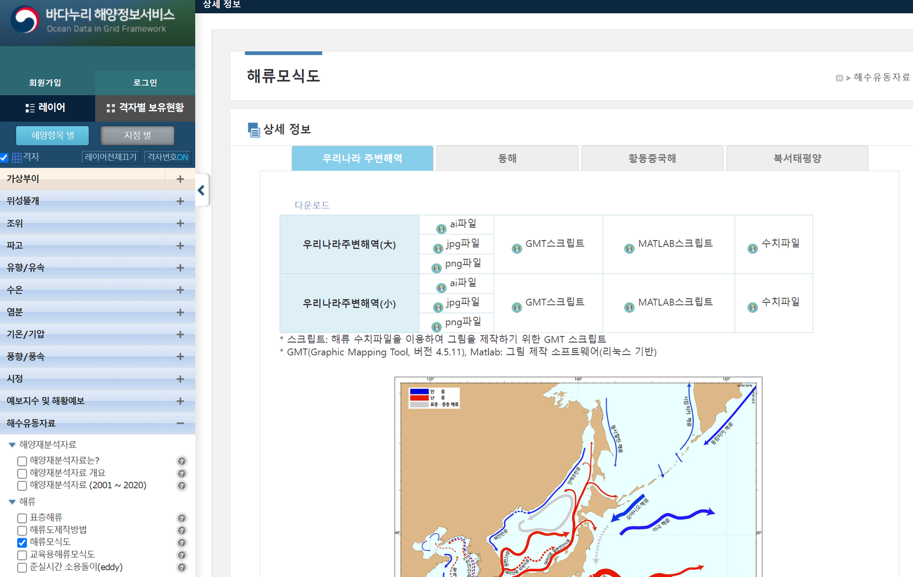
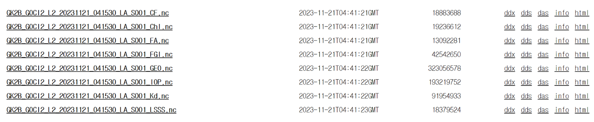

# :material-map-marker-radius: KOREA Oceanographic Database <span class="date">[2026.03.28]</span>

한반도 주변 해역의 관측·위성·재분석 자료를 기관별로 정리했습니다.

<div class="grid cards" markdown>

-   :material-ferry: **한반도 연근해 실측 관측 자료 모음**

    ---

    정선관측, 연안정지관측, 해양과학기지, 실시간 관측 자료를 찾는 곳

    [:octicons-arrow-right-24: 상세 보기](korea-observations.md)

-   :material-satellite-variant: **한반도 연근해 위성 관측 자료 모음**

    ---

    KOSC, SOIS, NOSC, NMSC

    [:octicons-arrow-right-24: 상세 보기](korea-satellite.md)

-   :material-fish: **어획량 자료** <span class="date">[2025.05.21]</span>

    ---

    어업 생산량, 총허용어획량 소진율, 어종별 어획량

    [:octicons-arrow-right-24: 상세 보기](korea-fisheries.md)

</div>

## 해양수산부 (Ministry of Oceans and Fisheries)

<div class="model-card" markdown>

### 해양수산부 · 바다허브 (VADAHUB)

해양수산부 공동활용체계와 자료 다운로드

[:octicons-link-external-24: Ministry of Oceans and Fisheries](https://www.mof.go.kr/en/index.do)<br>
[:octicons-link-external-24: 해양수산부 공동활용체계](https://www.vadahub.go.kr/bigdata/observe/space/index.do)<br>
[:octicons-download-24: 자료 다운로드 (VADAHUB)](https://www.vadahub.go.kr/user/main.do)

</div>

## NIFS 국립수산과학원

[:octicons-link-external-24: 국립수산과학원 OPEN API 목록](https://www.nifs.go.kr/openApi/actionOpenapiInfoList.do)

<div class="model-card" markdown>

### KODC 정선관측자료

NIFS Serial Oceanographic Observation. 정선을 따라 수행하는 정기 관측 자료입니다.

[:octicons-book-24: NIFS 정선관측자료 다운로드 방법](korea-nifs-download.md)

</div>

<div class="model-card" markdown>

### KODC 한반도 주변해 수온·염분 기후 평년 자료

1966~2023
{ .spec }

수온·염분 기후 평년장과 DIVA 기반 격자 시계열

[:octicons-link-external-24: KODC Atlas 개요](https://www.nifs.go.kr/kodc/ocean-info/atlas/overview)<br>
[:octicons-download-24: Continuous Gridded Time Series of T/S around the Korean Peninsula using DIVA (v1, SEANOE)](https://www.seanoe.org/data/01006/111799/)

<figure markdown="span">
  { loading=lazy }
  <figcaption>KODC 한반도 주변해 수온·염분 기후 평년 자료 (atlas)</figcaption>
</figure>

</div>

<div class="model-card" markdown>

### KODC 연안정지관측자료

1933~2023
{ .spec }

연안 정지점에서 수행한 장기 관측 자료

[:octicons-link-external-24: KODC 연안정지관측 개요](https://www.nifs.go.kr/kodc/observe/coastal/overview)

<figure markdown="span">
  { loading=lazy }
  <figcaption>KODC 연안정지관측 지점 (2023년 운영 종료)</figcaption>
</figure>

</div>

<div class="model-card" markdown>

### 실시간 해양수산환경 관측시스템 (RISA)

실시간 관측 자료

[:octicons-link-external-24: RISA](https://www.nifs.go.kr/risa/main.risa)

</div>

<div class="model-card" markdown>

### SOIS (Satellite Ocean Information System)

NOAA, Suomi NPP 위성 자료

[:octicons-link-external-24: e-연구바다](https://www.nifs.go.kr/portal/me/soisA/actionSoisTrenchSearch.do)

</div>

## KHOA 국립해양조사원

<div class="model-card" markdown>

### KHOA

국립해양조사원 홈페이지와 해양지도. 해양지도에서 양식장 위치 정보를 다운로드할 수 있습니다.

[:octicons-link-external-24: KHOA (English)](http://www.khoa.go.kr/eng/Main.do)<br>
[:octicons-link-external-24: KHOA 해양지도](https://www.khoa.go.kr/oceanmap/main.do#)

<figure markdown="span">
  { loading=lazy }
  <figcaption>위 화면과 같이 해양지도에서 양식장 위치 정보를 다운로드할 수 있습니다</figcaption>
</figure>

</div>

<div class="model-card" markdown>

### 바다누리 · 실시간해양관측정보시스템

Ocean Data in Grid Framework. 부이, 표층 뜰개 등

[:octicons-link-external-24: 바다누리 해양정보 지도](https://khoa.go.kr/oceandata/oceaninfo/map.do)

??? info "바다누리 자료 이용 시 참고 (전화 문의 결과)"
    - 부이, 표층 뜰개 자료 등 바다누리에서 제공하는 자료는 **KST(한국 표준시)** 기준입니다.
    - 바다누리에서 받을 수 있는 표층 뜰개 중 SVP drifter는 **GDP program에 포함되지 않는다**고 합니다.
    - 표층 뜰개 자료는 현재 개별로만 다운로드할 수 있고, 한 번에 받는 별도의 방법은 없다고 합니다. [2025.05.01 기준]

</div>

<div class="model-card" markdown>

### 한반도 주변 해류 모식도

한반도 주변 해역의 해류 모식도 자료. 바다누리에서 다운로드할 수 있습니다.

[:octicons-download-24: 바다누리 해양정보 지도](https://khoa.go.kr/oceandata/oceaninfo/map.do)

<figure markdown="span">
  { loading=lazy }
  <figcaption>해류 모식도 자료를 다운로드할 수 있는 사이트 화면</figcaption>
</figure>

</div>

<div class="model-card" markdown>

### NOSC (National Ocean Satellite Center)

GOCI-II
{ .spec }

GOCI-II 자료 다운로드 (OPeNDAP 제공)

[:octicons-link-external-24: NOSC](https://www.nosc.go.kr/eng/main.do)<br>
[:octicons-download-24: OPeNDAP: GOCI-II](https://nosc.go.kr/opendap/GOCI-II/contents.html)

??? example "Python & OPeNDAP: GOCI-II 자료 다운로드"
    위 OPeNDAP 링크에 접속해 원하는 nc 파일을 찾은 뒤 "html" 옵션을 클릭합니다.

    <figure markdown="span">
      { loading=lazy }
      <figcaption>OPeNDAP 디렉터리 목록의 html 옵션</figcaption>
    </figure>

    그 "html" 주소를 아래 코드의 변수 `url`에 넣습니다.

    ```py title="Download a GOCI-II file via OPeNDAP"
    import wget
    url = "http://www.nosc.go.kr/opendap/GOCI-II/2023/11/21/L2/GK2_GC2_L2_20231121_231530/GK2B_GOCI2_L2_20231121_231530_LA_S007_Chl.nc"
    wget.download(url)
    ```

</div>

## MEIS 해양환경측정망

<div class="model-card" markdown>

### MEIS 해양환경측정망

해양환경 정기 관측. 지도 화면은 어떤 관측 자료가 있는지 확인하는 데 유용합니다.

[:octicons-link-external-24: MEIS 항만 관측](https://www.meis.go.kr/mei/observe/port.do)<br>
[:octicons-link-external-24: MEIS 관측망 지도](https://www.meis.go.kr/map/oemsBaseMap.do)

</div>

<div class="model-card" markdown>

### 바다거북 이동 경로

논문으로 공개된 이동 경로 자료와 MBRIS 공공데이터 API 신청 방법

[:octicons-arrow-right-24: 바다거북 이동경로 다운로드 방법](korea-sea-turtle.md)

</div>

## KIOST 한국해양과학기술원

<div class="model-card" markdown>

### KIOST

한국해양과학기술원과 해양과학도서관

[:octicons-link-external-24: KIOST](https://www.kiost.ac.kr/eng.do)<br>
[:octicons-link-external-24: 해양과학도서관](https://library.kiost.ac.kr/)<br>
[:octicons-link-external-24: KIOST Data Portal](https://rdc.zeronesoft.kr/eng/dataPortal) (사이트 연결 안 됨)

</div>

<div class="model-card" markdown>

### KORS 해양과학기지

이어도, 신안가거초, 옹진소청초 해양과학기지. 경험상 해양과학기지 홈페이지보다 바다누리에서 자료를 받는 것이 더 수월합니다.

[:octicons-link-external-24: KORS Data Portal](https://kors.kiost.ac.kr/data/dataPortal)<br>
[:octicons-download-24: 바다누리 해양정보 지도](https://khoa.go.kr/oceandata/oceaninfo/map.do)<br>
[:octicons-book-24: 이어도 과학기지 자료 정리 논문 (데이터 포함, Scientific Data)](https://www.nature.com/articles/s41597-026-06769-4)

??? info "해양과학기지 위치"
    | Location | Longitude (°) | Latitude (°) | Longitude (DMS) | Latitude (DMS) | Observation start |
    |---|---|---|---|---|---|
    | **Ieodo** Ocean Research Station | 125.1822 | 32.1228 | E 125° 10' 55.92" | N 32° 07' 22.08" | |
    | **Sinan-Gageocho** Ocean Research Station | 124.5928 | 33.9419 | E 124° 35' 34.08" | N 33° 56' 30.84" | |
    | **Ongjin-Socheongcho** Ocean Research Station | 124.7381 | 37.4231 | E 124° 44' 17.16" | N 37° 25' 23.16" | |
    | Yellow Sea Buoy | | | E 123° 00' 12" | N 35° 15' 30" | 2018/10/21 |

    ```matlab title="Plot KORS locations with m_map"
    % OSD location
    osdll = dms2degrees([37, 25, 23.16; 124, 44, 17.16; 35, 15, 30; 123, 00, 12; ...
        32, 07, 22.08; 125, 10, 55.92; 33, 56, 30.84 ; 124, 35, 34.08]);
    m_scatter(osdll(2), osdll(1), 200, 'magenta', 'filled', 'marker', 'square', 'MarkerEdgeColor', 'k', 'LineWidth', 1.5)
    m_text(osdll(2) - 0.27, osdll(1)+0.02, 'Ongjin-Socheongcho Ocean Research Station', ...
        'Color', 'magenta', 'HorizontalAlignment', 'right', 'FontWeight', 'Bold', 'FontSize', 15,'Fontname','Consolas');
    m_scatter(osdll(4), osdll(3), 200, 'cyan', 'filled', 'marker', 'square', 'MarkerEdgeColor', 'k', 'LineWidth', 1.5)
    m_text(osdll(4) - 0.27, osdll(3)+0.02, 'Yellow Sea Buoy', ...
        'Color', 'cyan', 'HorizontalAlignment', 'right', 'FontWeight', 'Bold', 'FontSize', 15,'Fontname','Consolas');
    m_scatter(osdll(6), osdll(5), 200, 'magenta', 'filled', 'marker', 'square', 'MarkerEdgeColor', 'k', 'LineWidth', 1.5)
    m_text(osdll(6) - 0.27, osdll(5)+0.02, 'Ieodo Ocean Research Station', ...
        'Color', 'magenta', 'HorizontalAlignment', 'right', 'FontWeight', 'Bold', 'FontSize', 15,'Fontname','Consolas');
    m_scatter(osdll(8), osdll(7), 200, 'magenta', 'filled', 'marker', 'square', 'MarkerEdgeColor', 'k', 'LineWidth', 1.5)
    m_text(osdll(8) - 0.27, osdll(7)+0.02, 'Sinan-Gageocho Ocean Research Station', ...
        'Color', 'magenta', 'HorizontalAlignment', 'right', 'FontWeight', 'Bold', 'FontSize', 15,'Fontname','Consolas');
    ```

</div>

<div class="model-card" markdown>

### KOSC (Korea Ocean Satellite Center)

GOCI, GOCI-II
{ .spec }

[:octicons-download-24: GOCI & GOCI-II 자료 검색](https://kosc.kiost.ac.kr/gociSearch/view.nm?menuCd=11&lang=ko&url=gociSearch)

</div>

<div class="model-card" markdown>

### OCPC (Ocean Climate Prediction Center)

해면 수온, 해수면, 해상강수량, 해면기압, 해상기온, 해상풍속, 유의파고, 평균파주기, 해빙 면적·두께, 엘니뇨·라니냐, 인도양 쌍극진동, 양자강(장강) 담수 유입량

[:octicons-link-external-24: OCPC (oceanclimate.kr)](https://oceanclimate.kr/en/)<br>
[:octicons-link-external-24: OCPC (ocpc.kr)](https://www.ocpc.kr/)

</div>

## 관측 자료 (동해, 한반도 주변해)

<div class="model-card" markdown>

### CREAMS / EAST-I Hydrographic CTD

1993~2016
{ .spec }

CREAMS 프로그램과 EAST-I 프로젝트로 수행한 동해(Japan Sea) 19회 국제 공동 조사의 CTD 수온·염분 프로파일 922개

[:octicons-download-24: figshare dataset](https://figshare.com/articles/dataset/Data_submit_Scientific_Data_zip/5358058/2?file=9209548)

</div>

<div class="model-card" markdown>

### KIOST_CTD

1983~1991
{ .spec }

한반도 주변 연근해 916개 정점의 CTD 수온·염분 (Year, Month, Day, Lon, Lat, depth, T, S)

[:octicons-download-24: Hydrographic observation by KIOST](https://sciwatch.kiost.ac.kr/handle/2020.kiost/46591?mode=simple)

</div>

<div class="model-card" markdown>

### (SNU) EC1 mooring

1996.11~2023.04
{ .spec }

울릉도와 독도 사이 울릉해저간극(UIG)의 심층 계류 (37.33°N, 131.45°E, 수심 약 2,300 m)

[:octicons-download-24: SNU OOL: EC1 mooring data](http://ool.snu.ac.kr/bbs/board.php?bo_table=sub3_2_b&wr_id=3)<br>
[:octicons-download-24: SEANOE (1996-11 ~ 2020-11)](https://www.seanoe.org/data/00677/78916/)<br>
[:octicons-download-24: SEANOE (2020-11-12 ~ 2023-04-25)](https://www.seanoe.org/data/00904/101590/)

??? info "EC1 mooring 상세"
    울릉도와 독도 사이의 37.33°N, 131.45°E, 수심 약 2,300 m에 설치된 계류(mooring) 플랫폼으로, 울릉해저간극(UIG, Ulleung Interplain Gap)에서
    심층 흐름의 시간적 변동성을 정량적으로 관측하기 위해 1996년 11월부터 운용되어 왔습니다. 이 계류는 subsurface mooring 방식으로,
    계류선에 부착된 장비들의 측정 시간 간격과 배터리 용량을 고려하여 약 1년마다 회수 후 재계류하는 방식으로 관리되어 왔습니다.
    2020.09.22 기준으로 23번째 계류 관측이 진행 중이었습니다. 관측 장비는 3개의 표준 수심(400, 1400, 2200 m)에서 RCM과 Aquadopp을
    장착하였고, 일부 기간에는 ADCP, SBE 39, SBE 37을 장착하였습니다. 장비별 측정 시간 간격은 15분, 30분 또는 60분으로 대부분 60분 이내입니다.
    2017년부터 1400 m와 2250 m에 용존 산소 센서를 추가로 장착하여 관측하고 있습니다.

</div>

<div class="model-card" markdown>

### (SNU) ESROB

1999.04~2020.10
{ .spec }

East Sea Real-time Ocean Buoy. 묵호항 동쪽 약 8 km (37° 34.38'N, 129° 12.918'E, 수심 130 m)

[:octicons-download-24: SNU OOL: ESROB data](http://ool.snu.ac.kr/bbs/board.php?bo_table=sub3_2_b&wr_id=5)<br>
[:octicons-download-24: SEANOE (1999-04-25 ~ 2016-08-01)](https://www.seanoe.org/data/00466/57744/)<br>
[:octicons-download-24: SEANOE (2016-08-05 ~ 2020-10-27)](https://www.seanoe.org/data/00718/82957/)

??? info "ESROB 상세"
    East Sea Real-time Ocean Buoy(ESROB)는 묵호항에서 약 8 km 떨어진 지점(37° 34.38'N, 129° 12.918'E), 수심 130 m에 설치된
    해양관측 부이로, 1999년 4월 25일부터 운용되고 있습니다. 부이에 장착된 대기·해양 관측 장비의 자료는 실시간으로 서버에 전송되어
    해양 모니터링에 활용됩니다. 설치 초기에는 주로 물리 변수(풍속, 파고, 수온, 염분, 유속)를 관측하였으나, 2011년 4월부터 해양
    생물·화학 관측 장비를 추가하고 2011년 10월부터 장·단파 복사에너지 센서를 장착하여, 연안 복합 해양 부이로서 다학제 연구에 필요한
    양질의 자료를 획득하는 것을 목표로 합니다. 부이 유지는 (주)오트로닉스가 담당하며, 자사 선박 탐사2호로 매달 정기 점검과 문제 발생 시
    수시 점검을 하고, 1년에 1회 정도 부이를 완전히 회수하여 육상에서 보수·점검 후 재계류합니다.

</div>

<div class="model-card" markdown>

### (SNU) SAVEX15

Shallow-water Acoustic Variability EXperiment의 계류 및 선박 관측 자료

[:octicons-download-24: SEANOE: SAVEX15](https://www.seanoe.org/data/00611/72285/)

</div>

<div class="model-card" markdown>

### (SNU) 동해 남서부 심층 계류 유속

동해(Japan Sea) 남서부 심층 계류 유속과 해양 관측 자료

[:octicons-download-24: SEANOE dataset](https://www.seanoe.org/data/00611/72344/)

</div>

<div class="model-card" markdown>

### ONR Japan/East Sea

Hydrographic Data Status

[:octicons-link-external-24: ONR Japan/East Sea data (UCSD)](http://sam.ucsd.edu/onr_data/)

</div>

## KOPRI 극지연구소

<div class="model-card" markdown>

### KOPRI · KPoPS

극지연구소와 극지e야기 포털

[:octicons-link-external-24: 극지연구소](https://eng.kopri.re.kr/kopri/)<br>
[:octicons-link-external-24: 극지e야기 (KPoPS)](https://www.koreapolarportal.or.kr/)

</div>

<div class="model-card" markdown>

### KPDC (Korea Polar Data Center)

1988년 세종기지에서 시작된 극지 연구의 모든 연구 데이터를 수집·관리합니다. 과학적·비상업적 목적으로 이용 신청하면 원시데이터를 제공받을 수 있습니다.

[:octicons-download-24: 극지데이터센터](https://kpdc.kopri.re.kr/)

</div>

<div class="model-card" markdown>

### KAOS (북극해 환경변화 통합 관측-전망 시스템)

서북극해의 물리·화학·생물 관측 자료를 제공하며, 해빙-해양-생태계의 과거·현재 변화와 미래 전망을 함께 가시화하는 웹 GIS입니다.

[:octicons-link-external-24: K-AOOS](https://kaos.kopri.re.kr/uat/uia/actionAnonymousLogin.do)

</div>

## 기타 기관

<div class="model-card" markdown>

### KOEM 해양환경공단

[:octicons-link-external-24: 해양환경공단](https://www.koem.or.kr/site/koem/main.do)

</div>

<div class="model-card" markdown>

### APCC (APEC Climate Center)

기후 예측 정보와 CLIK 도구

[:octicons-link-external-24: APCC](https://www.apcc21.org/?lang=ko)<br>
[:octicons-link-external-24: CLIK: Climate Information Toolkit](https://cliks.apcc21.org/)

</div>

<div class="model-card" markdown>

### JOISS (Jurisdictional Ocean Information Sharing System)

[:octicons-link-external-24: JOISS](https://joiss.kr/joiss/?lang=en)<br>
[:octicons-link-external-24: JOISS GeoNetwork 카탈로그](https://joiss.kr/geonetwork/srv/eng/catalog.search#/metadata/a3dc83b7-7795-440a-88e9-ea5ce9c85f79)

</div>

<div class="model-card" markdown>

### 제주 연안환경 정보

[:octicons-link-external-24: Jeju coastal environment information](http://203.253.203.84/index_eng.php)

</div>

## 추가 자료

<div class="model-card" markdown>

### Korea shapefile

국토지리정보원 국가지도집

[:octicons-link-external-24: National Atlas of Korea (NGII)](http://nationalatlas.ngii.go.kr/pages/page_1159.php)

</div>

<div class="model-card" markdown>

### 대한민국 영해 한계선 및 기선

[:octicons-download-24: 공공데이터포털 (data.go.kr)](https://www.data.go.kr/data/15114331/fileData.do)

</div>

<div class="model-card" markdown>

### 대한민국 강

[:octicons-download-24: HOT OSM Korea waterways (HDX)](https://data.humdata.org/dataset/hotosm_kor_waterways)

</div>

<div class="model-card" markdown>

### 대한해협 수송량

시계열 figure는 NIFS에서, raw data는 바다누리(내려받기 → 공유자료 → 대한해협 수송량)에서 확인할 수 있습니다.

[:octicons-link-external-24: 자료 시계열 (NIFS, figure만 제공)](https://www.nifs.go.kr/board/actionBoard0057List.do?selectPage=&)<br>
[:octicons-download-24: 바다누리 해양정보 서비스](https://khoa.go.kr/oceandata/main.do)

??? info "대한해협 수송량 산출 방식"
    1. 자료 시계열: NIFS 링크에서는 시계열 figure만 확인할 수 있고, raw data는 따로 제공되지 않습니다.
    2. 자료 다운로드: 바다누리 해양정보 서비스 → **내려받기** → **공유자료** → **대한해협 수송량**. 최근에 raw data를 제공하는 서비스가 새로 열렸습니다.

    - 제주해협(유입량): 완도 및 제주 조위관측자료 활용
    - 제주도–큐슈(유입량): 대한해협(유출량) − 제주해협(유입량)
    - 대한해협(유출량): 부산 및 하카타 조위관측자료 활용
    - 대한해협 내 서수도(유출량): 부산 및 이즈하라 조위관측자료 활용
    - 대한해협 내 동수도(유출량): 이즈하라 및 하카타 조위관측자료 활용

</div>
