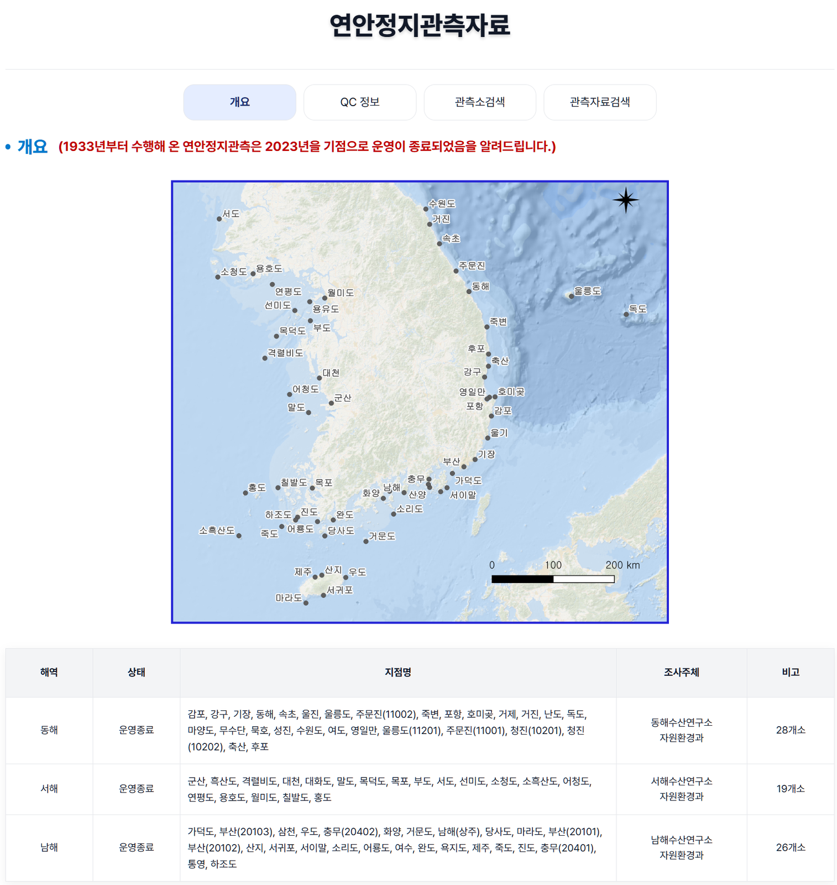
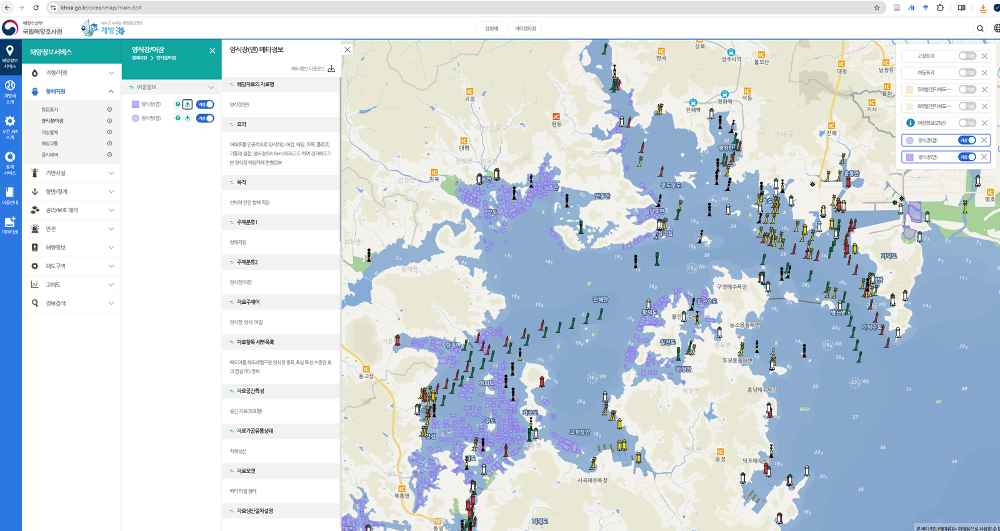
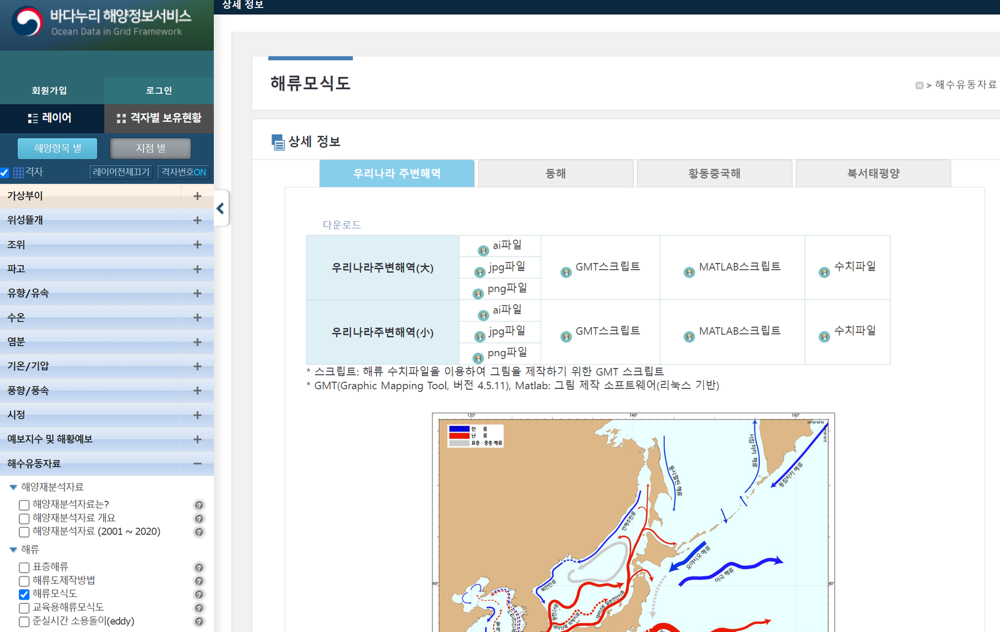
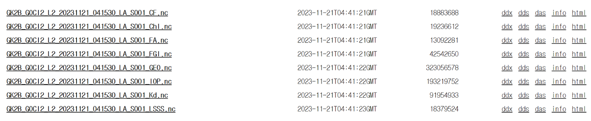

# :material-map-marker-radius: KOREA Oceanographic Database <span class="date">[2026.03.28]</span>

Observational, satellite, and reanalysis datasets for the seas around the Korean Peninsula, organized by institution.

<div class="grid cards" markdown>

-   :material-ferry: **In situ observations around Korea**

    ---

    Where to find serial, coastal, research-station, and real-time observations

    [:octicons-arrow-right-24: Open](korea-observations.md)

-   :material-satellite-variant: **Satellite observations around Korea**

    ---

    KOSC, SOIS, NOSC, NMSC

    [:octicons-arrow-right-24: Open](korea-satellite.md)

-   :material-fish: **Fisheries catch statistics** <span class="date">[2025.05.21]</span>

    ---

    Production, TAC consumption, catch by species

    [:octicons-arrow-right-24: Open](korea-fisheries.md)

</div>

## Ministry of Oceans and Fisheries (MOF)

<div class="model-card" markdown>

### MOF · VADAHUB

Data-sharing platform of the Ministry of Oceans and Fisheries, with downloads

[:octicons-link-external-24: Ministry of Oceans and Fisheries](https://www.mof.go.kr/en/index.do)<br>
[:octicons-link-external-24: VADAHUB observation platform](https://www.vadahub.go.kr/bigdata/observe/space/index.do)<br>
[:octicons-download-24: Data download (VADAHUB)](https://www.vadahub.go.kr/user/main.do)

</div>

## NIFS (National Institute of Fisheries Science)

[:octicons-link-external-24: NIFS OPEN API list](https://www.nifs.go.kr/openApi/actionOpenapiInfoList.do)

<div class="model-card" markdown>

### KODC: Serial Oceanographic Observation

NIFS Serial Oceanographic Observation along fixed lines

[:octicons-book-24: How to download NIFS Serial Oceanographic Observation data](korea-nifs-download.md)

</div>

<div class="model-card" markdown>

### KODC: T/S climatology around the Korean Peninsula

1966–2023
{ .spec }

Temperature and salinity climatology, and a DIVA-based gridded time series

[:octicons-link-external-24: KODC Atlas overview](https://www.nifs.go.kr/kodc/ocean-info/atlas/overview)<br>
[:octicons-download-24: Continuous Gridded Time Series of T/S around the Korean Peninsula using DIVA (v1, SEANOE)](https://www.seanoe.org/data/01006/111799/)

</div>

<div class="model-card" markdown>

### KODC: Coastal station observations

1933–2023
{ .spec }

Long-term observations at fixed coastal stations

[:octicons-link-external-24: KODC coastal station overview](https://www.nifs.go.kr/kodc/observe/coastal/overview)

<figure markdown="span">
  { loading=lazy }
  <figcaption>KODC coastal station observation overview</figcaption>
</figure>

</div>

<div class="model-card" markdown>

### RISA (Real-time Information System for Aquaculture environment)

Real-time observations

[:octicons-link-external-24: RISA](https://www.nifs.go.kr/risa/main.risa)

</div>

<div class="model-card" markdown>

### SOIS (Satellite Ocean Information System)

NOAA and Suomi NPP satellite data

[:octicons-link-external-24: e-Research Sea](https://www.nifs.go.kr/portal/me/soisA/actionSoisTrenchSearch.do)

</div>

## KHOA (Korea Hydrographic and Oceanographic Agency)

<div class="model-card" markdown>

### KHOA

Agency homepage and the KHOA ocean map. Aquaculture farm locations can be downloaded from the ocean map.

[:octicons-link-external-24: KHOA (English)](http://www.khoa.go.kr/eng/Main.do)<br>
[:octicons-link-external-24: KHOA ocean map](https://www.khoa.go.kr/oceanmap/main.do#)

<figure markdown="span">
  { loading=lazy }
  <figcaption>Aquaculture farm locations can be downloaded from the KHOA ocean map, as shown here</figcaption>
</figure>

</div>

<div class="model-card" markdown>

### Badanuri · Real-time Ocean Observation Information System

Ocean Data in Grid Framework: buoys, surface drifters, and more

[:octicons-link-external-24: Badanuri ocean information map](https://khoa.go.kr/oceandata/oceaninfo/map.do)

??? info "Notes on Badanuri data (from a phone inquiry)"
    - Buoy, surface drifter, and other data served by Badanuri are given in **KST (Korea Standard Time)**.
    - The SVP drifters downloadable from Badanuri are **not part of the GDP program**.
    - Surface drifter data can only be downloaded one at a time; there is no bulk download at present. [as of 2025.05.01]

</div>

<div class="model-card" markdown>

### Current schematic around Korea

Schematic ocean current data for the seas around the Korean Peninsula, downloadable from Badanuri

[:octicons-download-24: Badanuri ocean information map](https://khoa.go.kr/oceandata/oceaninfo/map.do)

<figure markdown="span">
  { loading=lazy }
  <figcaption>Download page for the current schematic data</figcaption>
</figure>

</div>

<div class="model-card" markdown>

### NOSC (National Ocean Satellite Center)

GOCI-II
{ .spec }

GOCI-II data download, with OPeNDAP access

[:octicons-link-external-24: NOSC](https://www.nosc.go.kr/eng/main.do)<br>
[:octicons-download-24: OPeNDAP: GOCI-II](https://nosc.go.kr/opendap/GOCI-II/contents.html)

??? example "Python and OPeNDAP: GOCI-II data download"
    Open the OPeNDAP link above, find the nc file you need, and click the "html" option.

    <figure markdown="span">
      { loading=lazy }
      <figcaption>The html option on the OPeNDAP directory listing</figcaption>
    </figure>

    Put that "html" address into the variable `url` in the code below.

    ```py title="Download a GOCI-II file via OPeNDAP"
    import wget
    url = "http://www.nosc.go.kr/opendap/GOCI-II/2023/11/21/L2/GK2_GC2_L2_20231121_231530/GK2B_GOCI2_L2_20231121_231530_LA_S007_Chl.nc"
    wget.download(url)
    ```

</div>

## MEIS (Marine Environment Information System)

<div class="model-card" markdown>

### MEIS marine environment monitoring network

Regular marine environment monitoring. The map view is useful for checking which observations exist where.

[:octicons-link-external-24: MEIS port observations](https://www.meis.go.kr/mei/observe/port.do)<br>
[:octicons-link-external-24: MEIS monitoring network map](https://www.meis.go.kr/map/oemsBaseMap.do)

</div>

<div class="model-card" markdown>

### Sea turtle tracks

Published tracking data and how to request the MBRIS open-data API

[:octicons-arrow-right-24: How to download sea turtle tracks](korea-sea-turtle.md)

</div>

## KIOST (Korea Institute of Ocean Science and Technology)

<div class="model-card" markdown>

### KIOST

Institute homepage and the Ocean Science Library

[:octicons-link-external-24: KIOST](https://www.kiost.ac.kr/eng.do)<br>
[:octicons-link-external-24: Ocean Science Library](https://library.kiost.ac.kr/)<br>
[:octicons-link-external-24: KIOST Data Portal](https://rdc.zeronesoft.kr/eng/dataPortal) (site not reachable)

</div>

<div class="model-card" markdown>

### KORS (Korea Ocean Research Stations)

Ieodo, Sinan-Gageocho, and Ongjin-Socheongcho ocean research stations. In practice, downloading from Badanuri is easier than from the KORS site.

[:octicons-link-external-24: KORS data portal](https://kors.kiost.ac.kr/data/dataPortal)<br>
[:octicons-download-24: Badanuri ocean information map](https://khoa.go.kr/oceandata/oceaninfo/map.do)<br>
[:octicons-book-24: Data paper on the Ieodo station (Scientific Data, with data)](https://www.nature.com/articles/s41597-026-06769-4)

??? info "Location of KORS"
    | Location | Longitude (°) | Latitude (°) | Longitude (DMS) | Latitude (DMS) | Observation start |
    |---|---|---|---|---|---|
    | **Ieodo** Ocean Research Station | 125.1822 | 32.1228 | E 125° 10' 55.92" | N 32° 07' 22.08" | |
    | **Sinan-Gageocho** Ocean Research Station | 124.5928 | 33.9419 | E 124° 35' 34.08" | N 33° 56' 30.84" | |
    | **Ongjin-Socheongcho** Ocean Research Station | 124.7381 | 37.4231 | E 124° 44' 17.16" | N 37° 25' 23.16" | |
    | Yellow Sea Buoy | | | E 123° 00' 12" | N 35° 15' 30" | 2018/10/21 |

    ```matlab title="Plot KORS locations with m_map"
    % OSD location
    osdll = dms2degrees([37, 25, 23.16; 124, 44, 17.16; 35, 15, 30; 123, 00, 12; ...
        32, 07, 22.08; 125, 10, 55.92; 33, 56, 30.84 ; 124, 35, 34.08]);
    m_scatter(osdll(2), osdll(1), 200, 'magenta', 'filled', 'marker', 'square', 'MarkerEdgeColor', 'k', 'LineWidth', 1.5)
    m_text(osdll(2) - 0.27, osdll(1)+0.02, 'Ongjin-Socheongcho Ocean Research Station', ...
        'Color', 'magenta', 'HorizontalAlignment', 'right', 'FontWeight', 'Bold', 'FontSize', 15,'Fontname','Consolas');
    m_scatter(osdll(4), osdll(3), 200, 'cyan', 'filled', 'marker', 'square', 'MarkerEdgeColor', 'k', 'LineWidth', 1.5)
    m_text(osdll(4) - 0.27, osdll(3)+0.02, 'Yellow Sea Buoy', ...
        'Color', 'cyan', 'HorizontalAlignment', 'right', 'FontWeight', 'Bold', 'FontSize', 15,'Fontname','Consolas');
    m_scatter(osdll(6), osdll(5), 200, 'magenta', 'filled', 'marker', 'square', 'MarkerEdgeColor', 'k', 'LineWidth', 1.5)
    m_text(osdll(6) - 0.27, osdll(5)+0.02, 'Ieodo Ocean Research Station', ...
        'Color', 'magenta', 'HorizontalAlignment', 'right', 'FontWeight', 'Bold', 'FontSize', 15,'Fontname','Consolas');
    m_scatter(osdll(8), osdll(7), 200, 'magenta', 'filled', 'marker', 'square', 'MarkerEdgeColor', 'k', 'LineWidth', 1.5)
    m_text(osdll(8) - 0.27, osdll(7)+0.02, 'Sinan-Gageocho Ocean Research Station', ...
        'Color', 'magenta', 'HorizontalAlignment', 'right', 'FontWeight', 'Bold', 'FontSize', 15,'Fontname','Consolas');
    ```

</div>

<div class="model-card" markdown>

### KOSC (Korea Ocean Satellite Center)

GOCI, GOCI-II
{ .spec }

[:octicons-download-24: GOCI & GOCI-II data search](https://kosc.kiost.ac.kr/gociSearch/view.nm?menuCd=11&lang=ko&url=gociSearch)

</div>

<div class="model-card" markdown>

### OCPC (Ocean Climate Prediction Center)

SST, sea level, marine precipitation, sea level pressure, marine air temperature, wind speed, significant wave height, mean wave period, sea ice extent and thickness, El Niño and La Niña, Indian Ocean Dipole, and Changjiang (Yangtze) freshwater discharge

[:octicons-link-external-24: OCPC (oceanclimate.kr)](https://oceanclimate.kr/en/)<br>
[:octicons-link-external-24: OCPC (ocpc.kr)](https://www.ocpc.kr/)

</div>

## Research datasets (East Sea and Korean marginal seas)

<div class="model-card" markdown>

### CREAMS / EAST-I hydrographic CTD

1993–2016
{ .spec }

922 CTD temperature and salinity profiles from 19 international joint surveys in the East Sea (Japan Sea), under the CREAMS program and the EAST-I project

[:octicons-download-24: figshare dataset](https://figshare.com/articles/dataset/Data_submit_Scientific_Data_zip/5358058/2?file=9209548)

</div>

<div class="model-card" markdown>

### KIOST_CTD

1983–1991
{ .spec }

CTD temperature and salinity at 916 stations around the Korean Peninsula (Year, Month, Day, Lon, Lat, depth, T, S)

[:octicons-download-24: Hydrographic observation by KIOST](https://sciwatch.kiost.ac.kr/handle/2020.kiost/46591?mode=simple)

</div>

<div class="model-card" markdown>

### (SNU) EC1 mooring

1996.11–2023.04
{ .spec }

Deep mooring in the Ulleung Interplain Gap (UIG) between Ulleungdo and Dokdo (37.33°N, 131.45°E, about 2,300 m depth)

[:octicons-download-24: SNU OOL: EC1 mooring data](http://ool.snu.ac.kr/bbs/board.php?bo_table=sub3_2_b&wr_id=3)<br>
[:octicons-download-24: SEANOE (1996-11 to 2020-11)](https://www.seanoe.org/data/00677/78916/)<br>
[:octicons-download-24: SEANOE (2020-11-12 to 2023-04-25)](https://www.seanoe.org/data/00904/101590/)

??? info "About EC1"
    The EC1 mooring, at 37.33°N, 131.45°E between Ulleungdo and Dokdo in about 2,300 m of water, has been operated since November 1996
    to quantify the temporal variability of the deep flow through the Ulleung Interplain Gap (UIG). It is a subsurface mooring, recovered
    and redeployed about once a year according to the sampling intervals and battery capacity of the attached instruments. As of
    2020-09-22 the 23rd deployment was in progress. RCM and Aquadopp current meters are mounted at three standard depths (400, 1400,
    and 2200 m), with ADCP, SBE 39, and SBE 37 instruments during some periods. Sampling intervals are 15, 30, or 60 minutes, mostly
    within 60 minutes. Dissolved oxygen sensors were added at 1400 m and 2250 m in 2017.

</div>

<div class="model-card" markdown>

### (SNU) ESROB

1999.04–2020.10
{ .spec }

East Sea Real-time Ocean Buoy, about 8 km east of Mukho Harbor (37° 34.38'N, 129° 12.918'E, 130 m depth)

[:octicons-download-24: SNU OOL: ESROB data](http://ool.snu.ac.kr/bbs/board.php?bo_table=sub3_2_b&wr_id=5)<br>
[:octicons-download-24: SEANOE (1999-04-25 to 2016-08-01)](https://www.seanoe.org/data/00466/57744/)<br>
[:octicons-download-24: SEANOE (2016-08-05 to 2020-10-27)](https://www.seanoe.org/data/00718/82957/)

??? info "About ESROB"
    The East Sea Real-time Ocean Buoy (ESROB) is moored about 8 km off Mukho Harbor (37° 34.38'N, 129° 12.918'E) in 130 m of water and
    has operated since 25 April 1999. Data from its atmospheric and oceanic sensors are transmitted to a server in real time for ocean
    monitoring. Physical variables (wind, waves, temperature, salinity, currents) have been measured from the start; biological and
    chemical sensors were added in April 2011 and short- and long-wave radiation sensors in October 2011, making it a multidisciplinary
    coastal buoy. Maintenance is carried out by Otronix Co., with monthly inspections from the vessel Tamsa 2, additional visits when
    problems arise, and full recovery for onshore servicing about once a year.

</div>

<div class="model-card" markdown>

### (SNU) SAVEX15

Moored and ship-based data from the Shallow-water Acoustic Variability EXperiment

[:octicons-download-24: SEANOE: SAVEX15](https://www.seanoe.org/data/00611/72285/)

</div>

<div class="model-card" markdown>

### (SNU) Deep moored currents, southwestern East Sea

Deep moored current and hydrographic measurements in the southwestern East Sea (Japan Sea)

[:octicons-download-24: SEANOE dataset](https://www.seanoe.org/data/00611/72344/)

</div>

<div class="model-card" markdown>

### ONR Japan/East Sea

Hydrographic data status

[:octicons-link-external-24: ONR Japan/East Sea data (UCSD)](http://sam.ucsd.edu/onr_data/)

</div>

## KOPRI (Korea Polar Research Institute)

<div class="model-card" markdown>

### KOPRI · KPoPS

Institute homepage and the Korea Polar Portal Service

[:octicons-link-external-24: KOPRI](https://eng.kopri.re.kr/kopri/)<br>
[:octicons-link-external-24: KPoPS](https://www.koreapolarportal.or.kr/)

</div>

<div class="model-card" markdown>

### KPDC (Korea Polar Data Center)

Collects and manages all research data from Korean polar research since the King Sejong Station began in 1988. Raw data are provided on request for scientific, non-commercial use.

[:octicons-download-24: Korea Polar Data Center](https://kpdc.kopri.re.kr/)

</div>

<div class="model-card" markdown>

### KAOS (Korea Arctic Ocean Observing System)

Physical, chemical, and biological observations from the western Arctic Ocean, with a web GIS that visualizes past and present sea ice, ocean, and ecosystem change together with future projections

[:octicons-link-external-24: K-AOOS](https://kaos.kopri.re.kr/uat/uia/actionAnonymousLogin.do)

</div>

## Other institutions

<div class="model-card" markdown>

### KOEM (Korea Marine Environment Management Corporation)

[:octicons-link-external-24: KOEM](https://www.koem.or.kr/site/koem/main.do)

</div>

<div class="model-card" markdown>

### APCC (APEC Climate Center)

Climate prediction information and the CLIK toolkit

[:octicons-link-external-24: APCC](https://www.apcc21.org/?lang=ko)<br>
[:octicons-link-external-24: CLIK: Climate Information Toolkit](https://cliks.apcc21.org/)

</div>

<div class="model-card" markdown>

### JOISS (Jurisdictional Ocean Information Sharing System)

[:octicons-link-external-24: JOISS](https://joiss.kr/joiss/?lang=en)<br>
[:octicons-link-external-24: JOISS GeoNetwork catalog](https://joiss.kr/geonetwork/srv/eng/catalog.search#/metadata/a3dc83b7-7795-440a-88e9-ea5ce9c85f79)

</div>

<div class="model-card" markdown>

### Jeju coastal environment information

[:octicons-link-external-24: Jeju coastal environment information](http://203.253.203.84/index_eng.php)

</div>

## Extra sources

<div class="model-card" markdown>

### Korea shapefile

National Atlas of Korea (National Geographic Information Institute)

[:octicons-link-external-24: National Atlas of Korea (NGII)](http://nationalatlas.ngii.go.kr/pages/page_1159.php)

</div>

<div class="model-card" markdown>

### Territorial sea limits and baselines of Korea

[:octicons-download-24: Public Data Portal (data.go.kr)](https://www.data.go.kr/data/15114331/fileData.do)

</div>

<div class="model-card" markdown>

### Rivers of Korea

[:octicons-download-24: HOT OSM Korea waterways (HDX)](https://data.humdata.org/dataset/hotosm_kor_waterways)

</div>

<div class="model-card" markdown>

### Korea Strait transport

Time-series figures at NIFS; raw data at Badanuri (Download → Shared data → Korea Strait transport)

[:octicons-link-external-24: Time series (NIFS, figures only)](https://www.nifs.go.kr/board/actionBoard0057List.do?selectPage=&)<br>
[:octicons-download-24: Badanuri ocean information service](https://khoa.go.kr/oceandata/main.do)

??? info "How the Korea Strait transport is derived"
    1. Time series: the NIFS link shows figures only; raw data are not provided there.
    2. Download: Badanuri ocean information service → **Download** → **Shared data** → **Korea Strait transport**. A service providing the raw data opened recently.

    - Jeju Strait (inflow): from the Wando and Jeju tide gauges
    - Jeju to Kyushu (inflow): Korea Strait (outflow) minus Jeju Strait (inflow)
    - Korea Strait (outflow): from the Busan and Hakata tide gauges
    - Western channel of the Korea Strait (outflow): from the Busan and Izuhara tide gauges
    - Eastern channel of the Korea Strait (outflow): from the Izuhara and Hakata tide gauges

</div>

??? note "Data files"
    `Current_schema.zip` (current schematic data), `Basemap.zip` (Korea shapefile), and
    `해양수산부_국립해양조사원_영해한계선및직선기선_20240705.zip` (territorial sea limits) will be hosted separately.
