# :material-earth: 태평양 [2026.05.12]

태평양의 장기 계류, 쿠로시오 확장역, 국가별(한국·일본·중국·대만) 관측 자료입니다.
자료 하나가 상자 하나로 정리되어 있어 오른쪽 목차에서 자료 이름으로 바로 이동할 수 있습니다.

<figure markdown="span">
  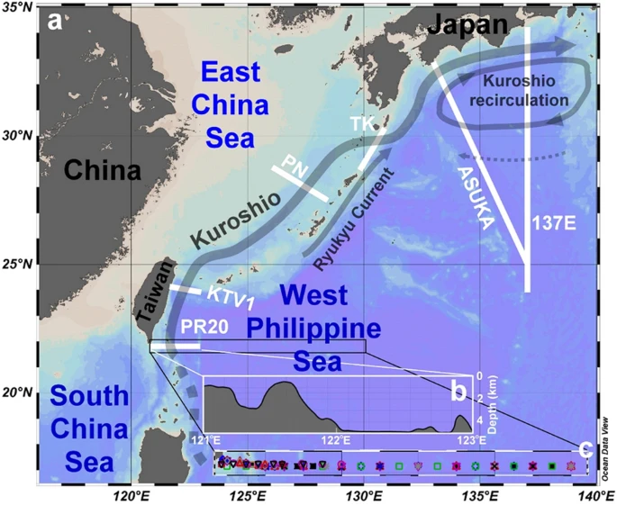{ loading=lazy }
  <figcaption>서태평양 순환 모식도 (doi:10.1038/s41598-021-84420-5)</figcaption>
</figure>
<figure markdown="span">
  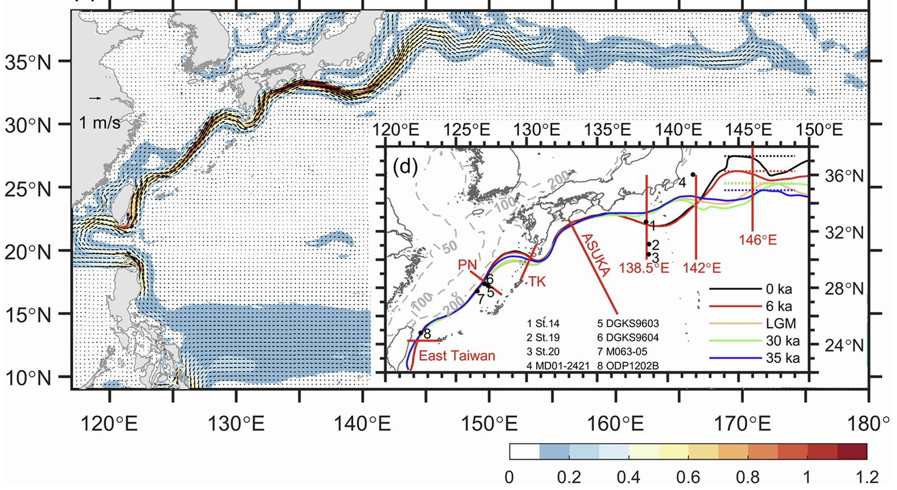{ loading=lazy }
  <figcaption>서태평양 관측 분포도 (doi:10.1029/2021GL097250)</figcaption>
</figure>

## 장기 계류 관측

### OceanSITES (TAO, TRITON etc.)

열대 태평양의 TAO/TRITON 배열을 포함하는 전 지구 장기 기준 계류 관측망입니다.

[:octicons-arrow-right-24: OceanSITES](../whole-ocean/in-situ/mooring.md)

### Pacific Ocean CO2 Time-series and Moorings (OCADS)

NOAA NCEI Ocean Carbon and Acidification Data System의 태평양 CO2 시계열·계류 프로젝트 자료입니다.

[:octicons-download-24: OCADS: Pacific moorings](https://www.ncei.noaa.gov/access/ocean-carbon-acidification-data-system/oceans/Moorings/Pacific.html)

<figure markdown="span">
  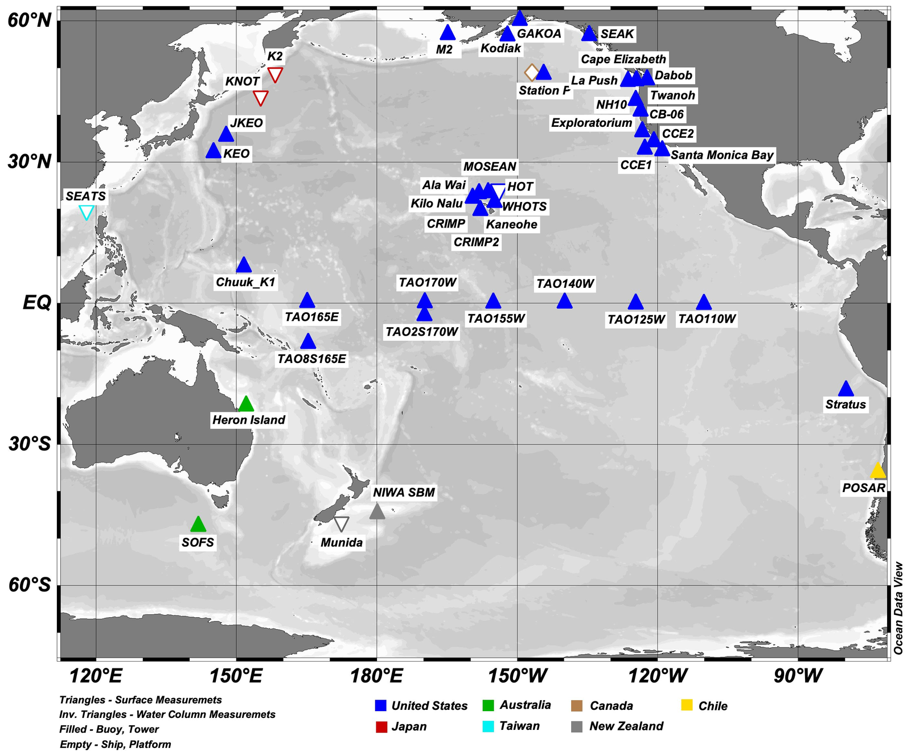{ loading=lazy }
  <figcaption>OCADS 태평양 CO2 시계열·계류 정점</figcaption>
</figure>

### Ocean Climate Stations (KEO, Papa, ARC)

PMEL Ocean Climate Stations의 기준 시계열 계류입니다. 쿠로시오 확장역 관측소(KEO)가 이 관측망에 속합니다.

[:octicons-download-24: OCS Mooring Data](https://www.pmel.noaa.gov/ocs/data/disdel/) 
[:octicons-link-external-24: Kuroshio Extension Observatory (KEO)](https://www.pmel.noaa.gov/ocs/KEO) 
[:octicons-book-24: PMEL Ocean Climate Stations as Reference Time Series and Research Aggregate Devices (Oceanography)](https://tos.org/oceanography/article/pmel-ocean-climate-stations-as-reference-time-seriesand-research-aggregate-devices) 
[:octicons-arrow-right-24: 위성 SST 검증용 현장 SST (iQuam)](../whole-ocean/in-situ/others.md)

<figure markdown="span">
  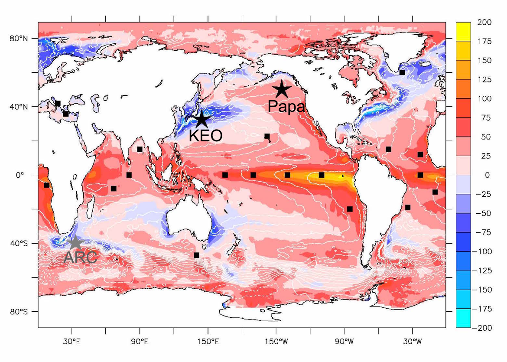{ loading=lazy }
  <figcaption>PMEL Ocean Climate Stations (KEO, Papa, ARC)</figcaption>
</figure>
<figure markdown="span">
  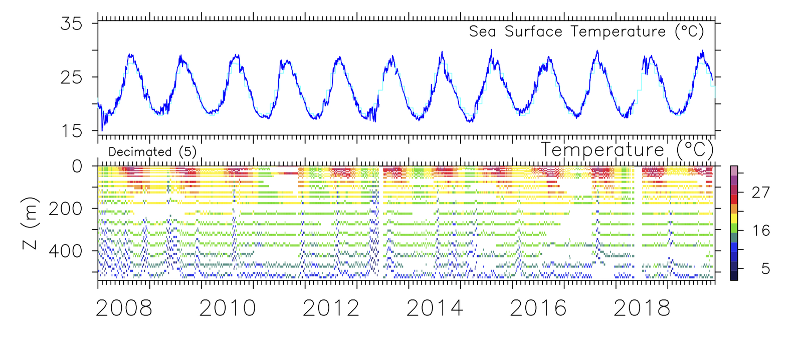{ loading=lazy }
  <figcaption>OCS 계류 자료 다운로드 페이지</figcaption>
</figure>

## 쿠로시오 확장역

### KEO

32.3°N, 144.5°E
{ .spec }

Kuroshio Extension Observatory. 위의 Ocean Climate Stations도 참고하세요.

[:octicons-link-external-24: KEO (PMEL CO2)](https://www.pmel.noaa.gov/co2/story/KEO)

### JKEO

37.9°N, 146.6°E
{ .spec }

Japanese Kuroshio Extension Observatory.

[:octicons-link-external-24: JKEO (PMEL CO2)](https://www.pmel.noaa.gov/co2/story/JKEO)

### KESS CPIES/PIES array (+ KEO)

Kuroshio Extension System Study의 역전 음향 측심기(CPIES/PIES) 배열 자료입니다. CAS 자료센터에서는 KESS + KEO 결합 자료도 제공합니다.

[:octicons-download-24: KESS Data (URI)](https://www.po.gso.uri.edu/dynamics/KESS/CPIES_data.html) 
[:octicons-download-24: KESS (CAS 해양과학대데이터센터)](https://msdc.qdio.ac.cn/data/metadata-special-detail?id=1462974032394600449&otherId=1462974032461709314) 
[:octicons-download-24: KESS + KEO (CAS 해양과학대데이터센터)](https://msdc.qdio.ac.cn/data/metadata-special-detail?id=1462973723240841217&otherId=1462973723299561474)

<figure markdown="span">
  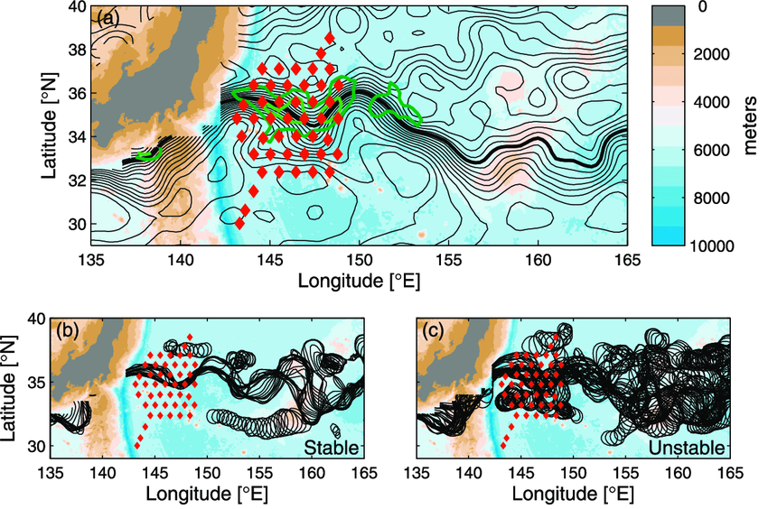{ loading=lazy }
  <figcaption>KESS CPIES/PIES 배열과 KEO</figcaption>
</figure>

### CKEO

China Kuroshio Extension Observatory. 쿠로시오–오야시오 전이대의 계류 부이 관측 자료입니다.

[:octicons-book-24: 자료 논문 (Adv. Atmos. Sci.)](https://doi.org/10.1007/s00376-025-5673-1) 
[:octicons-download-24: CKEO dataset (ScienceDB)](https://doi.org/10.57760/sciencedb.j00264.00002) 
[:octicons-download-24: CKEO dataset (Zenodo)](https://doi.org/10.5281/zenodo.16569633)

<figure markdown="span">
  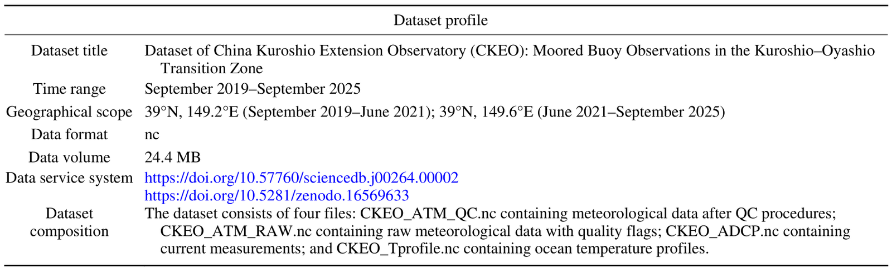{ loading=lazy }
  <figcaption>CKEO 데이터셋 개요 (기간·위치·파일 구성)</figcaption>
</figure>
<figure markdown="span">
  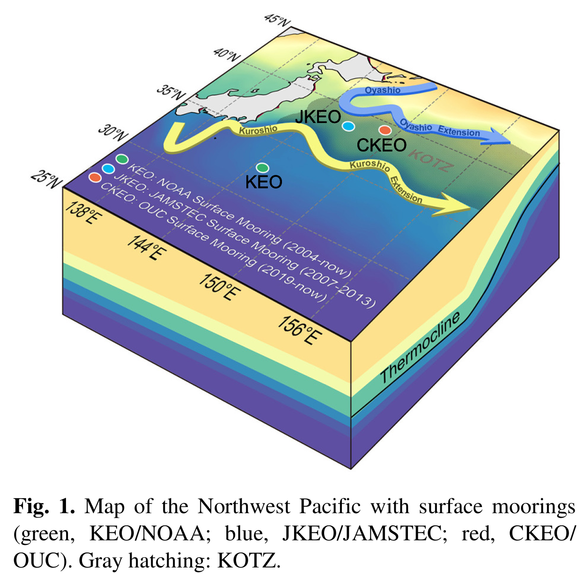{ loading=lazy }
  <figcaption>쿠로시오 확장역의 KEO·JKEO·CKEO 표층 계류 위치</figcaption>
</figure>

### KEMS

Kuroshio Extension Mooring System. 계류 자료는 KEMS 웹사이트에서 분할 압축 파일로 제공됩니다.

[:octicons-link-external-24: KEMS](https://cn-kems.net/) 
[:octicons-download-24: data.zip.001](https://cn-kems.net/Data/data.zip.001) · [:octicons-download-24: data.zip.002](https://cn-kems.net/Data/data.zip.002) 
[:octicons-book-24: Estimating the Volume Transport of Kuroshio Extension Based on Satellite Altimetry and Hydrographic Data (JTECH)](https://doi.org/10.1175/JTECH-D-23-0018.1)

<figure markdown="span">
  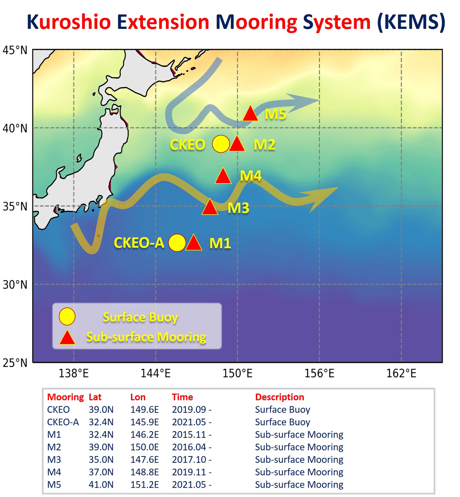{ loading=lazy }
  <figcaption>Kuroshio Extension Mooring System</figcaption>
</figure>

### Near-inertial velocity mooring

33°43'N, 156°34'E · 2017.11~2019.10
{ .spec }

쿠로시오 확장역의 아표층 계류로, 75 kHz ADCP(약 600 m 범위, 16 m bin)로 관측한 near-inertial 유속 자료입니다.

[:octicons-book-24: Mesoscale Flow Impacts on Downward Energy Flux of Near-Inertial Waves in the Kuroshio Extension (JGR Oceans)](https://agupubs.onlinelibrary.wiley.com/doi/10.1029/2024JC022153) 
[:octicons-download-24: Zenodo dataset](https://zenodo.org/records/12792912)

<figure markdown="span">
  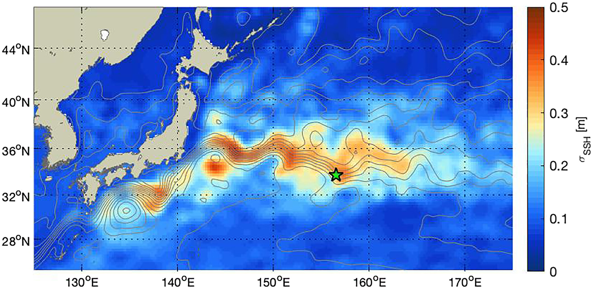{ loading=lazy }
  <figcaption>계류 위치 33°43'N, 156°34'E (2017.11~2019.10)</figcaption>
</figure>

## 한국

-   **KOREA Oceanographic Database**

    ---

    국내 관측망, 격자 자료, 다운로드 방법을 정리한 페이지입니다.

    [:octicons-arrow-right-24: Details](korea.md)

-   **한반도 주변 지역 격자 자료**

    ---

    Notion에는 제목만 있던 항목입니다: *한반도 주변해 해양 기후 평년 자료*,
    *Data-Driven Multidecadal Reconstruction and Nowcasting of Coastal and Offshore 3-D Sea Temperature Fields from Satellite Observations: A Case Study in the East/Japan Sea*.
    [아틀라스·기후값](../processed/atlas-climatology.md) 페이지를 참고하세요.

-   **NWP Ocean Climate Data Service**

    ---

    북서태평양 해양 기후 자료 서비스입니다.

    [:octicons-link-external-24: nwpoclimate.kr](https://nwpoclimate.kr/)

## 일본

[:octicons-arrow-right-24: Japan Oceanographic Database](japan.md)

### 137°E 자오선 단면 시계열 (JMA)

JMA가 1967년부터 유지해 온 137°E 자오선 해양 단면 시계열 자료입니다.

[:octicons-download-24: JMA 137°E dataset](https://www.data.jma.go.jp/gmd/kaiyou/db/mar_env/results/OI/137E_OI.html#data) 
[:octicons-link-external-24: 관련 자료 (CAS 해양과학대데이터센터)](https://msdc.qdio.ac.cn/data/metadata-special-detail?id=2034094529639903234&otherId=2034094529648291842)

<figure markdown="span">
  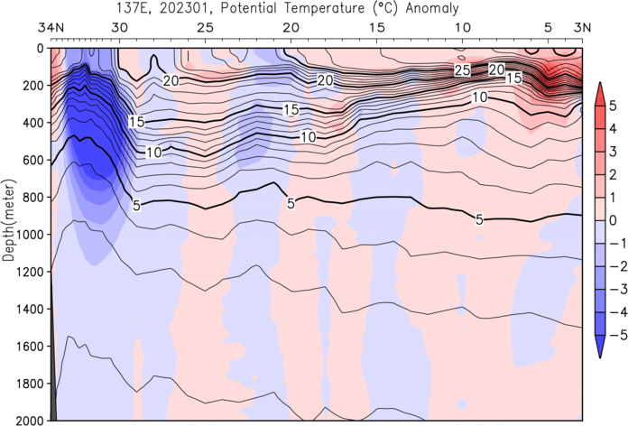{ loading=lazy }
  <figcaption>JMA 137°E 반복 관측선</figcaption>
</figure>
<figure markdown="span">
  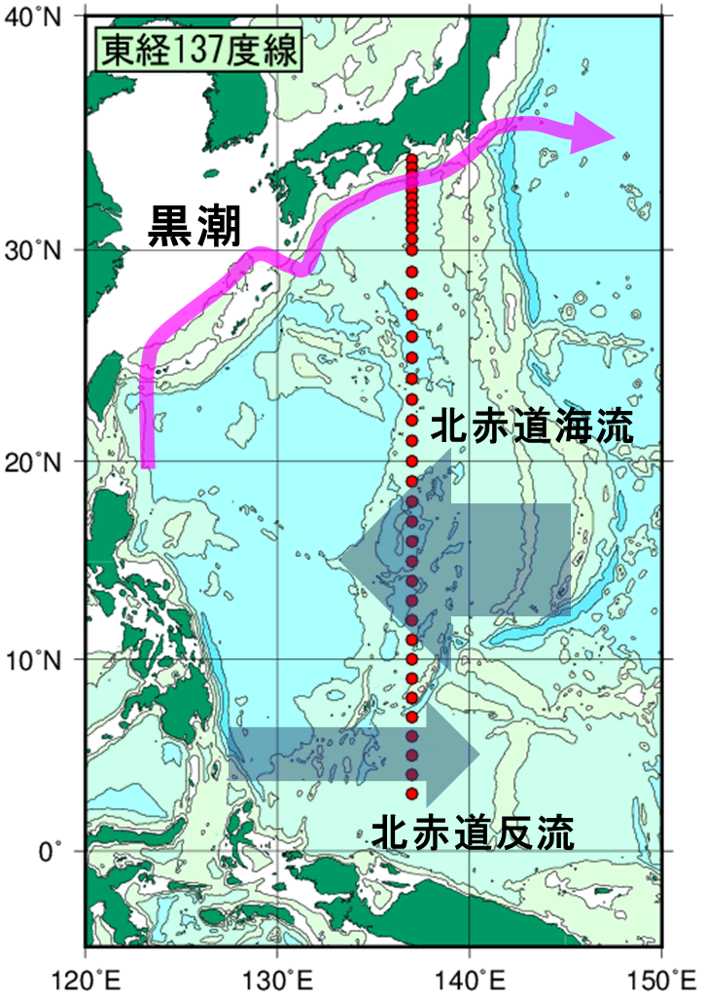{ loading=lazy }
  <figcaption>JMA 137°E 자료 페이지</figcaption>
</figure>
<figure markdown="span">
  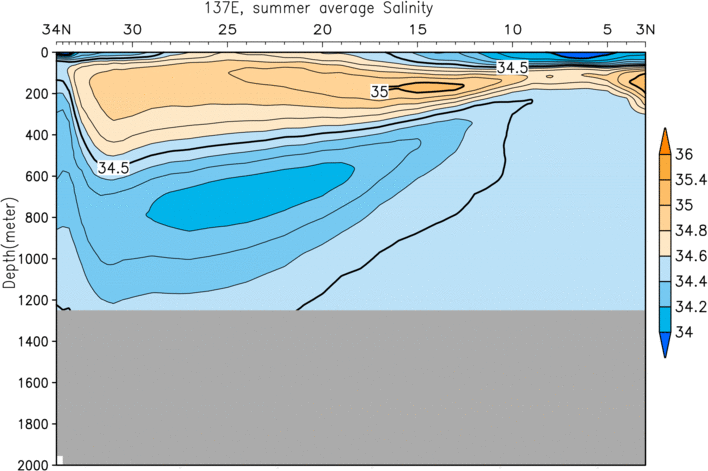{ loading=lazy }
  <figcaption>CAS 해양과학대데이터센터의 137°E 관련 자료</figcaption>
</figure>

### JMA 해양 부이 관측

[:octicons-download-24: JMA buoy data](https://www.data.jma.go.jp/kaiyou/db/vessel_obs/data-report/html/buoy/buoy_e.php)

<figure markdown="span">
  { loading=lazy }
  <figcaption>JMA 해양 부이 자료 페이지</figcaption>
</figure>

### JMA 조사선 관측

1997~2023
{ .spec }

JMA 조사선의 해양·해상 기상 관측 자료입니다. 자료는 txt 등의 형태로 제공되며, 자료마다 양식이 정해져 있고 관측 방식에 따라 포맷도 다르므로
원하는 자료의 포맷을 JMA 사이트에서 찾아서 참조하세요.

[:octicons-download-24: JMA Research Vessel data](https://www.data.jma.go.jp/kaiyou/db/vessel_obs/data-report/html/ship/ship_e.php) 
[:octicons-file-24: JMA 아표층 유속 자료 포맷 (PDF)](../assets/files/regional/pacific/JMA_subsurface_current_format.pdf)

<figure markdown="span">
  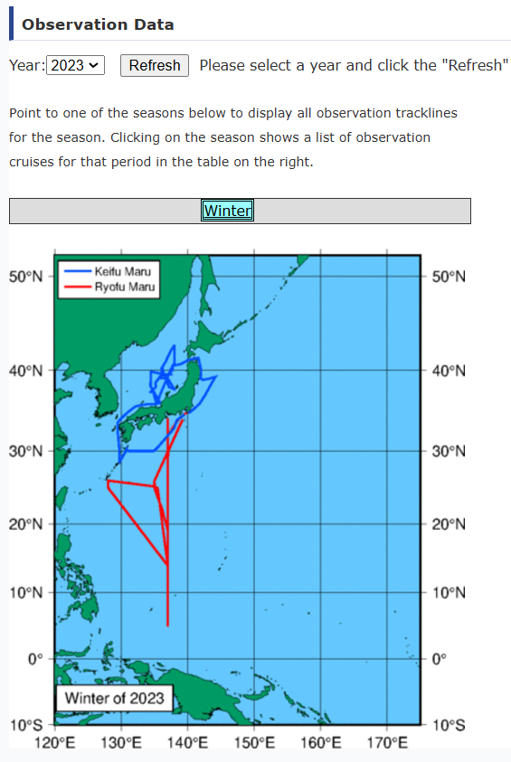{ loading=lazy }
  <figcaption>JMA 조사선 관측 자료 포맷</figcaption>
</figure>

### 오키노토리시마 관측

1993~현재
{ .spec }

1993년부터 오키노토리시마에서 수집한 기상·해양 관측 자료입니다. 최신 자료는 매년 4월경 추가됩니다.

[:octicons-link-external-24: JAMSTEC Okinotorishima](https://www.jamstec.go.jp/j/database/okitori/index.html) 
[:octicons-link-external-24: GODAC metadata](https://www.godac.jamstec.go.jp/data_catalog/view/metadata?key=Okinotorishima_WebPage&lang=en)

<figure markdown="span">
  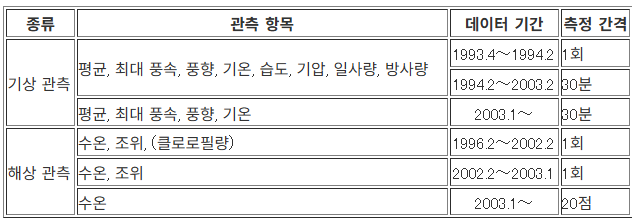{ loading=lazy }
  <figcaption>오키노토리시마</figcaption>
</figure>
<figure markdown="span">
  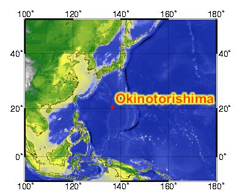{ loading=lazy }
  <figcaption>오키노토리시마 관측 자료 페이지</figcaption>
</figure>

### 시계열 정점 K2, S1 (JAMSTEC)

K2: 47°N, 160°E (서부 아한대 순환) · S1: 30°N, 145°E (아열대 순환)
{ .spec }

Marine Biogeochemical Cycle Research Team의 생지화학 시계열 정점입니다. 2010년부터 조사선 Mirai로 두 정점을 비교 관측하고 있습니다.

[:octicons-link-external-24: K2/S1 database](https://www.jamstec.go.jp/k2s1/en/index.html)

<figure markdown="span">
  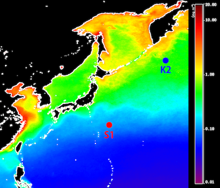{ loading=lazy }
  <figcaption>시계열 정점 K2, S1</figcaption>
</figure>

### PHSMO: Philippine Sea Mooring

13°N, 137°E · 2016.12~현재
{ .spec }

JAMSTEC이 필리핀 동쪽, 서태평양 난수역(warm pool) 북쪽 경계에 설치한 계류 부이입니다.

[:octicons-link-external-24: PHSMO (JAMSTEC)](https://www.jamstec.go.jp/ipobs/PhBuoy/)

<figure markdown="span">
  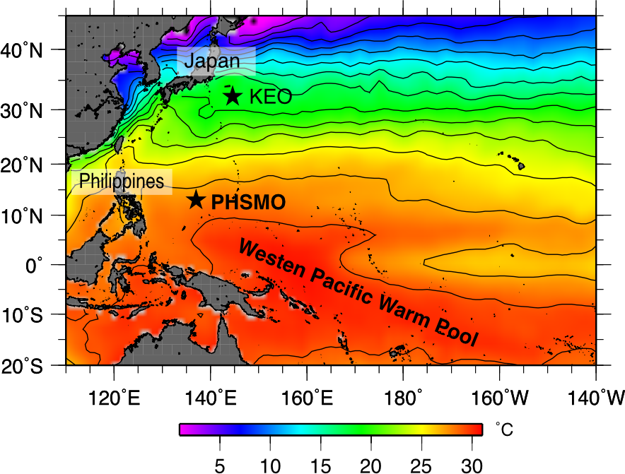{ loading=lazy }
  <figcaption>PHSMO 부이, 13°N 137°E</figcaption>
</figure>

### 토카라 해협 페리 ADCP

장기 페리 ADCP 관측에 기반한 토카라 해협 쿠로시오 자료입니다.

[:octicons-book-24: Tempo-Spatial Variations of the Kuroshio Current in the Tokara Strait Based on Long-Term Ferryboat ADCP Data (JGR Oceans)](https://agupubs.onlinelibrary.wiley.com/doi/full/10.1029/2018JC014771) 
[:octicons-download-24: data_tokara (Baidu Netdisk)](https://pan.baidu.com/s/18uwsDLFGQgfF_DhyHE_I0g#list/path=%2F)

<figure markdown="span">
  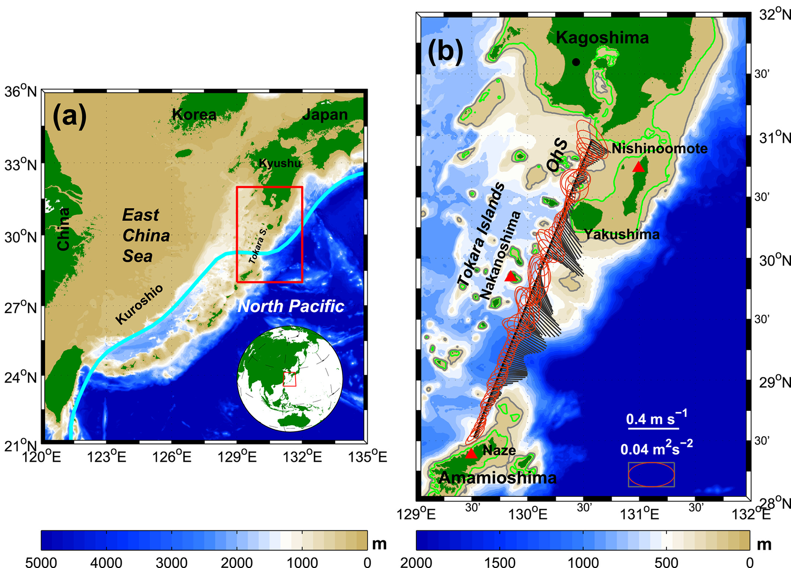{ loading=lazy }
  <figcaption>토카라 해협 페리 ADCP 항로</figcaption>
</figure>

### PN line

동중국해에서 쿠로시오를 가로지르는 JMA 오키나와 기상대의 반복 관측선입니다.

[:octicons-link-external-24: 沖縄気象台 PN線 (JMA Okinawa)](https://www.data.jma.go.jp/okinawa/know/kaiyo/pn.html) 
[:octicons-download-24: PN line (CAS 해양과학대데이터센터)](https://msdc.qdio.ac.cn/data/metadata-special-detail?id=1995761119976849409&otherId=1995761119985238018) 
[:octicons-book-24: 참고 문헌 (J. Oceanogr.)](https://doi.org/10.1007/s10872-013-0193-5)

<figure markdown="span">
  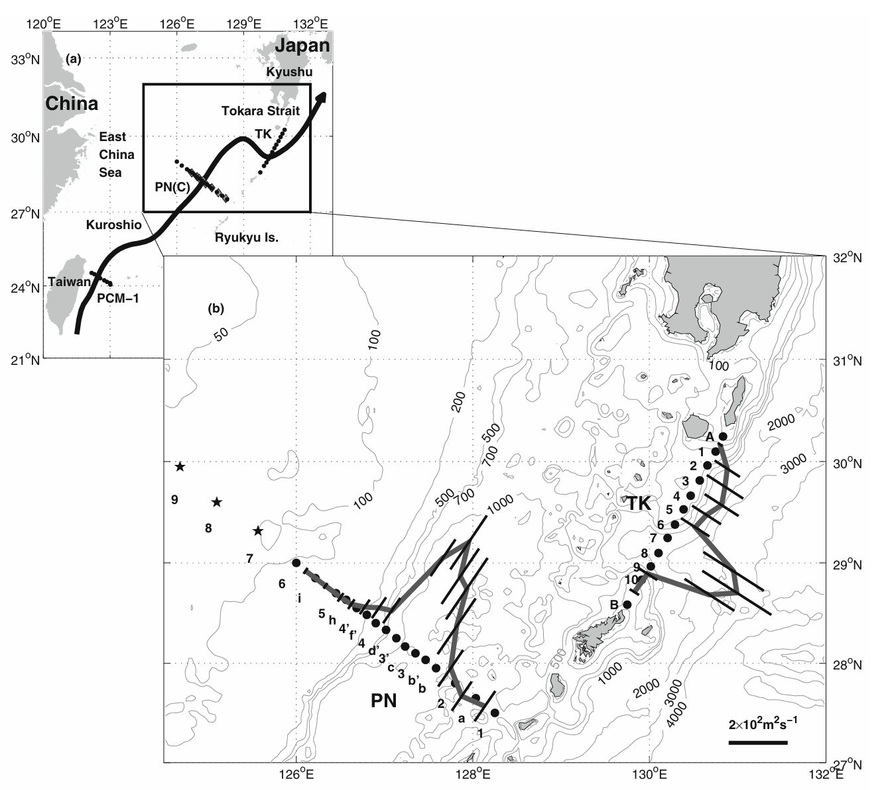{ loading=lazy }
  <figcaption>PN line (doi:10.1007/s10872-013-0193-5)</figcaption>
</figure>

### ASUKA line

일본 남서 연안 쿠로시오의 구조와 역학을 연구하는 프로젝트입니다.

[:octicons-link-external-24: ASUKA project (URI)](https://www.po.gso.uri.edu/dynamics/ASUKA/index.html) 
[:octicons-link-external-24: Uchida et al.](https://www.po.gso.uri.edu/wbc/uchida/index.html) 
[:octicons-book-24: Satellite altimeter monitoring the Kuroshio transport south of Japan (GRL)](https://agupubs.onlinelibrary.wiley.com/doi/pdf/10.1029/2000GL011796) 
[:octicons-book-24: ASUKA hydrographic data (RIAM, PDF)](https://www.riam.kyushu-u.ac.jp/oed/asuka/ahdc/ahdc.pdf) 
[:octicons-download-24: Data (RIAM)](https://www.riam.kyushu-u.ac.jp/oed/asuka/alt/)

<figure markdown="span">
  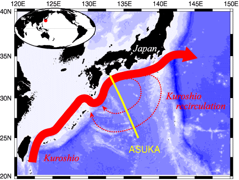{ loading=lazy }
  <figcaption>ASUKA line</figcaption>
</figure>
<figure markdown="span">
  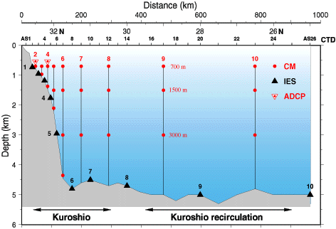{ loading=lazy }
  <figcaption>ASUKA 자료 페이지 (RIAM)</figcaption>
</figure>

### FRA 실시간 부이

[:octicons-link-external-24: buoy.fra.go.jp](https://buoy.fra.go.jp/)

### FRA A-line, N-line

일본 수산연구·교육기구(FRA)의 반복 관측선입니다. N-line 자료는 NOAA OCADS에 보관되어 있습니다.

[:octicons-download-24: A-line Monitoring](https://ocean.fra.go.jp/a-line/a-line_links2.html) 
[:octicons-download-24: OCADS: FRA Near Japan Sections (N-line)](https://www.ncei.noaa.gov/access/ocean-carbon-acidification-data-system/oceans/VOS_Program/FRA.html)

<figure markdown="span">
  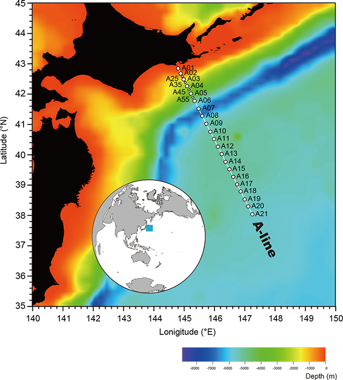{ loading=lazy }
  <figcaption>FRA A-line</figcaption>
</figure>
<figure markdown="span">
  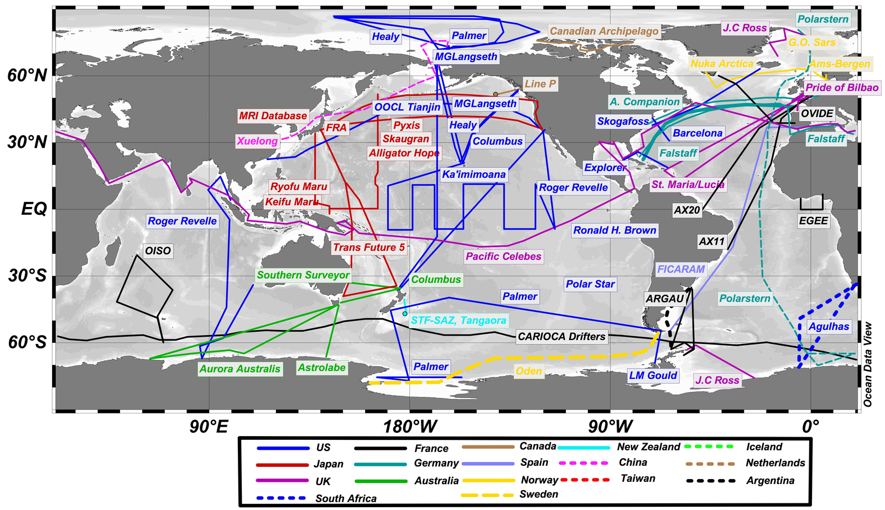{ loading=lazy }
  <figcaption>FRA N-line (OCADS)</figcaption>
</figure>

## 중국

### 자료 포털

-   **NPOCE**

    ---

    Northwestern Pacific Ocean Circulation and Climate Experiment

    [:octicons-link-external-24: NPOCE](http://npoce.org.cn/index.aspx)

-   **CAS 해양과학대데이터센터 (海洋科学大数据中心)**

    ---

    [:octicons-link-external-24: msdc.qdio.ac.cn](https://msdc.qdio.ac.cn/)

-   **국가해양과학데이터센터 (国家海洋科学数据中心)**

    ---

    [:octicons-link-external-24: mds.nmdis.org.cn](https://mds.nmdis.org.cn/pages/dataView.html?type=1&id=4cbe083006234f51a4b2782368b3f38f)

### 자료

#### 규슈-팔라우 해령의 등밀도면 횡단 용승 관측

2021.09.23~2021.10.22
{ .spec }

31개 정점의 CTD 관측 자료입니다 (Seabird 911 Plus).

[:octicons-book-24: Diapycnal Upwelling Over the Kyushu-Palau Ridge in the North Pacific Ocean (GRL)](https://agupubs.onlinelibrary.wiley.com/doi/full/10.1029/2023GL104369) 
[:octicons-download-24: Zenodo dataset](https://doi.org/10.5281/zenodo.7895316)

<figure markdown="span">
  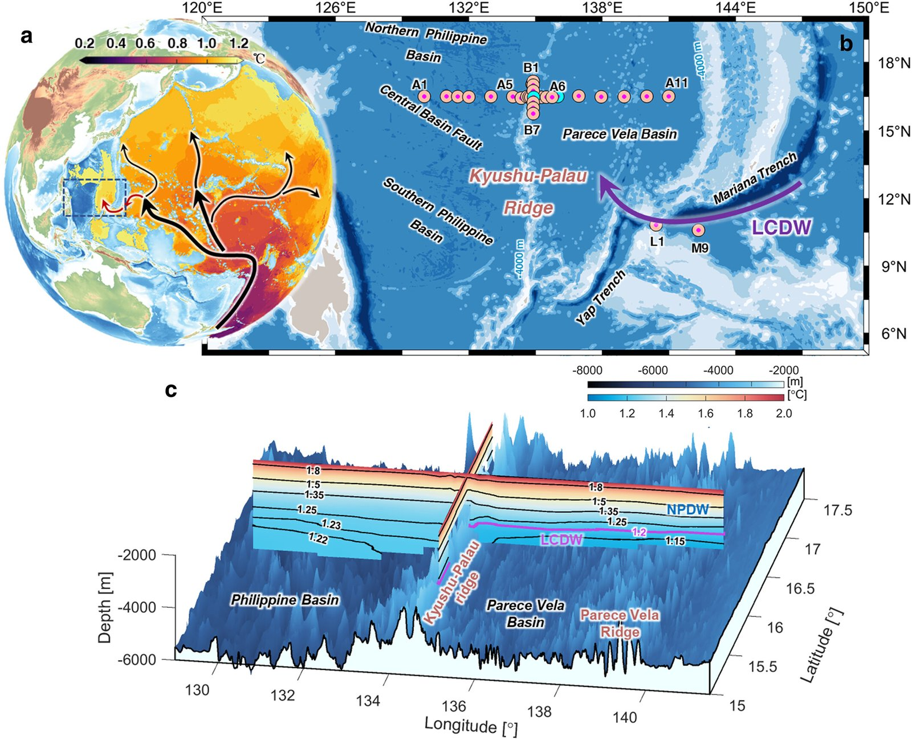{ loading=lazy }
  <figcaption>규슈-팔라우 해령 CTD 정점</figcaption>
</figure>

#### 서풍 이벤트에 의한 서부 적도 태평양 상층 혼합 관측

2018.12.17~2018.12.28
{ .spec }

1~3°N, 138~152°E의 16개 정점. 미세구조(VMP500), CTD, LADCP, 자동기상관측 자료입니다.

[:octicons-book-24: Mixing in the upper western equatorial Pacific driven by westerly wind event (Frontiers)](https://www.frontiersin.org/journals/marine-science/articles/10.3389/fmars.2022.907699/full) 
[:octicons-download-24: Zenodo dataset](https://doi.org/10.5281/zenodo.7006854)

<figure markdown="span">
  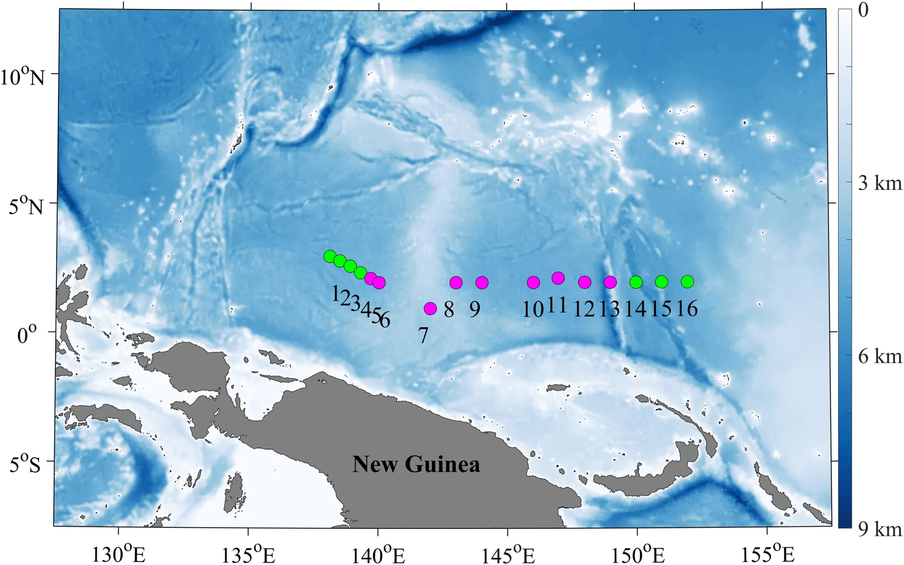{ loading=lazy }
  <figcaption>1~3°N, 138~152°E 관측 정점. 자홍색과 초록색은 각각 deep cycle turbulence(DCT)가 있는 정점과 없는 정점.</figcaption>
</figure>

#### 중국 연안해 지역 해양 데이터베이스

[:octicons-book-24: A regional ocean database for the Coastal China Sea (Scientific Data)](https://doi.org/10.1038/s41597-025-05840-w)

<figure markdown="span">
  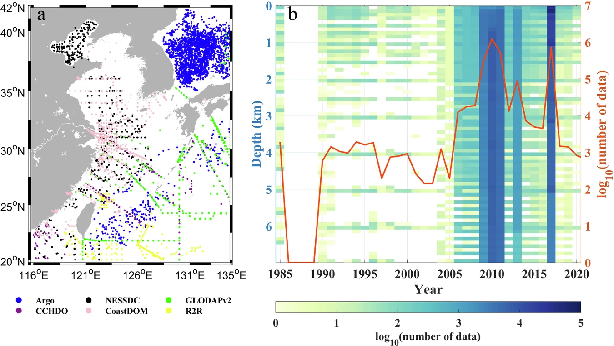{ loading=lazy }
  <figcaption>중국 연안해 지역 해양 데이터베이스</figcaption>
</figure>

#### CODC-v1

1940~2023
{ .spec }

품질 관리와 bias 보정을 거친 수온 profile 데이터베이스입니다.

[:octicons-book-24: Scientific Data 논문](https://www.nature.com/articles/s41597-024-03494-8#code-availability) 
[:octicons-download-24: CAS 해양과학대데이터센터](https://msdc.qdio.ac.cn/data/metadata-special-detail?id=1614882932315443202&otherId=1614882932386746369)

<figure markdown="span">
  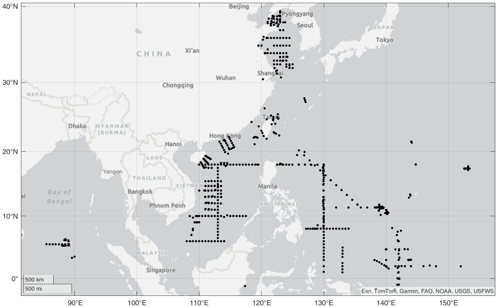{ loading=lazy }
  <figcaption>CODC-v1 다운로드 페이지</figcaption>
</figure>

#### CODC-v2

전 지구 현장 관측 profile 자료입니다.

[:octicons-download-24: CAS 해양과학대데이터센터](https://msdc.qdio.ac.cn/data/metadata-special-detail?id=1866385243443826689&otherId=1866385243481575426)

#### CODC-S

품질 관리를 거친 전 지구 염분 profile 자료입니다.

[:octicons-book-24: Scientific Data 논문](https://doi.org/10.1038/s41597-025-05172-9)

#### IAPv4

IAP/CAS의 격자 수온·해양 열용량 자료입니다.

[:octicons-book-24: ESSD 논문](https://essd.copernicus.org/articles/16/3517/2024/) 
[:octicons-download-24: 수온 (doi:10.12157/IOCAS.20240117.002)](https://doi.org/10.12157/IOCAS.20240117.002) 
[:octicons-download-24: 열용량 (doi:10.12157/IOCAS.20240117.001)](https://doi.org/10.12157/IOCAS.20240117.001) 
[:octicons-link-external-24: IAP ocean](http://www.ocean.iap.ac.cn/)

### 서태평양 아표층 계류 (CAS / NPOCE)

번호는 Notion 원본의 번호를 따랐습니다. 자료 간 정점·기간이 일부 겹치므로 "겹침" 열을 참고하세요.

| # | 위치 | 기간 | 자료 | 겹침 |
|---|---|---|---|---|
| 1 | 146°E, 25°N & 30°N | 2017.08~2017.12 | [CAS ODC (태풍 Sanvu)](https://msdc.qdio.ac.cn/data/metadata-special-detail?id=1480429794037420034&otherId=1480429794075168769) · [논문 (JPO)](https://journals.ametsoc.org/view/journals/phoc/53/9/JPO-D-22-0226.1.xml) | 8 |
| 2 | 142°E, 0~7.5°N (7기) | 2014.08~2015.10 | [논문 + 보충 xlsx (Sci. Rep.)](https://www.nature.com/articles/s41598-018-26047-7) | 4 |
| 3 | 140°E, 4.7°N | 2014.01~2018.12 | [Zenodo](https://zenodo.org/record/5765909) · [논문 (JGR)](https://agupubs.onlinelibrary.wiley.com/doi/10.1029/2021JC017969) | 4 |
| 4 | 130°E, 140°E, 142°E (15기) | 2014.11~2015.06 | [Zenodo](https://doi.org/10.5281/zenodo.3491843) · [논문 (JGR)](https://agupubs.onlinelibrary.wiley.com/doi/full/10.1029/2019JC015829) | 2, 3, 5 |
| 5 | 130°E, 8~17.5°N | 2014.09~2021.12 | [보충 자료 (Frontiers)](https://doi.org/10.3389/fmars.2022.979442) | 4, 6, 7, 9 |
| 6 | 130°E, 8.5~15°N | 2016~2021 | [Zenodo (유속계)](https://doi.org/10.5281/zenodo.13901456) · [논문 (JGR)](https://agupubs.onlinelibrary.wiley.com/doi/10.1029/2024JC021960) | 5, 7, 9 |
| 7 | 130°E, 11~17.5°N | 2017.10~2017.11 (태풍 Lan) | [CAS ODC](https://msdc.qdio.ac.cn/data/metadata-special-detail?id=1722854892608958466&otherId=1722854892692844545) · [논문 (JGR)](https://agupubs.onlinelibrary.wiley.com/doi/10.1029/2023JC020187) | 5, 6, 9 |
| 8 | M1 146°E 25°N, M2 122.67°E 22.3°N, M3 126°E 18°N | 2017.04~2020.12 | [CAS ODC](https://msdc.qdio.ac.cn/data/metadata-special-detail?id=1769562088985939969&otherId=1769562089216626690) · [프리프린트 (EGUsphere)](https://egusphere.copernicus.org/preprints/2026/egusphere-2025-6538/) | 1 (M1) |
| 9 | 130°E, 8.5~15°N (M1~M4) | 2015.09~2020.09 | [Zenodo](https://zenodo.org/records/11318020) · [논문 (JGR)](https://agupubs.onlinelibrary.wiley.com/doi/10.1029/2024JC021495) | 5, 6, 7 |
| 10 | 128.0°E, 20.45°N (필리핀 북부 해분) | 2021.12~2025.05 | [Zenodo](https://doi.org/10.5281/zenodo.19604675) · [Paper (JGR Oceans, 2026)](https://doi.org/10.1029/2026JC024576) | |

??? info "1~10번 계류 상세 설명"
    **1. 146°E, 25°N·30°N (2017.08~2017.12).** 서태평양 태풍 Sanvu 시기의 아표층 계류 관측 자료로, 품질 관리 후 필터링한
    near-inertial 및 sub-inertial 유속입니다. JPO 논문에서는 두 정점 중 한 자료를 사용하고 data는 request 형태로 제공한다고 명시했으며,
    CAS ODC 링크에서는 두 정점 자료를 태풍 시기에 맞춰 제공합니다. JPO 논문의 계류는 25°N, 146°E에 2017년 4월부터 2018년 6월까지 설치되었습니다.

    [:octicons-file-24: 1번 계류 readme (txt)](../assets/files/regional/pacific/其它_DATA2022000022_readme-1641797062275.txt)

    <figure markdown="span">
      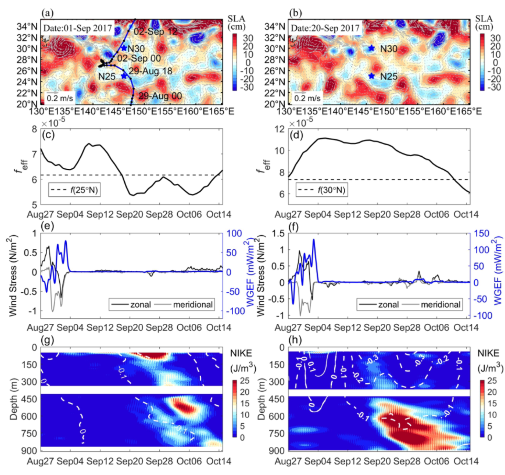{ loading=lazy }
      <figcaption>태풍 Sanvu 시기 146°E, 25°N·30°N 계류</figcaption>
    </figure>
    <figure markdown="span">
      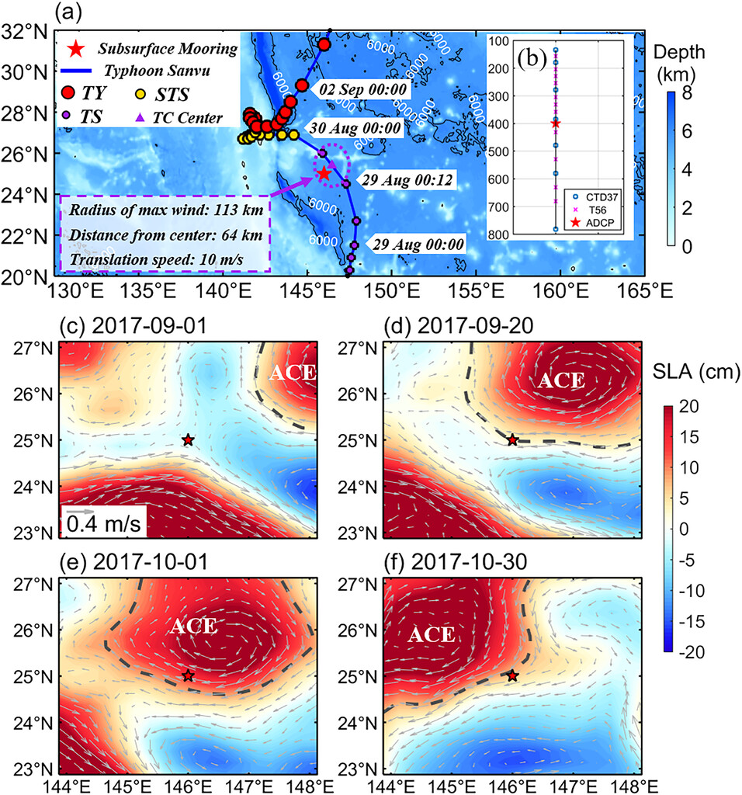{ loading=lazy }
      <figcaption>25°N, 146°E 계류 (JPO 논문)</figcaption>
    </figure>

    **2. 142°E, 0~7.5°N (2014.08~2015.10).** 142°E를 따라 0, 1, 2, 3, 4.5, 6, 7.5°N에 설치한 아표층 계류 7기입니다. 각 계류에는 설계 수심 400 m에
    상향·하향 75 kHz ADCP가 하나씩 달려 있습니다. U, V는 60~650 m 구간을 10 m 간격으로 보간하고 일평균했습니다.
    상향 ADCP 2기가 고장 나서 3°N과 6°N의 상부 400 m 자료는 없습니다.
    같은 자료를 쓴 [Subsurface structure and variability of the zonal currents in the Northwestern Tropical Pacific (DSR I)](https://www.sciencedirect.com/science/article/abs/pii/S0967063718301699)
    에서는 자료 제공이 따로 없으며, 연구 목적으로 요청하려면 Fan Wang (fwang@qdio.ac.cn)에게 문의하면 됩니다.

    [:octicons-file-24: 보충 자료 2 (xlsx)](../assets/files/regional/pacific/41598_2018_26047_MOESM2_ESM.xlsx)
    [:octicons-file-24: 보충 자료 3 (xlsx)](../assets/files/regional/pacific/41598_2018_26047_MOESM3_ESM.xlsx)

    <figure markdown="span">
      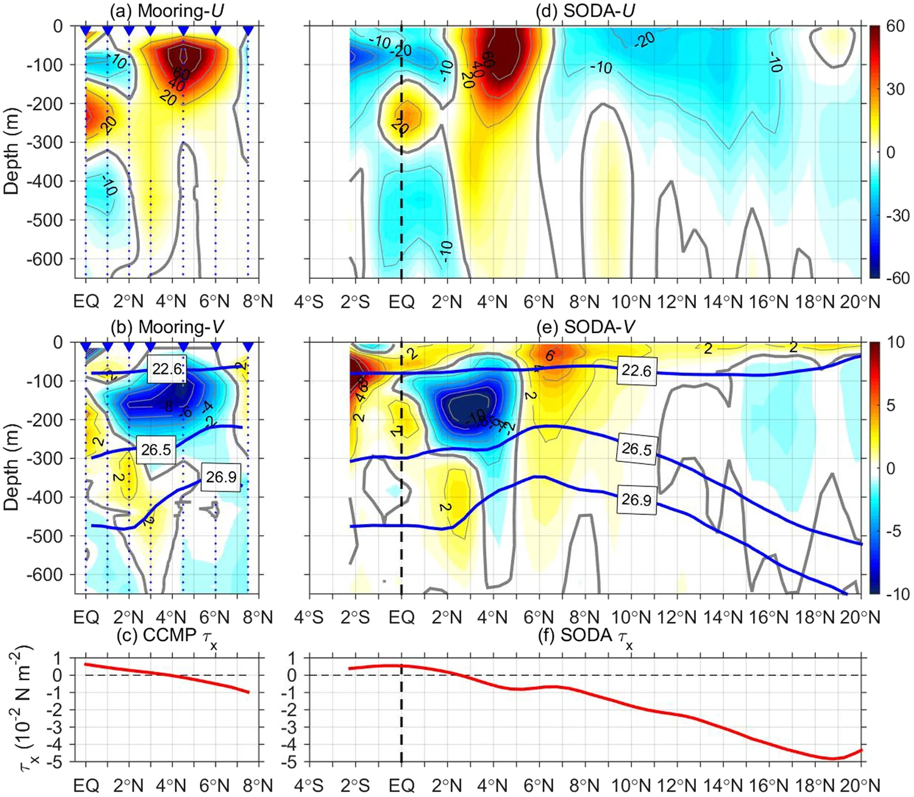{ loading=lazy }
      <figcaption>142°E 계류 7기</figcaption>
    </figure>
    <figure markdown="span">
      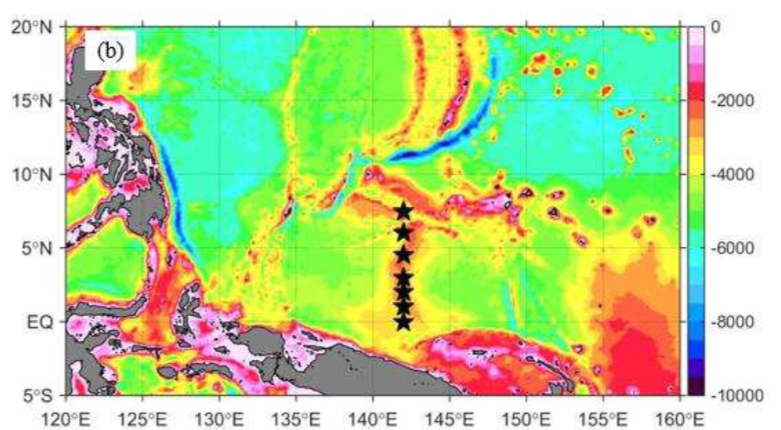{ loading=lazy }
      <figcaption>NPOCE 계류 배열 (DSR I 논문)</figcaption>
    </figure>

    **3. 140°E, 4.7°N (2014.01~2018.12).** CAS Scientific Observing Network의 일부로, 수심 약 4,100 m, 네 차례 회수·재설치로 유지되었습니다.
    약 500 m에 설치한 상향·하향 75 kHz TRDI ADCP로 50~1000 m 구간을 8 m bin으로 매시간 관측했습니다.

    <figure markdown="span">
      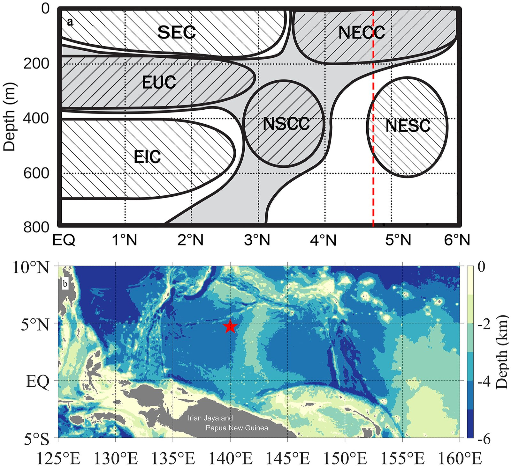{ loading=lazy }
      <figcaption>4.7°N, 140°E 계류</figcaption>
    </figure>

    **4. 130°E, 140°E, 142°E (2014.11~2015.06).** 130°E에 5기, 142°E에 7기, 그리고 (139.05°E, 11.58°N), (140°E, 4.7°N), (140°E, 2°N)에 3기입니다.
    자료는 연구 목적으로만 사용할 수 있습니다.
    [Model-based assessment of a Northwestern Tropical Pacific moored array (Ocean Modelling)](https://www.sciencedirect.com/science/article/pii/S1463500318301276)
    은 같은 배열(2013년 WPOS 프로젝트로 구축한 NWTPO 계류 관측 시스템)을 소개하지만 자료 제공은 따로 없습니다.

    <figure markdown="span">
      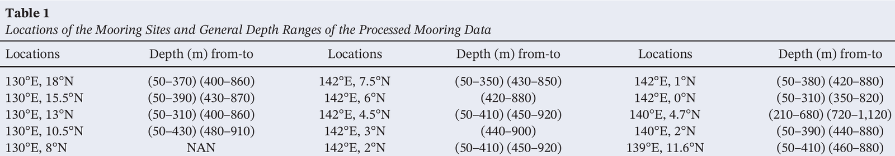{ loading=lazy }
      <figcaption>130°E, 140°E, 142°E 계류 (2014.11~2015.06)</figcaption>
    </figure>
    <figure markdown="span">
      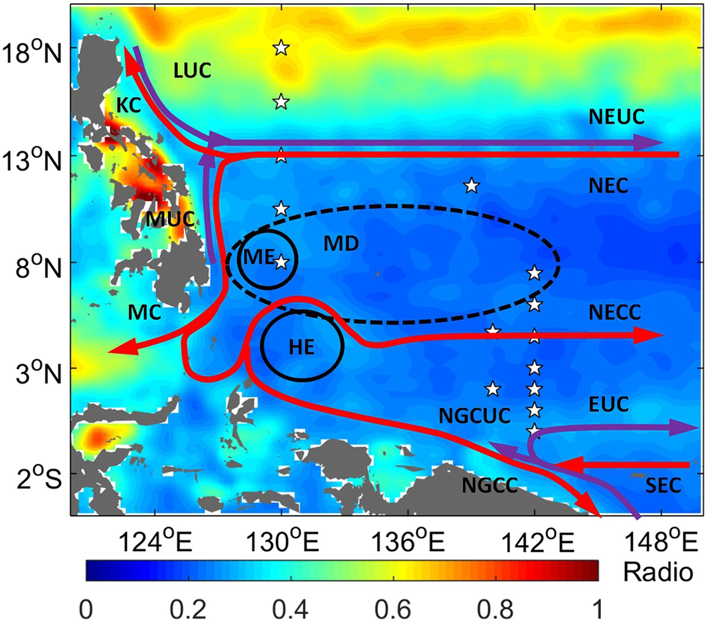{ loading=lazy }
      <figcaption>계류 배열 상세</figcaption>
    </figure>
    <figure markdown="span">
      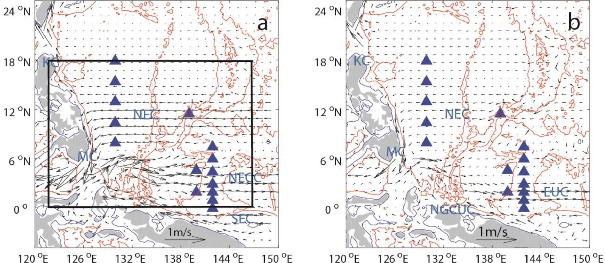{ loading=lazy }
      <figcaption>NWTPO 계류 관측 시스템 (WPOS)</figcaption>
    </figure>

    **5. 130°E, 8~17.5°N (2014.09~2021.12).** 2014년 9월에 8, 10.5, 13, 15.5, 18°N에 계류 5기를 설치했고, NEUC 제트를 더 잘 포착하기 위해
    2015년 9월에 8.5, 11, 12.5, 15, 17.5°N으로 옮긴 뒤 매년 회수하고 있습니다.

    <figure markdown="span">
      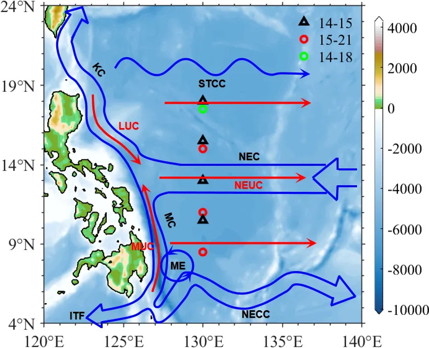{ loading=lazy }
      <figcaption>130°E 계류 배열</figcaption>
    </figure>
    <figure markdown="span">
      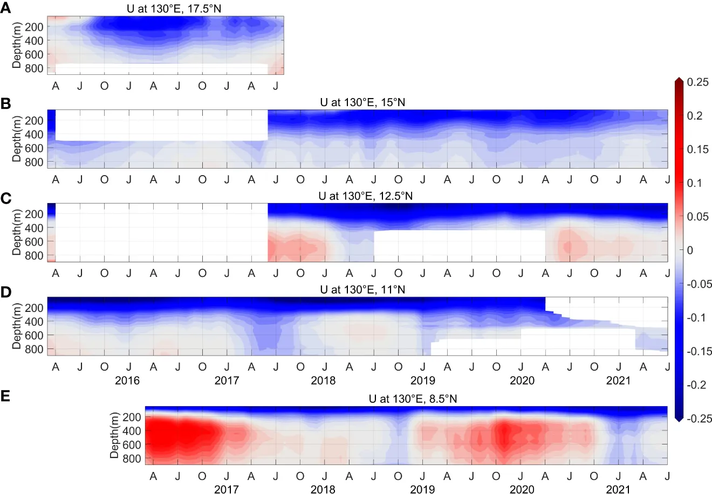{ loading=lazy }
      <figcaption>130°E 계류 배열 설치 상세</figcaption>
    </figure>
    <figure markdown="span">
      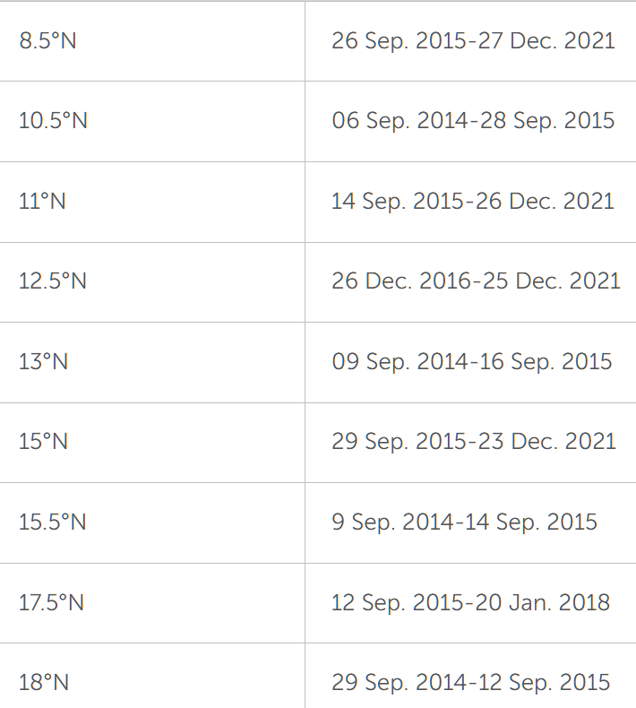{ loading=lazy }
      <figcaption>130°E NEC/NEUC 단면</figcaption>
    </figure>

    **6. 130°E, 8.5~15°N (2016~2021).** 유속계 자료는 Zenodo에, ADCP 자료는 Huang et al. (2022)의 supporting information(5번 자료)에 있습니다.

    <figure markdown="span">
      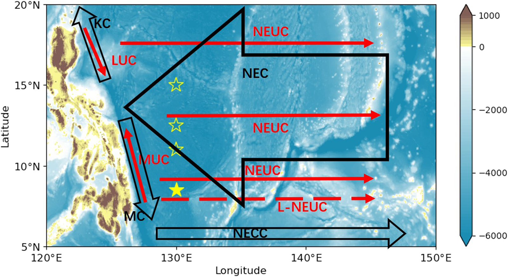{ loading=lazy }
      <figcaption>130°E 유속계 계류</figcaption>
    </figure>
    <figure markdown="span">
      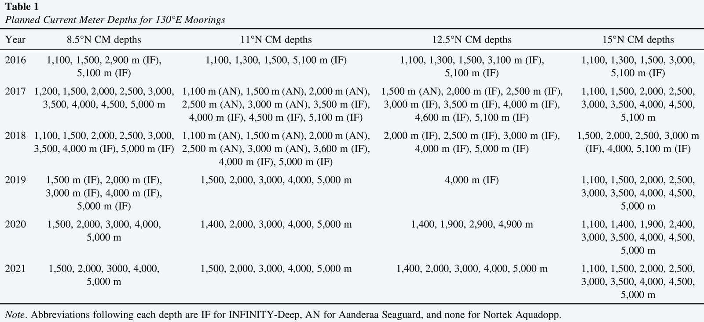{ loading=lazy }
      <figcaption>유속계 계류 상세</figcaption>
    </figure>

    **7. 130°E, 11~17.5°N.** NPOCE 사업으로 2016년 8월 1일부터 2017년 12월 14일까지 설치한 계류 4기(L11, L12, L15, L17)이며, 각각 400 m에 75 kHz ADCP 2대가 있습니다.
    논문에서는 태풍 Lan이 배열 위를 지난 2017년 10월 10일~11월 5일 자료를 사용했습니다.

    <figure markdown="span">
      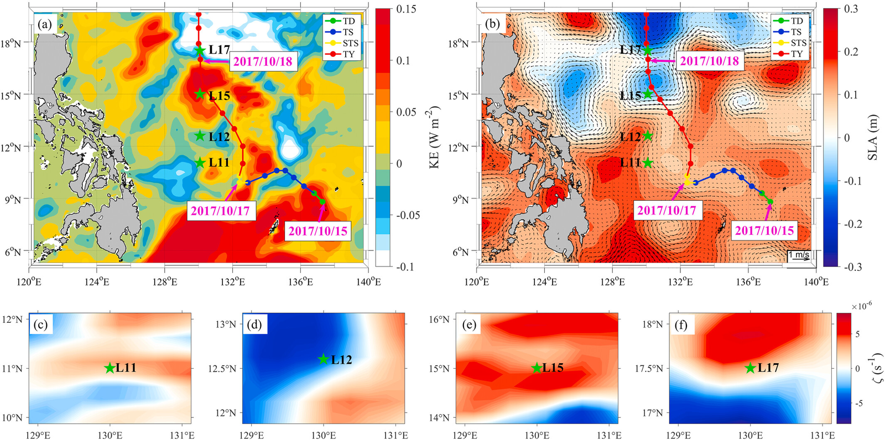{ loading=lazy }
      <figcaption>계류 L11, L12, L15, L17과 태풍 Lan 경로</figcaption>
    </figure>

    **8.** 서태평양 중층 계류 자료 (수온, 수심, 염분; 2017.04~2020.12).
    M1 = 146°E, 25°N (2017년 4월~2018년 6월), M2 = 122.67°E, 22.3°N (2019년 8월~2020년 12월), M3 = 126°E, 18°N (2016년 1월~2017년 6월).

    [:octicons-file-24: 8번 계류 자료 설명 (txt)](../assets/files/regional/pacific/论文_PAPER2024030002_PAPER2024030002-01_详见数据文件-1720923126982.txt)

    <figure markdown="span">
      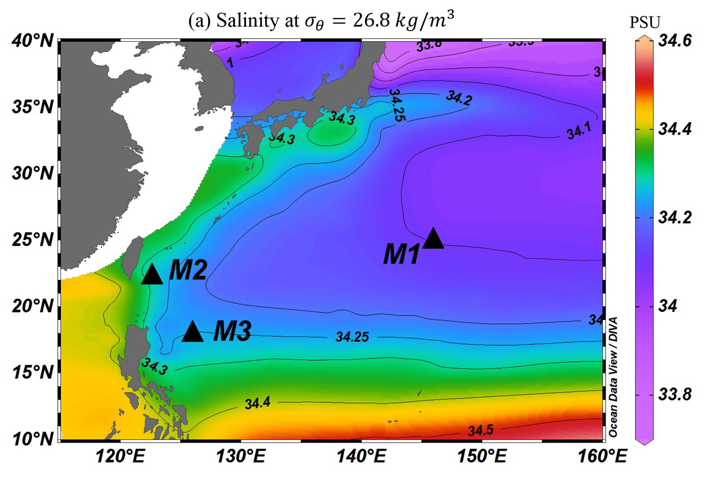{ loading=lazy }
      <figcaption>중층 계류 M1~M3 위치</figcaption>
    </figure>

    **9. 130°E (2015.09~2020.09).** 필리핀 남부 해분의 CASSON 계류 M1~M4 (8.5, 11.0, 12.5, 15.0°N), 수심 약 5,800~5,975 m, 매년 회수·재설치했습니다.

    <figure markdown="span">
      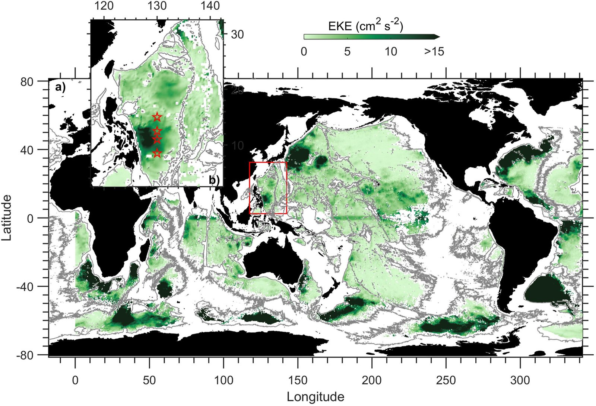{ loading=lazy }
      <figcaption>130°E CASSON 계류 M1~M4</figcaption>
    </figure>
    <figure markdown="span">
      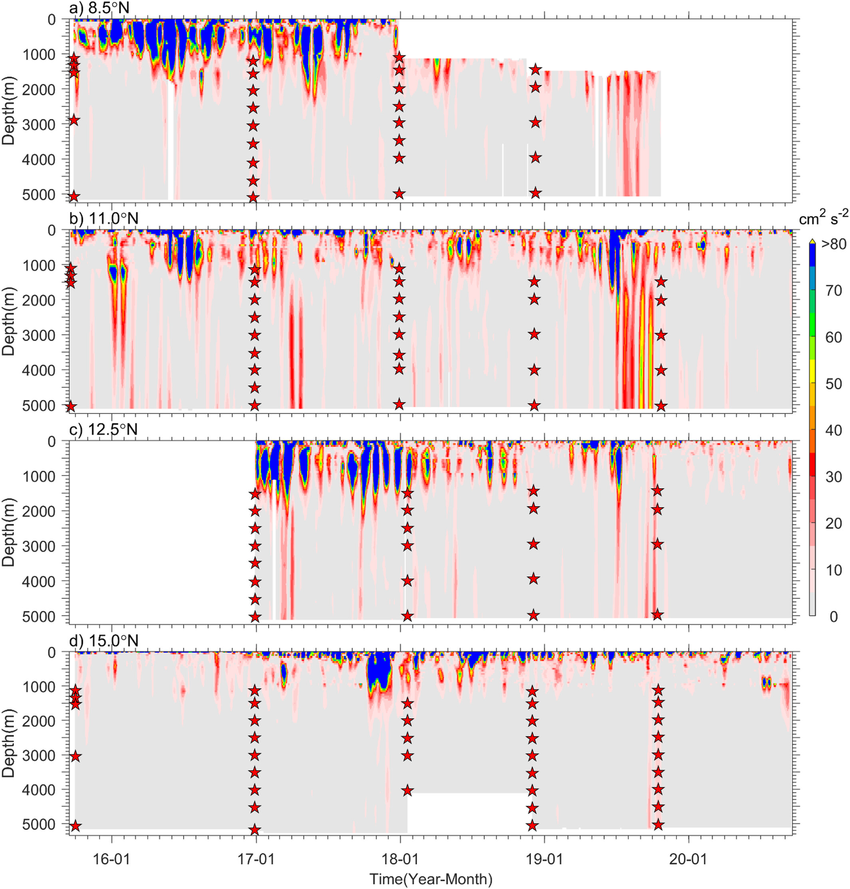{ loading=lazy }
      <figcaption>CASSON 계류 상세</figcaption>
    </figure>

    **10. 128.0°E, 20.45°N (2021.12~2025.05).** 필리핀 북부 해분의 CASSON 전층 계류로, 수심 약 5,200 m 지점에
    2021년 12월 10일 설치되어 2023년 12월 5일 회수 후 같은 위치에 재설치되었으며, 표층부터 약 4,900 m까지의 유속 기록을 제공합니다.
    [Ma et al. (2026, JGR Oceans)](https://doi.org/10.1029/2026JC024576)에서 topographic Rossby wave와 일치하는
    두 개의 저층 강화 계절내 변동 밴드(약 83일, 113일)를 보이는 데 사용되었습니다. Potential temperature와 유속 자료는
    [Zenodo (Ma, 2026)](https://doi.org/10.5281/zenodo.19604675)에 공개되어 있으며, 사용 전 저자(Dr. Jie Ma, jma@qdio.ac.cn)에게
    연락해 달라는 안내가 붙어 있습니다.

??? warning "가입 필요 또는 접근 불가 자료"
    **(가입 필요) NPOCE data access:** [NPOCE data access](http://npoce.org.cn/dateAcc.aspx) (가입 후 접근 가능한 경로, 아직 시도해 보지 않았습니다)

    - 2010~2012: ADCP at (18°N, 122.7°E) `ADCP_18N.nc`, (8°N, 127.3°E) `ADCP_8N.nc`
    - 2015~2019: (1.7°S, 141.4°E) `ADCP_1.7S141.4E.mat`, (1°S, 141.7°E) `ADCP_1S141.7E.mat`,
      (8.5°N, 130°E) `ADCP_8.5N130E.mat`, (12.5°N, 130°E) `ADCP_12.5N130E.mat`
    - 130°E 8.5°N (2015.09.26~2019.10.24) & 12.5°N (2016.12.26~2018.11.30):
      [Interannual Modulation of Subthermocline EKE East of the Philippines](https://agupubs.onlinelibrary.wiley.com/doi/10.1029/2022JC018452)
      (논문에 명시된 http://npoce.qdio.ac.cn/moored 는 접근 불가)

    <figure markdown="span">
      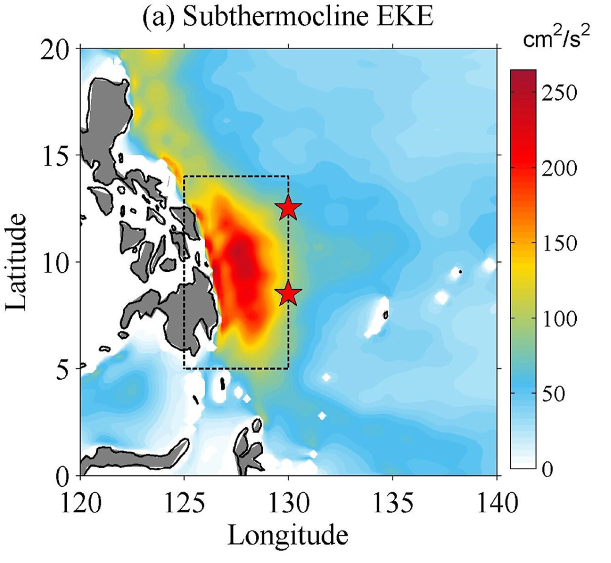{ loading=lazy }
      <figcaption>130°E, 8.5°N·12.5°N 계류</figcaption>
    </figure>

    참고 문헌 (NPOCE 계류):
    [Direct Measurements of the Luzon Undercurrent](https://journals.ametsoc.org/view/journals/phoc/43/7/jpo-d-12-0165.1.xml) ·
    [Mindanao Current/Undercurrent measured by a subsurface mooring](https://agupubs.onlinelibrary.wiley.com/doi/10.1002/2013JC009693) ·
    [Strengthening Kuroshio observed at its origin during November 2010 to October 2012](https://agupubs.onlinelibrary.wiley.com/doi/full/10.1002/2014JC010590) ·
    [Interannual Variability of the Mindanao Current/Undercurrent](https://journals.ametsoc.org/view/journals/phoc/46/2/jpo-d-15-0092.1.xml) ·
    [Currents off the New Guinea Coast From Mooring Measurements](https://agupubs.onlinelibrary.wiley.com/doi/10.1029/2020JC016242)

    **(접근 불가)**

    - 루손 동쪽 18°N (2018.01~2020.05, 유속):
      [Kuroshio and Luzon Undercurrent observed by a Mooring Array (JGR)](https://agupubs.onlinelibrary.wiley.com/doi/full/10.1029/2021JC017754) ·
      [CAS ODC](https://msdc.qdio.ac.cn/data/metadata-special-detail?id=1412683181714436098&otherId=1412695063133278209)

      <figure markdown="span">
        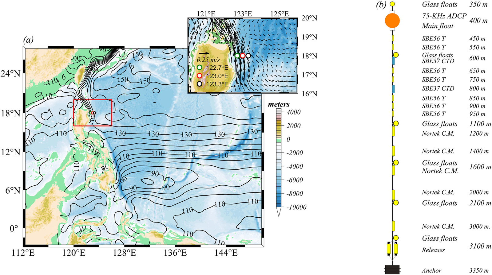{ loading=lazy }
        <figcaption>루손 동쪽 18°N 계류 배열</figcaption>
      </figure>

    - 142°E, 4.7°N (2016.11~2017.10), NESC 축 부근:
      [Pacific North Equatorial Subsurface Current (Sci. Rep.)](https://www.nature.com/articles/s41598-020-68605-y) · https://itf.qdio.ac.cn/xzlxz/

      <figure markdown="span">
        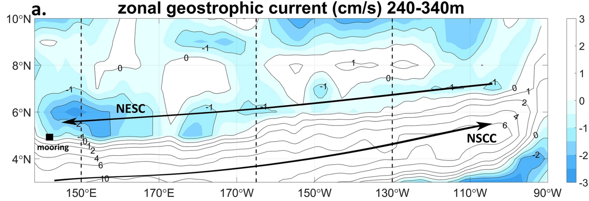{ loading=lazy }
        <figcaption>NESC 축 부근 4.7°N, 142°E 계류</figcaption>
      </figure>

    - 140~142°E, 0~4.7°N (2014~2021), 2·3·4번과 일부 겹침:
      [Seasonality of intraseasonal variability in upper equatorial western Pacific currents (ERL)](https://iopscience.iop.org/article/10.1088/1748-9326/ad657f) ·
      [Zenodo](https://zenodo.org/records/10836814)

      <figure markdown="span">
        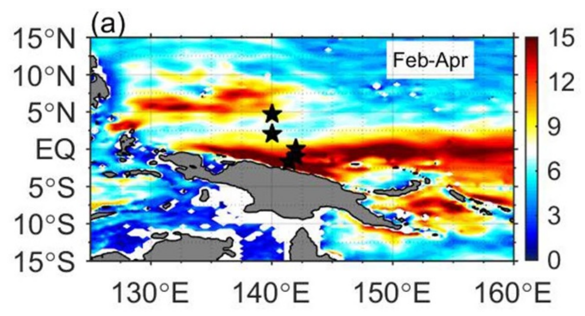{ loading=lazy }
        <figcaption>적도 서태평양 계류 (1)</figcaption>
      </figure>
      <figure markdown="span">
        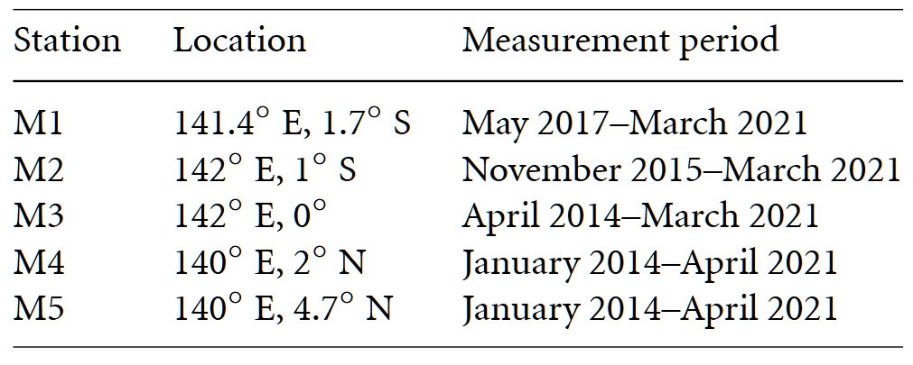{ loading=lazy }
        <figcaption>적도 서태평양 계류 (2)</figcaption>
      </figure>
      <figure markdown="span">
        { loading=lazy }
        <figcaption>적도 서태평양 계류 (3)</figcaption>
      </figure>

    - 140°E, 2°N·4.7°N (2014.01~2014.08), 3번과 일부 겹침 (4번과 정점은 같으나 기간은 겹치지 않음):
      [Mooring observations of equatorial currents in the upper 1000 m (JGR)](https://agupubs.onlinelibrary.wiley.com/doi/full/10.1002/2015jc011510)
      (연구 목적 요청 시 Fan Wang, fwang@qdio.ac.cn)

      <figure markdown="span">
        { loading=lazy }
        <figcaption>2014년 140°E, 2°N·4.7°N 계류</figcaption>
      </figure>

    - 140~142°E, 0~2°N (2014~2019; NG1 0°, 142°E / NG2 1°S, 142°E / NG3 1.7°S, 141.4°E / NG4 2°N, 140°E), 2·4번과 일부 겹침:
      [Upper Deep Branch of the Pacific MOC North of New Guinea (JPO)](https://journals.ametsoc.org/view/journals/phoc/53/5/JPO-D-22-0180.1.xml) ·
      [Zenodo](https://doi.org/10.5281/zenodo.7024824)

      <figure markdown="span">
        { loading=lazy }
        <figcaption>뉴기니 북쪽 계류 NG1~NG4</figcaption>
      </figure>

    - 143°E, 0~22°N (2015.11~2017.03, 17기; 0~16°N, 16~20°N, 20~22°N에서 각각 2°, 1°, 0.5° 간격):
      [Full-Depth Zonal Currents along 143°E (JPO)](https://journals.ametsoc.org/view/journals/phoc/53/10/JPO-D-22-0210.1.xml) (교신저자 문의)

      <figure markdown="span">
        { loading=lazy }
        <figcaption>143°E, 0~22°N 계류 17기</figcaption>
      </figure>

    **130°E 라인 자료를 사용했으나 별도 자료 제공이 없는 논문** (4~7번 참조)

    - [Structure and Variability of the NEC/NEUC from Mooring Measurements at 130°E (Sci. Rep.)](https://www.nature.com/articles/srep46310) (2014.09~2015.09; 8.5°N 계류는 유실)
    - [NEC/NEUC volume transport and its 40-day variability along 130°E (J. Oceanol. Limnol.)](https://link.springer.com/article/10.1007/s00343-020-0289-x) (2016.12~2017.12)
    - [Deep currents in the Southern Philippine Basin (DSR I)](https://www.sciencedirect.com/science/article/abs/pii/S0967063723000821) (2015.09~2020.09)

    <figure markdown="span">
      { loading=lazy }
      <figcaption>130°E 계류, 2014.09~2015.09</figcaption>
    </figure>
    <figure markdown="span">
      { loading=lazy }
      <figcaption>순환 모식도와 130°E 배열</figcaption>
    </figure>
    <figure markdown="span">
      { loading=lazy }
      <figcaption>필리핀 남부 해분 심층 유속 계류</figcaption>
    </figure>

??? note "데이터 파일"
    Notion 페이지에 첨부되어 있던 자료 파일(중국 자료센터 제출본·아카이브, near-inertial flow MAT 파일)은
    원 자료센터가 가입·승인제로 운영되므로 **여기서는 재배포하지 않습니다**. 링크된 자료센터를 직접 이용해 주세요.

## 대만

-   **ODB (國科會海洋學門資料庫)** · 1/4°, 1985~

    ---

    대만 주변 해역(105~135°E, 10~35°N)의 표준 수심별 수온·염분 등 격자 평균·표준편차 자료입니다.

    [:octicons-link-external-24: ODB](https://www.odb.ntu.edu.tw/) 
    [:octicons-download-24: 資料下載 (CTD 15′ grid)](https://www.odb.ntu.edu.tw/ctd/ctd15moa/) 
    [:octicons-download-24: ctd_grid15moa.zip](https://app05.odb.ntu.edu.tw/physv/phyfile/ctd_grid15moa.zip)

??? info "ODB 격자 자료 처리 방식"
    1985년 이후로 데이터 수집이 증가해 왔습니다. 현재 다운로드 가능한 데이터는 1985년부터 현재까지의 다양한 기간의 통계입니다.
    처리 과정은 먼저 모든 깊이 프로파일 데이터(온도, 염도 등)를 위도와 경도 위치에 따라 표준 깊이로 나눈 다음, 이를 15′×15′(1/4°×1/4°)
    크기로 격자화하는 것입니다. 그런 다음 각 격자의 다양한 수문학적 매개변수의 평균과 표준 편차를 계산합니다. 온도 및 염도 데이터는
    통계에 포함되려면 각 격자에 최소 3개의 데이터 레코드가 있어야 합니다.

## 지역 프로그램

-   **NEAR-GOOS** (Northeast Asian Regional GOOS)

    ---

    대한민국, 일본, 중국, 러시아 공동 프로젝트입니다. JMA와 JODC가 실시간·지연 모드 데이터베이스를 운영합니다.

    [:octicons-arrow-right-24: Details](pacific-near-goos.md)

-   **IMOS / AODN (호주)**

    ---

    Integrated Marine Observing System과 Australian Ocean Data Network입니다.

    [:octicons-link-external-24: IMOS](https://imos.org.au/)

