# :material-earth: Pacific Ocean [2026.05.12]

Long-term moorings, the Kuroshio Extension, and national observation programs (Korea, Japan, China, Taiwan) in the Pacific.
Blocks with a `.model-card` layout list one dataset each, so every dataset appears in the table of contents on the right.

<figure markdown="span">
  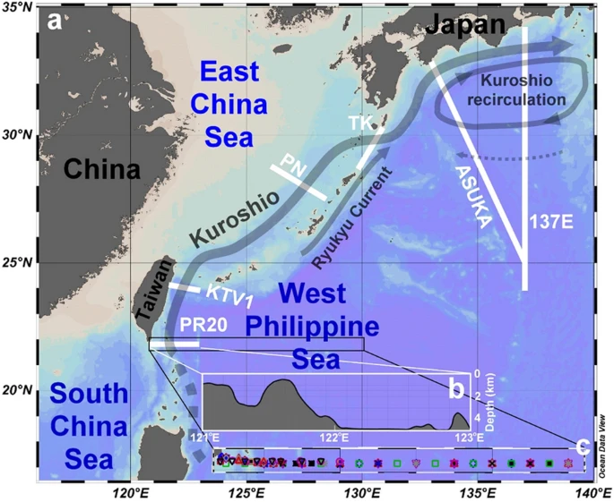{ loading=lazy }
  <figcaption>Western Pacific circulation schematic (doi:10.1038/s41598-021-84420-5)</figcaption>
</figure>
<figure markdown="span">
  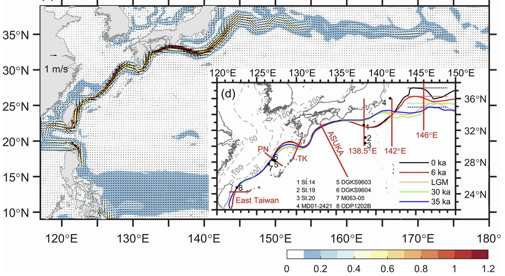{ loading=lazy }
  <figcaption>Western Pacific observation map (doi:10.1029/2021GL097250)</figcaption>
</figure>

## Long-term moorings

### OceanSITES (TAO, TRITON etc.)

Global network of long-term reference moorings, including the tropical Pacific TAO/TRITON arrays.

[:octicons-arrow-right-24: OceanSITES](../whole-ocean/in-situ/mooring.md)

### Pacific Ocean CO2 Time-series and Moorings (OCADS)

NOAA NCEI Ocean Carbon and Acidification Data System: CO2 time-series and mooring project, Pacific Ocean.

[:octicons-download-24: OCADS: Pacific moorings](https://www.ncei.noaa.gov/access/ocean-carbon-acidification-data-system/oceans/Moorings/Pacific.html)

<figure markdown="span">
  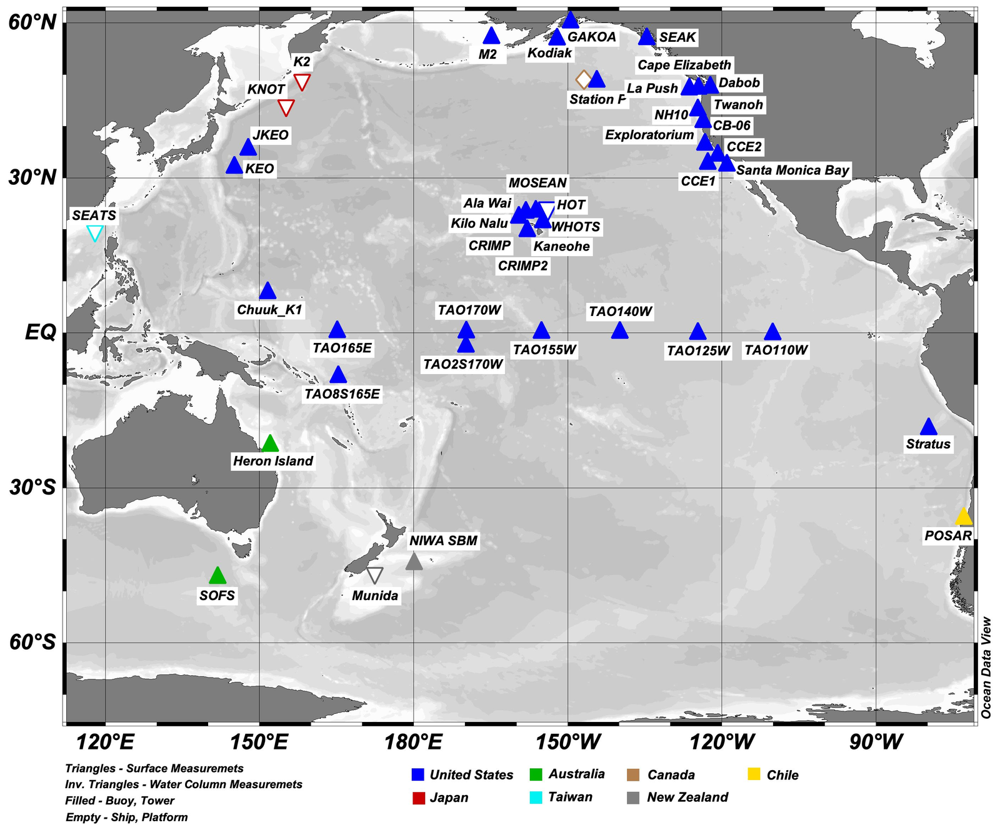{ loading=lazy }
  <figcaption>OCADS Pacific CO2 time-series and mooring sites</figcaption>
</figure>

### Ocean Climate Stations (KEO, Papa, ARC)

PMEL Ocean Climate Stations: reference time-series moorings. The Kuroshio Extension Observatory (KEO) is part of this network.

[:octicons-download-24: OCS Mooring Data](https://www.pmel.noaa.gov/ocs/data/disdel/) 
[:octicons-link-external-24: Kuroshio Extension Observatory (KEO)](https://www.pmel.noaa.gov/ocs/KEO) 
[:octicons-book-24: PMEL Ocean Climate Stations as Reference Time Series and Research Aggregate Devices (Oceanography)](https://tos.org/oceanography/article/pmel-ocean-climate-stations-as-reference-time-seriesand-research-aggregate-devices) 
[:octicons-arrow-right-24: In situ SST for validation (iQuam)](../whole-ocean/in-situ/others.md)

<figure markdown="span">
  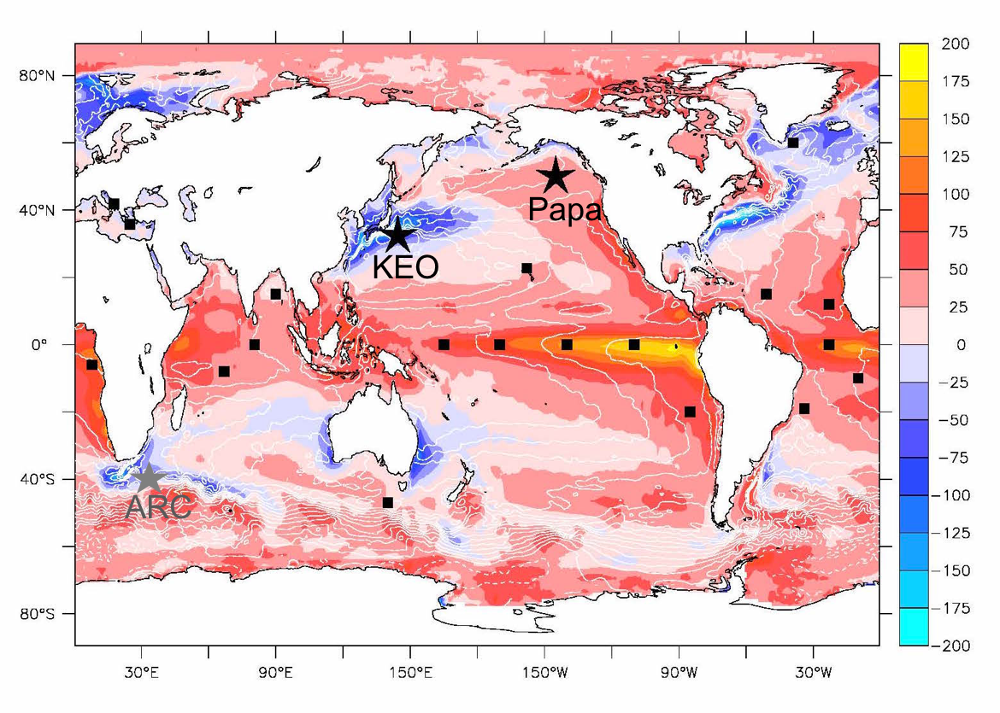{ loading=lazy }
  <figcaption>PMEL Ocean Climate Stations (KEO, Papa, ARC)</figcaption>
</figure>
<figure markdown="span">
  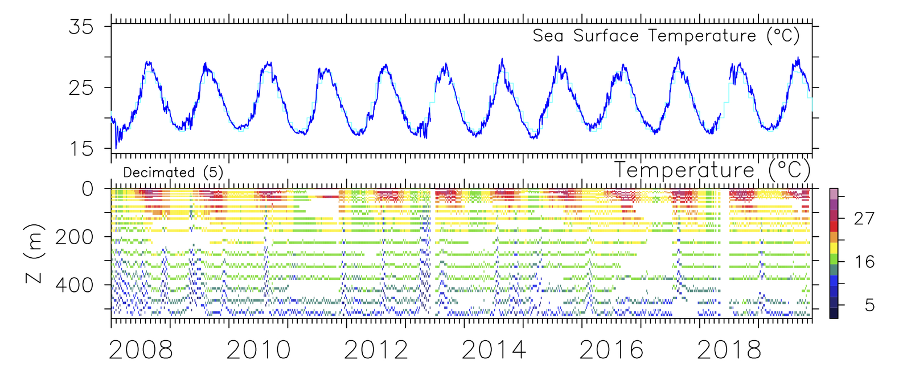{ loading=lazy }
  <figcaption>OCS mooring data download page</figcaption>
</figure>

## Kuroshio Extension

### KEO

32.3°N, 144.5°E
{ .spec }

Kuroshio Extension Observatory. See also Ocean Climate Stations above.

[:octicons-link-external-24: KEO (PMEL CO2)](https://www.pmel.noaa.gov/co2/story/KEO)

### JKEO

37.9°N, 146.6°E
{ .spec }

Japanese Kuroshio Extension Observatory.

[:octicons-link-external-24: JKEO (PMEL CO2)](https://www.pmel.noaa.gov/co2/story/JKEO)

### KESS CPIES/PIES array (+ KEO)

Kuroshio Extension System Study inverted echo sounder array; the CAS data center also distributes a combined KESS + KEO set.

[:octicons-download-24: KESS Data (URI)](https://www.po.gso.uri.edu/dynamics/KESS/CPIES_data.html) 
[:octicons-download-24: KESS (CAS Oceanographic Data Center)](https://msdc.qdio.ac.cn/data/metadata-special-detail?id=1462974032394600449&otherId=1462974032461709314) 
[:octicons-download-24: KESS + KEO (CAS Oceanographic Data Center)](https://msdc.qdio.ac.cn/data/metadata-special-detail?id=1462973723240841217&otherId=1462973723299561474)

<figure markdown="span">
  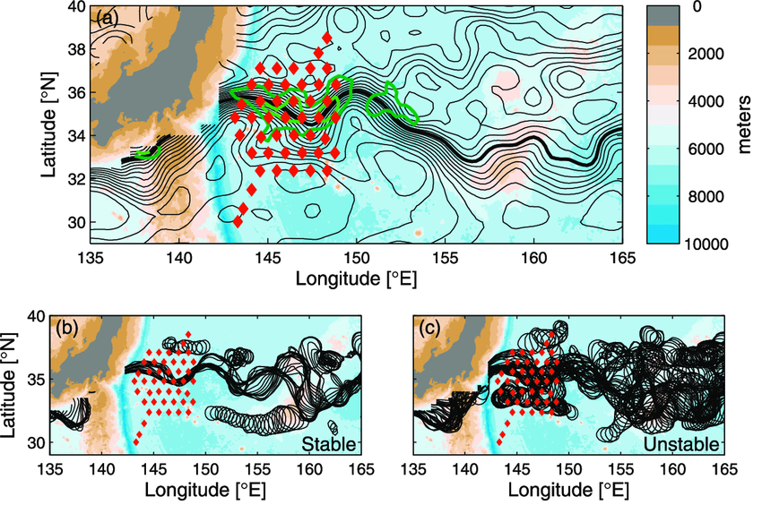{ loading=lazy }
  <figcaption>KESS CPIES/PIES array and KEO</figcaption>
</figure>

### CKEO

China Kuroshio Extension Observatory: moored buoy observations in the Kuroshio–Oyashio transition zone.

[:octicons-book-24: Dataset paper (Adv. Atmos. Sci.)](https://doi.org/10.1007/s00376-025-5673-1) 
[:octicons-download-24: CKEO dataset (ScienceDB)](https://doi.org/10.57760/sciencedb.j00264.00002) 
[:octicons-download-24: CKEO dataset (Zenodo)](https://doi.org/10.5281/zenodo.16569633)

<figure markdown="span">
  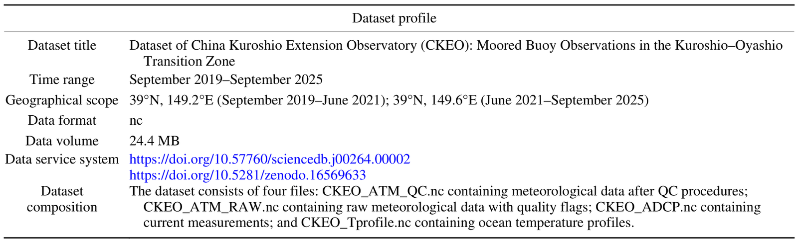{ loading=lazy }
  <figcaption>CKEO dataset profile: period, locations and files</figcaption>
</figure>
<figure markdown="span">
  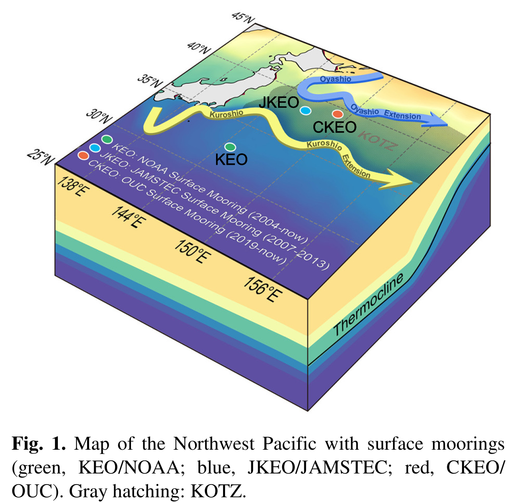{ loading=lazy }
  <figcaption>KEO, JKEO and CKEO surface moorings in the Kuroshio Extension</figcaption>
</figure>

### KEMS

Kuroshio Extension Mooring System. The mooring data are distributed from the KEMS website as a split archive.

[:octicons-link-external-24: KEMS](https://cn-kems.net/) 
[:octicons-download-24: data.zip.001](https://cn-kems.net/Data/data.zip.001) · [:octicons-download-24: data.zip.002](https://cn-kems.net/Data/data.zip.002) 
[:octicons-book-24: Estimating the Volume Transport of Kuroshio Extension Based on Satellite Altimetry and Hydrographic Data (JTECH)](https://doi.org/10.1175/JTECH-D-23-0018.1)

<figure markdown="span">
  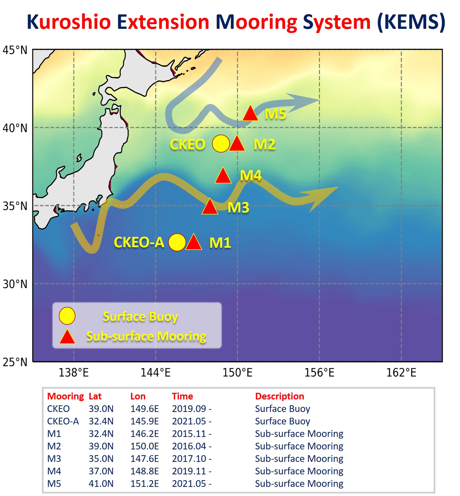{ loading=lazy }
  <figcaption>Kuroshio Extension Mooring System</figcaption>
</figure>

### Near-inertial velocity mooring

33°43'N, 156°34'E · 2017.11 to 2019.10
{ .spec }

A subsurface mooring in the Kuroshio Extension with a 75 kHz ADCP (about 600 m range, 16 m bins), used to study near-inertial wave energy flux.

[:octicons-book-24: Mesoscale Flow Impacts on Downward Energy Flux of Near-Inertial Waves in the Kuroshio Extension (JGR Oceans)](https://agupubs.onlinelibrary.wiley.com/doi/10.1029/2024JC022153) 
[:octicons-download-24: Zenodo dataset](https://zenodo.org/records/12792912)

<figure markdown="span">
  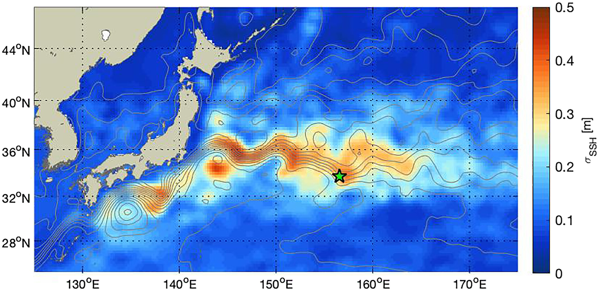{ loading=lazy }
  <figcaption>Mooring at 33°43'N, 156°34'E (2017.11 to 2019.10)</figcaption>
</figure>

## Korea

-   **KOREA Oceanographic Database**

    ---

    Korean national observation networks, gridded products and download guides.

    [:octicons-arrow-right-24: Details](korea.md)

-   **Regional gridded datasets around the Korean Peninsula**

    ---

    Listed in Notion by title only: *한반도 주변해 해양 기후 평년 자료* (ocean climate normals around Korea) and
    *Data-Driven Multidecadal Reconstruction and Nowcasting of Coastal and Offshore 3-D Sea Temperature Fields from Satellite Observations: A Case Study in the East/Japan Sea*.
    See [Atlas & Climatology](../processed/atlas-climatology.md).

-   **NWP Ocean Climate Data Service**

    ---

    Northwest Pacific ocean climate data service.

    [:octicons-link-external-24: nwpoclimate.kr](https://nwpoclimate.kr/)

## Japan

[:octicons-arrow-right-24: Japan Oceanographic Database](japan.md)

### 137°E meridian section time-series (JMA)

Oceanographic section time-series dataset for the 137°E meridian, maintained by JMA since 1967.

[:octicons-download-24: JMA 137°E dataset](https://www.data.jma.go.jp/gmd/kaiyou/db/mar_env/results/OI/137E_OI.html#data) 
[:octicons-link-external-24: Related dataset (CAS Oceanographic Data Center)](https://msdc.qdio.ac.cn/data/metadata-special-detail?id=2034094529639903234&otherId=2034094529648291842)

<figure markdown="span">
  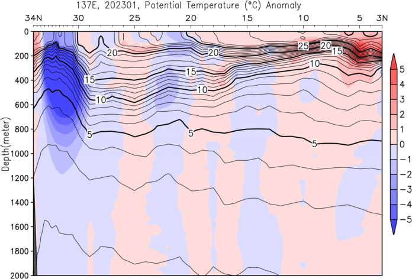{ loading=lazy }
  <figcaption>JMA 137°E repeat section</figcaption>
</figure>
<figure markdown="span">
  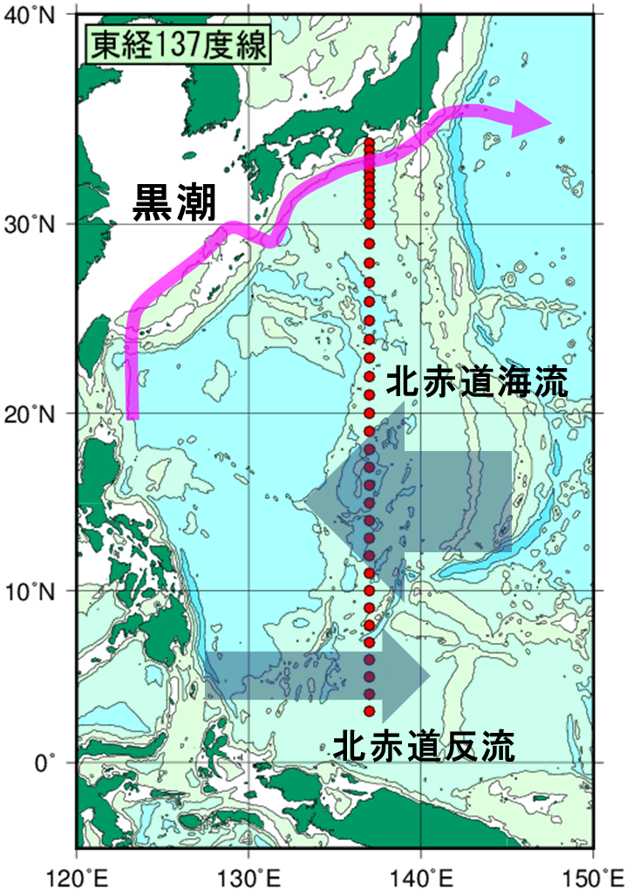{ loading=lazy }
  <figcaption>JMA 137°E dataset page</figcaption>
</figure>
<figure markdown="span">
  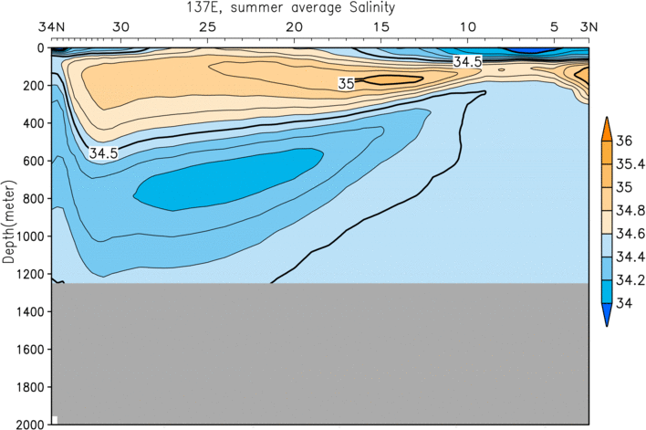{ loading=lazy }
  <figcaption>Related 137°E dataset at the CAS Oceanographic Data Center</figcaption>
</figure>

### JMA ocean data buoy observations

[:octicons-download-24: JMA buoy data](https://www.data.jma.go.jp/kaiyou/db/vessel_obs/data-report/html/buoy/buoy_e.php)

<figure markdown="span">
  { loading=lazy }
  <figcaption>JMA ocean data buoy page</figcaption>
</figure>

### JMA research vessel observations

1997 to 2023
{ .spec }

Oceanographic and marine meteorological observations by JMA research vessels. Files are provided as text; each data type has its own fixed format,
which also differs by observation method, so check the format document for the variable you need on the JMA page.

[:octicons-download-24: JMA Research Vessel data](https://www.data.jma.go.jp/kaiyou/db/vessel_obs/data-report/html/ship/ship_e.php) 
[:octicons-file-24: JMA subsurface current data format (PDF)](../assets/files/regional/pacific/JMA_subsurface_current_format.pdf)

<figure markdown="span">
  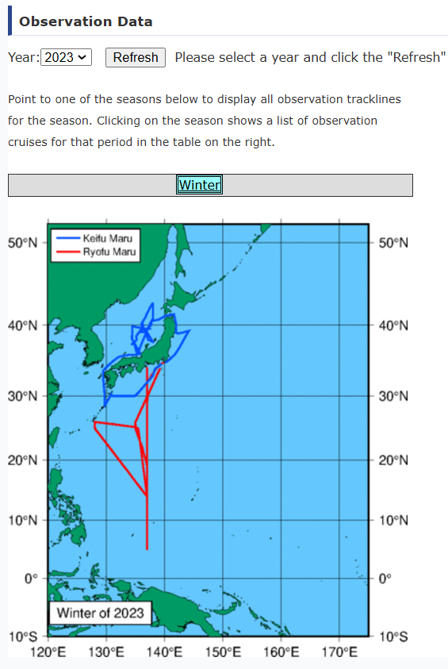{ loading=lazy }
  <figcaption>JMA research vessel data formats</figcaption>
</figure>

### Okinotorishima Island observations

1993 to present
{ .spec }

Meteorological and oceanographic observations collected at Okinotorishima Island since 1993. The latest data are added around April each year.

[:octicons-link-external-24: JAMSTEC Okinotorishima](https://www.jamstec.go.jp/j/database/okitori/index.html) 
[:octicons-link-external-24: GODAC metadata](https://www.godac.jamstec.go.jp/data_catalog/view/metadata?key=Okinotorishima_WebPage&lang=en)

<figure markdown="span">
  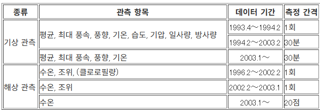{ loading=lazy }
  <figcaption>Okinotorishima Island</figcaption>
</figure>
<figure markdown="span">
  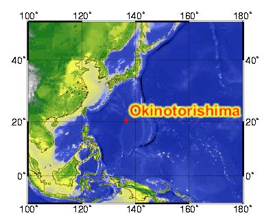{ loading=lazy }
  <figcaption>Okinotorishima observation data page</figcaption>
</figure>

### Time-series stations K2 and S1 (JAMSTEC)

K2: 47°N, 160°E (western subarctic gyre) · S1: 30°N, 145°E (subtropical gyre)
{ .spec }

Biogeochemical time-series stations of the Marine Biogeochemical Cycle Research Team. Since 2010 the R/V Mirai has conducted comparative time-series observations at the two stations.

[:octicons-link-external-24: K2/S1 database](https://www.jamstec.go.jp/k2s1/en/index.html)

<figure markdown="span">
  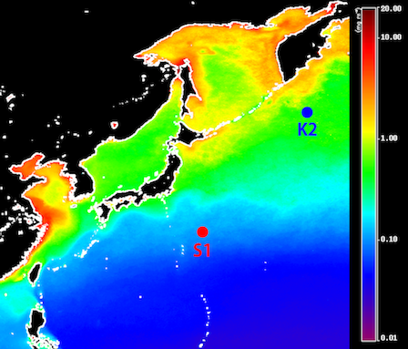{ loading=lazy }
  <figcaption>Time-series stations K2 and S1</figcaption>
</figure>

### PHSMO: Philippine Sea Mooring

13°N, 137°E · 2016.12 to present
{ .spec }

JAMSTEC moored buoy east of the Philippines, at the northern edge of the western Pacific warm pool.

[:octicons-link-external-24: PHSMO (JAMSTEC)](https://www.jamstec.go.jp/ipobs/PhBuoy/)

<figure markdown="span">
  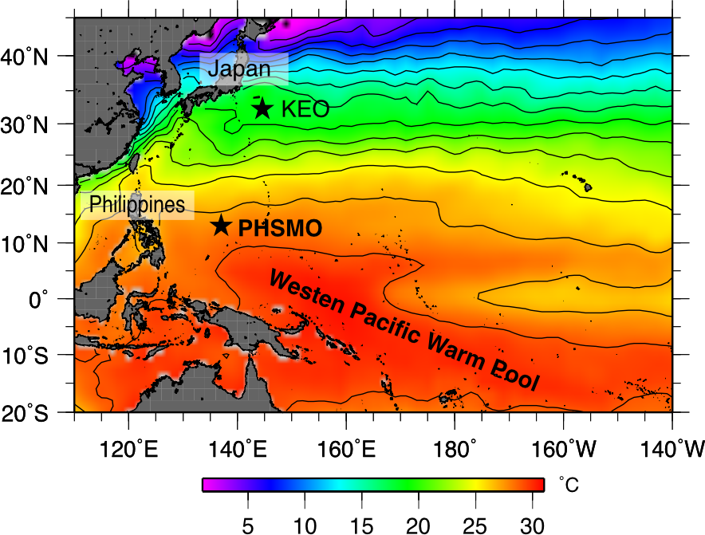{ loading=lazy }
  <figcaption>PHSMO buoy, 13°N 137°E</figcaption>
</figure>

### Tokara Strait ferryboat ADCP

Long-term ferryboat ADCP observations of the Kuroshio in the Tokara Strait.

[:octicons-book-24: Tempo-Spatial Variations of the Kuroshio Current in the Tokara Strait Based on Long-Term Ferryboat ADCP Data (JGR Oceans)](https://agupubs.onlinelibrary.wiley.com/doi/full/10.1029/2018JC014771) 
[:octicons-download-24: data_tokara (Baidu Netdisk)](https://pan.baidu.com/s/18uwsDLFGQgfF_DhyHE_I0g#list/path=%2F)

<figure markdown="span">
  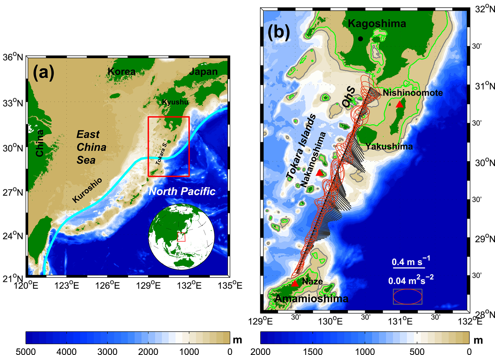{ loading=lazy }
  <figcaption>Ferryboat ADCP track across the Tokara Strait</figcaption>
</figure>

### PN line

JMA Okinawa repeat section across the Kuroshio in the East China Sea.

[:octicons-link-external-24: 沖縄気象台 PN線 (JMA Okinawa)](https://www.data.jma.go.jp/okinawa/know/kaiyo/pn.html) 
[:octicons-download-24: PN line (CAS Oceanographic Data Center)](https://msdc.qdio.ac.cn/data/metadata-special-detail?id=1995761119976849409&otherId=1995761119985238018) 
[:octicons-book-24: Reference (J. Oceanogr.)](https://doi.org/10.1007/s10872-013-0193-5)

<figure markdown="span">
  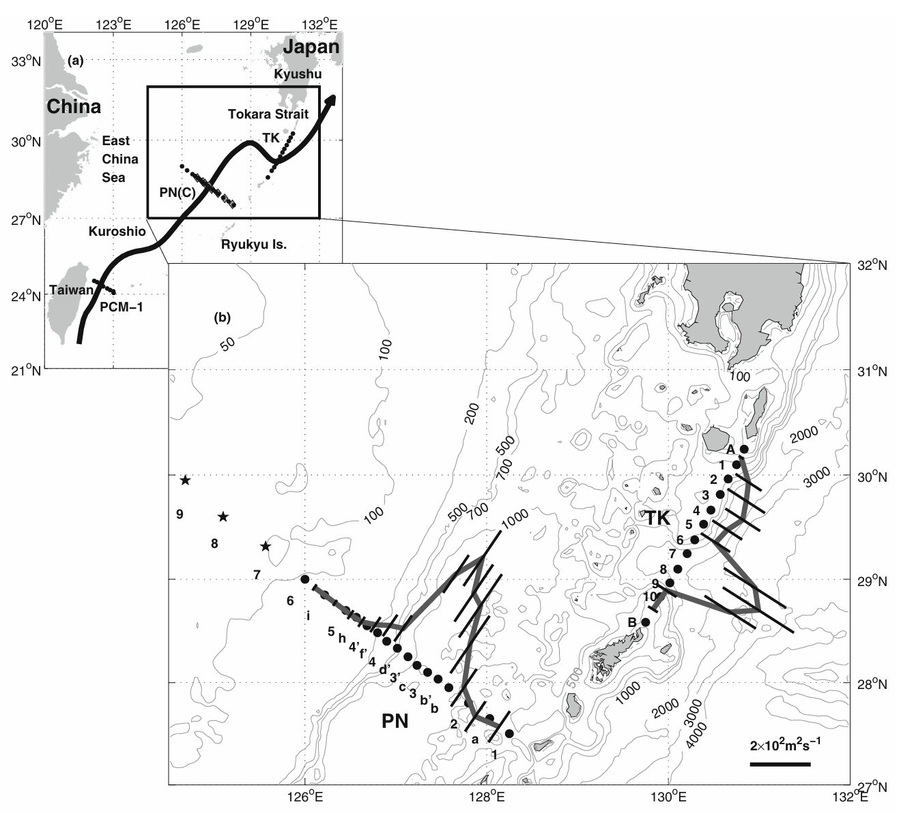{ loading=lazy }
  <figcaption>PN line (doi:10.1007/s10872-013-0193-5)</figcaption>
</figure>

### ASUKA line

Project on the structure and dynamics of the Kuroshio off southwest Japan.

[:octicons-link-external-24: ASUKA project (URI)](https://www.po.gso.uri.edu/dynamics/ASUKA/index.html) 
[:octicons-link-external-24: Uchida et al.](https://www.po.gso.uri.edu/wbc/uchida/index.html) 
[:octicons-book-24: Satellite altimeter monitoring the Kuroshio transport south of Japan (GRL)](https://agupubs.onlinelibrary.wiley.com/doi/pdf/10.1029/2000GL011796) 
[:octicons-book-24: ASUKA hydrographic data (RIAM, PDF)](https://www.riam.kyushu-u.ac.jp/oed/asuka/ahdc/ahdc.pdf) 
[:octicons-download-24: Data (RIAM)](https://www.riam.kyushu-u.ac.jp/oed/asuka/alt/)

<figure markdown="span">
  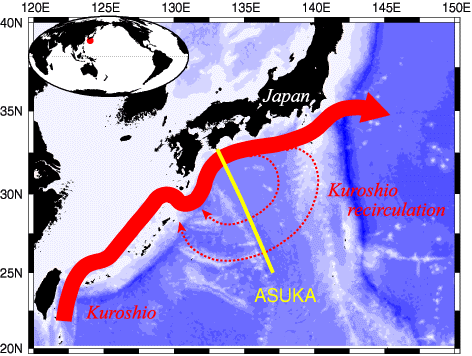{ loading=lazy }
  <figcaption>ASUKA line</figcaption>
</figure>
<figure markdown="span">
  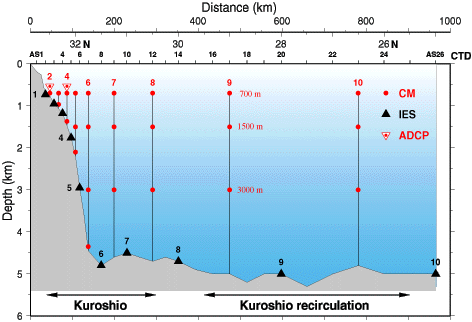{ loading=lazy }
  <figcaption>ASUKA data page (RIAM)</figcaption>
</figure>

### FRA real-time buoy

[:octicons-link-external-24: buoy.fra.go.jp](https://buoy.fra.go.jp/)

### FRA A-line and N-line

Repeat sections of the Fisheries Research Agency (FRA). N-line data are archived at NOAA OCADS.

[:octicons-download-24: A-line Monitoring](https://ocean.fra.go.jp/a-line/a-line_links2.html) 
[:octicons-download-24: OCADS: FRA Near Japan Sections (N-line)](https://www.ncei.noaa.gov/access/ocean-carbon-acidification-data-system/oceans/VOS_Program/FRA.html)

<figure markdown="span">
  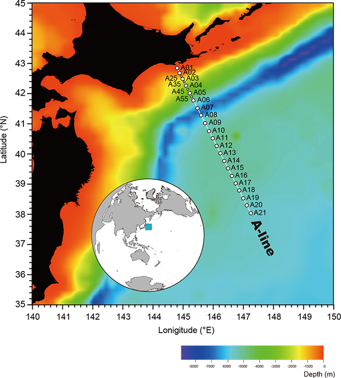{ loading=lazy }
  <figcaption>FRA A-line</figcaption>
</figure>
<figure markdown="span">
  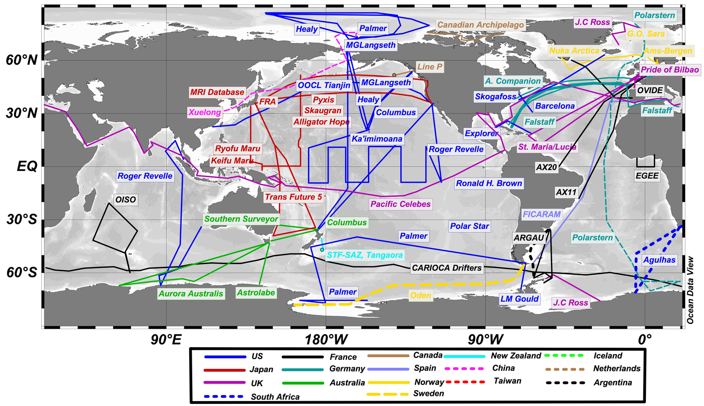{ loading=lazy }
  <figcaption>FRA N-line (OCADS)</figcaption>
</figure>

## China

### Data portals

-   **NPOCE**

    ---

    Northwestern Pacific Ocean Circulation and Climate Experiment

    [:octicons-link-external-24: NPOCE](http://npoce.org.cn/index.aspx)

-   **CAS Oceanographic Data Center (海洋科学大数据中心)**

    ---

    [:octicons-link-external-24: msdc.qdio.ac.cn](https://msdc.qdio.ac.cn/)

-   **National Marine Science Data Center (国家海洋科学数据中心)**

    ---

    [:octicons-link-external-24: mds.nmdis.org.cn](https://mds.nmdis.org.cn/pages/dataView.html?type=1&id=4cbe083006234f51a4b2782368b3f38f)

### Datasets

#### Diapycnal upwelling over the Kyushu-Palau Ridge

2021.09.23 to 2021.10.22
{ .spec }

Hydrographic observations at 31 stations (Seabird 911 Plus CTD).

[:octicons-book-24: Diapycnal Upwelling Over the Kyushu-Palau Ridge in the North Pacific Ocean (GRL)](https://agupubs.onlinelibrary.wiley.com/doi/full/10.1029/2023GL104369) 
[:octicons-download-24: Zenodo dataset](https://doi.org/10.5281/zenodo.7895316)

<figure markdown="span">
  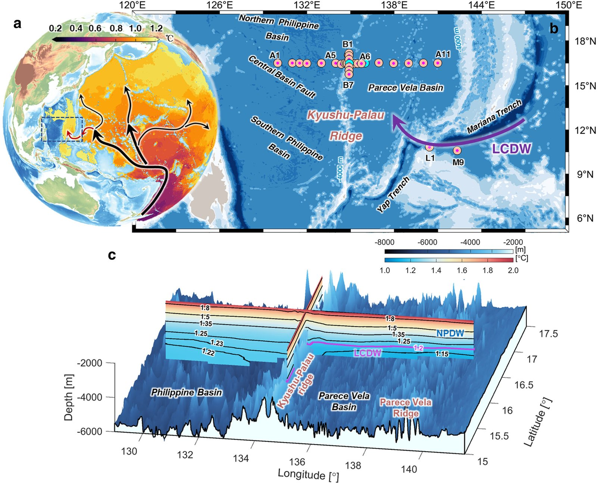{ loading=lazy }
  <figcaption>CTD stations over the Kyushu-Palau Ridge</figcaption>
</figure>

#### Mixing in the upper western equatorial Pacific driven by a westerly wind event

2018.12.17 to 2018.12.28
{ .spec }

16 stations along 1 to 3°N, 138 to 152°E. Microstructure (VMP500), CTD, LADCP and automatic weather station data.

[:octicons-book-24: Mixing in the upper western equatorial Pacific driven by westerly wind event (Frontiers)](https://www.frontiersin.org/journals/marine-science/articles/10.3389/fmars.2022.907699/full) 
[:octicons-download-24: Zenodo dataset](https://doi.org/10.5281/zenodo.7006854)

<figure markdown="span">
  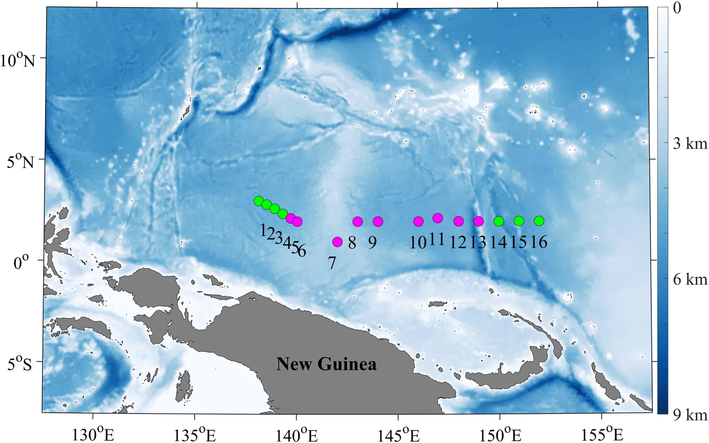{ loading=lazy }
  <figcaption>Stations along 1 to 3°N, 138 to 152°E. Magenta and green denote stations with and without deep cycle turbulence (DCT).</figcaption>
</figure>

#### Regional ocean database for the Coastal China Sea

[:octicons-book-24: A regional ocean database for the Coastal China Sea (Scientific Data)](https://doi.org/10.1038/s41597-025-05840-w)

<figure markdown="span">
  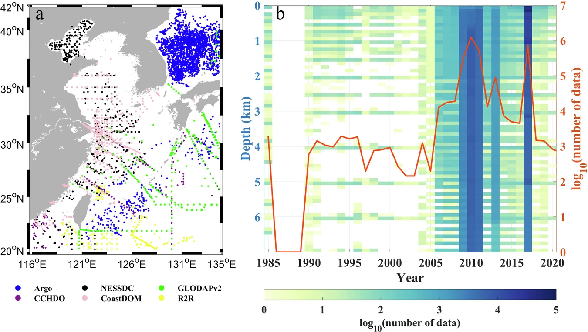{ loading=lazy }
  <figcaption>Regional ocean database for the Coastal China Sea</figcaption>
</figure>

#### CODC-v1

1940 to 2023
{ .spec }

Quality-controlled and bias-corrected ocean temperature profile database.

[:octicons-book-24: Scientific Data paper](https://www.nature.com/articles/s41597-024-03494-8#code-availability) 
[:octicons-download-24: CAS Oceanographic Data Center](https://msdc.qdio.ac.cn/data/metadata-special-detail?id=1614882932315443202&otherId=1614882932386746369)

<figure markdown="span">
  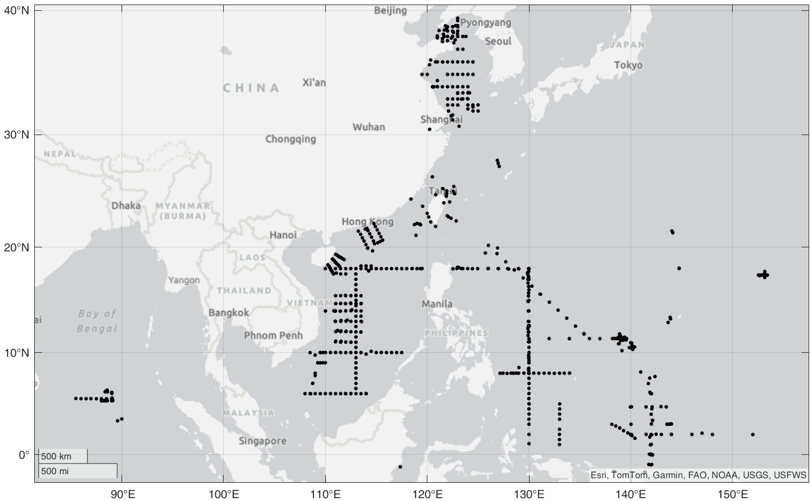{ loading=lazy }
  <figcaption>CODC-v1 download page</figcaption>
</figure>

#### CODC-v2

Global ocean in situ profile observational dataset.

[:octicons-download-24: CAS Oceanographic Data Center](https://msdc.qdio.ac.cn/data/metadata-special-detail?id=1866385243443826689&otherId=1866385243481575426)

#### CODC-S

Quality-controlled global ocean salinity profile dataset.

[:octicons-book-24: Scientific Data paper](https://doi.org/10.1038/s41597-025-05172-9)

#### IAPv4

Gridded ocean temperature and ocean heat content dataset (IAP/CAS).

[:octicons-book-24: ESSD paper](https://essd.copernicus.org/articles/16/3517/2024/) 
[:octicons-download-24: Temperature (doi:10.12157/IOCAS.20240117.002)](https://doi.org/10.12157/IOCAS.20240117.002) 
[:octicons-download-24: OHC (doi:10.12157/IOCAS.20240117.001)](https://doi.org/10.12157/IOCAS.20240117.001) 
[:octicons-link-external-24: IAP ocean](http://www.ocean.iap.ac.cn/)

### Western Pacific subsurface moorings (CAS / NPOCE)

The numbering follows the original Notion page. Several datasets share stations or periods; see the "Overlap" column.

| # | Location | Period | Data | Overlap |
|---|---|---|---|---|
| 1 | 146°E, 25°N & 30°N | 2017.08 to 2017.12 | [CAS ODC (Typhoon Sanvu)](https://msdc.qdio.ac.cn/data/metadata-special-detail?id=1480429794037420034&otherId=1480429794075168769) · [Paper (JPO)](https://journals.ametsoc.org/view/journals/phoc/53/9/JPO-D-22-0226.1.xml) | 8 |
| 2 | 142°E, 0 to 7.5°N (7 moorings) | 2014.08 to 2015.10 | [Paper + supplementary xlsx (Sci. Rep.)](https://www.nature.com/articles/s41598-018-26047-7) | 4 |
| 3 | 140°E, 4.7°N | 2014.01 to 2018.12 | [Zenodo](https://zenodo.org/record/5765909) · [Paper (JGR)](https://agupubs.onlinelibrary.wiley.com/doi/10.1029/2021JC017969) | 4 |
| 4 | 130°E, 140°E, 142°E (15 moorings) | 2014.11 to 2015.06 | [Zenodo](https://doi.org/10.5281/zenodo.3491843) · [Paper (JGR)](https://agupubs.onlinelibrary.wiley.com/doi/full/10.1029/2019JC015829) | 2, 3, 5 |
| 5 | 130°E, 8 to 17.5°N | 2014.09 to 2021.12 | [Supplementary (Frontiers)](https://doi.org/10.3389/fmars.2022.979442) | 4, 6, 7, 9 |
| 6 | 130°E, 8.5 to 15°N | 2016 to 2021 | [Zenodo (current meter)](https://doi.org/10.5281/zenodo.13901456) · [Paper (JGR)](https://agupubs.onlinelibrary.wiley.com/doi/10.1029/2024JC021960) | 5, 7, 9 |
| 7 | 130°E, 11 to 17.5°N | 2017.10 to 2017.11 (Typhoon Lan) | [CAS ODC](https://msdc.qdio.ac.cn/data/metadata-special-detail?id=1722854892608958466&otherId=1722854892692844545) · [Paper (JGR)](https://agupubs.onlinelibrary.wiley.com/doi/10.1029/2023JC020187) | 5, 6, 9 |
| 8 | M1 146°E 25°N, M2 122.67°E 22.3°N, M3 126°E 18°N | 2017.04 to 2020.12 | [CAS ODC](https://msdc.qdio.ac.cn/data/metadata-special-detail?id=1769562088985939969&otherId=1769562089216626690) · [Preprint (EGUsphere)](https://egusphere.copernicus.org/preprints/2026/egusphere-2025-6538/) | 1 (M1) |
| 9 | 130°E, 8.5 to 15°N (M1 to M4) | 2015.09 to 2020.09 | [Zenodo](https://zenodo.org/records/11318020) · [Paper (JGR)](https://agupubs.onlinelibrary.wiley.com/doi/10.1029/2024JC021495) | 5, 6, 7 |
| 10 | 128°E, Northern Philippine Basin | | [Zenodo](https://zenodo.org/records/19604676) (contact the author, Dr. Jie Ma, jma@qdio.ac.cn, before use) | |

??? info "Details of moorings 1 to 10"
    **1. 146°E, 25°N and 30°N (2017.08 to 2017.12).** Subsurface mooring observations during Typhoon Sanvu in the western Pacific:
    near-inertial and sub-inertial velocities obtained by filtering after quality control. The JPO paper uses one of the two moorings and states that
    data are available on request, whereas the CAS ODC link provides both moorings for the typhoon period. The mooring in the JPO paper was deployed at
    25°N, 146°E from April 2017 to June 2018.

    [:octicons-file-24: Mooring 1 readme (txt)](../assets/files/regional/pacific/其它_DATA2022000022_readme-1641797062275.txt)

    <figure markdown="span">
      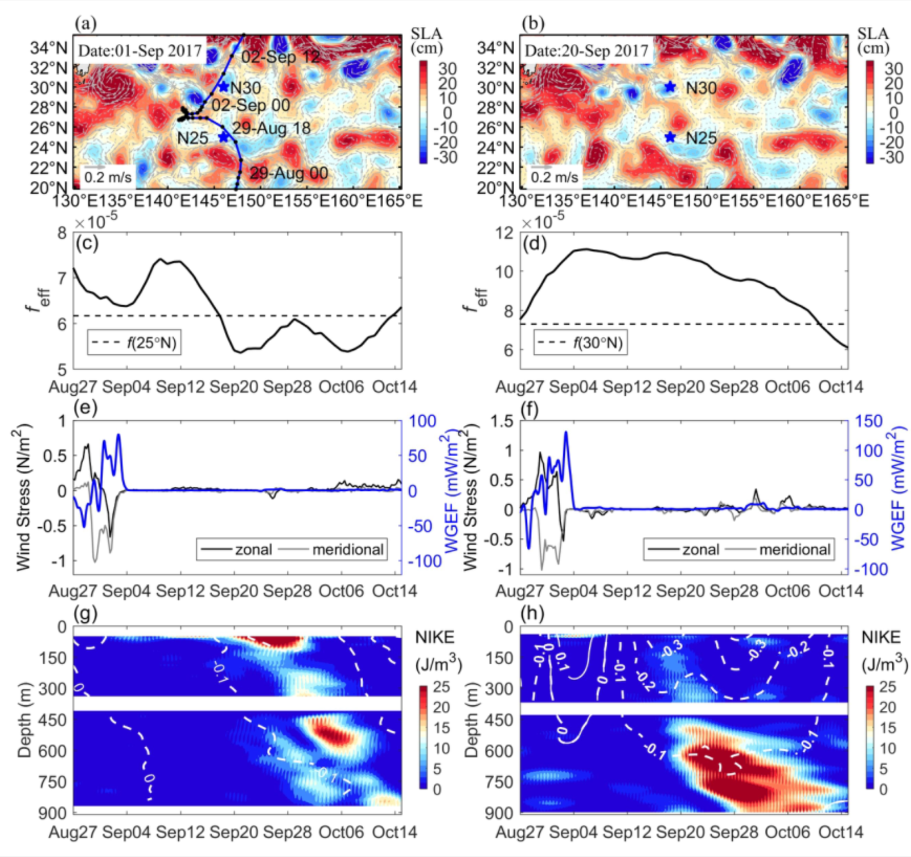{ loading=lazy }
      <figcaption>Moorings at 146°E, 25°N and 30°N during Typhoon Sanvu</figcaption>
    </figure>
    <figure markdown="span">
      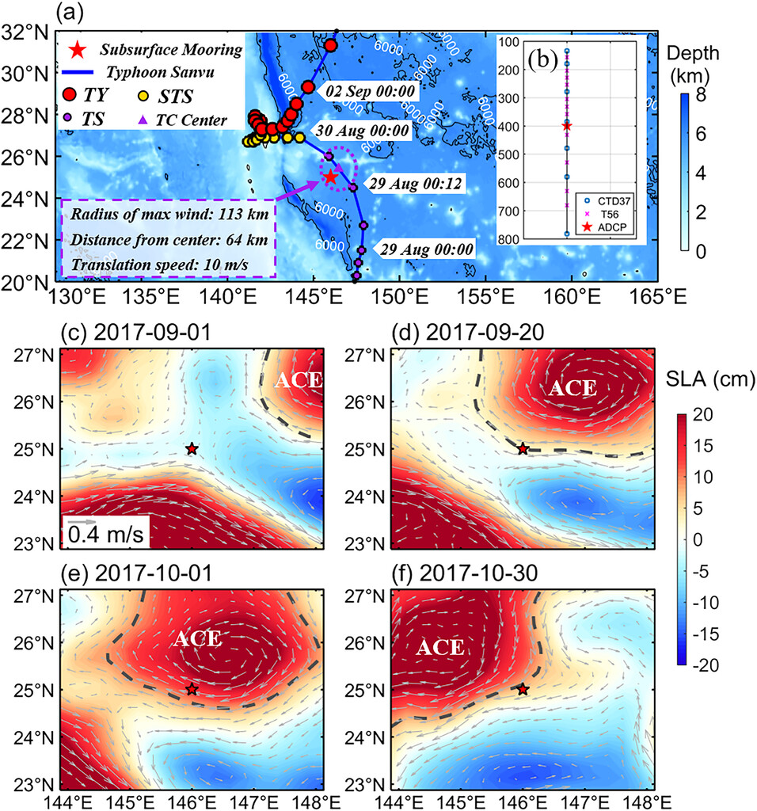{ loading=lazy }
      <figcaption>Mooring at 25°N, 146°E (JPO paper)</figcaption>
    </figure>

    **2. 142°E, 0 to 7.5°N (2014.08 to 2015.10).** Seven subsurface moorings along 142°E at 0, 1, 2, 3, 4.5, 6 and 7.5°N. Each mooring carried one upward- and one
    downward-looking 75 kHz ADCP at a design depth of 400 m. U and V were interpolated to 10 m intervals between 60 and 650 m and averaged into daily means.
    Because two upward-looking ADCPs failed, no data are available for the upper 400 m at 3°N and 6°N.
    [Subsurface structure and variability of the zonal currents in the Northwestern Tropical Pacific (DSR I)](https://www.sciencedirect.com/science/article/abs/pii/S0967063718301699)
    uses the same moorings but provides no data; they are available for research purposes on request to Fan Wang (fwang@qdio.ac.cn).

    [:octicons-file-24: Supplementary data 2 (xlsx)](../assets/files/regional/pacific/41598_2018_26047_MOESM2_ESM.xlsx)
    [:octicons-file-24: Supplementary data 3 (xlsx)](../assets/files/regional/pacific/41598_2018_26047_MOESM3_ESM.xlsx)

    <figure markdown="span">
      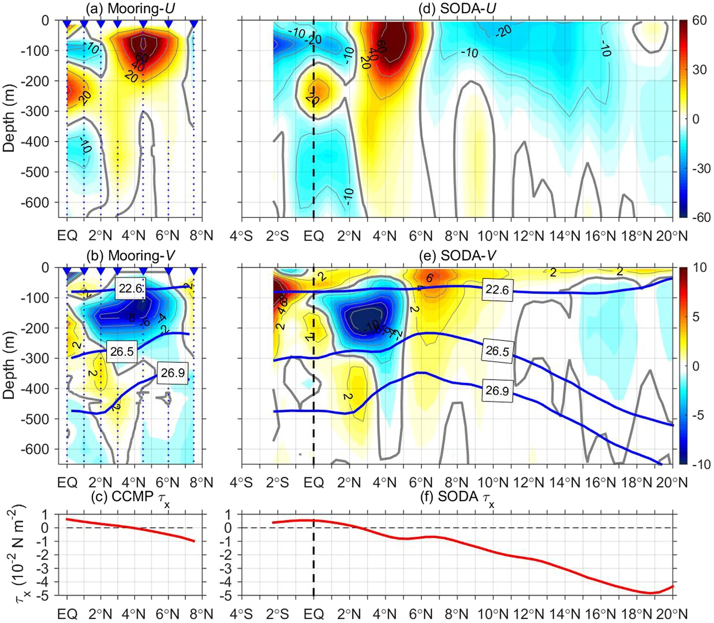{ loading=lazy }
      <figcaption>Seven moorings along 142°E</figcaption>
    </figure>
    <figure markdown="span">
      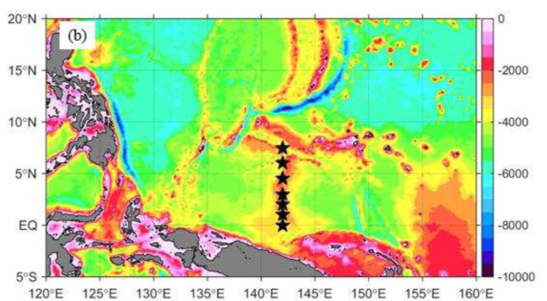{ loading=lazy }
      <figcaption>NPOCE mooring array (DSR I paper)</figcaption>
    </figure>

    **3. 140°E, 4.7°N (2014.01 to 2018.12).** Part of the CAS Scientific Observing Network, water depth about 4,100 m, maintained through four recoveries and redeployments.
    Upward- and downward-looking 75 kHz TRDI ADCPs at about 500 m give hourly profiles over 50 to 1000 m in 8 m bins.

    <figure markdown="span">
      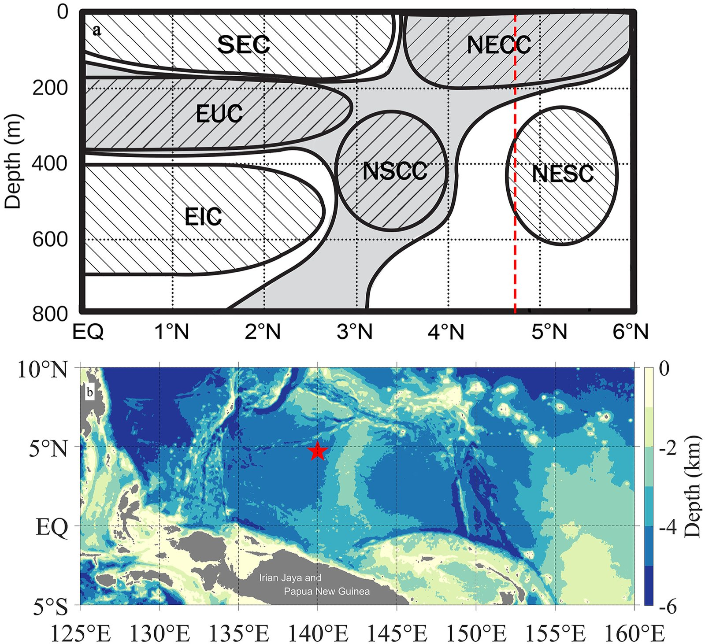{ loading=lazy }
      <figcaption>Mooring at 4.7°N, 140°E</figcaption>
    </figure>

    **4. 130°E, 140°E, 142°E (2014.11 to 2015.06).** Five moorings along 130°E, seven along 142°E, and three at (139.05°E, 11.58°N), (140°E, 4.7°N) and (140°E, 2°N).
    Data are for scientific research only.
    [Model-based assessment of a Northwestern Tropical Pacific moored array (Ocean Modelling)](https://www.sciencedirect.com/science/article/pii/S1463500318301276)
    describes the same array (the NWTPO mooring system established in 2013 under the WPOS project) but provides no data.

    <figure markdown="span">
      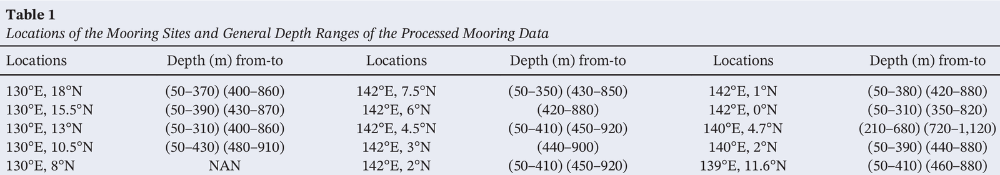{ loading=lazy }
      <figcaption>Moorings along 130°E, 140°E and 142°E (2014.11 to 2015.06)</figcaption>
    </figure>
    <figure markdown="span">
      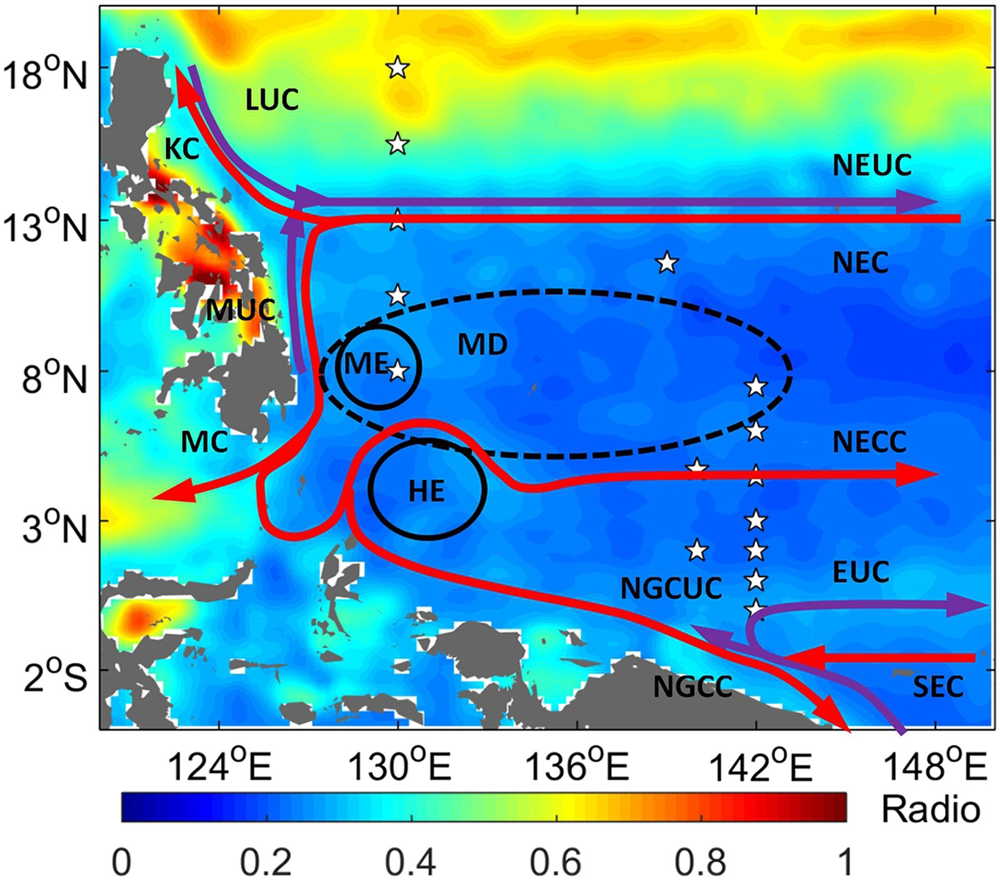{ loading=lazy }
      <figcaption>Mooring array detail</figcaption>
    </figure>
    <figure markdown="span">
      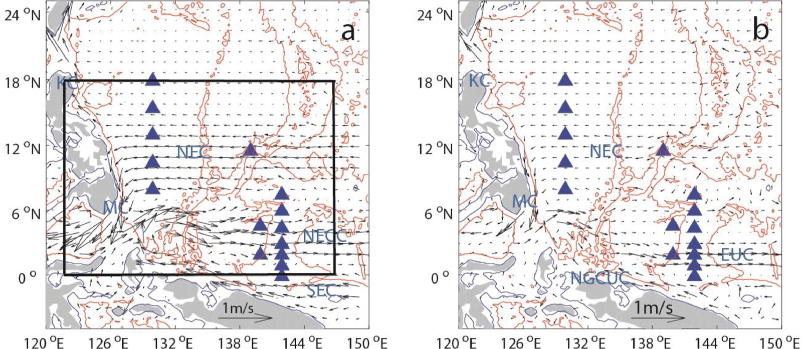{ loading=lazy }
      <figcaption>NWTPO mooring observation system (WPOS)</figcaption>
    </figure>

    **5. 130°E, 8 to 17.5°N (2014.09 to 2021.12).** Five moorings deployed at 8, 10.5, 13, 15.5 and 18°N in September 2014, then moved to
    8.5, 11, 12.5, 15 and 17.5°N in September 2015 to capture the NEUC jets better, and recovered every year since.

    <figure markdown="span">
      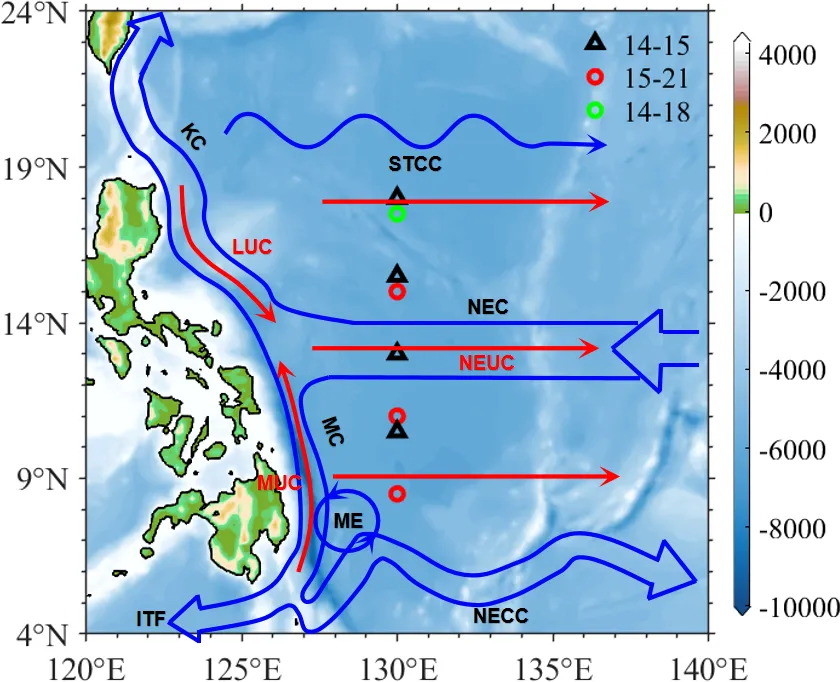{ loading=lazy }
      <figcaption>130°E mooring array</figcaption>
    </figure>
    <figure markdown="span">
      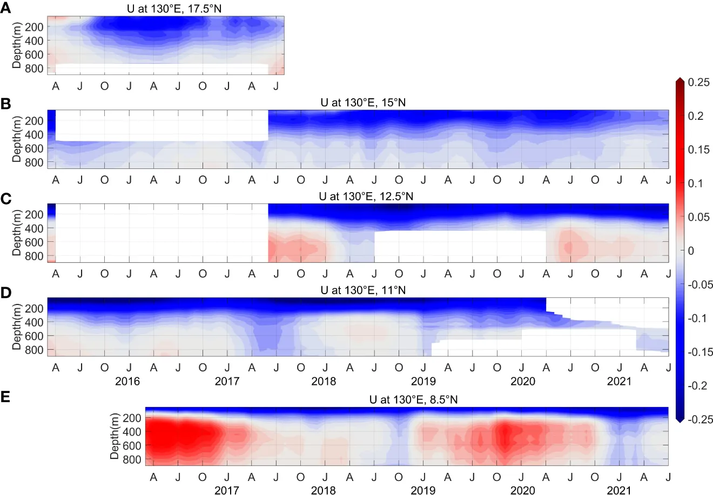{ loading=lazy }
      <figcaption>130°E mooring array, deployment detail</figcaption>
    </figure>
    <figure markdown="span">
      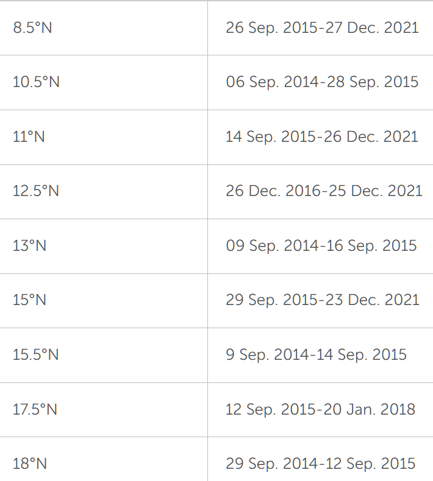{ loading=lazy }
      <figcaption>NEC/NEUC sections along 130°E</figcaption>
    </figure>

    **6. 130°E, 8.5 to 15°N (2016 to 2021).** Current meter data are on Zenodo; the ADCP data are in the supporting information of Huang et al. (2022) (dataset 5).

    <figure markdown="span">
      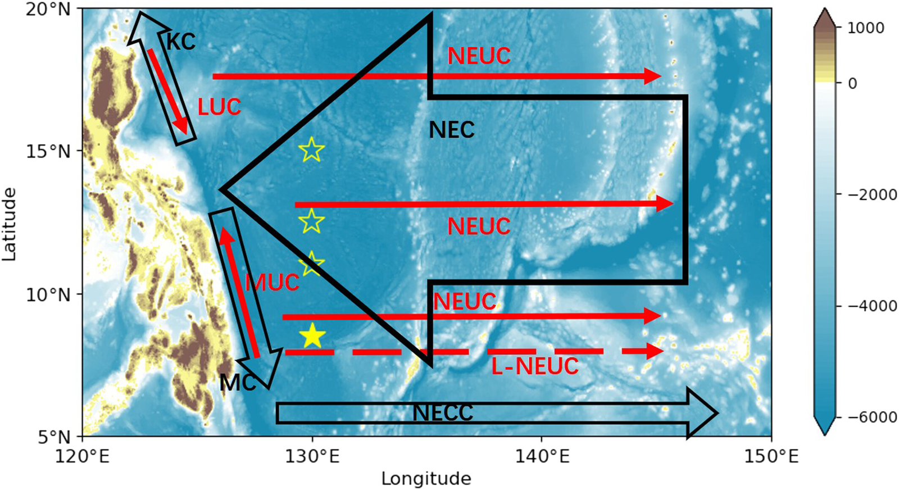{ loading=lazy }
      <figcaption>Current meter moorings along 130°E</figcaption>
    </figure>
    <figure markdown="span">
      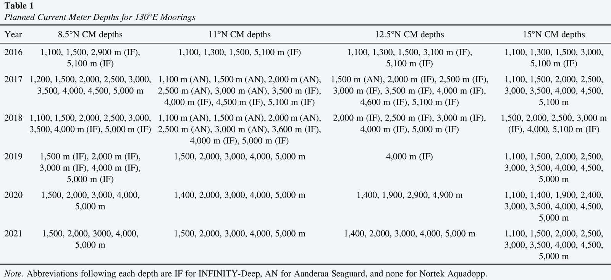{ loading=lazy }
      <figcaption>Current meter mooring detail</figcaption>
    </figure>

    **7. 130°E, 11 to 17.5°N.** Four moorings (L11, L12, L15, L17) deployed from 1 August 2016 to 14 December 2017 under NPOCE, each with two 75 kHz ADCPs at 400 m.
    The study used 10 October to 5 November 2017, when Typhoon Lan passed over the array.

    <figure markdown="span">
      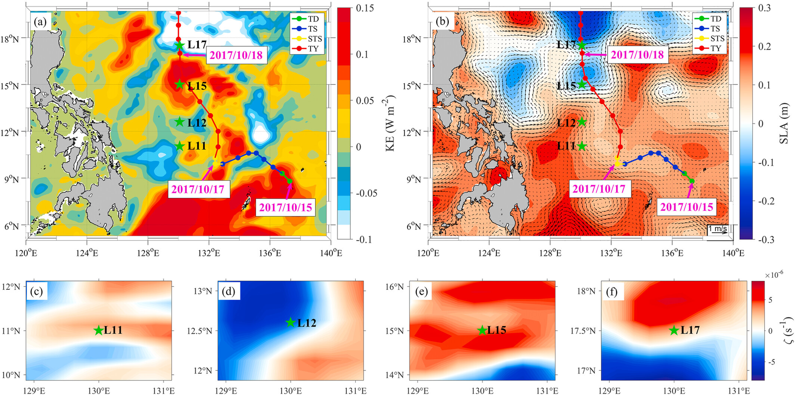{ loading=lazy }
      <figcaption>Moorings L11, L12, L15, L17 and the track of Typhoon Lan</figcaption>
    </figure>

    **8.** Intermediate-layer mooring data in the western Pacific (temperature, depth, salinity; 2017.04 to 2020.12).
    M1 = 146°E, 25°N (April 2017 to June 2018); M2 = 122.67°E, 22.3°N (August 2019 to December 2020); M3 = 126°E, 18°N (January 2016 to June 2017).

    [:octicons-file-24: Mooring 8 data description (txt)](../assets/files/regional/pacific/论文_PAPER2024030002_PAPER2024030002-01_详见数据文件-1720923126982.txt)

    <figure markdown="span">
      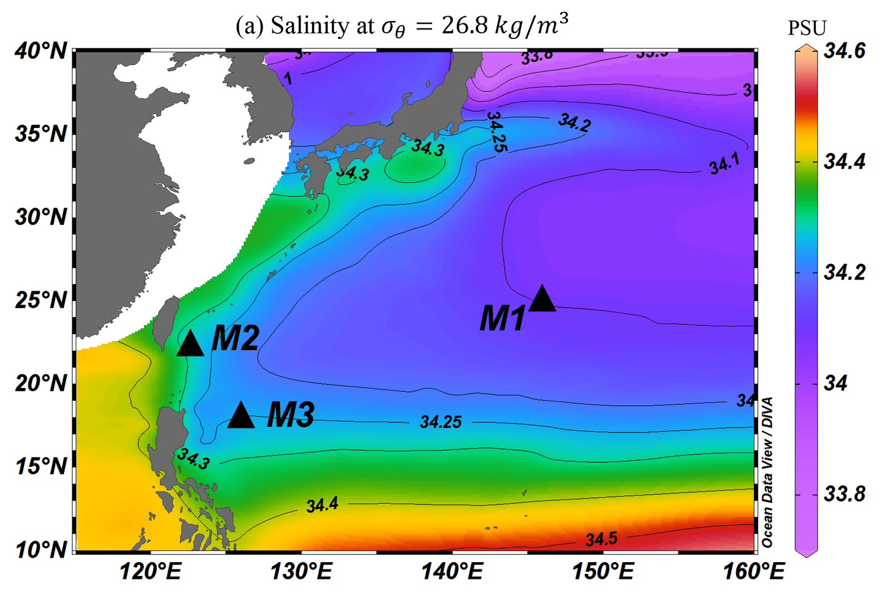{ loading=lazy }
      <figcaption>Intermediate-layer moorings M1 to M3</figcaption>
    </figure>

    **9. 130°E (2015.09 to 2020.09).** CASSON moorings M1 to M4 at 8.5, 11.0, 12.5 and 15.0°N in the Southern Philippine Basin, water depths about 5,800 to 5,975 m,
    recovered and redeployed annually.

    <figure markdown="span">
      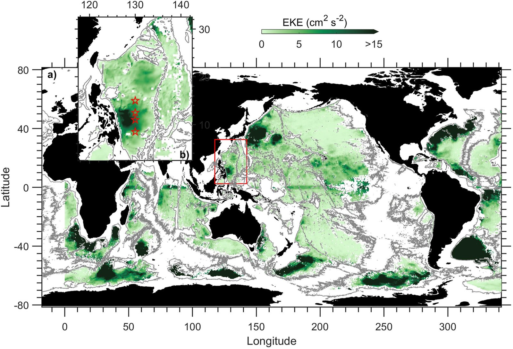{ loading=lazy }
      <figcaption>CASSON moorings M1 to M4 along 130°E</figcaption>
    </figure>
    <figure markdown="span">
      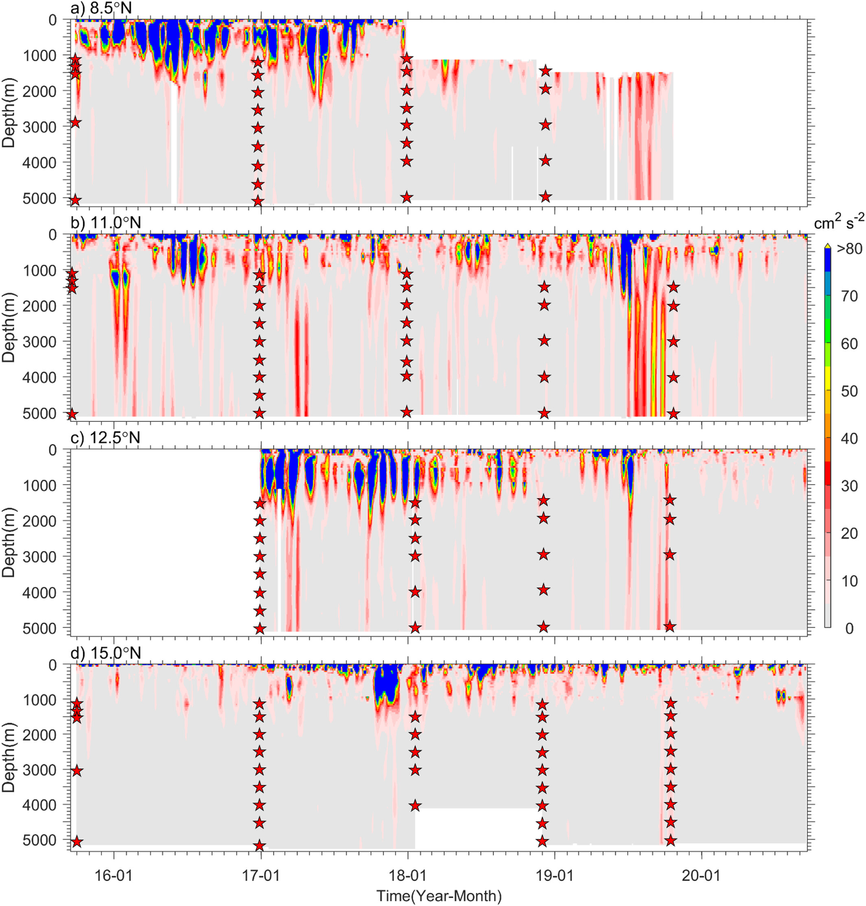{ loading=lazy }
      <figcaption>CASSON mooring detail</figcaption>
    </figure>

    **10. 128°E.** Potential temperature and velocity in the Northern Philippine Basin, supplementary to "Topographic Organization of Abyssal
    Intraseasonal Variability in the Northern Philippine Sea Basin" (submitted to JGR Oceans).

??? warning "Datasets that require registration or are not accessible"
    **Registration required: NPOCE data access.** [NPOCE data access](http://npoce.org.cn/dateAcc.aspx) (accessible after registration; not yet tried)

    - 2010 to 2012: ADCP at (18°N, 122.7°E) `ADCP_18N.nc`, (8°N, 127.3°E) `ADCP_8N.nc`
    - 2015 to 2019: (1.7°S, 141.4°E) `ADCP_1.7S141.4E.mat`, (1°S, 141.7°E) `ADCP_1S141.7E.mat`,
      (8.5°N, 130°E) `ADCP_8.5N130E.mat`, (12.5°N, 130°E) `ADCP_12.5N130E.mat`
    - 130°E, 8.5°N (2015.09.26 to 2019.10.24) and 12.5°N (2016.12.26 to 2018.11.30):
      [Interannual Modulation of Subthermocline EKE East of the Philippines](https://agupubs.onlinelibrary.wiley.com/doi/10.1029/2022JC018452)
      (the address given in the paper, http://npoce.qdio.ac.cn/moored, is not accessible)

    <figure markdown="span">
      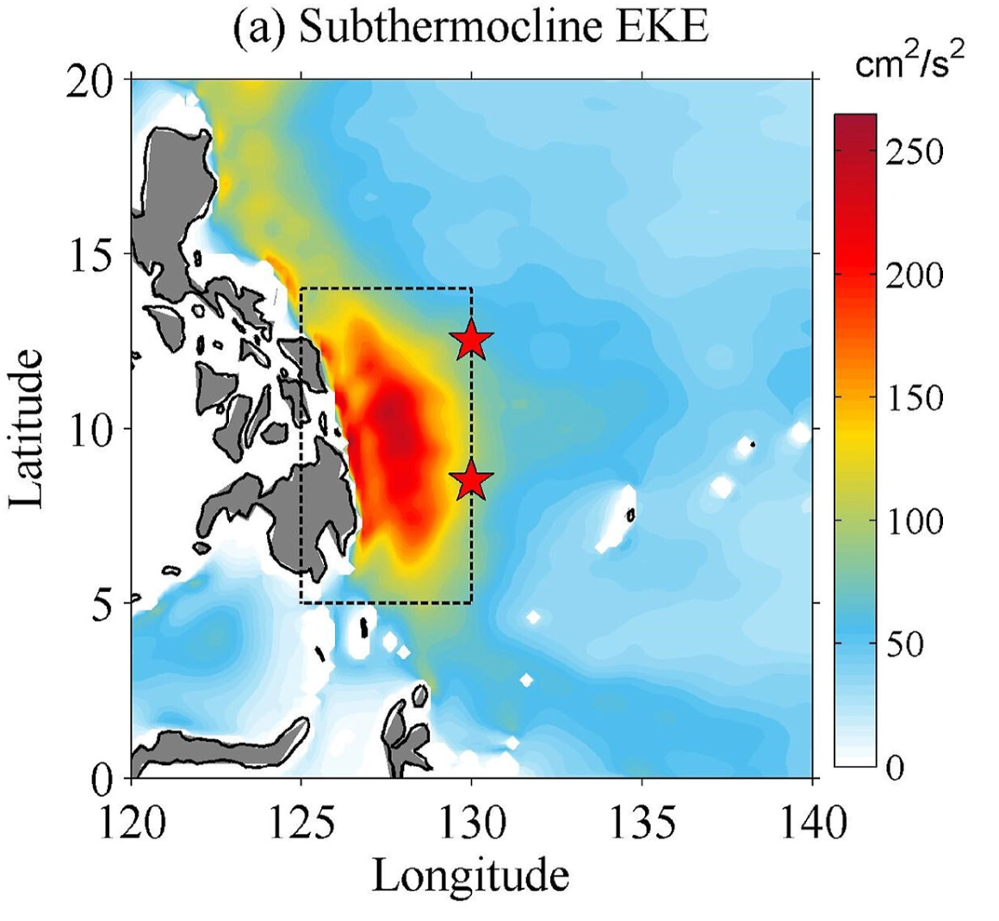{ loading=lazy }
      <figcaption>Moorings at 8.5°N and 12.5°N, 130°E</figcaption>
    </figure>

    Bibliography (NPOCE moorings):
    [Direct Measurements of the Luzon Undercurrent](https://journals.ametsoc.org/view/journals/phoc/43/7/jpo-d-12-0165.1.xml) ·
    [Mindanao Current/Undercurrent measured by a subsurface mooring](https://agupubs.onlinelibrary.wiley.com/doi/10.1002/2013JC009693) ·
    [Strengthening Kuroshio observed at its origin during November 2010 to October 2012](https://agupubs.onlinelibrary.wiley.com/doi/full/10.1002/2014JC010590) ·
    [Interannual Variability of the Mindanao Current/Undercurrent](https://journals.ametsoc.org/view/journals/phoc/46/2/jpo-d-15-0092.1.xml) ·
    [Currents off the New Guinea Coast From Mooring Measurements](https://agupubs.onlinelibrary.wiley.com/doi/10.1029/2020JC016242)

    **Not accessible**

    - 18°N east of Luzon (2018.01 to 2020.05, current velocity):
      [Kuroshio and Luzon Undercurrent observed by a Mooring Array (JGR)](https://agupubs.onlinelibrary.wiley.com/doi/full/10.1029/2021JC017754) ·
      [CAS ODC](https://msdc.qdio.ac.cn/data/metadata-special-detail?id=1412683181714436098&otherId=1412695063133278209)

      <figure markdown="span">
        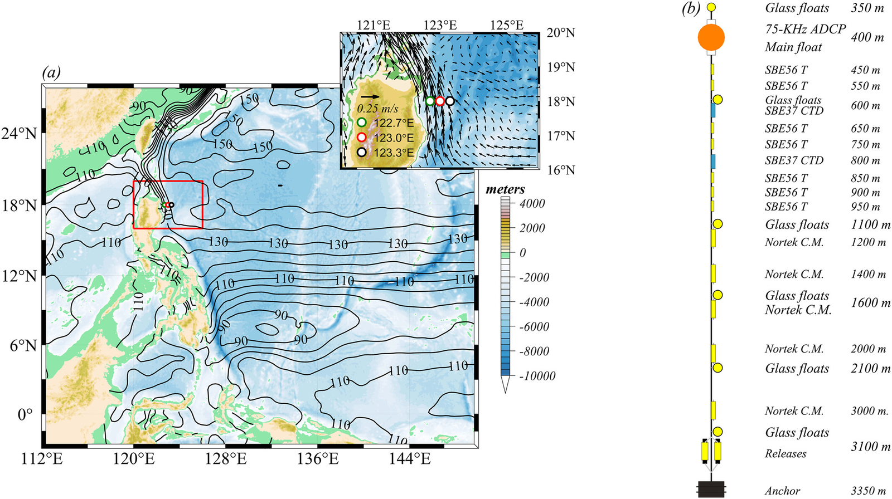{ loading=lazy }
        <figcaption>Mooring array at 18°N east of Luzon</figcaption>
      </figure>

    - 142°E, 4.7°N (2016.11 to 2017.10), near the NESC axis:
      [Pacific North Equatorial Subsurface Current (Sci. Rep.)](https://www.nature.com/articles/s41598-020-68605-y) · https://itf.qdio.ac.cn/xzlxz/

      <figure markdown="span">
        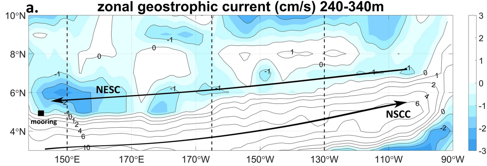{ loading=lazy }
        <figcaption>Mooring at 4.7°N, 142°E near the NESC axis</figcaption>
      </figure>

    - 140 to 142°E, 0 to 4.7°N (2014 to 2021), partly overlapping datasets 2, 3 and 4:
      [Seasonality of intraseasonal variability in upper equatorial western Pacific currents (ERL)](https://iopscience.iop.org/article/10.1088/1748-9326/ad657f) ·
      [Zenodo](https://zenodo.org/records/10836814)

      <figure markdown="span">
        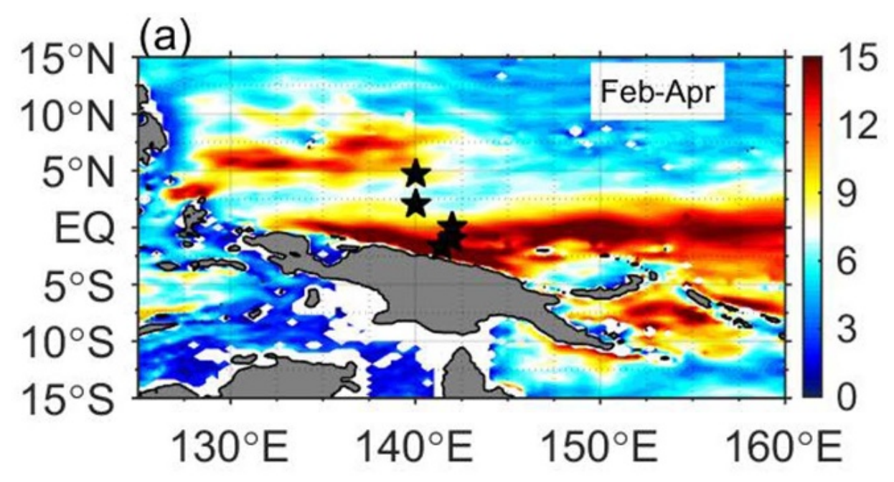{ loading=lazy }
        <figcaption>Equatorial western Pacific moorings (1)</figcaption>
      </figure>
      <figure markdown="span">
        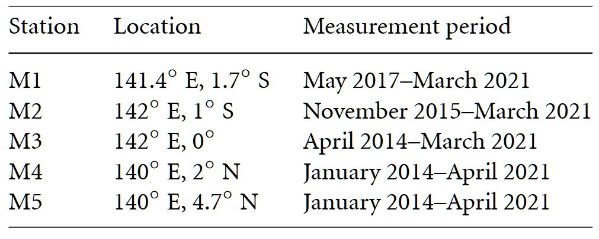{ loading=lazy }
        <figcaption>Equatorial western Pacific moorings (2)</figcaption>
      </figure>
      <figure markdown="span">
        { loading=lazy }
        <figcaption>Equatorial western Pacific moorings (3)</figcaption>
      </figure>

    - 140°E, 2°N and 4.7°N (2014.01 to 2014.08), partly overlapping dataset 3 (same stations as dataset 4 but different period):
      [Mooring observations of equatorial currents in the upper 1000 m (JGR)](https://agupubs.onlinelibrary.wiley.com/doi/full/10.1002/2015jc011510)
      (available for research purposes on request to Fan Wang, fwang@qdio.ac.cn)

      <figure markdown="span">
        { loading=lazy }
        <figcaption>Moorings at 2°N and 4.7°N, 140°E in 2014</figcaption>
      </figure>

    - 140 to 142°E, 0 to 2°N (2014 to 2019; NG1 0°, 142°E / NG2 1°S, 142°E / NG3 1.7°S, 141.4°E / NG4 2°N, 140°E), partly overlapping datasets 2 and 4:
      [Upper Deep Branch of the Pacific MOC North of New Guinea (JPO)](https://journals.ametsoc.org/view/journals/phoc/53/5/JPO-D-22-0180.1.xml) ·
      [Zenodo](https://doi.org/10.5281/zenodo.7024824)

      <figure markdown="span">
        { loading=lazy }
        <figcaption>Moorings NG1 to NG4 north of New Guinea</figcaption>
      </figure>

    - 143°E, 0 to 22°N (2015.11 to 2017.03, 17 moorings; spacing 2°, 1° and 0.5° over 0 to 16°N, 16 to 20°N and 20 to 22°N):
      [Full-Depth Zonal Currents along 143°E (JPO)](https://journals.ametsoc.org/view/journals/phoc/53/10/JPO-D-22-0210.1.xml) (contact the corresponding author)

      <figure markdown="span">
        { loading=lazy }
        <figcaption>17 moorings along 143°E, 0 to 22°N</figcaption>
      </figure>

    **Papers that used the 130°E line but provide no separate data** (see datasets 4 to 7)

    - [Structure and Variability of the NEC/NEUC from Mooring Measurements at 130°E (Sci. Rep.)](https://www.nature.com/articles/srep46310) (2014.09 to 2015.09; the 8.5°N mooring was lost)
    - [NEC/NEUC volume transport and its 40-day variability along 130°E (J. Oceanol. Limnol.)](https://link.springer.com/article/10.1007/s00343-020-0289-x) (2016.12 to 2017.12)
    - [Deep currents in the Southern Philippine Basin (DSR I)](https://www.sciencedirect.com/science/article/abs/pii/S0967063723000821) (2015.09 to 2020.09)

    <figure markdown="span">
      { loading=lazy }
      <figcaption>130°E moorings, 2014.09 to 2015.09</figcaption>
    </figure>
    <figure markdown="span">
      { loading=lazy }
      <figcaption>Circulation schematic and the 130°E array</figcaption>
    </figure>
    <figure markdown="span">
      { loading=lazy }
      <figcaption>Deep-current moorings in the Southern Philippine Basin</figcaption>
    </figure>

??? note "Data files"
    The data files that were attached to the Notion page (submissions and archives from Chinese data centers, and a
    near-inertial flow MAT file) are **not redistributed here**, because access to the original archives requires
    registration. Please use the linked data centers directly.

## Taiwan

-   **ODB (國科會海洋學門資料庫)** · 1/4°, 1985 to present

    ---

    Gridded means and standard deviations of temperature, salinity and other variables at standard depths around Taiwan (105 to 135°E, 10 to 35°N).

    [:octicons-link-external-24: ODB](https://www.odb.ntu.edu.tw/) 
    [:octicons-download-24: Data download (CTD 15' grid)](https://www.odb.ntu.edu.tw/ctd/ctd15moa/) 
    [:octicons-download-24: ctd_grid15moa.zip](https://app05.odb.ntu.edu.tw/physv/phyfile/ctd_grid15moa.zip)

??? info "How the ODB gridded product is made"
    Data collection has increased since 1985, and the downloadable products are statistics over various periods from 1985 to the present.
    All depth profiles (temperature, salinity and others) are first interpolated to standard depths by latitude and longitude, then binned onto a
    15' × 15' (1/4° × 1/4°) grid, and the mean and standard deviation of each hydrographic variable are computed for each cell.
    A cell needs at least three records of temperature and salinity to enter the statistics.

## Regional programs

-   **NEAR-GOOS** (Northeast Asian Regional GOOS)

    ---

    Joint program of China, Japan, Korea and Russia: real-time and delayed-mode databases hosted by JMA and JODC.

    [:octicons-arrow-right-24: Details](pacific-near-goos.md)

-   **IMOS / AODN (Australia)**

    ---

    Integrated Marine Observing System and the Australian Ocean Data Network.

    [:octicons-link-external-24: IMOS](https://imos.org.au/)

