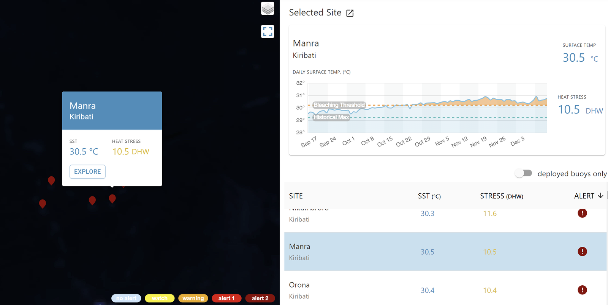
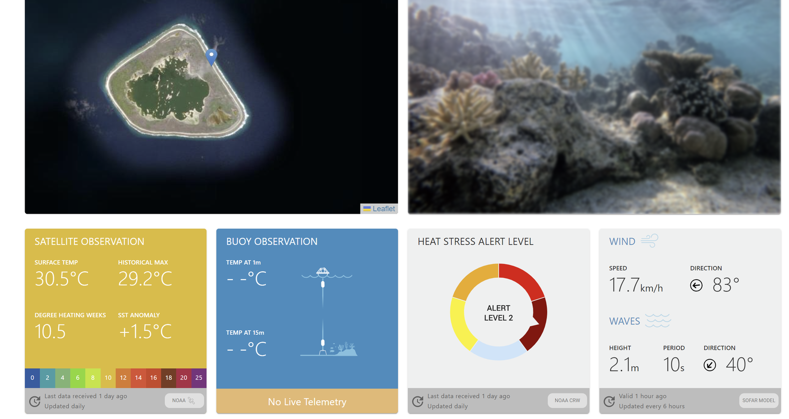
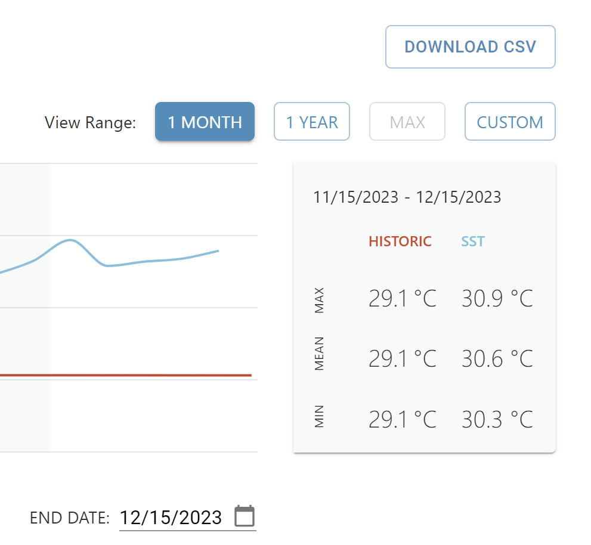

# :material-fish: Ecological Oceanography [2026.10.08]

해양 생물 이동 추적, 생물다양성, 서식지(갯벌·맹그로브·해초) 및 블루카본 자료 모음입니다.

## 생물 추적 (Biologging) { #biologging-animal-telemetry }

-   **바다거북 이동경로**

    ---

    국내 바다거북 이동경로 논문 자료와 국립해양생물자원관 OpenAPI 다운로드 방법

    [:octicons-arrow-right-24: 다운로드 방법](../regional/korea-sea-turtle.md)

-   **OBIS-SEAMAP**

    ---

    해양 포유류·바다거북·바닷새 분포 및 추적 자료 (바다거북)

    [:octicons-link-external-24: OBIS-SEAMAP](https://seamap.env.duke.edu/swot)

-   **Movebank**

    ---

    동물 이동 추적 자료 저장소

    [:octicons-link-external-24: Movebank](https://www.movebank.org/cms/movebank-main)

-   **Animal Telemetry Network** (IOOS)

    ---

    IOOS가 관리하는 animal telemetry network. 한국 주변은 일본이 연구한 데이터가 많은 듯

    [:octicons-link-external-24: ATN Portal](https://portal.atn.ioos.us/#)

-   **GIS for Wildlife**

    ---

    야생동물 GIS 자료

    [:octicons-link-external-24: GIS4Wildlife Data](https://gis4-wildlife.com/data/)

??? info "Animal Telemetry Network 사용법"
    - Project → 특정 project 접근 → "Add project to map" → 상단 map에서 경로 확인 가능
    - 다운로드: 특정 project 내에서 Archives 혹은 Project data 접근 후 다운로드

## 해양 생물다양성 { #ocean-biodiversity }

-   **OBIS**

    ---

    Ocean Biodiversity Information System. 플랑크톤 데이터가 많은 것으로 보임

    [:octicons-download-24: OBIS Data Access](https://obis.org/data/access/#) 
    [:octicons-link-external-24: OBIS](https://www.obis.org/)

-   **GBIF**

    ---

    Global Biodiversity Information Facility

    [:octicons-link-external-24: GBIF](https://www.gbif.org/)

-   **ICES DataPortal**

    ---

    ICES 해양 생물·환경 자료 지도 검색

    [:octicons-link-external-24: ICES DataPortal](https://data.ices.dk/view-map)

-   **IGMETS Explorer**

    ---

    International Group for Marine Ecological Time Series

    [:octicons-link-external-24: IGMETS Explorer](https://www.st.nmfs.noaa.gov/nauplius/media/igmets/explorer/index-00.html)

-   **CalCOFI**

    ---

    California Cooperative Oceanic Fisheries Investigations 자료

    [:octicons-download-24: CalCOFI Data](https://calcofi.org/data/) 
    [:octicons-download-24: EDI Data Package (knb-lter-cce.262.2)](https://portal.edirepository.org/nis/mapbrowse?packageid=knb-lter-cce.262.2)

-   **BISMaL** (Japan)

    ---

    Biological Information System for Marine Life (JAMSTEC)

    [:octicons-link-external-24: BISMaL](https://www.godac.jamstec.go.jp/bismal/e/)

??? info "OBIS에서 특정 해역 자료 받기"
    상단의 DATA > Mapper로 들어가서 좌측의 다각형 모양을 클릭하고 원하는 해역을 설정합니다.
    우측 상단의 사각형 여러 개가 겹친 'Layer'를 클릭하고, 가로선 세 개가 그려진 버튼을 클릭합니다.
    'View data'를 클릭하거나 'Download'를 클릭해서 이메일로 자료를 받을 수 있습니다.

## 서식지·생태지역 { #habitat-ecoregions }

-   **Large Marine Ecosystems (LMEs)**

    ---

    IW:LEARN GeoNode LME 경계 레이어

    [:octicons-download-24: LMEs layer](http://geonode.iwlearn.org/layers/geonode:lmes)

-   **Marine Ecoregions of the World**

    ---

    연안·대륙붕 생물지리 구분 (WWF)

    [:octicons-link-external-24: MEOW (WWF)](https://www.worldwildlife.org/publications/marine-ecoregions-of-the-world-a-bioregionalization-of-coastal-and-shelf-areas)

-   **Mangroves & Seagrasses** (CMEMS, UNEP-WCMC)

    ---

    전 지구 맹그로브·해초 분포

    [:octicons-download-24: Mangroves](https://data.marine.copernicus.eu/product/EXT_UNEP_WCMC_MANGROVE/description) 
    [:octicons-download-24: Seagrasses](https://data.marine.copernicus.eu/product/EXT_UNEP_WCMC_SEAGRASSES/description)

-   **Global tidal flats** · 1984–2019

    ---

    High-resolution global maps of tidal flat ecosystems from 1984 to 2019 (Scientific Data)

    [:octicons-link-external-24: Scientific Data article](https://www.nature.com/articles/s41597-022-01635-5)

## 산호초 모니터링 { #coral-reef-monitoring }

-   **Aqualink**

    ---

    산호 모니터링. 정점별 자료를 CSV로 다운로드 가능

    [:octicons-link-external-24: Aqualink Map](https://aqualink.org/map)

-   **NOAA Coral Reef Watch**

    ---

    산호 모니터링, 산호와 관련된 MHW 자료

    [:octicons-link-external-24: Coral Reef Watch](https://coralreefwatch.noaa.gov/main/) 
    [:octicons-download-24: Marine Heatwave Product](https://coralreefwatch.noaa.gov/product/marine_heatwave/)

??? info "Aqualink에서 CSV 파일 다운받기"
    1. 특정 정점을 클릭합니다.

        <figure markdown="span">
          { loading=lazy }
          <figcaption>Aqualink 정점 선택</figcaption>
        </figure>

    2. 상단의 Selected Site를 클릭하거나, 우측 지도에서 Explorer를 클릭합니다. 해당 정점의 자료가 자세히 나옵니다.

        <figure markdown="span">
          { loading=lazy }
          <figcaption>Aqualink 정점 상세</figcaption>
        </figure>

    3. 스크롤을 아래로 내리면 CSV를 다운받을 수 있습니다.

        <figure markdown="span">
          { loading=lazy }
          <figcaption>Aqualink CSV 다운로드</figcaption>
        </figure>

## 대한민국 { #republic-of-korea }

| 출처 | 내용 |
|---|---|
| [해양수산부 공동활용체계 (VADAHUB)](https://www.vadahub.go.kr/bigdata/observe/space/index.do) | 해양 생물 분포 종합 조사 자료 |
| [e-나라지표](https://www.index.go.kr/unity/potal/main/EachDtlPageDetail.do?idx_cd=1275) | 연안습지(갯벌) 면적의 변동 추이 |
| [국가발전지표](https://www.index.go.kr/unity/potal/indicator/IndexInfo.do?clasCd=2&idxCd=4286&upCd=15) | 연안습지 면적 |
| [해양수산통계](https://www.mof.go.kr/statPortal/stp/ofs/stl/ztlStatsList.do) | 해양보호구역 지정 현황, 갯벌 현황 |
| [e-나라지표](https://www.index.go.kr/unity/potal/main/EachDtlPageDetail.do?idx_cd=3056) | 해양보호구역 지정 현황 |

### Blue Carbon Monitoring

국가 블루카본 정보 시스템 (K-BIS 연계) → [:octicons-link-external-24: 블루카본 | Blue Carbon](https://bluecarbon.kr/kor/#/)
: 기초자료 입력 및 관리, 면적 및 흡수량 등 결과 공개, 블루카본 관련 콘텐츠 제공 및 홍보

??? info "모니터링 방법"
    - 원격탐사 기반으로 1990년부터 전년도까지 연단위의 연안습지 종류별 분포면적 생산 및 재계산
    - 위성영상 수집·분석을 통한 면적자료 생산, 현장조사를 통한 검·보정 실시
    - 조간대 결과는 면적결과가 아닌 신뢰도 및 경향 분석을 위한 자료로 활용

    | 연안습지 종류 | 염습지 | 해초대 | 조간대\* |
    |---|---|---|---|
    | **기반 영상** | Landsat 위성영상 | Sentinel 위성영상 | Landsat 위성영상 |

## 메모 { #memo }

- [:octicons-link-external-24: Ocean Data Bank (National Taiwan University)](https://www.odb.ntu.edu.tw/bio/) ← 대만 관측 자료를 모아 두는 데이터베이스인 것으로 보임
- [:octicons-link-external-24: Global ocean carbon data (NOAA NCEI OCADS)](https://www.ncei.noaa.gov/access/ocean-carbon-acidification-data-system/oceans/)
  · [하위 페이지: Carbon data](https://www.ncei.noaa.gov/access/ocean-carbon-acidification-data-system/oceans/doc.html)
