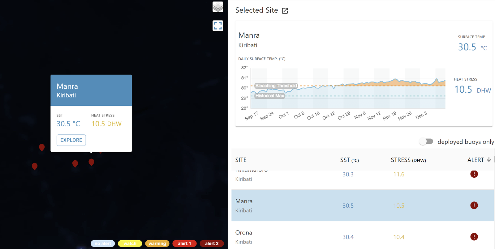
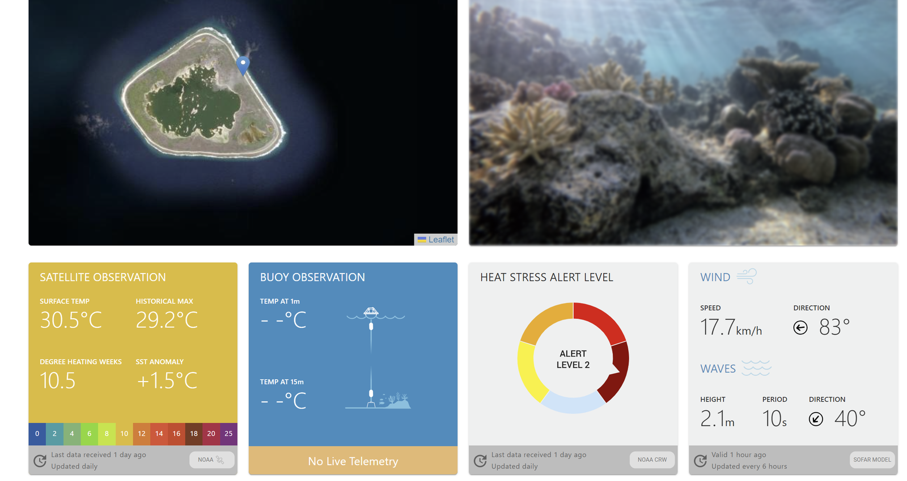
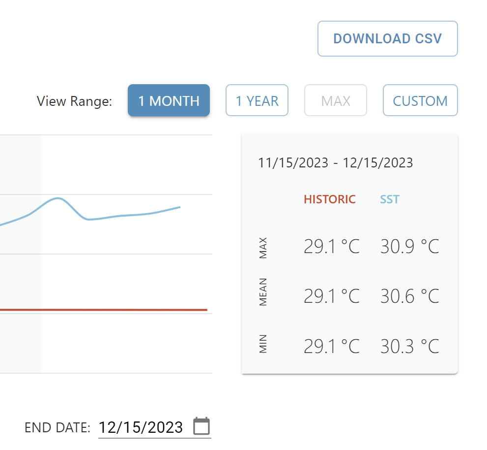

# :material-fish: Ecological Oceanography [2026.10.08]

Animal tracking, marine biodiversity, habitats (tidal flats, mangroves, seagrass), and blue carbon data.

## Biologging / Animal telemetry

-   **Sea turtle tracks (Korea)**

    ---

    Published sea turtle tracking data around Korea and how to download them from the MABIK OpenAPI

    [:octicons-arrow-right-24: How to download](../regional/korea-sea-turtle.md)

-   **OBIS-SEAMAP**

    ---

    Distribution and tracking data for marine mammals, sea turtles, and seabirds (sea turtles)

    [:octicons-link-external-24: OBIS-SEAMAP](https://seamap.env.duke.edu/swot)

-   **Movebank**

    ---

    Repository of animal movement tracking data

    [:octicons-link-external-24: Movebank](https://www.movebank.org/cms/movebank-main)

-   **Animal Telemetry Network** (IOOS)

    ---

    Animal telemetry network run by IOOS. Around Korea, much of the data appears to come from Japanese studies

    [:octicons-link-external-24: ATN Portal](https://portal.atn.ioos.us/#)

-   **GIS for Wildlife**

    ---

    Wildlife GIS data

    [:octicons-link-external-24: GIS4Wildlife Data](https://gis4-wildlife.com/data/)

??? info "Using the Animal Telemetry Network"
    - Project → open a project → "Add project to map" → the tracks appear on the map at the top
    - Download: inside a project, open Archives or Project data and download from there

## Ocean biodiversity

-   **OBIS**

    ---

    Ocean Biodiversity Information System. Appears to hold a large amount of plankton data

    [:octicons-download-24: OBIS Data Access](https://obis.org/data/access/#) 
    [:octicons-link-external-24: OBIS](https://www.obis.org/)

-   **GBIF**

    ---

    Global Biodiversity Information Facility

    [:octicons-link-external-24: GBIF](https://www.gbif.org/)

-   **ICES DataPortal**

    ---

    Map search of ICES marine biological and environmental data

    [:octicons-link-external-24: ICES DataPortal](https://data.ices.dk/view-map)

-   **IGMETS Explorer**

    ---

    International Group for Marine Ecological Time Series

    [:octicons-link-external-24: IGMETS Explorer](https://www.st.nmfs.noaa.gov/nauplius/media/igmets/explorer/index-00.html)

-   **CalCOFI**

    ---

    California Cooperative Oceanic Fisheries Investigations data

    [:octicons-download-24: CalCOFI Data](https://calcofi.org/data/) 
    [:octicons-download-24: EDI Data Package (knb-lter-cce.262.2)](https://portal.edirepository.org/nis/mapbrowse?packageid=knb-lter-cce.262.2)

-   **BISMaL** (Japan)

    ---

    Biological Information System for Marine Life (JAMSTEC)

    [:octicons-link-external-24: BISMaL](https://www.godac.jamstec.go.jp/bismal/e/)

??? info "Downloading OBIS data for a specific region"
    Go to DATA > Mapper at the top, click the polygon tool on the left, and draw the region you want.
    Click 'Layer' (the stacked squares) at the top right, then the button with three horizontal lines.
    Click 'View data' or 'Download' to receive the data by e-mail.

## Habitat & ecoregions

-   **Large Marine Ecosystems (LMEs)**

    ---

    LME boundary layer on IW:LEARN GeoNode

    [:octicons-download-24: LMEs layer](http://geonode.iwlearn.org/layers/geonode:lmes)

-   **Marine Ecoregions of the World**

    ---

    Biogeographic regionalization of coastal and shelf areas (WWF)

    [:octicons-link-external-24: MEOW (WWF)](https://www.worldwildlife.org/publications/marine-ecoregions-of-the-world-a-bioregionalization-of-coastal-and-shelf-areas)

-   **Mangroves & Seagrasses** (CMEMS, UNEP-WCMC)

    ---

    Global distribution of mangroves and seagrasses

    [:octicons-download-24: Mangroves](https://data.marine.copernicus.eu/product/EXT_UNEP_WCMC_MANGROVE/description) 
    [:octicons-download-24: Seagrasses](https://data.marine.copernicus.eu/product/EXT_UNEP_WCMC_SEAGRASSES/description)

-   **Global tidal flats** · 1984–2019

    ---

    High-resolution global maps of tidal flat ecosystems from 1984 to 2019 (Scientific Data)

    [:octicons-link-external-24: Scientific Data article](https://www.nature.com/articles/s41597-022-01635-5)

## Coral reef monitoring

-   **Aqualink**

    ---

    Coral reef monitoring. Site data can be downloaded as CSV

    [:octicons-link-external-24: Aqualink Map](https://aqualink.org/map)

-   **NOAA Coral Reef Watch**

    ---

    Coral reef monitoring and coral-related MHW data

    [:octicons-link-external-24: Coral Reef Watch](https://coralreefwatch.noaa.gov/main/) 
    [:octicons-download-24: Marine Heatwave Product](https://coralreefwatch.noaa.gov/product/marine_heatwave/)

??? info "Downloading a CSV file from Aqualink"
    1. Click a site.

        <figure markdown="span">
          { loading=lazy }
          <figcaption>Aqualink: select a site</figcaption>
        </figure>

    2. Click Selected Site at the top, or Explorer on the map to the right. Detailed data for the site appear.

        <figure markdown="span">
          { loading=lazy }
          <figcaption>Aqualink: site details</figcaption>
        </figure>

    3. Scroll down to download the CSV.

        <figure markdown="span">
          { loading=lazy }
          <figcaption>Aqualink: CSV download</figcaption>
        </figure>

## Republic of Korea

| Source | Content |
|---|---|
| [MOF data-sharing platform (VADAHUB)](https://www.vadahub.go.kr/bigdata/observe/space/index.do) | Comprehensive marine biological distribution surveys |
| [e-National Indicators](https://www.index.go.kr/unity/potal/main/EachDtlPageDetail.do?idx_cd=1275) | Trends in coastal wetland (tidal flat) area |
| [National Development Indicators](https://www.index.go.kr/unity/potal/indicator/IndexInfo.do?clasCd=2&idxCd=4286&upCd=15) | Coastal wetland area |
| [Marine and Fisheries Statistics](https://www.mof.go.kr/statPortal/stp/ofs/stl/ztlStatsList.do) | Marine protected area designations, tidal flat status |
| [e-National Indicators](https://www.index.go.kr/unity/potal/main/EachDtlPageDetail.do?idx_cd=3056) | Marine protected area designations |

### Blue Carbon Monitoring

National Blue Carbon Information System (linked with K-BIS) → [:octicons-link-external-24: Blue Carbon](https://bluecarbon.kr/kor/#/)
: Entry and management of baseline data, publication of results such as area and carbon uptake, and blue carbon outreach content

??? info "Monitoring method"
    - Annual distribution area by coastal wetland type, produced and recomputed from remote sensing for 1990 through the previous year
    - Area data derived from satellite imagery, with validation and correction by field surveys
    - Intertidal results are used for reliability and trend analysis rather than as area estimates

    | Coastal wetland type | Salt marsh | Seagrass bed | Intertidal zone\* |
    |---|---|---|---|
    | **Base imagery** | Landsat | Sentinel | Landsat |

## Memo

- [:octicons-link-external-24: Ocean Data Bank (National Taiwan University)](https://www.odb.ntu.edu.tw/bio/) ← appears to be a database collecting Taiwanese observations
- [:octicons-link-external-24: Global ocean carbon data (NOAA NCEI OCADS)](https://www.ncei.noaa.gov/access/ocean-carbon-acidification-data-system/oceans/)
  · [Sub-page: Carbon data](https://www.ncei.noaa.gov/access/ocean-carbon-acidification-data-system/oceans/doc.html)
