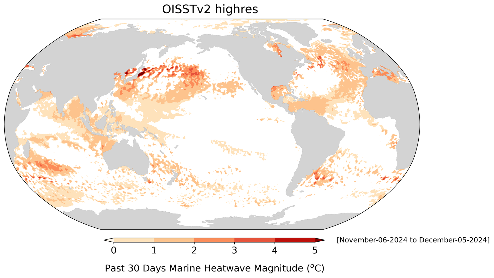

# :material-thermometer-alert: Marine Heat Wave [2025.05.21]

Marine heatwave (MHW) datasets, detection codes, and references.

<figure markdown="span">
  { loading=lazy }
  <figcaption>Past-30-day marine heatwave magnitude from OISSTv2 (NOAA PSL)</figcaption>
</figure>

## Data

-   **NOAA PSL Marine Heatwaves**

    ---

    Marine heatwave monitoring and forecasts from the NOAA Physical Sciences Laboratory

    [:octicons-link-external-24: PSL Marine Heatwaves](https://psl.noaa.gov/marine-heatwaves/)

-   **NOAA Coral Reef Watch MHW Watch** · 5 km, daily

    ---

    Daily Global 5km Satellite Marine Heatwave Watch Product (Version 1.0.1)

    [:octicons-download-24: CRW Marine Heatwave](https://coralreefwatch.noaa.gov/product/marine_heatwave/)

-   **Subsurface MHW**

    ---

    Detecting marine heatwaves below the sea surface globally using dynamics-guided statistical learning (Communications Earth & Environment)

    [:octicons-link-external-24: Data availability](https://www.nature.com/articles/s43247-024-01769-x#data-availability) 
    [:octicons-mark-github-16: Zhang-Koda/Detecting_subsurface_MHWs](https://github.com/Zhang-Koda/Detecting_subsurface_MHWs)

## Detection codes

-   **marineHeatWaves** (Python)

    ---

    MHW detection code following the Hobday et al. definition (E. C. J. Oliver)

    [:octicons-mark-github-16: ecjoliver/marineHeatWaves](https://github.com/ecjoliver/marineHeatWaves) 
    [:octicons-link-external-24: Marine heatwaves detection code (Research Data Australia)](https://researchdata.edu.au/marine-heatwaves-detection-code/814983)

-   **m_mhw** (MATLAB)

    ---

    MHW detection toolbox for MATLAB (Zhao & Marin)

    [:octicons-mark-github-16: ZijieZhaoMMHW/m_mhw1.0](https://github.com/ZijieZhaoMMHW/m_mhw1.0)

-   **heatwaveR** (R)

    ---

    Detect heatwaves and cold-spells

    [:octicons-link-external-24: heatwaveR](https://robwschlegel.github.io/heatwaveR/) 
    [:octicons-file-24: JOSS paper (PDF)](https://www.theoj.org/joss-papers/joss.01124/10.21105.joss.01124.pdf)

## Related sources

- [CMEMS: Marine Heatwaves](https://marine.copernicus.eu/explainers/phenomena-threats/heatwaves)
- [GHRSST: Marine Heatwaves](https://www.ghrsst.org/ghrsst-news/marine-heatwaves/)
- [Marine Heatwaves International Working Group](https://www.marineheatwaves.org/)
- [NOAA Research: In hot water, exploring marine heatwaves](https://research.noaa.gov/in-hot-water-exploring-marine-heatwaves/)
- [WHOI: What is a marine heatwave?](https://www.whoi.edu/know-your-ocean/did-you-know/what-is-a-marine-heatwave/)
- [CLIVAR: Marine Heatwaves in the Global Ocean](https://www.clivar.org/research-foci/marine-heatwaves)
- [National Oceanography Centre: Marine Heatwaves](https://noc.ac.uk/under-the-surface/marine-heatwaves)
- [Wikipedia: Marine heatwave](https://en.wikipedia.org/wiki/Marine_heatwave)

## Related references

- [Annual Review of Marine Science (doi:10.1146/annurev-marine-032720-095144)](https://www.annualreviews.org/content/journals/10.1146/annurev-marine-032720-095144)
- [Annual Review of Marine Science (doi:10.1146/annurev-marine-032122-121437)](https://www.annualreviews.org/content/journals/10.1146/annurev-marine-032122-121437)
- [Categorizing and naming marine heatwaves (Oceanography)](https://tos.org/oceanography/article/categorizing-and-naming-marine-heatwaves)
- [Nature Reviews Earth & Environment article (s44358-025-00058-5)](https://www.nature.com/articles/s44358-025-00058-5)
- [Marine heatwave topic overview (ScienceDirect)](https://www.sciencedirect.com/topics/earth-and-planetary-sciences/marine-heatwave)

