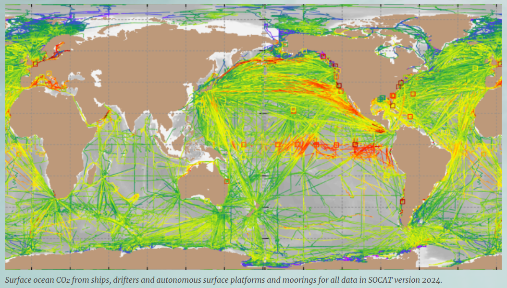
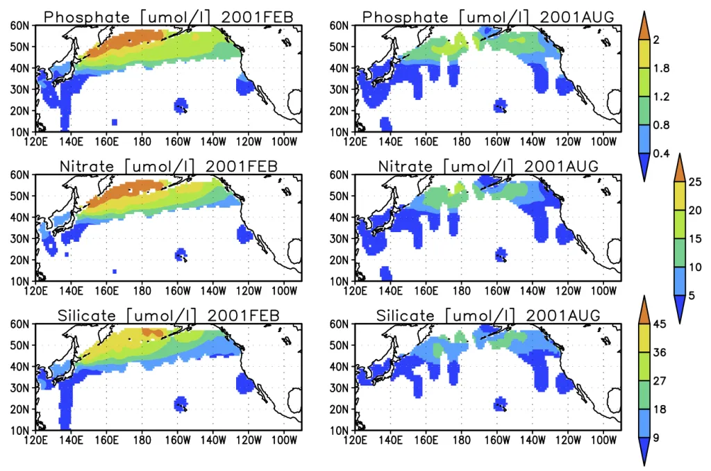

# :material-flask-outline: Nutrient & Carbon Cycle [2025.05.21]

Nutrient, carbon, and ocean chemistry observations.

## Global programs & databases

-   **GEOTRACES**

    ---

    International program on marine trace elements and isotopes

    [:octicons-link-external-24: GEOTRACES](https://www.geotraces.org/)

-   **SOCAT** (Surface Ocean CO₂ Atlas)

    ---

    Synthesis database of surface ocean CO₂ fugacity observations

    [:octicons-download-24: SOCAT](https://socat.info/) 
    [:octicons-link-external-24: About SOCAT (NOAA PMEL)](https://www.pmel.noaa.gov/co2/story/SOCAT)

    <figure markdown="span">
      { loading=lazy }
      <figcaption>SOCAT</figcaption>
    </figure>

-   **BCO-DMO**

    ---

    Biological and Chemical Oceanography Data Management Office

    [:octicons-link-external-24: BCO-DMO](https://www.bco-dmo.org/)

-   **Ocean Productivity**

    ---

    Ocean primary productivity data from Oregon State University

    [:octicons-link-external-24: Ocean Productivity](http://orca.science.oregonstate.edu/index.php)

-   **In situ carbon & chemistry** · GLODAPv2, CoastDOM

    ---

    Ship-based global carbon and chemistry synthesis (GLODAPv2) and the coastal dissolved organic matter database (CoastDOM). Described on the In Situ page

    [:octicons-arrow-right-24: Other in situ datasets (In Situ)](../whole-ocean/in-situ/others.md)

## Copernicus Marine (CMEMS)

-   **In Situ Carbon Observations** · Multi Year

    ---

    Copernicus Marine In Situ - Carbon Observations Multi Year Product

    [:octicons-download-24: SEANOE](https://www.seanoe.org/data/00879/99089/)

-   **Surface ocean carbon fields** · 0.25°, monthly, REP L4

    ---

    Global reconstructed surface pCO₂, air-sea CO₂ flux, pH, alkalinity, DIC, calcite and aragonite saturation states, with uncertainties

    [:octicons-download-24: MULTIOBS_GLO_BIO_CARBON_SURFACE_MYNRT_015_008](https://data.marine.copernicus.eu/product/MULTIOBS_GLO_BIO_CARBON_SURFACE_MYNRT_015_008/description)

??? info "How the surface ocean carbon fields are produced"
    The product is obtained from an ensemble-based forward feed neural network approach mapping in situ data for
    **surface ocean fugacity** ([SOCAT](https://www.socat.info/), Bakker et al. 2016) and sea surface salinity, temperature,
    sea surface height, chlorophyll a, mixed layer depth and atmospheric CO₂ mole fraction.

## NOAA laboratories

=== "AOML"

    **Ocean Chemistry and Ecosystems Division**

    - [:octicons-link-external-24: Ships of Opportunity (SOOP)](https://www.aoml.noaa.gov/ocd/ocdweb/occ_soop.html)
    - [:octicons-link-external-24: GO-SHIP](https://www.aoml.noaa.gov/ocd/ocdweb/occ_goship.html)
    - [:octicons-link-external-24: Ocean Acidification](https://www.aoml.noaa.gov/ocd/ocdweb/occ_oa.html)

=== "PMEL"

    **Pacific Marine Environmental Laboratory** · [Data Links](https://www.pmel.noaa.gov/data-links)

    - [:octicons-download-24: GTMBA OceanSITES Flux Data](http://www.pmel.noaa.gov/tao/oceansites/flux/main.html)
    - [:octicons-download-24: Underway pCO₂ Data](http://www.pmel.noaa.gov/co2/uwpco2/)
    - [:octicons-download-24: Atmospheric Chemistry](http://saga.pmel.noaa.gov/data/)

## Regional

-   **China: Global ocean oxygen profiles**

    ---

    A quality-controlled and bias adjusted global ocean oxygen profile dataset (Marine Science Data Center, IOCAS)

    [:octicons-download-24: Marine Science Data Center (IOCAS)](https://msdc.qdio.ac.cn/data/metadata-special-detail?id=1733027685011034114&otherId=1733027685094920193)

-   **Japan: North Pacific surface nutrients**

    ---

    Surface nutrient data for the North Pacific

    [:octicons-download-24: North Pacific Surface Nutrients](https://caos.sakura.ne.jp/sao/north-pacific-surface-nutrients/)

    <figure markdown="span">
      { loading=lazy }
      <figcaption>North Pacific surface nutrients</figcaption>
    </figure>

