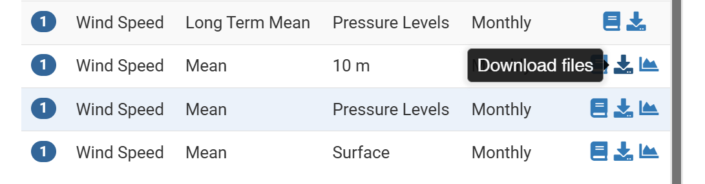
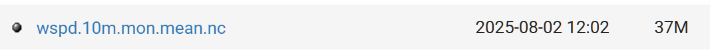
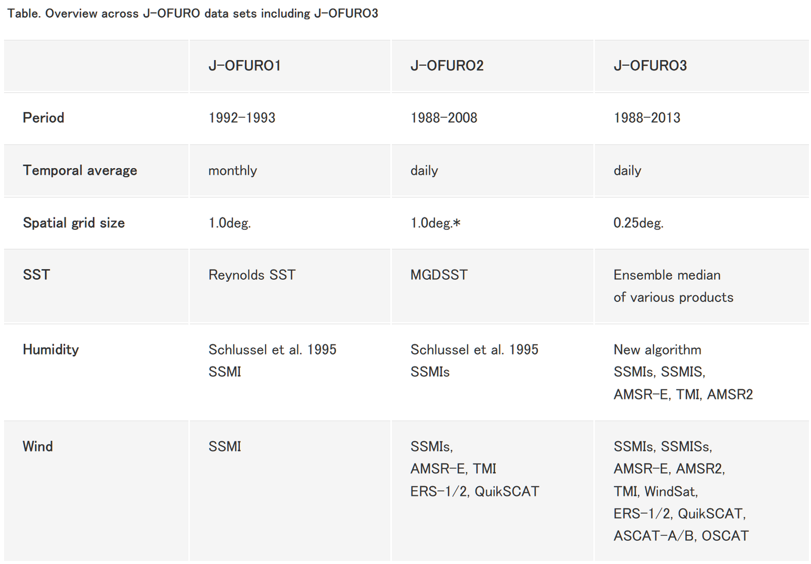
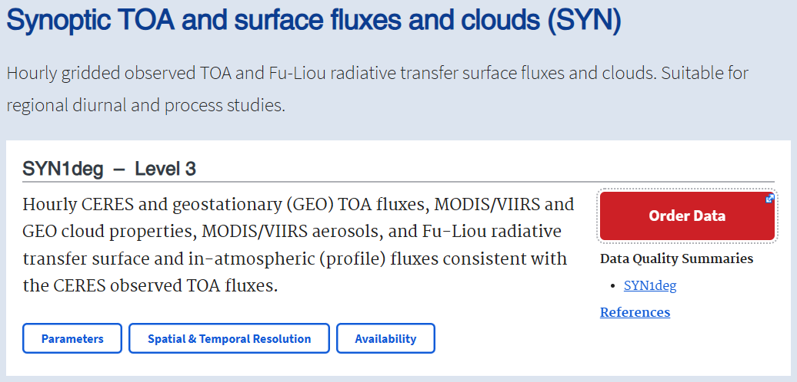
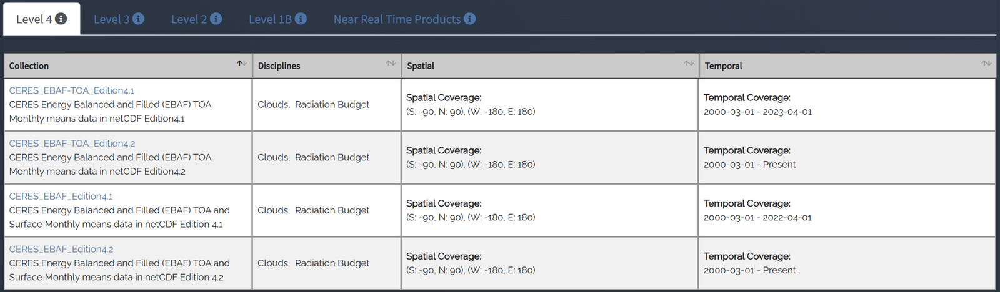

# :material-weather-partly-cloudy: Atmosphere [2026.05.12]

해상풍, 강수, 열속, 구름 등 대기 자료와 대기 재분석입니다. 태풍 자료는 [Typhoon & Hurricane](../topics/typhoon.md) 페이지에서 관리합니다.

## 재분석

-   **ERA5** (ECMWF)

    ---

    ECMWF 5세대 대기 재분석

    [:octicons-arrow-right-24: ERA5 다운로드 방법 (웹, Python, MATLAB)](era5-download.md) 
    [:octicons-link-external-24: ERA5 (ECMWF)](https://www.ecmwf.int/en/forecasts/datasets/reanalysis-datasets/era5) 
    [:octicons-link-external-24: ECMWF datasets](https://www.ecmwf.int/en/forecasts/datasets) 
    [:octicons-link-external-24: ECMWF real-time products catalogue](https://www.ecmwf.int/en/forecasts/datasets/catalogue-ecmwf-real-time-products)

-   **MERRA-2** (NASA GMAO)

    ---

    Modern-Era Retrospective Analysis for Research and Applications, version 2

    [:octicons-download-24: MERRA-2 data access](https://gmao.gsfc.nasa.gov/reanalysis/MERRA-2/data_access/) 
    [:octicons-book-24: Gelaro et al. (2017), J. Climate](https://doi.org/10.1175/JCLI-D-16-0758.1)

-   **JRA55-do** · 3-hourly, ~0.56°

    ---

    JRA-55 기반, 위성 및 다른 재분석으로 보정한 해양–해빙 모형 구동용 지표 자료 (Tsujino et al. 2020)

    [:octicons-download-24: JRA55-do (MRI-JMA)](https://climate.mri-jma.go.jp/pub/ocean/JRA55-do/)

-   **NCEP Reanalysis**

    ---

    NCEP-NCAR Reanalysis 및 NCAR 자료 서비스

    [:octicons-download-24: NCEP-NCAR Reanalysis 1 (NOAA PSL)](https://psl.noaa.gov/data/gridded/data.ncep.reanalysis.html) 
    [:octicons-link-external-24: NCAR data services](https://ncar.ucar.edu/what-we-offer/data-services)

-   **Copernicus data stores**

    ---

    Climate Data Store와 Atmosphere Data Store

    [:octicons-link-external-24: Climate Data Store (CDS)](https://cds.climate.copernicus.eu/datasets) 
    [:octicons-link-external-24: Atmosphere Data Store (ADS)](https://ads.atmosphere.copernicus.eu/datasets)

<figure markdown="span">
  { loading=lazy }
  <figcaption>NCEP-NCAR Reanalysis 1 페이지 (NOAA PSL)</figcaption>
</figure>
<figure markdown="span">
  { loading=lazy }
  <figcaption>NCEP-NCAR Reanalysis 1 변수 목록 (NOAA PSL)</figcaption>
</figure>

??? quote "JRA55-do 설명 (논문 발췌)"
    One atmospheric reanalysis dataset is the surface dataset developed for driving ocean-sea-ice models (JRA55-do; Tsujino et al. 2020)
    based on the Japanese 55-year atmospheric reanalysis (JRA55). The JRA55-do dataset corrects JRA-55 using satellite and other atmospheric reanalysis products
    (Tsujino et al. 2020). The JRA55-do dataset has resolutions of 3 h in time and approximately 0.56° in horizontal.
    The 3-hourly JRA55-do variables are averaged into monthly means.

    Source: [The poleward expansion of the Hadley Cell has weakened the winter circulation in a midlatitude semi-enclosed shelf sea over the past six decades](https://doi.org/10.1007/s00382-025-07774-w)

## 해상풍·강수·플럭스

-   **Scatterometer wind** (CMEMS)

    ---

    전 지구 위성 해상풍 L3 (NRT 및 multi-year)

    [:octicons-link-external-24: WIND_GLO_PHY_L3_NRT_012_002](https://data.marine.copernicus.eu/product/WIND_GLO_PHY_L3_NRT_012_002/description) 
    [:octicons-link-external-24: WIND_GLO_PHY_L3_MY_012_005](https://data.marine.copernicus.eu/product/WIND_GLO_PHY_L3_MY_012_005/description)

-   **Precipitation**

    ---

    GPCP, GPM 등 위성 강수 자료

    [:octicons-arrow-right-24: AMSR-2 다운로드](satellite/microwave.md) 
    [:octicons-download-24: GPCP (NOAA PSL)](https://psl.noaa.gov/data/gridded/data.gpcp.html) 
    [:octicons-link-external-24: GPM data directory (NASA)](https://gpm.nasa.gov/data/directory) 
    [:octicons-link-external-24: CDS: satellite-precipitation](https://cds.climate.copernicus.eu/datasets/satellite-precipitation?tab=overview) 
    [:octicons-link-external-24: Climate Data Guide: GPM](https://climatedataguide.ucar.edu/climate-data/gpm-global-precipitation-measurement-mission)

-   **J-OFURO**

    ---

    Japanese Ocean Flux data sets with Use of Remote sensing Observations

    [:octicons-link-external-24: J-OFURO](https://www.j-ofuro.com/en/)

-   **Ocean surface buoys** (PMEL OCS)

    ---

    대기–해양 경계 계류 관측

    [:octicons-link-external-24: PMEL Ocean Climate Stations](https://www.pmel.noaa.gov/ocs/research-overview)

<figure markdown="span">
  { loading=lazy }
  <figcaption>J-OFURO 웹사이트</figcaption>
</figure>

## 복사·구름·에어로졸

-   **CERES**

    ---

    지표 복사 플럭스와 구름 자료

    [:octicons-download-24: CERES data (NASA LaRC)](https://ceres.larc.nasa.gov/data/) 
    [:octicons-link-external-24: CERES (ASDC)](https://asdc.larc.nasa.gov/project/CERES)

-   **MISR**

    ---

    Multi-angle Imaging SpectroRadiometer

    [:octicons-link-external-24: MISR (ASDC)](https://asdc.larc.nasa.gov/project/MISR)

-   **CALIPSO**

    ---

    구름·에어로졸 라이다 위성

    [:octicons-link-external-24: CALIPSO (ASDC)](https://asdc.larc.nasa.gov/project/CALIPSO)

-   **CFMIP-OBS**

    ---

    Cloud observations for model evaluation

    [:octicons-link-external-24: CFMIP-OBS (IPSL)](https://climserv.ipsl.polytechnique.fr/cfmip-obs/)

<figure markdown="span">
  { loading=lazy }
  <figcaption>CERES 자료 포털</figcaption>
</figure>
<figure markdown="span">
  { loading=lazy }
  <figcaption>CERES 프로젝트 페이지 (ASDC)</figcaption>
</figure>

## 한국·아시아 태평양

=== "KMA: 기후 변화"

    - [종합기후변화 감시](http://www.climate.go.kr/home/09_monitoring/)
    - [기후정보포털](http://www.climate.go.kr/home/)
    - [기상청 기후예측정보서비스](https://www.kma.go.kr/cpd/index.html)

=== "KMA: 기상 자료"

    - [국립기상과학원 연구자료 제공 목록](http://www.nims.go.kr/?sub_num=1124)
    - [기상자료개방포털](https://data.kma.go.kr/cmmn/main.do)
    - [기상청 날씨마루 (기상기후 빅데이터 분석 플랫폼)](https://bd.kma.go.kr/kma2020/)
    - [기상청 API허브](https://apihub.kma.go.kr/apiList.do?seqApi=3)
    - [해양기상부이 (기상청 날씨누리)](https://www.weather.go.kr/w/observation/sea/buoy-obs.do)

=== "APCC"

    [APEC 기후센터 (APCC)](https://www.apcc21.org/?lang=ko)

## Toolbox

- [:octicons-mark-github-16: sea-mat/air-sea: 해양-대기 플럭스 MATLAB 툴박스](https://github.com/sea-mat/air-sea)

