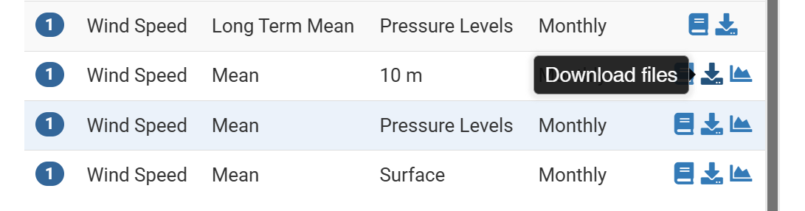
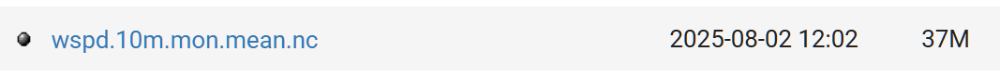
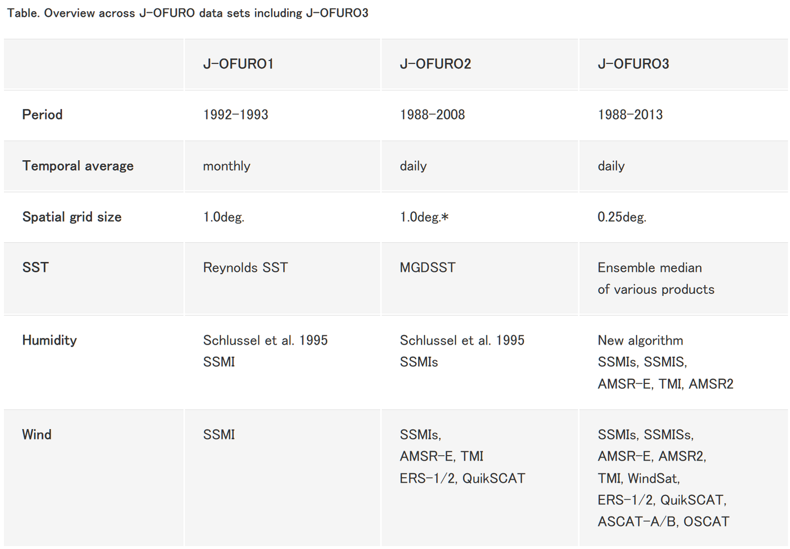
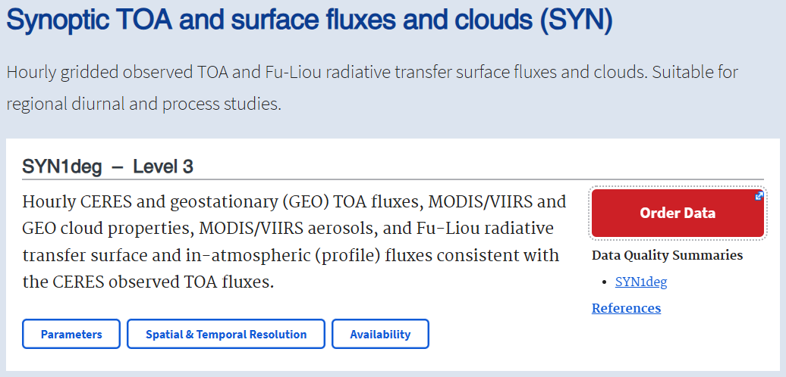
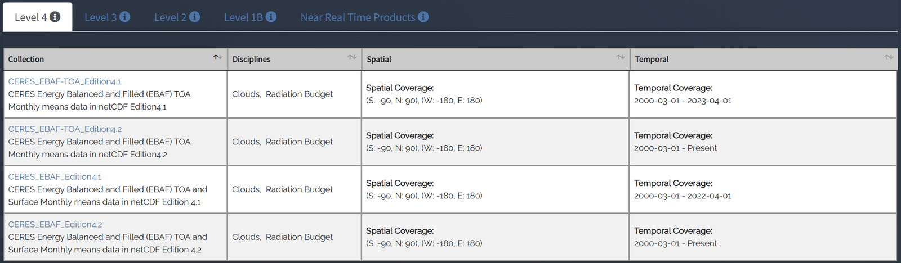

# :material-weather-partly-cloudy: Atmosphere [2026.05.12]

Atmospheric data and reanalyses: surface wind, precipitation, heat flux, clouds. Typhoon data are kept on the [Typhoon & Hurricane](../topics/typhoon.md) page.

## Reanalysis

-   **ERA5** (ECMWF)

    ---

    Fifth-generation ECMWF atmospheric reanalysis

    [:octicons-arrow-right-24: How to download ERA5 (web, Python, MATLAB)](era5-download.md) 
    [:octicons-link-external-24: ERA5 (ECMWF)](https://www.ecmwf.int/en/forecasts/datasets/reanalysis-datasets/era5) 
    [:octicons-link-external-24: ECMWF datasets](https://www.ecmwf.int/en/forecasts/datasets) 
    [:octicons-link-external-24: ECMWF real-time products catalogue](https://www.ecmwf.int/en/forecasts/datasets/catalogue-ecmwf-real-time-products)

-   **MERRA-2** (NASA GMAO)

    ---

    Modern-Era Retrospective Analysis for Research and Applications, version 2

    [:octicons-download-24: MERRA-2 data access](https://gmao.gsfc.nasa.gov/reanalysis/MERRA-2/data_access/) 
    [:octicons-book-24: Gelaro et al. (2017), J. Climate](https://doi.org/10.1175/JCLI-D-16-0758.1)

-   **JRA55-do** · 3-hourly, ~0.56°

    ---

    Surface dataset for driving ocean and sea-ice models, based on JRA-55 and corrected with satellite and other reanalysis products (Tsujino et al. 2020)

    [:octicons-download-24: JRA55-do (MRI-JMA)](https://climate.mri-jma.go.jp/pub/ocean/JRA55-do/)

-   **NCEP Reanalysis**

    ---

    NCEP-NCAR Reanalysis and NCAR data services

    [:octicons-download-24: NCEP-NCAR Reanalysis 1 (NOAA PSL)](https://psl.noaa.gov/data/gridded/data.ncep.reanalysis.html) 
    [:octicons-link-external-24: NCAR data services](https://ncar.ucar.edu/what-we-offer/data-services)

-   **Copernicus data stores**

    ---

    Climate Data Store and Atmosphere Data Store

    [:octicons-link-external-24: Climate Data Store (CDS)](https://cds.climate.copernicus.eu/datasets) 
    [:octicons-link-external-24: Atmosphere Data Store (ADS)](https://ads.atmosphere.copernicus.eu/datasets)

<figure markdown="span">
  { loading=lazy }
  <figcaption>NCEP-NCAR Reanalysis 1 page (NOAA PSL)</figcaption>
</figure>
<figure markdown="span">
  { loading=lazy }
  <figcaption>NCEP-NCAR Reanalysis 1 variables (NOAA PSL)</figcaption>
</figure>

??? quote "JRA55-do description (from a published study)"
    One atmospheric reanalysis dataset is the surface dataset developed for driving ocean-sea-ice models (JRA55-do; Tsujino et al. 2020)
    based on the Japanese 55-year atmospheric reanalysis (JRA55). The JRA55-do dataset corrects JRA-55 using satellite and other atmospheric reanalysis products
    (Tsujino et al. 2020). The JRA55-do dataset has resolutions of 3 h in time and approximately 0.56° in horizontal.
    The 3-hourly JRA55-do variables are averaged into monthly means.

    Source: [The poleward expansion of the Hadley Cell has weakened the winter circulation in a midlatitude semi-enclosed shelf sea over the past six decades](https://doi.org/10.1007/s00382-025-07774-w)

## Wind, precipitation & fluxes

-   **Scatterometer wind** (CMEMS)

    ---

    Global satellite surface wind, L3 (NRT and multi-year)

    [:octicons-link-external-24: WIND_GLO_PHY_L3_NRT_012_002](https://data.marine.copernicus.eu/product/WIND_GLO_PHY_L3_NRT_012_002/description) 
    [:octicons-link-external-24: WIND_GLO_PHY_L3_MY_012_005](https://data.marine.copernicus.eu/product/WIND_GLO_PHY_L3_MY_012_005/description)

-   **Precipitation**

    ---

    Satellite precipitation products such as GPCP and GPM

    [:octicons-arrow-right-24: Download AMSR-2](satellite/microwave.md) 
    [:octicons-download-24: GPCP (NOAA PSL)](https://psl.noaa.gov/data/gridded/data.gpcp.html) 
    [:octicons-link-external-24: GPM data directory (NASA)](https://gpm.nasa.gov/data/directory) 
    [:octicons-link-external-24: CDS: satellite-precipitation](https://cds.climate.copernicus.eu/datasets/satellite-precipitation?tab=overview) 
    [:octicons-link-external-24: Climate Data Guide: GPM](https://climatedataguide.ucar.edu/climate-data/gpm-global-precipitation-measurement-mission)

-   **J-OFURO**

    ---

    Japanese Ocean Flux data sets with Use of Remote sensing Observations

    [:octicons-link-external-24: J-OFURO](https://www.j-ofuro.com/en/)

-   **Ocean surface buoys** (PMEL OCS)

    ---

    Moored observations at the air-sea interface

    [:octicons-link-external-24: PMEL Ocean Climate Stations](https://www.pmel.noaa.gov/ocs/research-overview)

<figure markdown="span">
  { loading=lazy }
  <figcaption>J-OFURO website</figcaption>
</figure>

## Radiation, clouds & aerosols

-   **CERES**

    ---

    Surface radiative fluxes and cloud data

    [:octicons-download-24: CERES data (NASA LaRC)](https://ceres.larc.nasa.gov/data/) 
    [:octicons-link-external-24: CERES (ASDC)](https://asdc.larc.nasa.gov/project/CERES)

-   **MISR**

    ---

    Multi-angle Imaging SpectroRadiometer

    [:octicons-link-external-24: MISR (ASDC)](https://asdc.larc.nasa.gov/project/MISR)

-   **CALIPSO**

    ---

    Cloud and aerosol lidar satellite

    [:octicons-link-external-24: CALIPSO (ASDC)](https://asdc.larc.nasa.gov/project/CALIPSO)

-   **CFMIP-OBS**

    ---

    Cloud observations for model evaluation

    [:octicons-link-external-24: CFMIP-OBS (IPSL)](https://climserv.ipsl.polytechnique.fr/cfmip-obs/)

<figure markdown="span">
  { loading=lazy }
  <figcaption>CERES data portal</figcaption>
</figure>
<figure markdown="span">
  { loading=lazy }
  <figcaption>CERES project page (ASDC)</figcaption>
</figure>

## Korea & Asia-Pacific

=== "KMA: climate change"

    - [Climate change monitoring (종합기후변화 감시)](http://www.climate.go.kr/home/09_monitoring/)
    - [Climate information portal (기후정보포털)](http://www.climate.go.kr/home/)
    - [KMA climate prediction service](https://www.kma.go.kr/cpd/index.html)

=== "KMA: weather data"

    - [NIMS research data list](http://www.nims.go.kr/?sub_num=1124)
    - [KMA open data portal (기상자료개방포털)](https://data.kma.go.kr/cmmn/main.do)
    - [KMA Nalssi-Maru (weather and climate big-data platform)](https://bd.kma.go.kr/kma2020/)
    - [KMA API Hub](https://apihub.kma.go.kr/apiList.do?seqApi=3)
    - [Marine meteorological buoys (KMA)](https://www.weather.go.kr/w/observation/sea/buoy-obs.do)

=== "APCC"

    [APEC Climate Center (APCC)](https://www.apcc21.org/?lang=ko)

## Toolbox

- [:octicons-mark-github-16: sea-mat/air-sea: Air-sea flux MATLAB toolbox](https://github.com/sea-mat/air-sea)

