# :material-weather-cloudy-arrow-right: ERA5 다운로드 방법 <span class="date">[2025.08.25]</span>

Climate Data Store(CDS)에서 ERA5를 받는 세 가지 방법입니다: 웹 양식, Python의 CDS API, MATLAB.
먼저 [Climate Data Store](https://cds.climate.copernicus.eu/datasets)에 가입하고 로그인하세요.

예시 product:

- [ERA5 hourly data on single levels from 1940 to present](https://cds.climate.copernicus.eu/datasets/reanalysis-era5-single-levels?tab=overview)
- [ERA5 monthly averaged data on single levels from 1940 to present](https://cds.climate.copernicus.eu/datasets/reanalysis-era5-single-levels-monthly-means?tab=overview)

=== "웹 양식"

    1. [Climate Data Store](https://cds.climate.copernicus.eu/datasets)에 접속하여 로그인합니다.
    2. 원하는 product를 찾아 **Download**를 열고 옵션을 선택합니다.

        <figure markdown="span">
          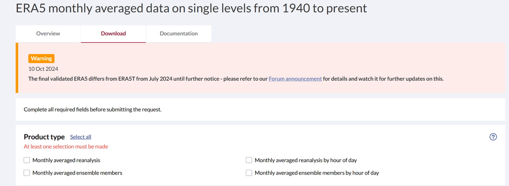{ loading=lazy }
          <figcaption>CDS 다운로드 양식</figcaption>
        </figure>

    3. 맨 아래 **Submit Form**이 활성화되면 클릭합니다. 에러가 날 수 있는데, 계속 다시 시도하면 됩니다.

        <figure markdown="span">
          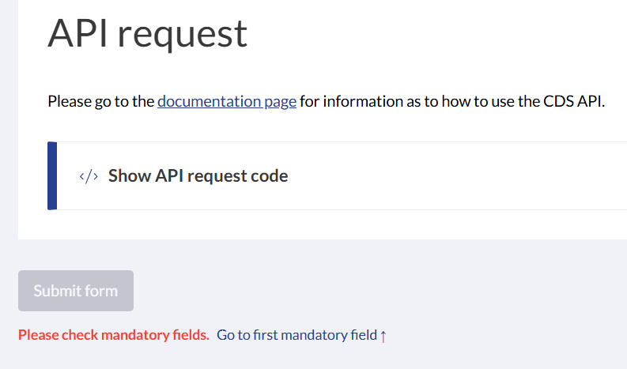{ loading=lazy }
          <figcaption>Submit Form 버튼</figcaption>
        </figure>

    4. 자료 용량에 따라 다르지만, 2012~2023년 동중국해 범위의 monthly u, v 자료는 처리에 1분이 채 걸리지 않았습니다.
       요청 화면에서 **Status**가 complete로 바뀔 때까지 기다리면 됩니다.

        <figure markdown="span">
          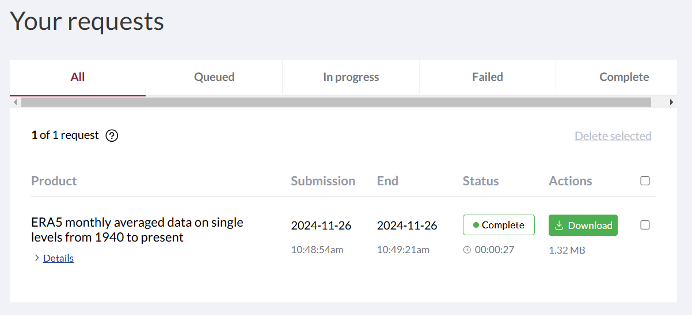{ loading=lazy }
          <figcaption>요청 상태 화면</figcaption>
        </figure>

=== "Python (CDS API)"

    원하는 자료의 옵션을 모두 선택한 뒤 **API request** 탭을 보면 Python 스크립트가 작성되어 있습니다.
    이 스크립트를 복사해서 Python 환경에 붙여 넣습니다. 그대로 실행하면 첫 줄에서 오류가 나는데, `cdsapi` 패키지를 먼저 준비해야 하기 때문입니다.

    <figure markdown="span">
      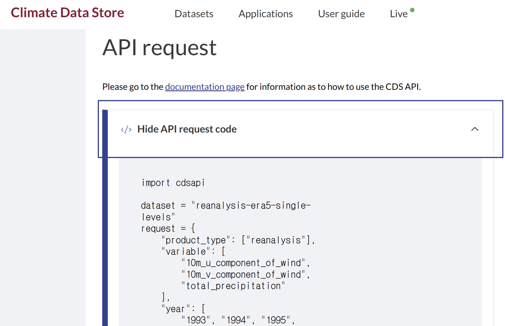{ loading=lazy }
      <figcaption>API request 탭의 자동 생성 스크립트</figcaption>
    </figure>
    <figure markdown="span">
      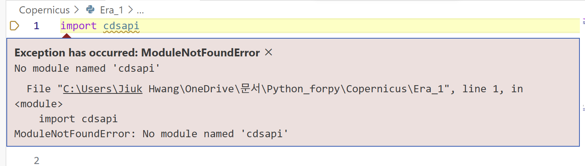{ loading=lazy }
      <figcaption>cdsapi 설치 전 발생하는 import 오류</figcaption>
    </figure>

    1. **`cdsapi` 패키지 설치.** Python 가상 환경이 활성화된 상태에서 터미널에 입력합니다.

        ```powershell
        pip install cdsapi
        ```

    2. **CDS API 키 설정.** 패키지 설치만으로는 자료를 받을 수 없고, CDS에 접속하기 위한 API 키를 설정해야 합니다.
        1. ECMWF의 Copernicus Climate Change Service(C3S) 웹사이트에서 회원 가입을 합니다.
        2. 로그인 후 프로필 페이지에서 API 키를 확인합니다.

            <figure markdown="span">
              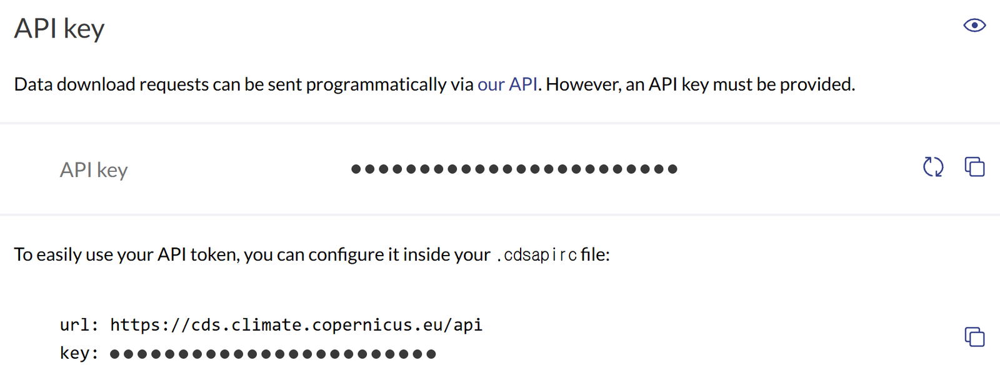{ loading=lazy }
              <figcaption>CDS 프로필 페이지의 API 키</figcaption>
            </figure>

        3. 홈 디렉터리(`~` 또는 `%USERPROFILE%`, 윈도우에서는 `C:\Users\사용자이름`)에 `.cdsapirc` 파일을 만들고,
           프로필 페이지의 API key 란에 적힌 본인의 token을 복사해서 붙여 넣습니다.

            ```txt title=".cdsapirc"
            url: https://cds.climate.copernicus.eu/api
            key:
            ```

            새 txt 문서를 만들어 내용을 채운 뒤 이름을 바꾸면 되는데, 이때 **확장자 `.txt`를 제거**해야 합니다.
            이름 바꾸기에서 `.txt`가 보이지 않으면 탐색기의 보기 설정에서 파일 확장명을 표시하도록 바꾸면 됩니다.

            <figure markdown="span">
              { loading=lazy }
              <figcaption>탐색기 보기 설정 (1)</figcaption>
            </figure>
            <figure markdown="span">
              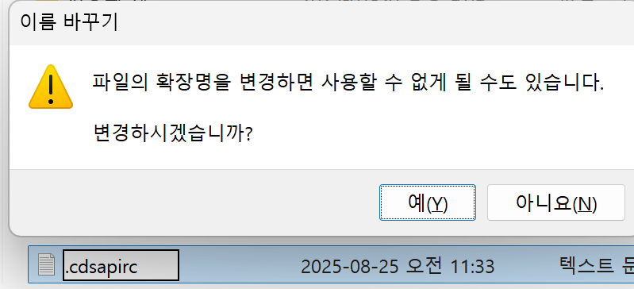{ loading=lazy }
              <figcaption>탐색기 보기 설정 (2)</figcaption>
            </figure>
            <figure markdown="span">
              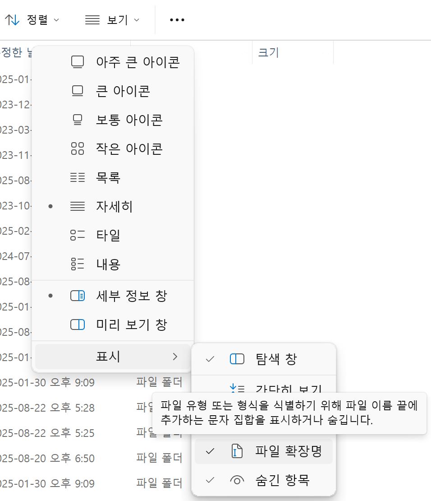{ loading=lazy }
              <figcaption>이름을 바꾼 .cdsapirc 파일</figcaption>
            </figure>

    3. **코드 실행.** `cdsapi`가 설치되고 API 키가 올바르게 설정되었다면, 제시된 코드를 실행하여 ERA5 재분석 자료를 받을 수 있습니다.

    4. `uv pip list`에 `cdsapi`가 보이는데도 Jupyter Interactive 창에서 `No module named 'cdsapi'`가 뜰 수 있습니다.
       현재 Jupyter 환경이 `cdsapi`를 설치한 가상환경이 아니기 때문일 수 있습니다. Interactive 창 우측 상단에 본인이 작업하는 가상환경 이름
       (예시에서는 `forpy`)이 나와야 하며, 아니라면 클릭해서 kernel을 바꾸고, `ipykernel`을 설치하겠냐는 문구가 뜨면 확인하면 됩니다.

        <figure markdown="span">
          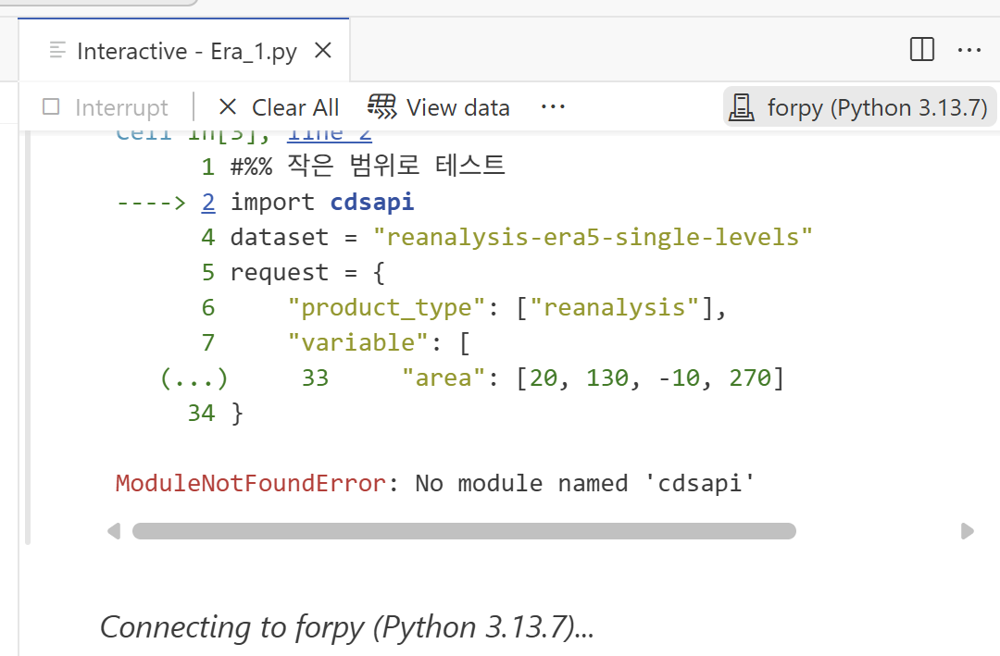{ loading=lazy }
          <figcaption>Jupyter Interactive 창에서 kernel 선택</figcaption>
        </figure>

    ??? tip ".cdsapirc 파일이 읽히지 않을 때"
        동료의 도움으로, `.cdsapirc` 파일을 읽지 않고 코드에서 url과 key를 바로 제공하는 방식으로 해결했습니다.

        ```py title="자격 정보를 직접 지정한 ERA5 요청"
        import cdsapi

        url= ' '
        key= ' '

        dataset = "reanalysis-era5-single-levels"
        request = {
            "product_type": ["reanalysis"],
            "variable": [
                "10m_u_component_of_wind",
                "10m_v_component_of_wind",
                "total_precipitation"
            ],
            "year": [
                "1993"
            ],
            "month": [
                "01"
            ],
            "day": [
                "01"
            ],
            "time": [
                "00:00", "01:00", "02:00",
                "03:00", "04:00", "05:00",
                "06:00", "07:00", "08:00",
                "09:00", "10:00", "11:00",
                "12:00", "13:00", "14:00",
                "15:00", "16:00", "17:00",
                "18:00", "19:00", "20:00",
                "21:00", "22:00", "23:00"
            ],
            "data_format": "netcdf",
            "download_format": "unarchived",
            "area": [20, 130, -10, 270]
        }

        client = cdsapi.Client(url=url, key=key)
        client.retrieve(dataset, request).download()
        ```

=== "MATLAB"

    [:octicons-download-24: Climate Data Store Toolbox for MATLAB (File Exchange)](https://kr.mathworks.com/matlabcentral/fileexchange/104550-climate-data-store-toolbox-for-matlab)

    ??? info "웹사이트의 CDS Toolbox로 받기 (구버전, 서비스 종료)"
        브라우저 기반 CDS Toolbox는 더 이상 제공되지 않습니다. 절차는 참고용으로 남겨 둡니다.

        1. 로그인 후 product 페이지에서 원하는 조건을 설정합니다 (**변수는 한 번에 하나만** 설정하는 것을 권합니다. 구 링크 기준, 경험상 2개 이상이면
           경고가 뜨고 받아도 변수 한 개만 들어 있었습니다). 아래 링크는 **ERA5 hourly data on single levels from 1940 to present**에 대한 것입니다:
           [새 링크](https://cds.climate.copernicus.eu/datasets/reanalysis-era5-single-levels?tab=download) ·
           [구 링크 (폐쇄됨)](https://cds.climate.copernicus.eu/cdsapp#!/dataset/reanalysis-era5-single-levels?tab=form)
        2. 맨 아래 **show Toolbox request**를 클릭하고 코드를 복사합니다.

            <figure markdown="span">
              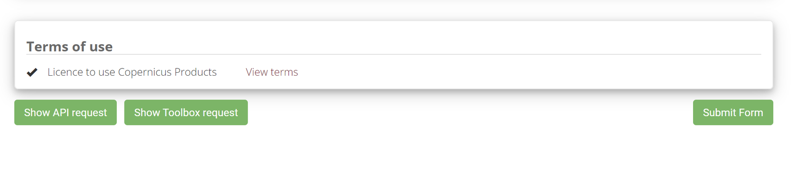{ loading=lazy }
              <figcaption>show Toolbox request</figcaption>
            </figure>

        3. 상단의 **Toolbox**를 클릭합니다.

            <figure markdown="span">
              { loading=lazy }
              <figcaption>Toolbox 메뉴</figcaption>
            </figure>

        4. **Toolbox Editor**를 클릭합니다.

            <figure markdown="span">
              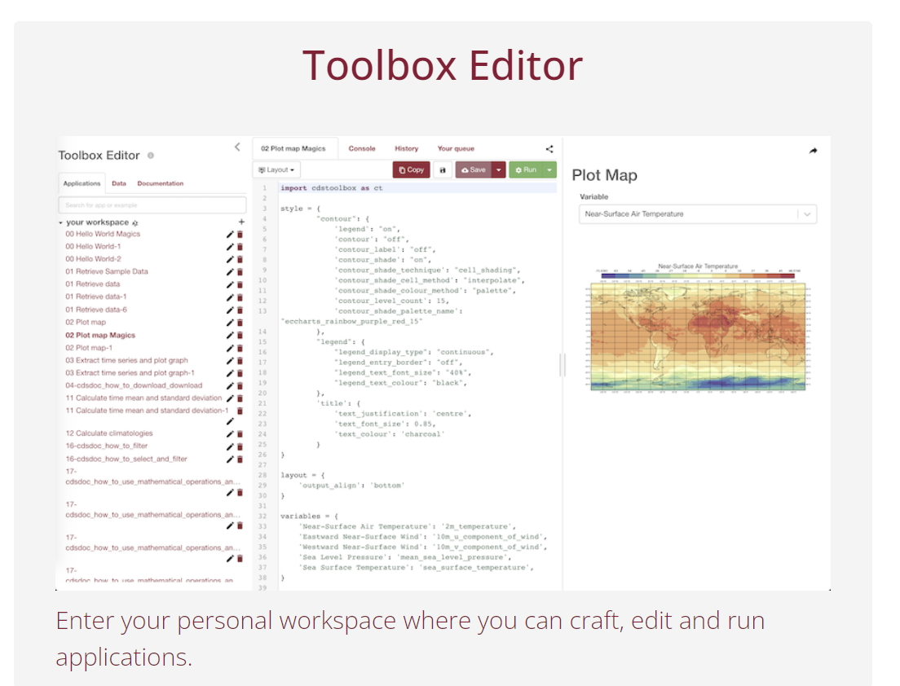{ loading=lazy }
              <figcaption>Toolbox Editor</figcaption>
            </figure>

        5. your workspace에 새 항목을 만듭니다.

            <figure markdown="span">
              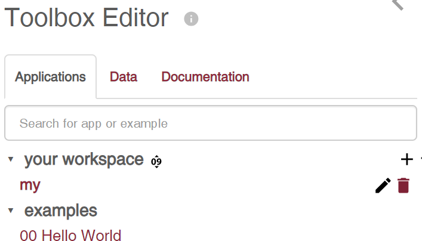{ loading=lazy }
              <figcaption>새 workspace 항목</figcaption>
            </figure>

        6. 코드를 붙여 넣고 **Run**을 클릭합니다.

            <figure markdown="span">
              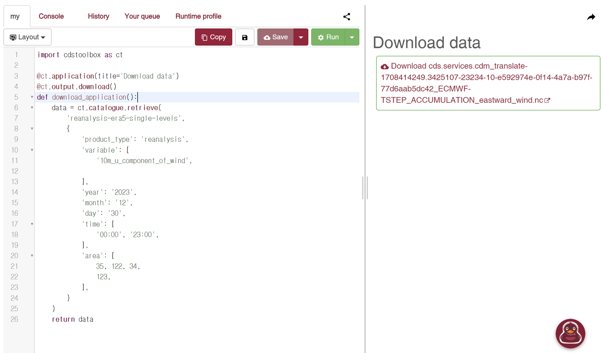{ loading=lazy }
              <figcaption>요청 실행</figcaption>
            </figure>

            ```txt title="CDS Toolbox request"
            import cdstoolbox as ct

            @ct.application(title='Download data')
            @ct.output.download()
            def download_application():
                data = ct.catalogue.retrieve(
                    'reanalysis-era5-single-levels',
                    {
                        'product_type': 'reanalysis',
                        'variable': [
                            '10m_u_component_of_wind',
                        ],
                        'year': '2023',
                        'month': '12',
                        'day': '30',
                        'time': [
                            '00:00', '23:00',
                        ],
                        'area': [
                            35, 122, 34,
                            123,
                        ],
                    }
                )
                return data
            ```
