# :material-weather-cloudy-arrow-right: How to download ERA5 <span class="date">[2025.08.25]</span>

Three ways to download ERA5 from the Climate Data Store (CDS): the web form, the CDS API in Python, and MATLAB.
Create a free account at the [Climate Data Store](https://cds.climate.copernicus.eu/datasets) and log in first.

Example products:

- [ERA5 hourly data on single levels from 1940 to present](https://cds.climate.copernicus.eu/datasets/reanalysis-era5-single-levels?tab=overview)
- [ERA5 monthly averaged data on single levels from 1940 to present](https://cds.climate.copernicus.eu/datasets/reanalysis-era5-single-levels-monthly-means?tab=overview)

=== "Web form"

    1. Log in to the [Climate Data Store](https://cds.climate.copernicus.eu/datasets).
    2. Find the product, open **Download**, and select the options.

        <figure markdown="span">
          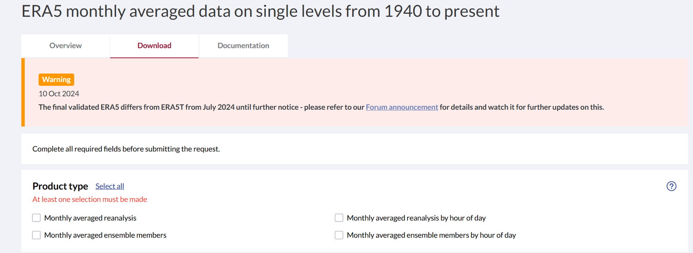{ loading=lazy }
          <figcaption>CDS download form</figcaption>
        </figure>

    3. Click **Submit Form** at the bottom once it becomes active. It may fail with an error; retrying usually works.

        <figure markdown="span">
          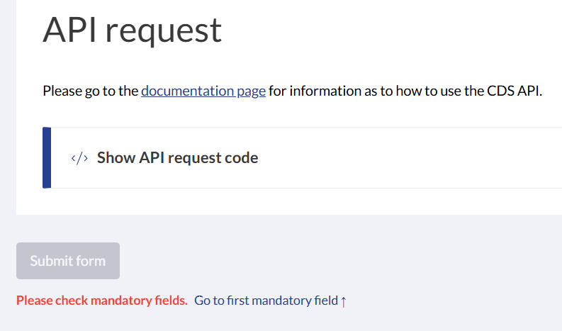{ loading=lazy }
          <figcaption>Submit Form button</figcaption>
        </figure>

    4. The processing time depends on the request size. Monthly u and v over the East China Sea for 2012 to 2023 took less than a minute.
       Wait until **Status** shows *complete* on the request page.

        <figure markdown="span">
          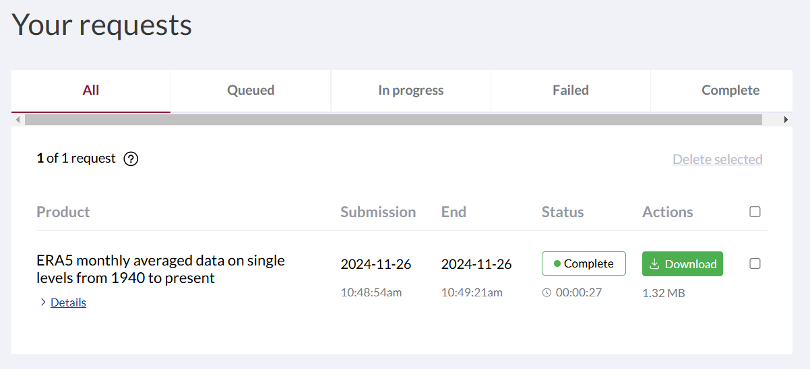{ loading=lazy }
          <figcaption>Request status page</figcaption>
        </figure>

=== "Python (CDS API)"

    After selecting all options for a product, the **API request** tab shows a ready-made Python script.
    Paste it into your Python environment. Running it as is fails on the first line, because the `cdsapi` package must be set up first.

    <figure markdown="span">
      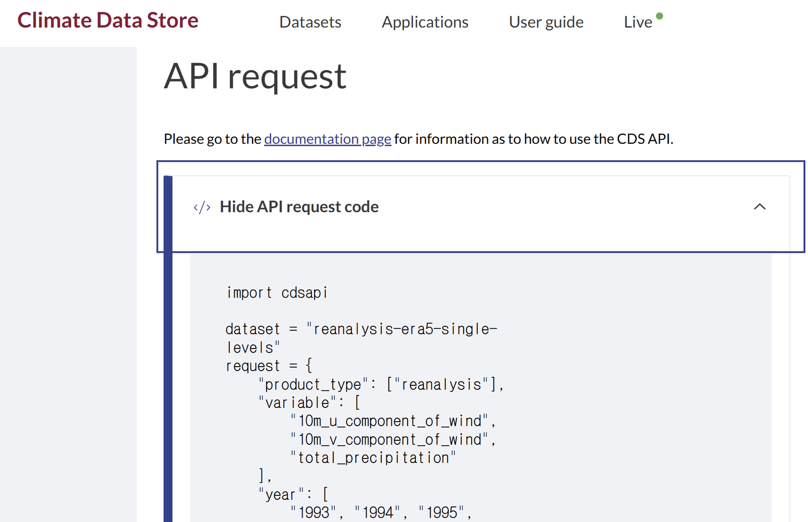{ loading=lazy }
      <figcaption>API request tab with the generated script</figcaption>
    </figure>
    <figure markdown="span">
      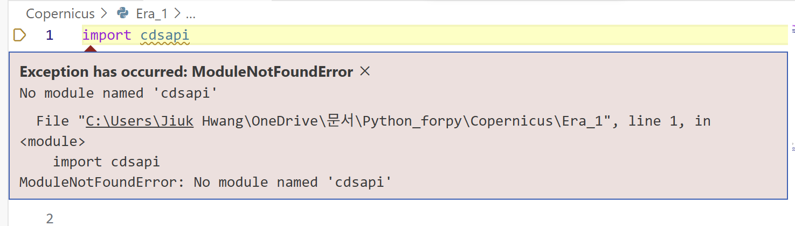{ loading=lazy }
      <figcaption>Import error before cdsapi is installed</figcaption>
    </figure>

    1. **Install `cdsapi`.** With your Python virtual environment active, run:

        ```powershell
        pip install cdsapi
        ```

    2. **Set up the CDS API key.** The package alone cannot download anything; the API key identifies your account.
        1. Register on the Copernicus Climate Change Service (C3S) website.
        2. After logging in, open your profile page to find the API key.

            <figure markdown="span">
              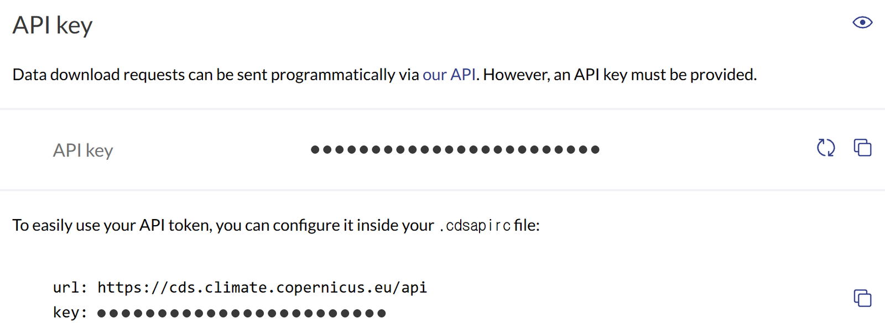{ loading=lazy }
              <figcaption>API key on the CDS profile page</figcaption>
            </figure>

        3. Create a file named `.cdsapirc` in your home directory (`~` or `%USERPROFILE%`, that is `C:\Users\<user>` on Windows)
           and paste the URL and your personal API token shown on the profile page:

            ```txt title=".cdsapirc"
            url: https://cds.climate.copernicus.eu/api
            key:
            ```

            The simplest way is to create a new text file, fill it in, and rename it, **removing the `.txt` extension**.
            If the extension is not shown in the rename dialog, enable file name extensions in the Explorer view settings.

            <figure markdown="span">
              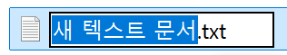{ loading=lazy }
              <figcaption>Explorer view settings (1)</figcaption>
            </figure>
            <figure markdown="span">
              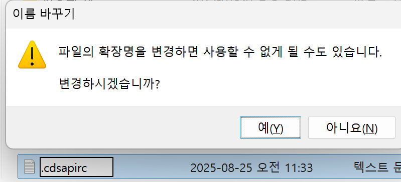{ loading=lazy }
              <figcaption>Explorer view settings (2)</figcaption>
            </figure>
            <figure markdown="span">
              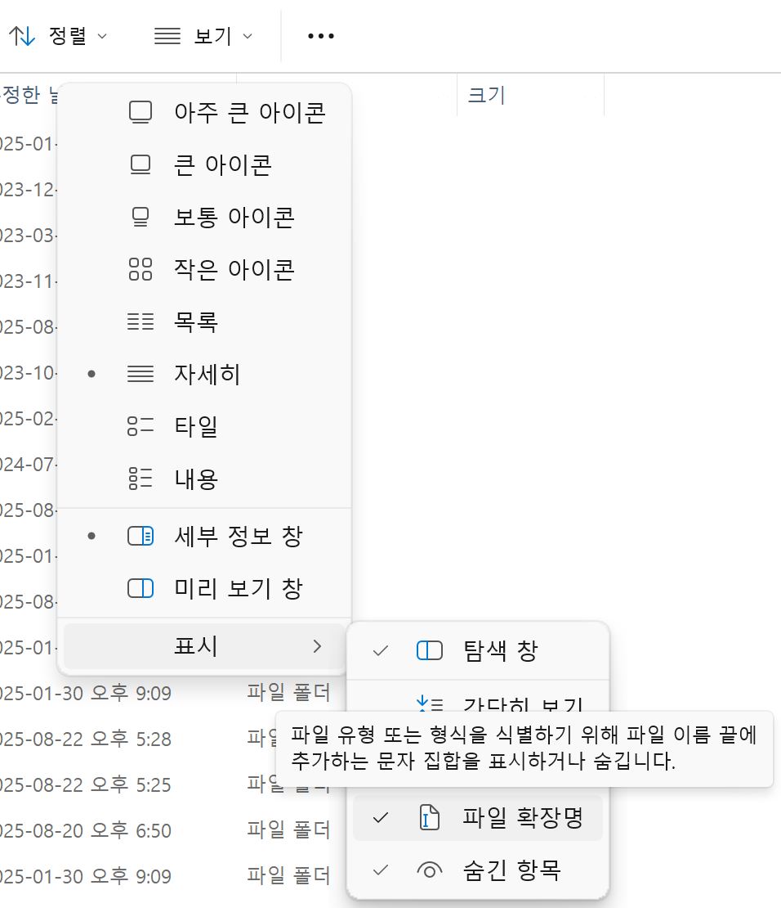{ loading=lazy }
              <figcaption>Renamed .cdsapirc file</figcaption>
            </figure>

    3. **Run the script.** With `cdsapi` installed and the key in place, the generated script downloads the ERA5 data.

    4. If `uv pip list` shows `cdsapi` but the Jupyter interactive window still reports `No module named 'cdsapi'`,
       Jupyter is probably running in a different environment. The environment name shown at the top right of the interactive window
       (here `forpy`) must be the one where you installed `cdsapi`; if not, click it to change the kernel, and accept the prompt to install `ipykernel`.

        <figure markdown="span">
          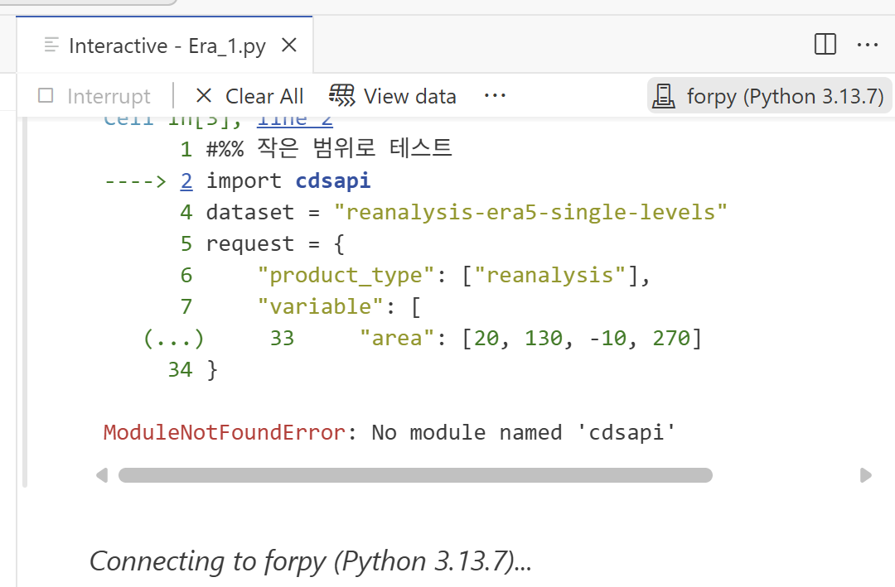{ loading=lazy }
          <figcaption>Selecting the kernel in the Jupyter interactive window</figcaption>
        </figure>

    ??? tip "When `.cdsapirc` is not read"
        A colleague suggested passing the URL and key directly in the code instead of relying on the `.cdsapirc` file.

        ```py title="ERA5 request with explicit credentials"
        import cdsapi

        url= ' '
        key= ' '

        dataset = "reanalysis-era5-single-levels"
        request = {
            "product_type": ["reanalysis"],
            "variable": [
                "10m_u_component_of_wind",
                "10m_v_component_of_wind",
                "total_precipitation"
            ],
            "year": [
                "1993"
            ],
            "month": [
                "01"
            ],
            "day": [
                "01"
            ],
            "time": [
                "00:00", "01:00", "02:00",
                "03:00", "04:00", "05:00",
                "06:00", "07:00", "08:00",
                "09:00", "10:00", "11:00",
                "12:00", "13:00", "14:00",
                "15:00", "16:00", "17:00",
                "18:00", "19:00", "20:00",
                "21:00", "22:00", "23:00"
            ],
            "data_format": "netcdf",
            "download_format": "unarchived",
            "area": [20, 130, -10, 270]
        }

        client = cdsapi.Client(url=url, key=key)
        client.retrieve(dataset, request).download()
        ```

=== "MATLAB"

    [:octicons-download-24: Climate Data Store Toolbox for MATLAB (File Exchange)](https://kr.mathworks.com/matlabcentral/fileexchange/104550-climate-data-store-toolbox-for-matlab)

    ??? info "Downloading with the CDS Toolbox on the website (discontinued)"
        The browser-based CDS Toolbox is no longer available. The steps are kept for reference.

        1. Log in and set the options for the product (**one variable at a time** is recommended: with the old link, two or more variables
           produced a warning and the downloaded file contained only one). The links refer to **ERA5 hourly data on single levels from 1940 to present**:
           [new link](https://cds.climate.copernicus.eu/datasets/reanalysis-era5-single-levels?tab=download) ·
           [old link (closed)](https://cds.climate.copernicus.eu/cdsapp#!/dataset/reanalysis-era5-single-levels?tab=form)
        2. Click **show Toolbox request** at the bottom and copy the code.

            <figure markdown="span">
              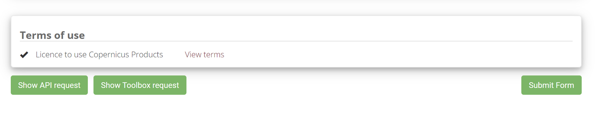{ loading=lazy }
              <figcaption>show Toolbox request</figcaption>
            </figure>

        3. Click **Toolbox** at the top.

            <figure markdown="span">
              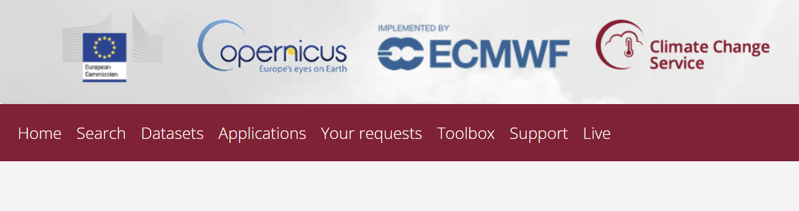{ loading=lazy }
              <figcaption>Toolbox menu</figcaption>
            </figure>

        4. Click **Toolbox Editor**.

            <figure markdown="span">
              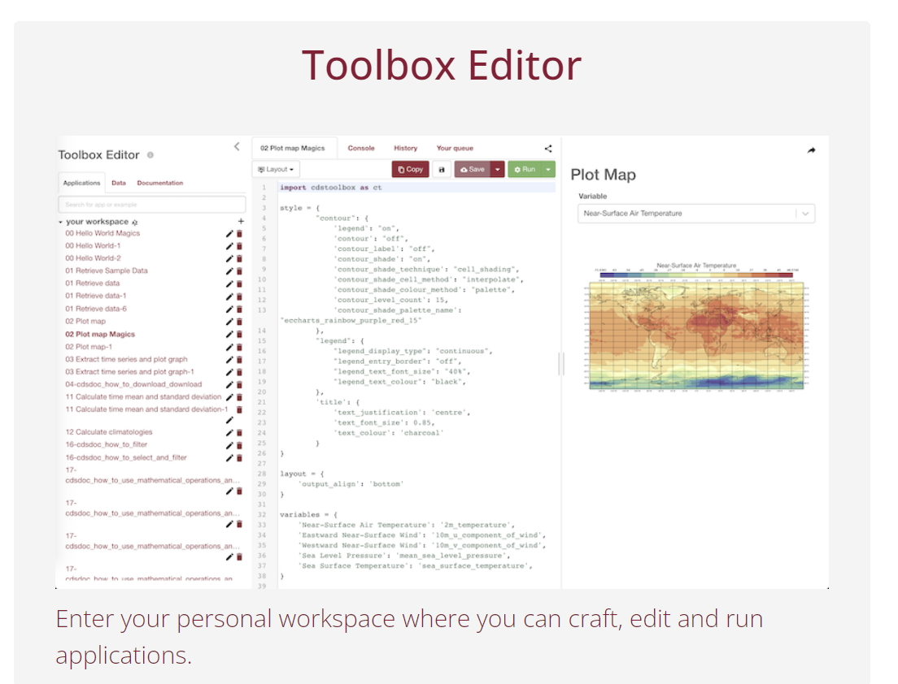{ loading=lazy }
              <figcaption>Toolbox Editor</figcaption>
            </figure>

        5. Create a new item in your workspace.

            <figure markdown="span">
              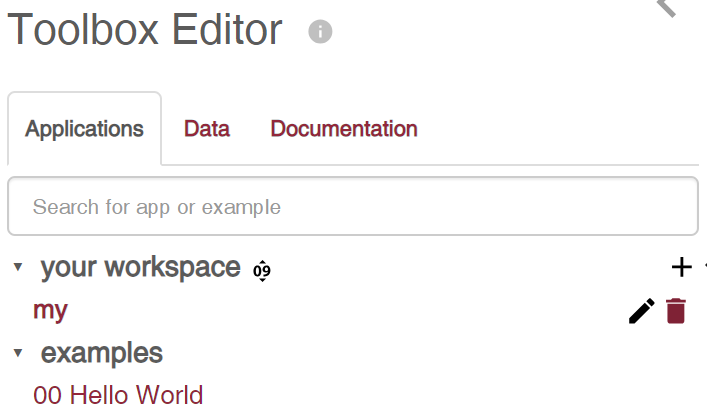{ loading=lazy }
              <figcaption>New workspace item</figcaption>
            </figure>

        6. Paste the code and click **Run**.

            <figure markdown="span">
              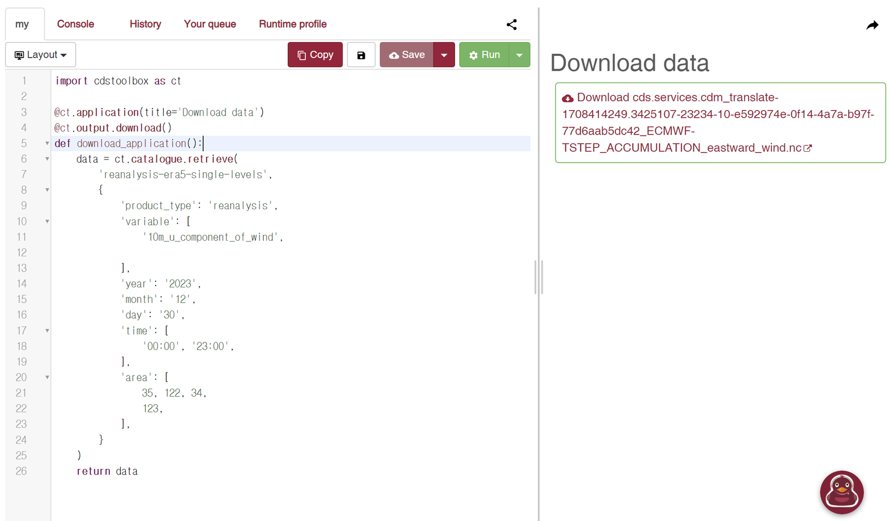{ loading=lazy }
              <figcaption>Run the request</figcaption>
            </figure>

            ```txt title="CDS Toolbox request"
            import cdstoolbox as ct

            @ct.application(title='Download data')
            @ct.output.download()
            def download_application():
                data = ct.catalogue.retrieve(
                    'reanalysis-era5-single-levels',
                    {
                        'product_type': 'reanalysis',
                        'variable': [
                            '10m_u_component_of_wind',
                        ],
                        'year': '2023',
                        'month': '12',
                        'day': '30',
                        'time': [
                            '00:00', '23:00',
                        ],
                        'area': [
                            35, 122, 34,
                            123,
                        ],
                    }
                )
                return data
            ```
