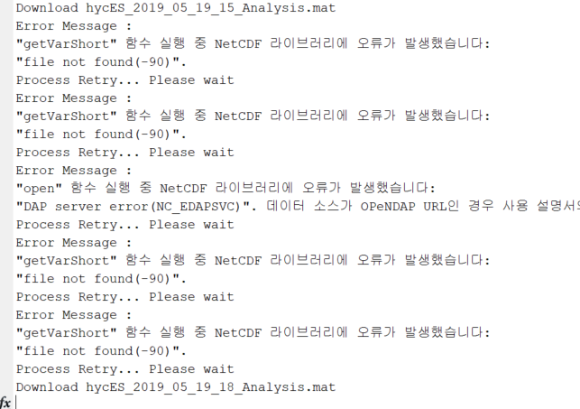

# :material-download-network-outline: HYCOM 다운로드 방법 <span class="date">[2025.12.10]</span>

원하는 영역·기간·수심 범위의 HYCOM 산출물을 OPeNDAP으로 내려받는 MATLAB 코드입니다.
최신 툴박스는 MATLAB File Exchange와 GitHub에서 배포하며, 이전 버전 스크립트는 참고용으로 아래에 남겨 두었습니다.

=== "최신 버전 (MATLAB)"

    ### [2025.12.10] 최신 버전: HYCOM ESPC와 GOFS 3.1

    - **ESPC** 산출물을 다운로드하는 코드를 작성했습니다. ESPC의 Tide dataset(non-steric, steric, surf_el tides) 포함:
      [ESPC-D-V02 tides catalog](https://tds.hycom.org/thredds/catalog/datasets/ESPC-D-V02/tides/catalog.html)
    - GOFS 3.1에서 **sur**, **ice** 산출물을 다운로드하는 코드를 추가했습니다.
    - MAT 파일뿐 아니라 NetCDF 파일로도 저장할 수 있도록 개선했습니다.

    [:octicons-download-24: HYCOM Download: HYCOM ESPC (MATLAB File Exchange)](https://kr.mathworks.com/matlabcentral/fileexchange/180840-hycom-download-hycom-espc)<br>
    [:octicons-download-24: HYCOM Download: HYCOM GOFS 3.1 (MATLAB File Exchange)](https://kr.mathworks.com/matlabcentral/fileexchange/173220-hycom-download-hycom-gofs-3-1)<br>
    [:octicons-mark-github-16: GitHub: kamanberr/Ocean-Data-Download](https://github.com/kamanberr/Ocean-Data-Download/tree/main)

    !!! tip ""
        툴박스를 사용하시는 분들은 해당 MathWorks 페이지에서 **[Review → 별점]**을 달아 주시면 큰 보람이 될 것 같습니다. 감사합니다.

    ### [2024.09.28] GitHub와 MATLAB File Exchange에 코드 공개

    - [2024.10.02] `knnsearch` 함수를 사용자 정의 함수로 대체했습니다. 원래 필요하던 툴박스가 이제 필요 없습니다.

    ??? info "다운로드 속도"
        - 같은 인터넷 환경에서 같은 사양의 컴퓨터 세 대로 서로 다른 연도를 받아 본 결과,
          **3일 동안 최대 1년, 최소 4개월** 기간의 자료를 받을 수 있었습니다
          (시간 해상도 3시간, 동해 영역, 수심 3800 m까지).
        - 다운로드 속도는 받으려는 자료의 연도에 따라 다릅니다. 특히 2019년 이후 자료는 이전 연도보다 현저히 느립니다.
        - 동중국해 수심 2500 m까지 3시간 간격 자료 1년치를 받는 데 걸린 시간:

            | 연도 (analysis) | 소요 시간 |
            |---|---|
            | 2015 | 20시간 |
            | 2016 | 18시간 |
            | 2017 | 18시간 |
            | 2018 | 17시간 |
            | 2019 | 32시간 |
            | 2020 | 3일 |
            | 2021 | 24시간 |
            | 2022 | 32시간 |
            | 2023 | 2일 |

=== "이전 버전 (2024.09)"

    File Exchange 툴박스 이전에 쓰던 단독 스크립트입니다. GOFS 3.1(GLBv0.08, GLBy0.08)을 3시간 간격 MAT 파일로 저장하며,
    각 파일에는 `hyc`라는 구조체가 들어 있습니다. 위 탭의 File Exchange 툴박스가 이 스크립트를 대체합니다.

    ### [2024.09.23] 수정 공지

    [:octicons-file-24: HYCOM_31down_Jiuk_ES.m (메인 스크립트)](../assets/files/whole-ocean/hycom-download/HYCOM_31down_Jiuk_ES.m)
    [:octicons-file-24: HYCOM_31down_func_Jiuk_2.m (함수)](../assets/files/whole-ocean/hycom-download/HYCOM_31down_func_Jiuk_2.m)

    디버깅

    - 버그: 2018년 자료를 받는 과정에서 서버 문제가 아닌 자료 처리상의 문제가 발생하는 것을 확인했습니다.
    - 디버깅 완료. 큰 문제는 아니었고, HYCOM 서버가 제공하는 시간축에 중복된 시점이 있어서 발생한 것으로 보입니다.

    m-file을 직접 내려받을 수 없다면 아래 두 코드를 복사해서 같은 이름의 파일로 저장하세요.

    ??? example "Main code: HYCOM_31down_Jiuk_ES.m"

        ```matlab title="HYCOM_31down_Jiuk_ES.m"
        %% DOWNLOAD HYCOM - Global Ocean Forecasting System (GOFS) 3.1 output
        %   [2024.03.04] Written    by Jiuk Hwang 
        %   [2024.03.04] Modified   by Jiuk Hwang 
        %   [2024.03.29] Modified   by Jiuk Hwang 
        %   [2024.07.25] Updated    by Jiuk Hwang
        %   [2024.09.10] Modified   by Yunji Noh 
        %   [2024.09.19] Modified   by Jiuk Hwang
        %   [2024.09.23] Modified   by Jiuk Hwang
        %
        % WARNING =================================================================
        % 1. Analysis and Reanalysis have different periods of data.
        %    Please make sure to check the period and download appropriate data.
        % 2. The size of the Spatial Resolution grid changes around 2019.
        % -------------------------------------------------------------------------
        % [ Analysis ]                              (2014-07-01 12:00:00 ~ Present)
        % 2014~2018 : GLBv0.08
        %             0.08 deg lon x 0.08 deg lat between 40S-40N. 
        %             Poleward of 40S/40N, the grid is 0.08 deg lon x 0.04 deg lat.
        % 2019~     : GLBy0.08
        %             0.08 deg lon x 0.04 deg lat that covers 80S to 90N.
        % -------------------------------------------------------------------------
        % [ Reanalysis ]                (1994-01-01 12:00:00 ~ 2015-12-31 09:00:00)
        % 0.08° resolution between 40°S and 40°N
        % 0.04° poleward of 40°S and 40°N
        % -------------------------------------------------------------------------
        % If there is a bug or you are debugging, please contact the e-mail below.
        % e-mail : hwangjiuk34@gmail.com
        % 
        % I hope you enjoy your data shopping.
        % Best regards, 
        % Jiuk.

        %% Download HYCOM 
        % Notes ===================================================================
        % Variables : temp[°C],  sal[psu],  ssh[m],  uv[m/s]
        % Temporal resolution : (at least) 3 hours
        % -------------------------------------------------------------------------

        clc; clear; close all;
        tic % start to count time 

        % [Start year, Start month ; End year, End month]
        % Period = [2019, 01, 01, 00, 00, 00 ; 2023, 12, 31, 21, 00, 00];
        Period = [2018, 03, 01, 00, 00, 00 ; 2018, 12, 31, 21, 00, 00];

        % Time Step : e.g. 3 or 12 hours
        timestep = 3;

        % 'Analysis' or 'Reanalysis' (Be careful with the date range!)
        HYC_ver = 'Analysis';

        % [lat start, lat end, lon start, lon end]
        Spatial_area = [33, 54, 127, 143];

        % [shallow depth ; deep depth]
        Depth_range = [0 ; 3800];

        % select from {'temp', 'sal', 'ssh', 'u', 'v'};
        VariableData = {'temp', 'sal', 'ssh', 'u', 'v'};

        % you will save data in this file path below.
        HomeFolderNm = "D:\MATLAB_JU\RawData\";
        RawDataFolderNm = "HYC_JIUK_ES";

        % mat files will be save with this name below.
        % DO NOT USE UNDERBAR("_") IN "MatFileNm" 
        % → e.g) "hyc_hello" → Don't use "_" !!!
        MatFileNm = "hycES"; % you will save data with this file name

        % function execution

        HYCOM_31down_func_Jiuk_2(Period, timestep, Spatial_area, Depth_range, ...
            VariableData, HomeFolderNm, RawDataFolderNm, MatFileNm, HYC_ver)

        toc % display download time
        ```

    ??? example "Function code: HYCOM_31down_func_Jiuk_2.m"

        ```matlab title="HYCOM_31down_func_Jiuk_2.m"
        function HYCOM_31down_func_Jiuk_2(Period, timestep, Spatial_area, Depth_range, VariableData, HomeFolderNm, RawDataFolderNm, MatFileNm, HYC_ver)
        %   Written by Jiuk Hwang
        %   Log
        %       HYCOM_31down_func_Jiuk.m
        %       2024.03.04 Draft completed
        %       2024.03.06 Modify (1) : setting time range
        %       2024.03.29 Modify (2) : bug with reject for download data after 2019
        %
        %       HYCOM_31down_func_Jiuk_2.m
        %       2024.07.25 Update (1)
        %                   1. now you can change the time step (3 or 12 hours) of data
        %                   2. now we notice the unavailable data among the input time range
        %                   3. save the mat file in each year
        %                   4. avoid downloading duplicated mat file
        %       2024.09.19 Modified by Jiuk Hwang
        %       2024.09.23 Modified by Jiuk Hwang
        % =========================================================================

        %% Preprocessing

        % make FOLDER for save mat file -------------------------------------------
        hfn_ch = char(HomeFolderNm); hfn_end = hfn_ch(end);
        if hfn_end ~= '\';            HomeFolderNm = strcat(HomeFolderNm, '\');        end
        clear hfn_ch hfn_end;
        hfn_ch = char(RawDataFolderNm); hfn_end = hfn_ch(end);
        if hfn_end ~= '\';            RawDataFolderNm = strcat(RawDataFolderNm, '\');        end
        clear hfn_ch hfn_end;

        HomeFolderNm = sprintf('%s%s', HomeFolderNm, RawDataFolderNm);

        if ~exist(HomeFolderNm, 'dir')
            mkdir(HomeFolderNm);
        end
        % -------------------------------------------------------------------------

        % Time Axis of HYCOM 3.1
        HycSetTime      = NaT(8, 2);
        HycSetTime(2,1) = datetime(2014,07,01,12,00,00);    HycSetTime(2,2) = datetime(2016,08,31,21,00,00);
        HycSetTime(3,1) = datetime(2016,09,01,00,00,00);    HycSetTime(3,2) = datetime(2017,02,01,09,00,00);
        HycSetTime(4,1) = datetime(2017,02,01,12,00,00);    HycSetTime(4,2) = datetime(2017,06,01,09,00,00);
        HycSetTime(5,1) = datetime(2017,06,01,12,00,00);    HycSetTime(5,2) = datetime(2017,10,01,09,00,00);
        HycSetTime(6,1) = datetime(2017,10,01,12,00,00);    HycSetTime(6,2) = datetime(2018,02,28,21,00,00);
        HycSetTime(7,1) = datetime(2018,03,01,00,00,00);    HycSetTime(7,2) = datetime(2018,12,31,21,00,00);
        HycSetTime(8,1) = datetime(2019,01,01,00,00,00);    HycSetTime(8,2) = datetime(3000,12,31,21,00,00);

        % Input Time Range
        datestart   = datetime(sprintf('%d-%d-%d %d:%d:%d',Period(1,1), Period(1,2), Period(1,3), Period(1,4), Period(1,5), Period(1,6)), ...
            'Format','uuuu-MM-dd HH:mm:ss');
        dateend   = datetime(sprintf('%d-%d-%d %d:%d:%d',Period(2,1), Period(2,2), Period(2,3), Period(2,4), Period(2,5), Period(2,6)), ...
            'Format','uuuu-MM-dd HH:mm:ss');

        % Time Step
        daterange   = (datestart:timestep*hours(1):dateend)';

        % Check the Input Parameter
        dateID = nan(length(daterange),size(HycSetTime,1));     % prepare 'empty room'
        for i=1:size(HycSetTime,1)                              % loop : time axis of hycom
            if strcmp(HYC_ver, 'Reanalysis') && datestart <= datetime('2015-12-31 09:00:00') && dateend <= datetime('2015-12-31 09:00:00')
                Rean_yr = unique(year(daterange));
                % elseif strcmp(HYC_ver, 'Analysis') && datestart > datetime('2015-12-31 09:00:00') && dateend > datetime('2015-12-31 09:00:00')
            elseif strcmp(HYC_ver, 'Analysis') && datestart >= datetime('2014-07-01 12:00:00') && dateend >= datetime('2014-07-01 12:00:00')
                % find the "input time range" from "time axis" of hycom
                dateID1 = daterange >= HycSetTime(i,1);
                dateID2 = daterange <= HycSetTime(i,2);
                % find the proper 'time zone' for each step in "input time range"
                dateID(:,i) = all([dateID1, dateID2] ,2);
            else
                disp('Wrong INPUT parameter!');        break;
            end
        end

        % check Variables
        varcheck    = nan(1,5);
        varcheck(1) = ismember('ssh', string(VariableData));
        varcheck(2) = ismember('temp', string(VariableData));
        varcheck(3) = ismember('sal', string(VariableData));
        varcheck(4) = ismember('u', string(VariableData));
        varcheck(5) = ismember('v', string(VariableData));

        % URL
        idlinkfull(1) = "https://tds.hycom.org//thredds//dodsC//GLBv0.08//expt_53.X//data//";

        idlink1 = 'https://tds.hycom.org//thredds//dodsC//GLBv0.08//expt_';
        idlink2 = '56.3';
        idlinkfull(2) = sprintf('%s%s', idlink1, idlink2);

        idlink1 = 'https://tds.hycom.org//thredds//dodsC//GLBv0.08//expt_';
        idlink2 = '57.2';
        idlinkfull(3) = sprintf('%s%s', idlink1, idlink2);

        idlink1 = 'https://tds.hycom.org//thredds//dodsC//GLBv0.08//expt_';
        idlink2 = '92.8';
        idlinkfull(4) = sprintf('%s%s', idlink1, idlink2);

        idlink1 = 'https://tds.hycom.org//thredds//dodsC//GLBv0.08//expt_';
        idlink2 = '57.7';
        idlinkfull(5) = sprintf('%s%s', idlink1, idlink2);

        idlink1 = 'https://tds.hycom.org//thredds//dodsC//GLBv0.08//expt_';
        idlink2 = '92.9';
        idlinkfull(6) = sprintf('%s%s', idlink1, idlink2);

        idlink1 = 'https://tds.hycom.org//thredds//dodsC//GLBv0.08//expt_';
        idlink2 = '93.0';
        idlinkfull(7) = sprintf('%s%s', idlink1, idlink2);

        idlink1 = 'https://tds.hycom.org//thredds//dodsC//GLBy0.08//expt_';
        idlink2 = '93.0';
        idlinkfull(8) = sprintf('%s%s', idlink1, idlink2);

        idlinkfull=idlinkfull';

        %% MAIN CODE - Download


        % Analysis
        if strcmp(HYC_ver, 'Analysis')
            dateID_any = find(any(dateID,1));

            % loop : time axis (zone) of hycom
            for i_ver = 1:size(HycSetTime,1)
                if ismember(i_ver, dateID_any)
                    dateID_re = logical(dateID(:,i_ver));
                    if any(dateID_re)
                        daterange_re = daterange(dateID_re);
                        daterange_str_end = [daterange_re(1), daterange_re(end)];

                        ads1 = idlinkfull(i_ver);

                        [id_tm, id_la, id_lo, id_dep, timeaxisfromhyc] = hyc_down_preparing(ads1, daterange_str_end, timestep, Spatial_area, Depth_range);

                        % Check the pre-downloaded mat file -----------------------
                        timeaxisfromhyc2 = datetime(timeaxisfromhyc(id_tm+1), 'Format','uuuu-MM-dd HH:mm:ss');
                        hycyr = unique(year(timeaxisfromhyc2));
                        for loophycyr = hycyr'
                            ckfpath = sprintf('%s%d\\',HomeFolderNm,loophycyr);

                            % check the existence of FOLDER
                            if exist(ckfpath, 'dir')
                                clear fn ifn fn2 fndate ifndate id_id_tm;
                                fn = dir(sprintf('%s%s', ckfpath, '*.mat'));
                                if height(fn) ~= 0
                                    for ifn = 1:height(fn)
                                        fn2 = split([fn(ifn).name], ["_", ".mat"]);
                                        fprintf('%s already exist \n', [fn(ifn).name])
                                        fn3(1) = double(string(fn2{2,:}));
                                        fn3(2) = double(string(fn2{3,:}));
                                        fn3(3) = double(string(fn2{4,:}));
                                        fn3(4) = double(string(fn2{5,:}));
                                        fndate(ifn) = datetime(fn3(1),fn3(2),fn3(3),fn3(4),00, 00, 'Format','uuuu-MM-dd HH:mm:ss');
                                    end
                                    for ifndate = 1:length(fndate)
                                        id_id_tm = timeaxisfromhyc2 == fndate(ifndate);
                                        id_tm(id_id_tm) = NaN;
                                    end
                                end
                            end
                        end

                        id_tm = rmmissing(id_tm);
                        % ---------------------------------------------------------

                        % Download ================================================
                        if ~isempty(id_tm)
                            for loopdown = 1:length(id_tm)

                                hyc = hyc_down_specific_area(ads1, id_tm(loopdown), id_la, id_lo, id_dep, varcheck);

                                % save struct to mat file
                                strtime = datevec(hyc.date);
                                fpath = sprintf('%s%d\\',HomeFolderNm,strtime(1));
                                if ~exist(fpath, 'dir')
                                    mkdir(fpath);
                                end
                                matnm = sprintf('%s_%d_%02.f_%02.f_%02.f_%s.mat', MatFileNm, strtime(1), strtime(2), strtime(3), strtime(4), HYC_ver);
                                fpath2 = sprintf('%s%s', fpath, matnm);
                                save(fpath2, "hyc")
                                fprintf('Download %s\n', matnm);
                            end
                        end
                        % =========================================================
                    end
                end
            end

            % Reanalysis ==========================================================
        elseif strcmp(HYC_ver, 'Reanalysis')
            for i_ver = Rean_yr(1):Rean_yr(end)

                ads1 = sprintf('%s%d', idlinkfull(1), i_ver);

                [id_tm, id_la, id_lo, id_dep, timeaxisfromhyc] = hyc_down_preparing(ads1, [datestart, dateend], timestep, Spatial_area, Depth_range);

                % Check the pre-downloaded mat file -----------------------
                timeaxisfromhyc2 = datetime(timeaxisfromhyc(id_tm+1), 'Format','uuuu-MM-dd HH:mm:ss');
                hycyr = unique(year(timeaxisfromhyc2));
                for loophycyr = hycyr'
                    ckfpath = sprintf('%s%d\\',HomeFolderNm,loophycyr);

                    % check the existence of FOLDER
                    if exist(ckfpath, 'dir')
                        clear fn ifn fn2 fndate ifndate id_id_tm;
                        fn = dir(sprintf('%s%s', ckfpath, '*.mat'));
                        if height(fn) ~= 0
                            for ifn = 1:height(fn)
                                fn2 = split([fn(ifn).name], ["_", ".mat"]);
                                fprintf('%s already exist \n', [fn(ifn).name])
                                fn3(1) = double(string(fn2{2,:}));
                                fn3(2) = double(string(fn2{3,:}));
                                fn3(3) = double(string(fn2{4,:}));
                                fn3(4) = double(string(fn2{5,:}));
                                fndate(ifn) = datetime(fn3(1),fn3(2),fn3(3),fn3(4),00, 00, 'Format','uuuu-MM-dd HH:mm:ss');
                            end
                            for ifndate = 1:length(fndate)
                                id_id_tm = timeaxisfromhyc2 == fndate(ifndate);
                                id_tm(id_id_tm) = NaN;
                            end
                        end
                    end
                end

                id_tm = rmmissing(id_tm);
                % ---------------------------------------------------------

                % Download ================================================
                if ~isempty(id_tm)
                    for loopdown = 1:length(id_tm)
                        hyc = hyc_down_specific_area(ads1, id_tm(loopdown), id_la, id_lo, id_dep, varcheck);

                        % save struct to mat file
                        strtime = datevec(hyc.date);
                        fpath = sprintf('%s%d\\',HomeFolderNm,strtime(1));
                        if ~exist(fpath, 'dir')
                            mkdir(fpath);
                        end
                        matnm = sprintf('%s_%d_%02.f_%02.f_%02.f_%s.mat', MatFileNm, strtime(1), strtime(2), strtime(3), strtime(4), HYC_ver);
                        fpath2 = sprintf('%s%s', fpath, matnm);
                        save(fpath2, "hyc")
                        fprintf('Download %s\n', matnm);
                    end
                end
            end
        end


        end

        % =========================================================================

        % hyc_down_preparing ======================================================

        function [id_tm, id_la, id_lo, id_dep, timeaxisfromhyc] = hyc_down_preparing(ads1, daterange_str_end, timestep, Spatial_area, Depth_range)

        fprintf('NEW Session Begin!!! \n')
        fprintf('Preparing Download... Please Wait.\n')

        ads2 = '?time';
        ads_f2 = sprintf('%s%s', ads1, ads2);

        fprintf('Time data downloading... Please Wait.\n')
        all_time = downloadretry(ads_f2, 'time');

        timeaxisfromhyc = datetime(2000, 01, 01, 00, 00, 00)+hours(all_time);

        inputtime = (daterange_str_end(1):timestep*hours(1):daterange_str_end(2))';
        id_tm = nan(length(inputtime),1);
        for looptime = 1:length(inputtime)
            ck = find(timeaxisfromhyc == inputtime(looptime));
            if ~isempty(ck)
                if length(ck) > 1 % 2018-06-21 06:00:00 ← duplicated in "timeaxisfromhyc"
                    id_tm(looptime) = ck(1);
                else
                    id_tm(looptime) = ck;
                end
            else
                fprintf('Cannot find the data for %s in THIS Session. \n', string(inputtime(looptime)))
            end
        end

        id_tm = rmmissing(id_tm)-1;

        fprintf('TIME data Ready... Please Wait.\n')

        ads5 = '?lat,lon';
        ads_f5 = sprintf('%s%s', ads1, ads5);


        all_la = downloadretry(ads_f5, 'lat');        all_lo = downloadretry(ads_f5, 'lon');


        id_la = knnsearch(all_la, [Spatial_area(1); Spatial_area(2)]); id_la = id_la -1;
        id_lo = knnsearch(all_lo, [Spatial_area(3); Spatial_area(4)]); id_lo = id_lo -1;

        fprintf('LAT & LON data Ready... Please Wait.\n')

        ads3 = '?depth';
        ads_f3 = sprintf('%s%s', ads1, ads3);

        all_dep = downloadretry(ads_f3, 'depth');


        id_dep = knnsearch(all_dep, Depth_range); id_dep = id_dep -1;

        fprintf('DEPTH data Ready... Please Wait.\n')

        end

        % hyc_down_specific_area ==================================================

        function hyc = hyc_down_specific_area(ads1, id_tm, id_la, id_lo, id_dep, varcheck)

        % lon, lat, time
        adsset1 = sprintf('?lat[%d:1:%d],lon[%d:1:%d],time[%d:1:%d]', ...
            id_la(1), id_la(2), id_lo(1), id_lo(2), id_tm, id_tm);

        % ssh
        adsrng2 = sprintf('[%d:1:%d][%d:1:%d][%d:1:%d]', ...
            id_tm, id_tm, id_la(1), id_la(2), id_lo(1), id_lo(2));
        if varcheck(1) == 1
            adsset1 = sprintf('%s,surf_el%s',adsset1, adsrng2);
        end

        % depth
        adsset1 = sprintf('%s,depth[%d:1:%d]',adsset1, id_dep(1), id_dep(2));

        % temp, sal, u, v
        adsrng1 = sprintf('[%d:1:%d][%d:1:%d][%d:1:%d][%d:1:%d]', ...
            id_tm, id_tm, id_dep(1), id_dep(2), id_la(1), id_la(2), id_lo(1), id_lo(2));
        for i_var = 2:length(varcheck)
            if varcheck(i_var) == 1
                if i_var == 2
                    adsset1 = sprintf('%s,water_temp%s',adsset1, adsrng1);
                elseif i_var == 3
                    adsset1 = sprintf('%s,salinity%s',adsset1, adsrng1);
                elseif i_var == 4
                    adsset1 = sprintf('%s,water_u%s',adsset1, adsrng1);
                elseif i_var == 5
                    adsset1 = sprintf('%s,water_v%s',adsset1, adsrng1);
                end
            end
        end

        ads_f1 = sprintf('%s%s', ads1, adsset1);

        % load data
        hyc = struct;

        dntm = downloadretry(ads_f1, 'time');
        hyc.date = datetime(datetime(2000, 01, 01, 00, 00, 00)+hours(dntm), 'Format','uuuu-MM-dd HH:mm:ss');
        hyc.lat = downloadretry(ads_f1, 'lat');
        hyc.lon = downloadretry(ads_f1, 'lon');
        hyc.dep = downloadretry(ads_f1, 'depth');

        for i_var = 1:length(varcheck)
            if varcheck(i_var) == 1
                if i_var == 1
                    hyc.ssh = downloadretry(ads_f1, 'surf_el');
                elseif i_var == 2
                    hyc.temp = downloadretry(ads_f1, 'water_temp');
                elseif i_var == 3
                    hyc.sal = downloadretry(ads_f1, 'salinity');
                elseif i_var == 4
                    hyc.u = downloadretry(ads_f1, 'water_u');
                elseif i_var == 5
                    hyc.v = downloadretry(ads_f1, 'water_v');
                end
            end
        end

        end

        % -------------------------------------------------------------------------
        function output = downloadretry(adress, var)
        while true % If the downloading process is interrupted, then retry downloading automatically.
            try
                output = ncread(adress, var);
                break; % Exit the while statement if it runs without errors
            catch ME %Get information about errors that occur inside the try block into the object ME
                % Outputting error messages
                disp('Error Message : ');        disp(ME.message);
            end
            % Wait and run again
            disp('Process Retry... Please wait');    pause(15);    
        end


        end

        % =========================================================================
        % Check time range of each HYCOM data set
        % (log) Final check the time range of HYCOM data set : 2024-03-06
        %
        % 1
        %    1994-01-01 12:00:00   1994-12-31 21:00:00
        %    1995-01-01 00:00:00   1995-12-31 21:00:00
        %    1996-01-01 00:00:00   1996-12-31 21:00:00
        %    1997-01-01 00:00:00   1997-12-31 21:00:00
        %    1998-01-01 00:00:00   1998-12-31 21:00:00
        %    1999-01-01 00:00:00   1999-12-31 21:00:00
        %    2000-01-01 00:00:00   2000-12-31 21:00:00
        %    2001-01-01 00:00:00   2001-12-31 21:00:00
        %    2002-01-01 00:00:00   2002-12-31 21:00:00
        %    2003-01-01 00:00:00   2003-12-31 21:00:00
        %    2004-01-01 00:00:00   2004-12-31 21:00:00
        %    2005-01-01 00:00:00   2005-12-31 21:00:00
        %    2006-01-01 00:00:00   2006-12-31 21:00:00
        %    2007-01-01 00:00:00   2007-12-31 21:00:00
        %    2008-01-01 00:00:00   2008-12-31 21:00:00
        %    2009-01-01 00:00:00   2009-12-31 21:00:00
        %    2010-01-01 00:00:00   2010-12-31 21:00:00
        %    2011-01-01 03:00:00   2011-12-31 21:00:00
        %    2012-01-01 00:00:00   2012-12-31 21:00:00
        %    2013-01-01 00:00:00   2013-12-31 21:00:00
        %    2014-01-01 00:00:00   2014-12-31 09:00:00
        %    2015-01-01 12:00:00   2015-12-31 09:00:00
        % 2
        %    2014-07-01 12:00:00   2016-09-30 09:00:00 start 2015 // stop 2016-08
        % 3
        %    2016-05-01 12:00:00   2017-02-01 09:00:00 start 2016-09 // cut
        % 4
        %    2017-02-01 12:00:00   2017-06-01 09:00:00 cut // cut
        % 5
        %    2017-06-01 12:00:00   2017-10-01 09:00:00 cut // cut
        % 6
        %    2017-10-01 12:00:00   2018-03-20 09:00:00 cut // stop 2018-02
        % 7
        %    2018-01-01 12:00:00   2020-02-19 09:00:00 start 2018-03 // stop 2018-12
        % 8
        %    2018-12-04 12:00:00   2024-03-05 09:00:00 start 2019-01
        ```

    ### [2024.09.19] 수정 공지

    1. 9월 10일 자 피드백을 반영하여 코드 구조를 수정했습니다. 9월 10일 코드는 메인 스크립트에서 retry를 했지만,
       19일 코드는 함수 안에서 retry를 하는 방식입니다.
    2. 수정 과정에서 버그를 하나 확인했습니다. **`MatFileNm`에 "_"를 넣으면 에러가 발생합니다.**
       retry 과정에서 기존에 받은 MAT 파일 목록을 인식하지 못하는데, 함수 코드에서 파일 이름을 `split`으로 "_" 기준으로 나누기 때문입니다.

    ??? info "서버 오류 시 자동 재시도 예시"
        서버 문제가 생기면 원래는 다운로드가 중단되지만, 에러 메시지가 발생하면 자동으로 다시 시도하도록 수정하여
        해당 자료를 받아낼 때까지 반복합니다. 실행 중 서버 문제가 발생했을 때의 로그 예시입니다.

        ```text
        hycES_2019_05_19_18_Analysis.mat already exist
        Error Message :
        "open" 함수 실행 중 NetCDF 라이브러리에 오류가 발생했습니다: "DAP server error(NC_EDAPSVC)" ...
        Process Retry... Please wait
        Error Message :
        "getVarShort" 함수 실행 중 NetCDF 라이브러리에 오류가 발생했습니다: "file not found(-90)".
        Process Retry... Please wait
        ...
        Download hycES_2019_05_19_21_Analysis.mat
        ...
        Download hycES_2019_05_20_00_Analysis.mat
        ```

    ### [2024.09.10] 수정 공지

    !!! quote "Revised by Yunji Noh"
        서버 문제로 다운로드가 중단되었을 때(아래 사진) 코드가 자동으로 다시 실행되도록 `HYCOM_31down_func_Jiuk.m`을 수정했습니다.
        노윤지 씨가 올려 주신 예시 코드를 첨부했고, 해당 내용은 원본 코드에도 반영했습니다. 감사합니다.

    [:octicons-file-24: HYCOM_31down_Jiuk_0910.m (노윤지 예시 코드)](../assets/files/whole-ocean/hycom-download/HYCOM_31down_Jiuk_0910.m)
    <figure markdown="span">
      { loading=lazy }
      <figcaption>HYCOM 서버 오류로 다운로드가 중단된 화면</figcaption>
    </figure>

    ### 버전 관리를 위한 스크립트 로그

    이전 스크립트는 버전 관리를 위해서만 남겨 둡니다. 위의 코드를 사용하세요.

    - 09.23 업데이트 이전:
      [:octicons-file-24: HYCOM_31down_Jiuk_ES.m (09.23 이전)](../assets/files/whole-ocean/hycom-download/pre0923_HYCOM_31down_Jiuk_ES.m)
      [:octicons-file-24: HYCOM_31down_func_Jiuk_2.m (09.23 이전)](../assets/files/whole-ocean/hycom-download/pre0923_HYCOM_31down_func_Jiuk_2.m)
    - 09.19 업데이트 과정에서 버그가 생긴 코드:
      [:octicons-file-24: HYCOM_31down_Jiuk.m (09.19, 버그 있음)](../assets/files/whole-ocean/hycom-download/bug0919_HYCOM_31down_Jiuk.m)
      [:octicons-file-24: HYCOM_31down_func_Jiuk_2.m (09.19, 버그 있음)](../assets/files/whole-ocean/hycom-download/bug0919_HYCOM_31down_func_Jiuk_2.m)
    - 09.19 업데이트 이전 (버전 관리용, 위 코드를 사용하세요):

        ??? example "Main code (09.19 이전)"

            ```matlab title="HYCOM_31down_Jiuk_ES.m (09.19 이전)"
            %% DOWNLOAD HYCOM - Global Ocean Forecasting System (GOFS) 3.1 output
            %   [2024.03.04] Written by Jiuk Hwang 
            %   [2024.03.04] Modified by Jiuk Hwang 
            %   [2024.03.29] Modified by Jiuk Hwang 
            %   [2024.07.25] Updated by Jiuk Hwang
            %   [2024.09.10] Modified by Yunji Noh 
            %
            % WARNING =================================================================
            % 1. Analysis and Reanalysis have different periods of data.
            %    Please make sure to check the period and download appropriate data.
            % 2. The size of the Spatial Resolution grid changes around 2019.
            % -------------------------------------------------------------------------
            % [ Analysis ]                              (2014-07-01 12:00:00 ~ Present)
            % 2014~2018 : GLBv0.08
            %             0.08 deg lon x 0.08 deg lat between 40S-40N. 
            %             Poleward of 40S/40N, the grid is 0.08 deg lon x 0.04 deg lat.
            % 2019~     : GLBy0.08
            %             0.08 deg lon x 0.04 deg lat that covers 80S to 90N.
            % -------------------------------------------------------------------------
            % [ Reanalysis ]                (1994-01-01 12:00:00 ~ 2015-12-31 09:00:00)
            % 0.08° resolution between 40°S and 40°N
            % 0.04° poleward of 40°S and 40°N
            % -------------------------------------------------------------------------
            % If there is a bug or you are debugging, please contact the e-mail below.
            % e-mail : hwangjiuk34@gmail.com
            % 
            % I hope you enjoy your data shopping.
            % Best regards, 
            % Jiuk.

            clc; clear; close all;
            tic

            % [Start year, Start month ; End year, End month]
            % Period = [1999, 12, 31, 21, 00, 00 ; 2000, 01, 01, 06, 00, 00];
            Period = [2015, 3, 2, 15, 00, 00 ; 2015, 7, 3, 15, 00, 00];

            % Time Step : e.g. 3 or 12 hours
            timestep = 3;

            % 'Analysis' or 'Reanalysis' (Be careful with the date range!)
            HYC_ver = 'Analysis';

            % [lat start, lat end, lon start, lon end]
            Spatial_area = [25, 26, 121, 122];

            % [shallow depth ; deep depth]
            Depth_range = [0 ; 5];

            % select from {'temp', 'sal', 'ssh', 'u', 'v'};
            VariableData = {'temp', 'sal', 'ssh', 'u', 'v'};

            % you will save data in this file path below.
            HomeFolderNm = "C:\Users\Jiuk Hwang\OneDrive\문서\MATLAB\Toolbox\HYCOM_down\";
            RawDataFolderNm = "testhyc5";

            % mat files will be save with this name below.
            MatFileNm = "testhyc"; % you will save data with this file name

            % function execution
            while true
                try
                    HYCOM_31down_func_Jiuk_2(Period, timestep, Spatial_area, Depth_range, VariableData, HomeFolderNm, RawDataFolderNm, MatFileNm, HYC_ver)
                    break; % Exit the while statement if it runs without errors

                catch ME %Get information about errors that occur inside the try block into the object ME
                    % Outputting error messages
                    disp('Error Message : ');
                    disp(ME.message);
                end

                % Wait and run again
                pause(15);
                disp('Process Retry... Please wait');
            end

            toc
            ```

        ??? example "Function code (09.19 이전)"

            ```matlab title="HYCOM_31down_func_Jiuk_2.m (09.19 이전)"
            function HYCOM_31down_func_Jiuk_2(Period, timestep, Spatial_area, Depth_range, VariableData, HomeFolderNm, RawDataFolderNm, MatFileNm, HYC_ver)
            %   Written by Jiuk Hwang
            %   Log
            %       HYCOM_31down_func_Jiuk.m
            %       2024.03.04 Draft completed
            %       2024.03.06 Modify (1) : setting time range
            %       2024.03.29 Modify (2) : bug with reject for download data after 2019
            %
            %       HYCOM_31down_func_Jiuk_2.m
            %       2024.07.25 Update (1) 
            %                   1. now you can change the time step (3 or 12 hours) of data
            %                   2. now we notice the unavailable data among the input time range
            %                   3. save the mat file in each year
            %                   4. avoid downloading duplicated mat file
            % =========================================================================

            %% Preprocessing

            % make FOLDER for save mat file -------------------------------------------
            hfn_ch = char(HomeFolderNm); hfn_end = hfn_ch(end);
            if hfn_end ~= '\';            HomeFolderNm = strcat(HomeFolderNm, '\');        end
            clear hfn_ch hfn_end;
            hfn_ch = char(RawDataFolderNm); hfn_end = hfn_ch(end);
            if hfn_end ~= '\';            RawDataFolderNm = strcat(RawDataFolderNm, '\');        end
            clear hfn_ch hfn_end;

            HomeFolderNm = sprintf('%s%s', HomeFolderNm, RawDataFolderNm);

            if ~exist(HomeFolderNm, 'dir')
                mkdir(HomeFolderNm);
            end
            % -------------------------------------------------------------------------

            % Time Axis of HYCOM 3.1
            HycSetTime      = NaT(8, 2);
            HycSetTime(2,1) = datetime(2014,07,01,12,00,00);    HycSetTime(2,2) = datetime(2016,08,31,21,00,00);
            HycSetTime(3,1) = datetime(2016,09,01,00,00,00);    HycSetTime(3,2) = datetime(2017,02,01,09,00,00);
            HycSetTime(4,1) = datetime(2017,02,01,12,00,00);    HycSetTime(4,2) = datetime(2017,06,01,09,00,00);
            HycSetTime(5,1) = datetime(2017,06,01,12,00,00);    HycSetTime(5,2) = datetime(2017,10,01,09,00,00);
            HycSetTime(6,1) = datetime(2017,10,01,12,00,00);    HycSetTime(6,2) = datetime(2018,02,28,21,00,00);
            HycSetTime(7,1) = datetime(2018,03,01,00,00,00);    HycSetTime(7,2) = datetime(2018,12,31,21,00,00);
            HycSetTime(8,1) = datetime(2019,01,01,00,00,00);    HycSetTime(8,2) = datetime(3000,12,31,21,00,00);

            % Input Time Range
            datestart   = datetime(sprintf('%d-%d-%d %d:%d:%d',Period(1,1), Period(1,2), Period(1,3), Period(1,4), Period(1,5), Period(1,6)), ...
                'Format','uuuu-MM-dd HH:mm:ss');
            dateend   = datetime(sprintf('%d-%d-%d %d:%d:%d',Period(2,1), Period(2,2), Period(2,3), Period(2,4), Period(2,5), Period(2,6)), ...
                'Format','uuuu-MM-dd HH:mm:ss');

            % Time Step
            daterange   = (datestart:timestep*hours(1):dateend)';

            % Check the Input Parameter
            dateID = nan(length(daterange),size(HycSetTime,1));     % prepare 'empty room'
            for i=1:size(HycSetTime,1)                              % loop : time axis of hycom
                if strcmp(HYC_ver, 'Reanalysis') && datestart <= datetime('2015-12-31 09:00:00') && dateend <= datetime('2015-12-31 09:00:00')
                    Rean_yr = unique(year(daterange));
                    % elseif strcmp(HYC_ver, 'Analysis') && datestart > datetime('2015-12-31 09:00:00') && dateend > datetime('2015-12-31 09:00:00')
                elseif strcmp(HYC_ver, 'Analysis') && datestart >= datetime('2014-07-01 12:00:00') && dateend >= datetime('2014-07-01 12:00:00')
                    % find the "input time range" from "time axis" of hycom
                    dateID1 = daterange >= HycSetTime(i,1);
                    dateID2 = daterange <= HycSetTime(i,2);
                    % find the proper 'time zone' for each step in "input time range"
                    dateID(:,i) = all([dateID1, dateID2] ,2);
                else
                    disp('Wrong INPUT parameter!');        break;
                end
            end

            % check Variables
            varcheck    = nan(1,5);
            varcheck(1) = ismember('ssh', string(VariableData));
            varcheck(2) = ismember('temp', string(VariableData));
            varcheck(3) = ismember('sal', string(VariableData));
            varcheck(4) = ismember('u', string(VariableData));
            varcheck(5) = ismember('v', string(VariableData));

            % URL
            idlinkfull(1) = "https://tds.hycom.org//thredds//dodsC//GLBv0.08//expt_53.X//data//";

            idlink1 = 'https://tds.hycom.org//thredds//dodsC//GLBv0.08//expt_';
            idlink2 = '56.3';
            idlinkfull(2) = sprintf('%s%s', idlink1, idlink2);

            idlink1 = 'https://tds.hycom.org//thredds//dodsC//GLBv0.08//expt_';
            idlink2 = '57.2';
            idlinkfull(3) = sprintf('%s%s', idlink1, idlink2);

            idlink1 = 'https://tds.hycom.org//thredds//dodsC//GLBv0.08//expt_';
            idlink2 = '92.8';
            idlinkfull(4) = sprintf('%s%s', idlink1, idlink2);

            idlink1 = 'https://tds.hycom.org//thredds//dodsC//GLBv0.08//expt_';
            idlink2 = '57.7';
            idlinkfull(5) = sprintf('%s%s', idlink1, idlink2);

            idlink1 = 'https://tds.hycom.org//thredds//dodsC//GLBv0.08//expt_';
            idlink2 = '92.9';
            idlinkfull(6) = sprintf('%s%s', idlink1, idlink2);

            idlink1 = 'https://tds.hycom.org//thredds//dodsC//GLBv0.08//expt_';
            idlink2 = '93.0';
            idlinkfull(7) = sprintf('%s%s', idlink1, idlink2);

            idlink1 = 'https://tds.hycom.org//thredds//dodsC//GLBy0.08//expt_';
            idlink2 = '93.0';
            idlinkfull(8) = sprintf('%s%s', idlink1, idlink2);

            idlinkfull=idlinkfull';

            %% MAIN CODE - Download

            % Analysis
            if strcmp(HYC_ver, 'Analysis')
                dateID_any = find(any(dateID,1));

                % loop : time axis (zone) of hycom
                for i_ver = 1:size(HycSetTime,1)
                    if ismember(i_ver, dateID_any)
                        dateID_re = logical(dateID(:,i_ver));
                        if any(dateID_re)
                            daterange_re = daterange(dateID_re);
                            daterange_str_end = [daterange_re(1), daterange_re(end)];

                            ads1 = idlinkfull(i_ver);

                            [id_tm, id_la, id_lo, id_dep, timeaxisfromhyc] = hyc_down_preparing(ads1, daterange_str_end, timestep, Spatial_area, Depth_range);

                            % Check the pre-downloaded mat file -----------------------
                            timeaxisfromhyc2 = datetime(timeaxisfromhyc(id_tm+1), 'Format','uuuu-MM-dd HH:mm:ss');
                            hycyr = unique(year(timeaxisfromhyc2));
                            for loophycyr = hycyr'
                                ckfpath = sprintf('%s%d\\',HomeFolderNm,loophycyr);

                                % check the existence of FOLDER
                                if exist(ckfpath, 'dir')
                                    clear fn ifn fn2 fndate ifndate id_id_tm;
                                    fn = dir(sprintf('%s%s', ckfpath, '*.mat'));
                                    if height(fn) ~= 0
                                        for ifn = 1:height(fn)
                                            fn2 = split([fn(ifn).name], ["_", ".mat"]);
                                            fprintf('%s already exist \n', [fn(ifn).name])
                                            fn3(1) = double(string(fn2{2,:}));
                                            fn3(2) = double(string(fn2{3,:}));
                                            fn3(3) = double(string(fn2{4,:}));
                                            fn3(4) = double(string(fn2{5,:}));
                                            fndate(ifn) = datetime(fn3(1),fn3(2),fn3(3),fn3(4),00, 00, 'Format','uuuu-MM-dd HH:mm:ss');
                                        end
                                        for ifndate = 1:length(fndate)
                                            id_id_tm = timeaxisfromhyc2 == fndate(ifndate);
                                            id_tm(id_id_tm) = NaN;
                                        end
                                    end
                                end
                            end

                            id_tm = rmmissing(id_tm);
                            % ---------------------------------------------------------

                            % Download ================================================
                            if ~isempty(id_tm)
                                for loopdown = 1:length(id_tm)
                                    hyc = hyc_down_specific_area(ads1, id_tm(loopdown), id_la, id_lo, id_dep, varcheck);

                                    % save struct to mat file
                                    strtime = datevec(hyc.date);
                                    fpath = sprintf('%s%d\\',HomeFolderNm,strtime(1));
                                    if ~exist(fpath, 'dir')
                                        mkdir(fpath);
                                    end
                                    matnm = sprintf('%s_%d_%02.f_%02.f_%02.f_%s.mat', MatFileNm, strtime(1), strtime(2), strtime(3), strtime(4), HYC_ver);
                                    fpath2 = sprintf('%s%s', fpath, matnm);
                                    save(fpath2, "hyc")
                                    fprintf('Download %s\n', matnm);
                                end
                            end
                            % =========================================================
                        end
                    end
                end

                % Reanalysis ==========================================================
            elseif strcmp(HYC_ver, 'Reanalysis')
                for i_ver = Rean_yr(1):Rean_yr(end)

                    ads1 = sprintf('%s%d', idlinkfull(1), i_ver);

                    [id_tm, id_la, id_lo, id_dep, timeaxisfromhyc] = hyc_down_preparing(ads1, [datestart, dateend], timestep, Spatial_area, Depth_range);

                    % Check the pre-downloaded mat file -----------------------
                    timeaxisfromhyc2 = datetime(timeaxisfromhyc(id_tm+1), 'Format','uuuu-MM-dd HH:mm:ss');
                    hycyr = unique(year(timeaxisfromhyc2));
                    for loophycyr = hycyr'
                        ckfpath = sprintf('%s%d\\',HomeFolderNm,loophycyr);

                        % check the existence of FOLDER
                        if exist(ckfpath, 'dir')
                            clear fn ifn fn2 fndate ifndate id_id_tm;
                            fn = dir(sprintf('%s%s', ckfpath, '*.mat'));
                            if height(fn) ~= 0
                                for ifn = 1:height(fn)
                                    fn2 = split([fn(ifn).name], ["_", ".mat"]);
                                    fprintf('%s already exist \n', [fn(ifn).name])
                                    fn3(1) = double(string(fn2{2,:}));
                                    fn3(2) = double(string(fn2{3,:}));
                                    fn3(3) = double(string(fn2{4,:}));
                                    fn3(4) = double(string(fn2{5,:}));
                                    fndate(ifn) = datetime(fn3(1),fn3(2),fn3(3),fn3(4),00, 00, 'Format','uuuu-MM-dd HH:mm:ss');
                                end
                                for ifndate = 1:length(fndate)
                                    id_id_tm = timeaxisfromhyc2 == fndate(ifndate);
                                    id_tm(id_id_tm) = NaN;
                                end
                            end
                        end
                    end

                    id_tm = rmmissing(id_tm);
                    % ---------------------------------------------------------

                    % Download ================================================
                    if ~isempty(id_tm)
                        for loopdown = 1:length(id_tm)
                            hyc = hyc_down_specific_area(ads1, id_tm(loopdown), id_la, id_lo, id_dep, varcheck);

                            % save struct to mat file
                            strtime = datevec(hyc.date);
                            fpath = sprintf('%s%d\\',HomeFolderNm,strtime(1));
                            if ~exist(fpath, 'dir')
                                mkdir(fpath);
                            end
                            matnm = sprintf('%s_%d_%02.f_%02.f_%02.f_%s.mat', MatFileNm, strtime(1), strtime(2), strtime(3), strtime(4), HYC_ver);
                            fpath2 = sprintf('%s%s', fpath, matnm);
                            save(fpath2, "hyc")
                            fprintf('Download %s\n', matnm);
                        end
                    end
                end
            end

            % hyc_down_preparing ======================================================

            function [id_tm, id_la, id_lo, id_dep, timeaxisfromhyc] = hyc_down_preparing(ads1, daterange_str_end, timestep, Spatial_area, Depth_range)

            fprintf('NEW Session Begin!!! \n')
            fprintf('Preparing Download... Please Wait.\n')

            ads2 = '?time';
            ads_f2 = sprintf('%s%s', ads1, ads2);
            all_time = ncread(ads_f2, 'time');
            timeaxisfromhyc = datetime(2000, 01, 01, 00, 00, 00)+hours(all_time);

            inputtime = (daterange_str_end(1):timestep*hours(1):daterange_str_end(2))';
            id_tm = nan(length(inputtime),1);
            for looptime = 1:length(inputtime)
                ck = find(timeaxisfromhyc == inputtime(looptime));
                if ~isempty(ck)
                    id_tm(looptime) = ck;
                else
                    fprintf('Cannot find the data for %s in THIS Session. \n', string(inputtime(looptime)))
                end
            end

            id_tm = rmmissing(id_tm)-1;

            fprintf('TIME data Ready... Please Wait.\n')

            ads5 = '?lat,lon';
            ads_f5 = sprintf('%s%s', ads1, ads5);
            all_la = ncread(ads_f5, 'lat');        all_lo = ncread(ads_f5, 'lon');
            id_la = knnsearch(all_la, [Spatial_area(1); Spatial_area(2)]); id_la = id_la -1;
            id_lo = knnsearch(all_lo, [Spatial_area(3); Spatial_area(4)]); id_lo = id_lo -1;

            fprintf('LAT & LON data Ready... Please Wait.\n')

            ads3 = '?depth';
            ads_f3 = sprintf('%s%s', ads1, ads3);
            all_dep = ncread(ads_f3, 'depth');
            id_dep = knnsearch(all_dep, Depth_range); id_dep = id_dep -1;

            fprintf('DEPTH data Ready... Please Wait.\n')

            end

            % hyc_down_specific_area ==================================================

            function hyc = hyc_down_specific_area(ads1, id_tm, id_la, id_lo, id_dep, varcheck)

            % lon, lat, time
            adsset1 = sprintf('?lat[%d:1:%d],lon[%d:1:%d],time[%d:1:%d]', ...
                id_la(1), id_la(2), id_lo(1), id_lo(2), id_tm, id_tm);

            % ssh
            adsrng2 = sprintf('[%d:1:%d][%d:1:%d][%d:1:%d]', ...
                id_tm, id_tm, id_la(1), id_la(2), id_lo(1), id_lo(2));
            if varcheck(1) == 1
                adsset1 = sprintf('%s,surf_el%s',adsset1, adsrng2);
            end

            % depth
            adsset1 = sprintf('%s,depth[%d:1:%d]',adsset1, id_dep(1), id_dep(2));

            % temp, sal, u, v
            adsrng1 = sprintf('[%d:1:%d][%d:1:%d][%d:1:%d][%d:1:%d]', ...
                id_tm, id_tm, id_dep(1), id_dep(2), id_la(1), id_la(2), id_lo(1), id_lo(2));
            for i_var = 2:length(varcheck)
                if varcheck(i_var) == 1
                    if i_var == 2
                        adsset1 = sprintf('%s,water_temp%s',adsset1, adsrng1);
                    elseif i_var == 3
                        adsset1 = sprintf('%s,salinity%s',adsset1, adsrng1);
                    elseif i_var == 4
                        adsset1 = sprintf('%s,water_u%s',adsset1, adsrng1);
                    elseif i_var == 5
                        adsset1 = sprintf('%s,water_v%s',adsset1, adsrng1);
                    end
                end
            end

            ads_f1 = sprintf('%s%s', ads1, adsset1);

            % load data
            hyc = struct;

            dntm = ncread(ads_f1, 'time');
            hyc.date = datetime(datetime(2000, 01, 01, 00, 00, 00)+hours(dntm), 'Format','uuuu-MM-dd HH:mm:ss');
            hyc.lat = ncread(ads_f1, 'lat');
            hyc.lon = ncread(ads_f1, 'lon');
            hyc.dep = ncread(ads_f1, 'depth');

            for i_var = 1:length(varcheck)
                if varcheck(i_var) == 1
                    if i_var == 1
                        hyc.ssh = ncread(ads_f1, 'surf_el');
                    elseif i_var == 2
                        hyc.temp = ncread(ads_f1, 'water_temp');
                    elseif i_var == 3
                        hyc.sal = ncread(ads_f1, 'salinity');
                    elseif i_var == 4
                        hyc.u = ncread(ads_f1, 'water_u');
                    elseif i_var == 5
                        hyc.v = ncread(ads_f1, 'water_v');
                    end
                end
            end

            end

            % =========================================================================
            end

            % =========================================================================
            % Check time range of each HYCOM data set
            % (log) Final check the time range of HYCOM data set : 2024-03-06
            %
            % 1
            %    1994-01-01 12:00:00   1994-12-31 21:00:00
            %    1995-01-01 00:00:00   1995-12-31 21:00:00
            %    1996-01-01 00:00:00   1996-12-31 21:00:00
            %    1997-01-01 00:00:00   1997-12-31 21:00:00
            %    1998-01-01 00:00:00   1998-12-31 21:00:00
            %    1999-01-01 00:00:00   1999-12-31 21:00:00
            %    2000-01-01 00:00:00   2000-12-31 21:00:00
            %    2001-01-01 00:00:00   2001-12-31 21:00:00
            %    2002-01-01 00:00:00   2002-12-31 21:00:00
            %    2003-01-01 00:00:00   2003-12-31 21:00:00
            %    2004-01-01 00:00:00   2004-12-31 21:00:00
            %    2005-01-01 00:00:00   2005-12-31 21:00:00
            %    2006-01-01 00:00:00   2006-12-31 21:00:00
            %    2007-01-01 00:00:00   2007-12-31 21:00:00
            %    2008-01-01 00:00:00   2008-12-31 21:00:00
            %    2009-01-01 00:00:00   2009-12-31 21:00:00
            %    2010-01-01 00:00:00   2010-12-31 21:00:00
            %    2011-01-01 03:00:00   2011-12-31 21:00:00
            %    2012-01-01 00:00:00   2012-12-31 21:00:00
            %    2013-01-01 00:00:00   2013-12-31 21:00:00
            %    2014-01-01 00:00:00   2014-12-31 09:00:00
            %    2015-01-01 12:00:00   2015-12-31 09:00:00
            % 2
            %    2014-07-01 12:00:00   2016-09-30 09:00:00 start 2015 // stop 2016-08
            % 3
            %    2016-05-01 12:00:00   2017-02-01 09:00:00 start 2016-09 // cut
            % 4
            %    2017-02-01 12:00:00   2017-06-01 09:00:00 cut // cut
            % 5
            %    2017-06-01 12:00:00   2017-10-01 09:00:00 cut // cut
            % 6
            %    2017-10-01 12:00:00   2018-03-20 09:00:00 cut // stop 2018-02
            % 7
            %    2018-01-01 12:00:00   2020-02-19 09:00:00 start 2018-03 // stop 2018-12
            % 8
            %    2018-12-04 12:00:00   2024-03-05 09:00:00 start 2019-01
            ```

=== "구버전 (2024.03)"

    2024년 3월 첫 배포본입니다. 결과물은 3시간 간격 MAT 파일이며, 각 파일에 `hyc` 구조체가 들어 있습니다.

    [:octicons-file-24: HYCOM_31down_Jiuk.m (구버전)](../assets/files/whole-ocean/hycom-download/old_HYCOM_31down_Jiuk.m)
    [:octicons-file-24: HYCOM_31down_func_Jiuk.m (구버전)](../assets/files/whole-ocean/hycom-download/old_HYCOM_31down_func_Jiuk.m)

    m-file을 직접 내려받을 수 없다면 두 코드를 복사해서 같은 이름의 파일로 저장하세요.
    이 스크립트는 이전 탭의 `HYCOM_31down_Jiuk_ES.m`, `HYCOM_31down_func_Jiuk_2.m`의 전신입니다
    (`timestep` 인자, retry, 연도별 폴더 저장 기능이 없습니다).

    ??? info "스크립트 머리말의 주의 사항"
        - 변수와 단위: temp [°C], sal [psu], ssh [m], u·v [m/s]; 시간 해상도 3시간.
        - Analysis (2014-07-01 12:00 ~ 현재): 2014~2018년 GLBv0.08 (40°S~40°N에서 0.08° × 0.08°, 그 바깥은 0.08° × 0.04°);
          2019년 이후 GLBy0.08 (0.08° × 0.04°, 80°S~90°N).
        - Reanalysis (1994-01-01 12:00 ~ 2015-12-31 09:00): 40°S~40°N에서 0.08°, 그 바깥은 0.04°.
        - Analysis와 reanalysis는 제공 기간이 다르므로 기간을 확인하고 받으세요. 2019년 전후로 격자가 바뀝니다.
        - 느리거나 끊기는 다운로드는 코드가 아니라 HYCOM 서버 문제입니다. `ncread`에서 중단되면 코드를 다시 실행하세요.
