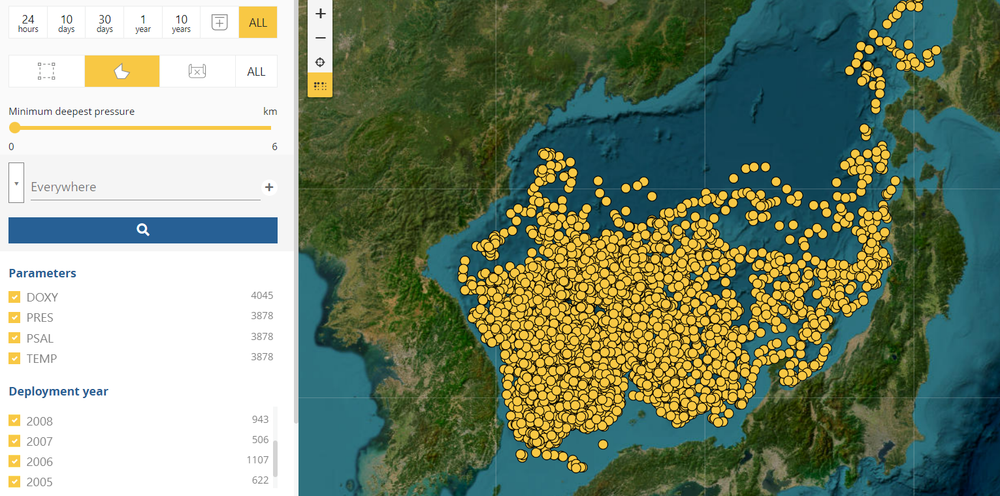
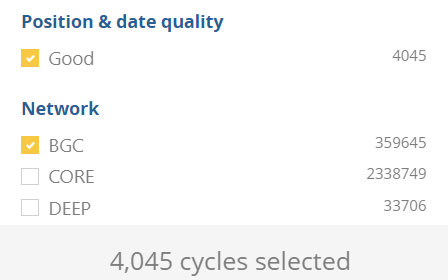
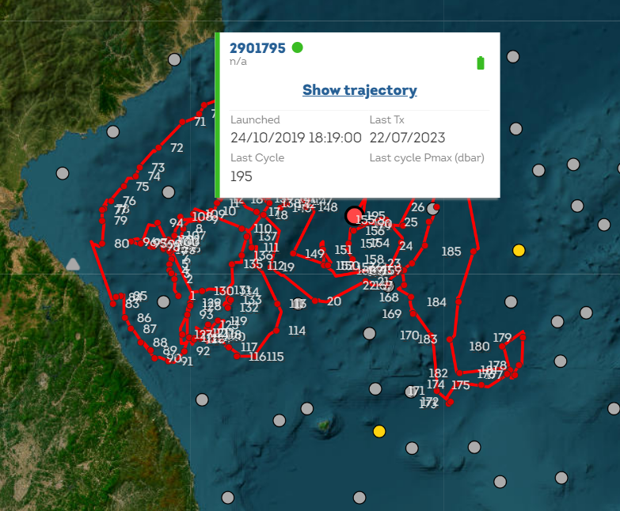
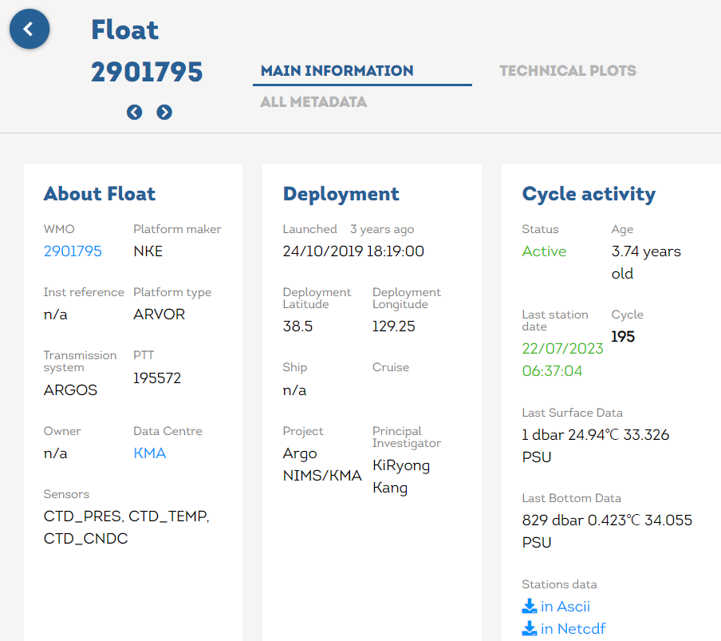

# :material-waves: Argo [2026.01.02]

Argo float 관측 profile과 float 궤적에서 계산한 유속 product를 정리했습니다.
Argo 기반 격자 수온·염분 product(EN4, MOAA GPV, CORA5, BOA-Argo)는 [Gridded T/S products](gridded.md) 페이지에서 비교하고,
표층 뜰개는 [Drifter](drifter.md) 페이지에서 다룹니다.

## Profiles

-   **Euro-Argo Data Selection**

    ---

    공간 범위(lon, lat)를 지정해서 바로 다운로드할 수 있습니다.

    [:octicons-download-24: Euro-Argo Data Selection](https://dataselection.euro-argo.eu/)

-   **Argo GDAC (ftp, https, s3)**

    ---

    Argo 전체 자료를 제공하는 Global Data Assembly Center 서버

    [:octicons-link-external-24: Argo GDAC servers](http://www.argodatamgt.org/Access-to-data/Argo-GDAC-ftp-https-and-s3-servers)

-   **Argovis**

    ---

    웹에서 Argo profile을 검색하고 시각화합니다.

    [:octicons-link-external-24: Argovis](https://argovis.colorado.edu/)

-   **Tools & tutorials**

    ---

    Argo 자료 활용 소프트웨어와 교육 자료

    [:octicons-mark-github-16: argopy (Python)](https://github.com/euroargodev/argopy) 
    [:octicons-link-external-24: Argo software tools (UCSD)](https://argo.ucsd.edu/data/argo-software-tools/) 
    [:octicons-link-external-24: Argo Online School](https://euroargodev.github.io/argoonlineschool/intro.html) 
    [:octicons-link-external-24: KIOST Argo](https://oceanclimate.kr/kiost_argo/)

<figure markdown="span">
  { loading=lazy }
  <figcaption>Euro-Argo Data Selection: 공간 범위 설정</figcaption>
</figure>
<figure markdown="span">
  { loading=lazy }
  <figcaption>Euro-Argo Data Selection: 다운로드 화면</figcaption>
</figure>

??? info "개별 Argo 검색 (WMO 번호를 알고 있을 때)"
    1. 아래 사이트에서 WMO 번호로 Argo를 검색한 후, 어느 기관이 투하한 것인지 확인합니다.
       [Euro-Argo Fleet Monitoring](https://fleetmonitoring.euro-argo.eu/dashboard?Status=Active,Inactive)
    2. HTTPS로 `dac` 디렉토리에 접근해서 해당 기관 이름의 디렉토리를 엽니다.
       [Argo profile selection (NRL GODAE)](https://nrlgodae1.nrlmry.navy.mil/cgi-bin/argo_select.pl)
    3. 참고 영상: [YouTube](https://www.youtube.com/watch?v=2vD6UDsW-GA)

    <figure markdown="span">
      { loading=lazy }
      <figcaption>Fleet Monitoring에서 WMO 번호로 검색</figcaption>
    </figure>
    <figure markdown="span">
      { loading=lazy }
      <figcaption>투하 기관의 GDAC dac 디렉토리</figcaption>
    </figure>

## Velocity products

전체 목록: [Velocity products (UCSD)](https://argo.ucsd.edu/data/argo-data-products/velocity-products/)

-   **G-YoMaHa** · 1°, 1000 dbar

    ---

    Argo float 궤적에서 계산한 약 1000 m 깊이의 객관 분석 유속

    [:octicons-link-external-24: G-YoMaHa (JAMSTEC)](https://www.jamstec.go.jp/argo_research/dataset/gyomaha/gyomaha_en.html)

-   **CMEMS in situ NRT ocean currents** · 1997-07-28 – present

    ---

    Argo float 궤적을 따라 계산한 parking depth와 표층의 동서·남북 유속.
    같은 product에 drifter 유속도 포함되어 있으며, 처리 방법은 [Drifter](drifter.md) 페이지를 참고하세요.

    [:octicons-link-external-24: INSITU_GLO_PHY_UV_DISCRETE_NRT_013_048](https://data.marine.copernicus.eu/product/INSITU_GLO_PHY_UV_DISCRETE_NRT_013_048/description)

