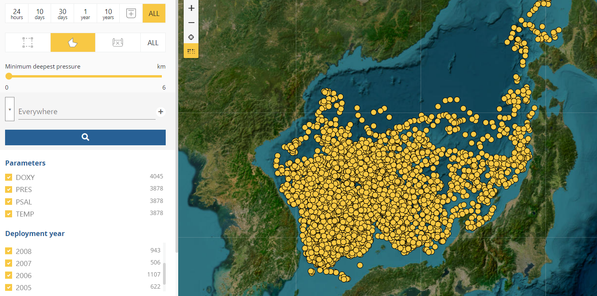
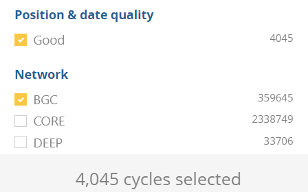
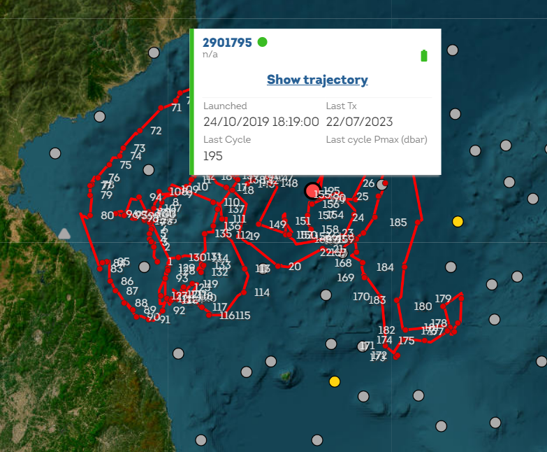
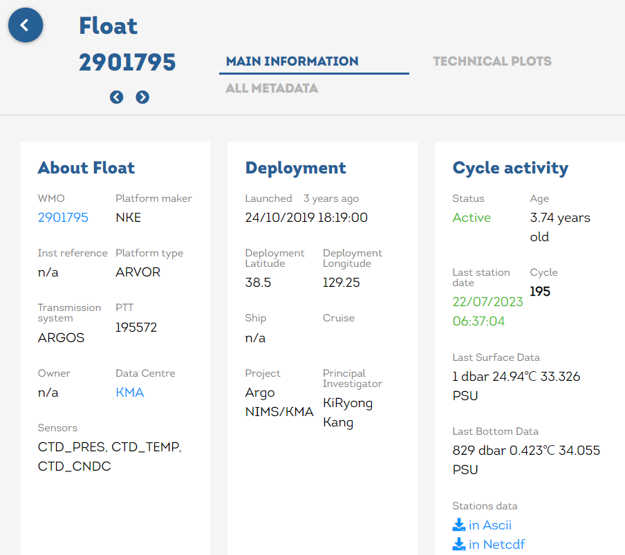

# :material-waves: Argo [2026.01.02]

Argo float profiles and velocity products derived from float trajectories.
Gridded temperature and salinity products built from Argo (EN4, MOAA GPV, CORA5, BOA-Argo) are compared on the
[Gridded T/S products](gridded.md) page; surface drifters are on the [Drifter](drifter.md) page.

## Profiles

-   **Euro-Argo Data Selection**

    ---

    Set the spatial range (lon, lat) and download directly.

    [:octicons-download-24: Euro-Argo Data Selection](https://dataselection.euro-argo.eu/)

-   **Argo GDAC (ftp, https, s3)**

    ---

    Global Data Assembly Center servers holding the full Argo archive

    [:octicons-link-external-24: Argo GDAC servers](http://www.argodatamgt.org/Access-to-data/Argo-GDAC-ftp-https-and-s3-servers)

-   **Argovis**

    ---

    Search and visualize Argo profiles in the browser

    [:octicons-link-external-24: Argovis](https://argovis.colorado.edu/)

-   **Tools & tutorials**

    ---

    Software and training material for working with Argo data

    [:octicons-link-external-24: Argo software tools (UCSD)](https://argo.ucsd.edu/data/argo-software-tools/) 
    [:octicons-link-external-24: Argo Online School](https://euroargodev.github.io/argoonlineschool/intro.html) 
    [:octicons-link-external-24: KIOST Argo](https://oceanclimate.kr/kiost_argo/)

<figure markdown="span">
  { loading=lazy }
  <figcaption>Euro-Argo Data Selection: setting the spatial range</figcaption>
</figure>
<figure markdown="span">
  { loading=lazy }
  <figcaption>Euro-Argo Data Selection: download page</figcaption>
</figure>

??? info "Finding a single float when you know its WMO number"
    1. Search the float by WMO number and check which institution deployed it:
       [Euro-Argo Fleet Monitoring](https://fleetmonitoring.euro-argo.eu/dashboard?Status=Active,Inactive)
    2. Go to the `dac` directory over HTTPS and open the directory named after that institution:
       [Argo profile selection (NRL GODAE)](https://nrlgodae1.nrlmry.navy.mil/cgi-bin/argo_select.pl)
    3. Video walkthrough: [YouTube](https://www.youtube.com/watch?v=2vD6UDsW-GA)

    <figure markdown="span">
      { loading=lazy }
      <figcaption>Fleet Monitoring: searching by WMO number</figcaption>
    </figure>
    <figure markdown="span">
      { loading=lazy }
      <figcaption>GDAC dac directory of the deploying institution</figcaption>
    </figure>

??? note "Needs checking"
    The Notion page embedded one external object in the "Another sources related to ARGO" section that could not be read
    through the API. Please check whether it was an extra link worth keeping.

## Velocity products

Full list: [Velocity products (UCSD)](https://argo.ucsd.edu/data/argo-data-products/velocity-products/)

-   **G-YoMaHa** · 1°, 1000 dbar

    ---

    Objectively mapped velocity at about 1000 m depth, derived from Argo float trajectories

    [:octicons-link-external-24: G-YoMaHa (JAMSTEC)](https://www.jamstec.go.jp/argo_research/dataset/gyomaha/gyomaha_en.html)

-   **CMEMS in situ NRT ocean currents** · 1997-07-28 – present

    ---

    Zonal and meridional velocities at parking depth and at the surface, computed along Argo float trajectories.
    The same product also carries drifter velocities; see the processing notes on the [Drifter](drifter.md) page.

    [:octicons-link-external-24: INSITU_GLO_PHY_UV_DISCRETE_NRT_013_048](https://data.marine.copernicus.eu/product/INSITU_GLO_PHY_UV_DISCRETE_NRT_013_048/description)

