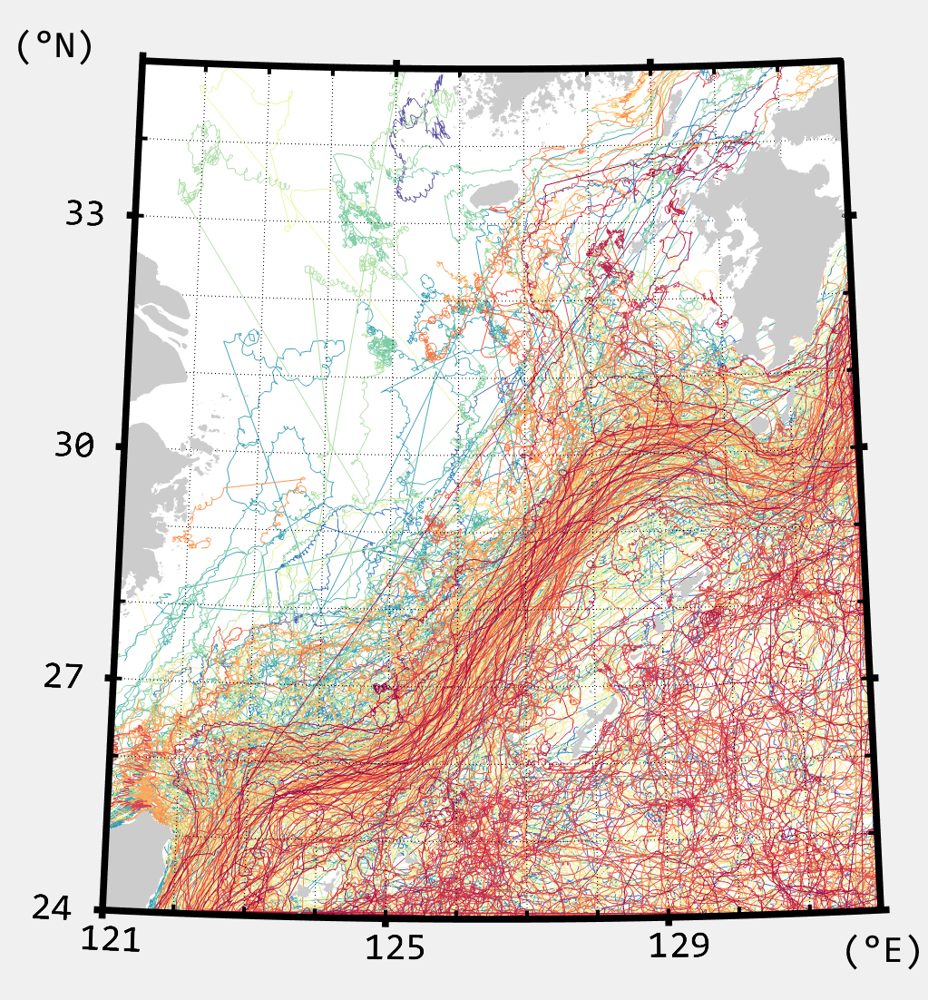
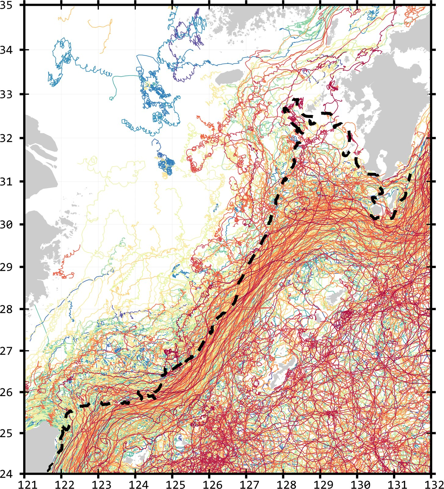
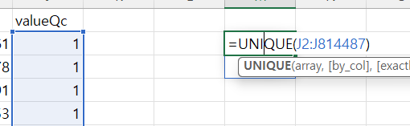
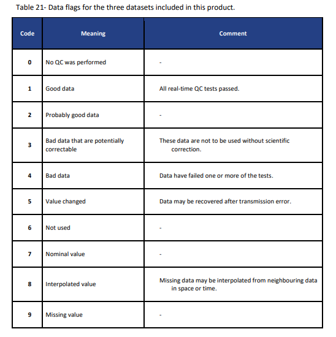

# :material-cog-outline: CMEMS drifter 자료 처리 <span class="date">[2024.08.20]</span>

CMEMS in situ drifter product(INSITU_GLO_PHY_UV_DISCRETE_NRT_013_048)를 MATLAB에서 개별 drifter 궤적으로 나누는 과정의 메모입니다.
product 자체는 [Drifter](drifter.md) 페이지를 참고하세요.

## 궤적을 나눠야 하는 이유

drifter id(`platformId`)만 기준으로 경위도와 유속 벡터를 묶으면, 서로 다른 기간의 drifter들이 하나의 id로 함께 묶이는 경우가 생깁니다.
그대로 그리면 아래 왼쪽 그림처럼 관련 없는 구간 사이에 직선 경로가 나타납니다.

이를 막기 위해 id별로 시간축을 확인하여 drifter를 구분했습니다. CMEMS drifter는 기본적으로 3시간 또는 1시간 간격으로 제공되므로,
**6시간 이상**의 간격이 있으면 서로 다른 drifter로 간주했습니다. 그 결과가 오른쪽 그림입니다.
오른쪽 그림의 검은 점선은 200 m 수심선입니다.

<figure markdown="span">
  { loading=lazy }
  <figcaption>분리 전: platformId로만 묶은 궤적</figcaption>
</figure>
<figure markdown="span">
  { loading=lazy }
  <figcaption>6시간 이상 간격에서 분리한 뒤. 점선은 200 m 수심선</figcaption>
</figure>

!!! tip "드로그 깊이"
    동중국해의 경우 `TEMP` 변수를 제외한 모든 drifter의 드로그가 15 m에 있는 것으로 확인했습니다.
    다른 지역은 아래 코드의 깊이 변수(`drfdp`)에 `unique()`를 적용해서 직접 확인하세요.

!!! warning "QC 변수는 아직 적용하지 않았습니다"
    QC 변수로 거르는 단계는 아직 확인하지 않았습니다. Excel에서 CSV를 열어 `valueQC`의 고유값을 보면 1과 4가 있으므로,
    QC 값을 고려하는 단계가 추가로 필요할 것으로 보입니다.

    <figure markdown="span">
      { loading=lazy }
      <figcaption>CSV의 valueQC 고유값</figcaption>
    </figure>
    <figure markdown="span">
      { loading=lazy }
      <figcaption>QC flag 값의 의미</figcaption>
    </figure>

## MATLAB 코드

??? example "CSV를 읽고 궤적을 나눠 mat 파일로 저장"

    ```matlab title="CMEMS drifter 궤적을 6시간 간격에서 분리"
    clc; clear; close all;

    fnm = "cmems_obs-ins_glo_phy-cur_nrt_drifter_irr_ECS.csv";
    tbl = readtable(fnm, "VariableNamingRule","preserve");

    drfid = unique(tbl.platformId);

    drfdt = NaT(1, length(drfid), "TimeZone","UTC");

    %%
    clc;
    para = string(tbl{:,1});
    for i1 = 1:length(drfid)
        id = para == 'EWCT' & tbl.platformId == drfid(i1);
        hamster = datetime(string(tbl.time(id)), "InputFormat","uuuu-MM-dd'T'HH:mm:ss.SSSZ", 'TimeZone','UTC');
        drfdt(1:length(hamster), i1) = hamster;
    end

    %%
    drfu = nan(size(drfdt));
    drfv = nan(size(drfdt));
    drflo = nan(size(drfdt));
    drfla = nan(size(drfdt));
    drfdp = nan(size(drfdt));
    % drfdp2 = nan(size(drfdt));

    for i1 = 1:length(drfid)
        id = para == 'EWCT' & tbl.platformId == drfid(i1);
        hamster = tbl.value(id);
        drfu(1:length(hamster), i1) = hamster;
        hamster = tbl.longitude(id);
        drflo(1:length(hamster), i1) = hamster;
        hamster = tbl.latitude(id);
        drfla(1:length(hamster), i1) = hamster;
        hamster = tbl.depth(id);
        drfdp(1:length(hamster), i1) = hamster;

        id = para == 'NSCT' & tbl.platformId == drfid(i1);
        hamster = tbl.value(id);
        drfv(1:length(hamster), i1) = hamster;

        % temp 변수 측정한 경우, 수심이 15가 아니라 0.5
        % id = para == 'TEMP' & tbl.platformId == drfid(i1);
        % hamster = tbl.depth(id);
        % drfdp2(1:length(hamster), i1) = hamster;
    end

    %%
    clc
    ad = length(drfid); adk = 1;

    drfdt2 = drfdt;
    drflo2 = drflo;
    drfla2 = drfla;
    drfv2 = drfv;
    drfu2 = drfu;

    % ck = nan(size(drfid));
    for i1 = 1:ad
        hamster = drfdt2(:, i1); isnt = find(isnat(hamster));
        if ~isempty(isnt)
            hamster = hamster(1:isnt(1));
        end
        tdiff = find(diff(hamster) > hours(6));
        % ck(i1) = length(tdiff);

        if ~isempty(tdiff)
            tdiff2 = [tdiff; length(hamster)];
            drfdt2(tdiff2(1)+1:end, i1) = NaT;
            drflo2(tdiff2(1)+1:end, i1) = NaN;
            drfla2(tdiff2(1)+1:end, i1) = NaN;
            drfu2(tdiff2(1)+1:end, i1) = NaN;
            drfv2(tdiff2(1)+1:end, i1) = NaN;

            for i2 = 2:length(tdiff2)
                ham2 = hamster(tdiff2(i2-1)+1:tdiff2(i2));
                drfdt2(1:length(ham2),ad+adk) = ham2;
                drflo2(1:length(ham2),ad+adk) = drflo(tdiff2(i2-1)+1:tdiff2(i2), i1);
                drfla2(1:length(ham2),ad+adk) = drfla(tdiff2(i2-1)+1:tdiff2(i2), i1);
                drfu2(1:length(ham2),ad+adk) = drfu(tdiff2(i2-1)+1:tdiff2(i2), i1);
                drfv2(1:length(ham2),ad+adk) = drfv(tdiff2(i2-1)+1:tdiff2(i2), i1);
                adk = adk+1;
            end
        end
    end

    drflo2(drflo2 == 0) = NaN;
    drfla2(drfla2 == 0) = NaN;
    drfu2(drfu2 == 0) = NaN;
    drfv2(drfv2 == 0) = NaN;

    save cmems_drf_ecs.mat drflo2 drfla2 drfu2 drfv2 drfdt2;
    ```
