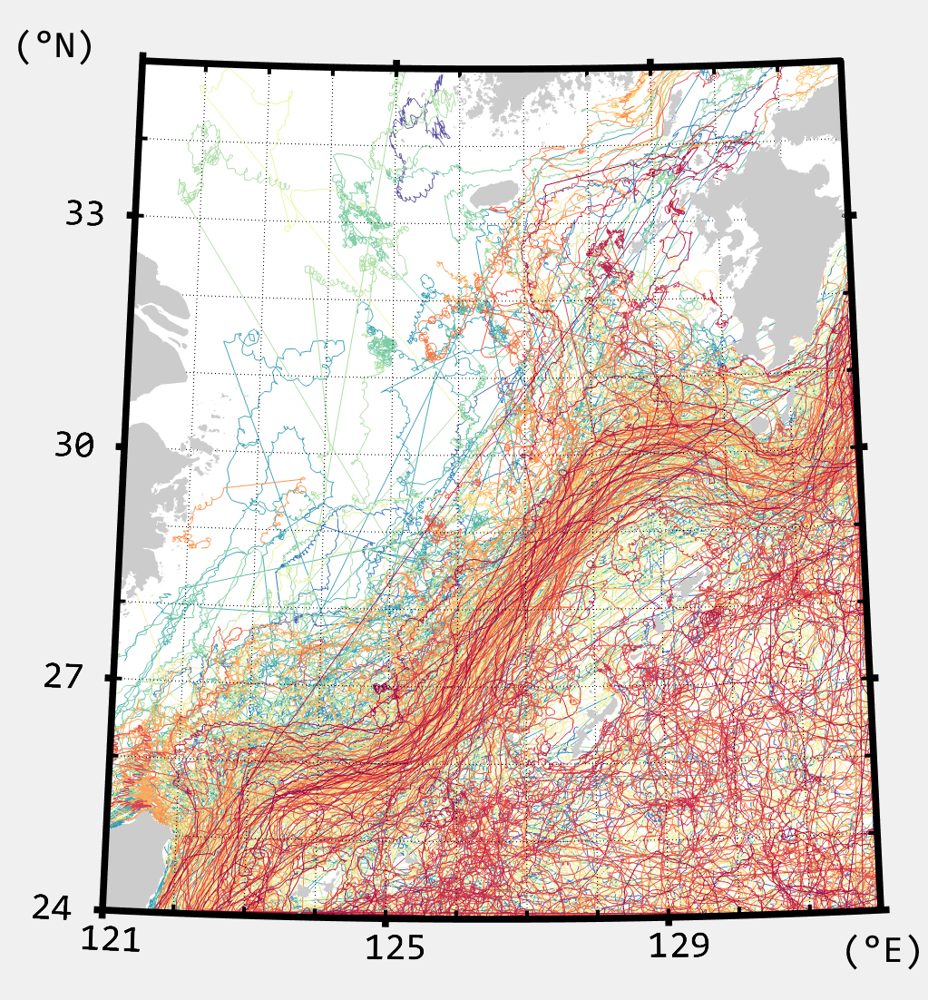
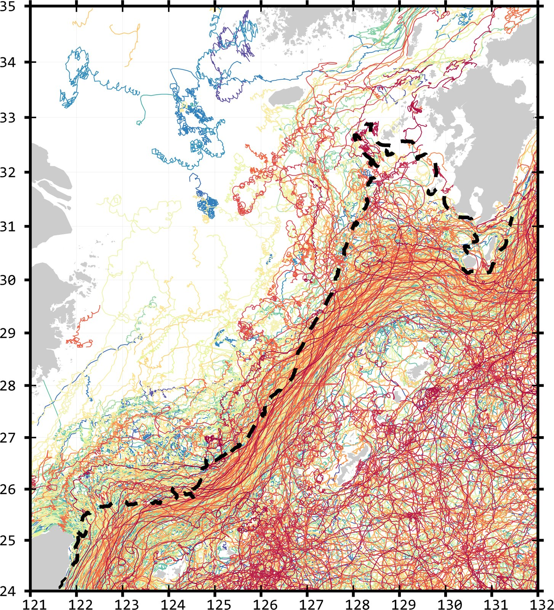
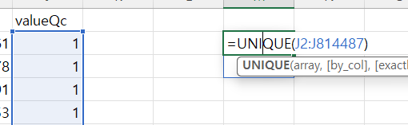
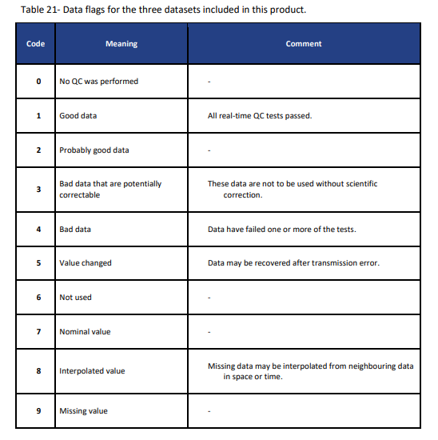

# :material-cog-outline: Data processing for CMEMS drifters <span class="date">[2024.08.20]</span>

Notes on splitting the CMEMS in situ drifter product (INSITU_GLO_PHY_UV_DISCRETE_NRT_013_048) into individual drifter tracks in MATLAB.
See the [Drifter](drifter.md) page for the product itself.

## Why the tracks need splitting

Grouping longitude, latitude and velocity by `platformId` alone can merge drifters from different periods under one ID.
Plotted as is, such groups show up as straight lines between unrelated segments (left figure below).

To avoid this, the time axis of each ID is checked. CMEMS drifters report at 3-hour or 1-hour intervals,
so any gap longer than **6 hours** is treated as the boundary between two different drifters. The result is the right figure.
The black dashed line in that figure is the 200 m isobath.

<figure markdown="span">
  { loading=lazy }
  <figcaption>Before splitting: tracks grouped by platformId only</figcaption>
</figure>
<figure markdown="span">
  { loading=lazy }
  <figcaption>After splitting at gaps longer than 6 hours; dashed line is the 200 m isobath</figcaption>
</figure>

!!! tip "Drogue depth"
    In the East China Sea every drifter except the `TEMP` records had its drogue at 15 m.
    For other regions, check this yourself with `unique()` on the depth variable (`drfdp` in the code below).

!!! warning "Quality-control flags are not yet applied"
    Filtering by the QC variable has not been implemented. Opening the CSV in Excel and listing the unique values of `valueQC`
    shows both 1 and 4, so an additional step that takes the QC flag into account will be needed.

    <figure markdown="span">
      { loading=lazy }
      <figcaption>Unique values of valueQC in the CSV</figcaption>
    </figure>
    <figure markdown="span">
      { loading=lazy }
      <figcaption>Meaning of the QC flag values</figcaption>
    </figure>

## MATLAB code

??? example "Read the CSV, split the tracks, and save a mat file"

    ```matlab title="Split CMEMS drifter tracks at 6-hour gaps"
    clc; clear; close all;

    fnm = "cmems_obs-ins_glo_phy-cur_nrt_drifter_irr_ECS.csv";
    tbl = readtable(fnm, "VariableNamingRule","preserve");

    drfid = unique(tbl.platformId);

    drfdt = NaT(1, length(drfid), "TimeZone","UTC");

    %%
    clc;
    para = string(tbl{:,1});
    for i1 = 1:length(drfid)
        id = para == 'EWCT' & tbl.platformId == drfid(i1);
        hamster = datetime(string(tbl.time(id)), "InputFormat","uuuu-MM-dd'T'HH:mm:ss.SSSZ", 'TimeZone','UTC');
        drfdt(1:length(hamster), i1) = hamster;
    end

    %%
    drfu = nan(size(drfdt));
    drfv = nan(size(drfdt));
    drflo = nan(size(drfdt));
    drfla = nan(size(drfdt));
    drfdp = nan(size(drfdt));
    % drfdp2 = nan(size(drfdt));

    for i1 = 1:length(drfid)
        id = para == 'EWCT' & tbl.platformId == drfid(i1);
        hamster = tbl.value(id);
        drfu(1:length(hamster), i1) = hamster;
        hamster = tbl.longitude(id);
        drflo(1:length(hamster), i1) = hamster;
        hamster = tbl.latitude(id);
        drfla(1:length(hamster), i1) = hamster;
        hamster = tbl.depth(id);
        drfdp(1:length(hamster), i1) = hamster;

        id = para == 'NSCT' & tbl.platformId == drfid(i1);
        hamster = tbl.value(id);
        drfv(1:length(hamster), i1) = hamster;

        % when the temp variable is measured, the depth is 0.5 rather than 15
        % id = para == 'TEMP' & tbl.platformId == drfid(i1);
        % hamster = tbl.depth(id);
        % drfdp2(1:length(hamster), i1) = hamster;
    end

    %%
    clc
    ad = length(drfid); adk = 1;

    drfdt2 = drfdt;
    drflo2 = drflo;
    drfla2 = drfla;
    drfv2 = drfv;
    drfu2 = drfu;

    % ck = nan(size(drfid));
    for i1 = 1:ad
        hamster = drfdt2(:, i1); isnt = find(isnat(hamster));
        if ~isempty(isnt)
            hamster = hamster(1:isnt(1));
        end
        tdiff = find(diff(hamster) > hours(6));
        % ck(i1) = length(tdiff);

        if ~isempty(tdiff)
            tdiff2 = [tdiff; length(hamster)];
            drfdt2(tdiff2(1)+1:end, i1) = NaT;
            drflo2(tdiff2(1)+1:end, i1) = NaN;
            drfla2(tdiff2(1)+1:end, i1) = NaN;
            drfu2(tdiff2(1)+1:end, i1) = NaN;
            drfv2(tdiff2(1)+1:end, i1) = NaN;

            for i2 = 2:length(tdiff2)
                ham2 = hamster(tdiff2(i2-1)+1:tdiff2(i2));
                drfdt2(1:length(ham2),ad+adk) = ham2;
                drflo2(1:length(ham2),ad+adk) = drflo(tdiff2(i2-1)+1:tdiff2(i2), i1);
                drfla2(1:length(ham2),ad+adk) = drfla(tdiff2(i2-1)+1:tdiff2(i2), i1);
                drfu2(1:length(ham2),ad+adk) = drfu(tdiff2(i2-1)+1:tdiff2(i2), i1);
                drfv2(1:length(ham2),ad+adk) = drfv(tdiff2(i2-1)+1:tdiff2(i2), i1);
                adk = adk+1;
            end
        end
    end

    drflo2(drflo2 == 0) = NaN;
    drfla2(drfla2 == 0) = NaN;
    drfu2(drfu2 == 0) = NaN;
    drfv2(drfv2 == 0) = NaN;

    save cmems_drf_ecs.mat drflo2 drfla2 drfu2 drfv2 drfdt2;
    ```
