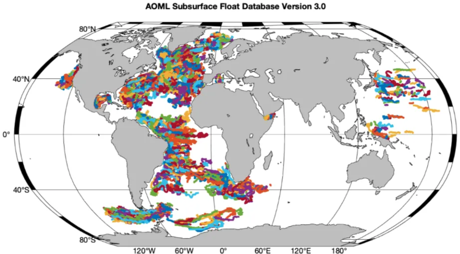
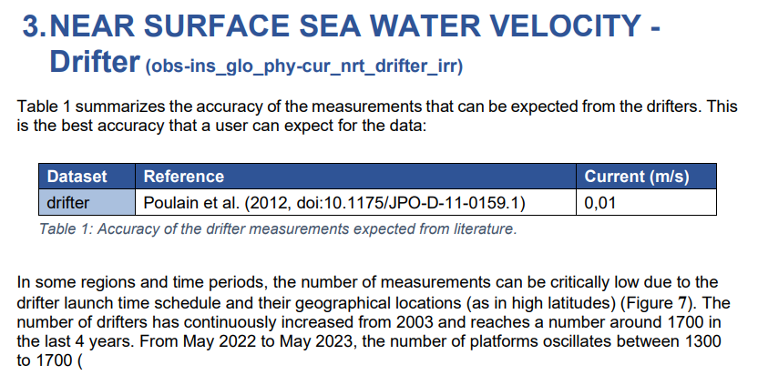
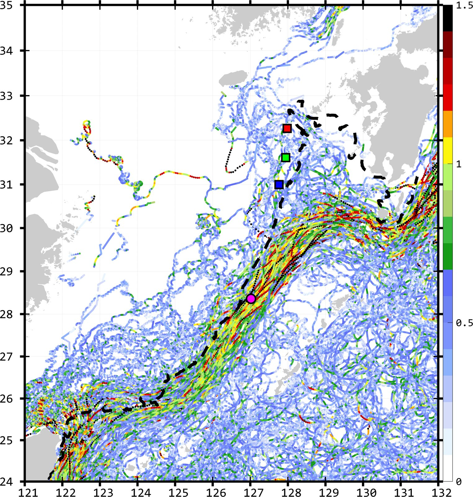
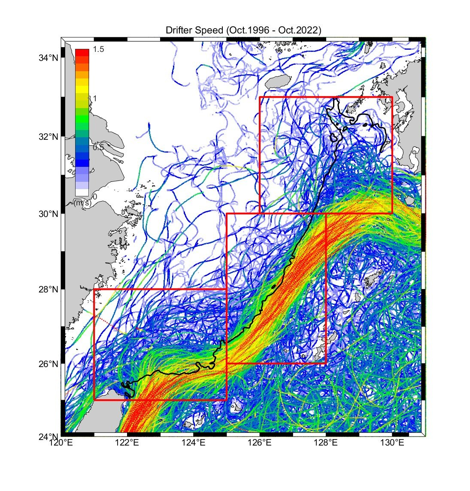
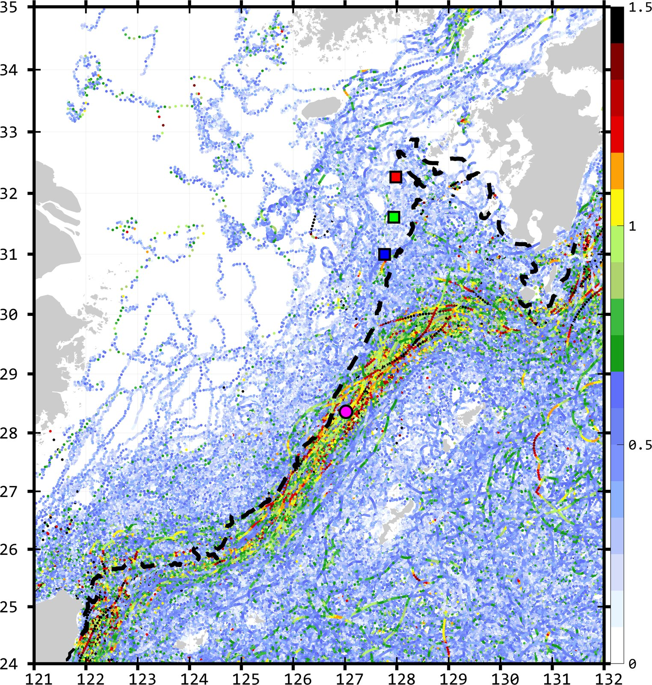
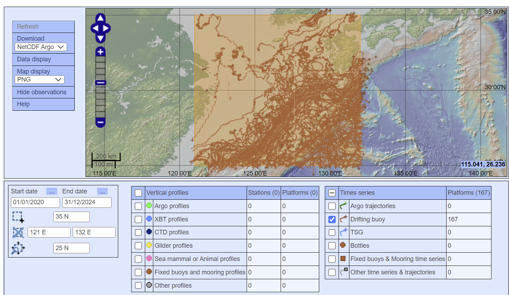
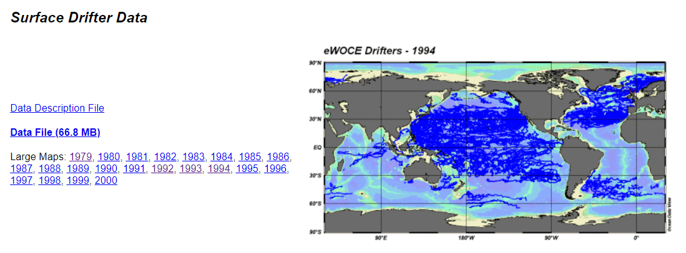
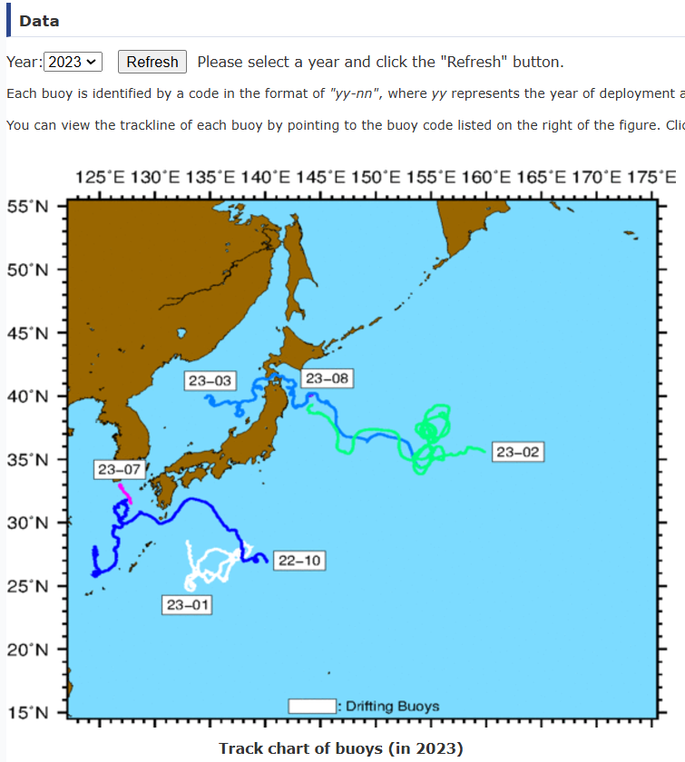

# :material-map-marker-path: Drifter [2026.01.02]

표층 뜰개(drifter)와 부이 관측 자료, 그리고 drifter 기반 합성 유속장을 정리했습니다.
Argo float 자료는 [Argo](argo.md) 페이지를 참고하세요.

## Surface drifters

-   **Global Drifter Program (GDP)**

    ---

    NOAA AOML의 전 지구 표층 뜰개 프로그램

    [:octicons-arrow-right-24: GDP 자료 다운로드 방법](gdp-download.md) 
    [:octicons-link-external-24: GDP (NOAA AOML)](https://www.aoml.noaa.gov/phod/gdp/index.php) 
    [:octicons-link-external-24: Lagrangian Drifter Laboratory (UCSD)](https://gdp.ucsd.edu/ldl/) 
    [:octicons-download-24: GDP ERDDAP](https://erddap.aoml.noaa.gov/gdp/erddap/info/index.html?page=1&itemsPerPage=1000)

-   **Near-surface drifter-wind-altimetry synthesis** · 0.25°, daily, 15 m

    ---

    NOAA AOML 개발. 드리프터를 기준으로 Ekman + geostrophic 성분을 결합한 관측 기반 합성 유속장
    (Drifter: GDP, Altimetry: AVISO multi-satellite delayed-mode product, Winds: ERA-Interim)

    [:octicons-download-24: AOML ftp: decomp](https://www.aoml.noaa.gov/ftp/pub/phod/lumpkin/decomp/)

-   **CMEMS in situ NRT drifter currents**

    ---

    CMEMS가 제공하는 drifter 기반 표층 유속 관측

    [:octicons-link-external-24: INSITU_GLO_PHY_UV_DISCRETE_NRT_013_048](https://data.marine.copernicus.eu/product/INSITU_GLO_PHY_UV_DISCRETE_NRT_013_048/description) 
    [:octicons-arrow-right-24: CMEMS drifter 자료 처리](cmems-drifter-processing.md)

-   **Subsurface float data**

    ---

    NOAA AOML 수중 float 궤적 자료

    [:octicons-link-external-24: AOML float trajectories](https://www.aoml.noaa.gov/phod/float_traj/data/index.php)

<figure markdown="span">
  { loading=lazy }
  <figcaption>AOML 수중 float 궤적</figcaption>
</figure>
<figure markdown="span">
  { loading=lazy }
  <figcaption>CMEMS INSITU_GLO_PHY_UV_DISCRETE_NRT_013_048 product 페이지</figcaption>
</figure>

[:octicons-book-24: CMEMS QUID 013-048 (제품 문서 페이지)](https://data.marine.copernicus.eu/product/INSITU_GLO_PHY_UV_DISCRETE_NRT_013_048/documentation)
[:octicons-book-24: CMEMS PUM 013-048](https://doi.org/10.13155/73192)

??? info "GDP와 CMEMS drifter 비교"
    - **GDP (1시간, 6시간)**: 2015-01-01 – 2022-10-23 18:00 (지도), 1996-10 – 2022-10-23 18:00 (속도 분포)
    - **CMEMS (1시간 또는 3시간)**: 2002-01-08 21:00 – 2024-07-31 23:00, 2024-08-19 내려받음

    <figure markdown="span">
      { loading=lazy }
      <figcaption>GDP 1시간 drifter, 2015-01-01 – 2022-10-23</figcaption>
    </figure>
    <figure markdown="span">
      { loading=lazy }
      <figcaption>GDP drifter 속도 분포, 1996-10 – 2022-10-23</figcaption>
    </figure>
    <figure markdown="span">
      { loading=lazy }
      <figcaption>CMEMS drifter, 2002-01-08 – 2024-07-31</figcaption>
    </figure>

    여기서는 GDP 1시간 자료와 CMEMS 자료를 비교하고 있는데, GDP 6시간 자료는 1시간 자료보다 훨씬 더 개수가 많아서,
    이 그림만으로 CMEMS에 자료가 더 많다고 보기는 어렵습니다.

??? info "OSMC drifter wave height (더 이상 사용하지 않음)"
    [ERDDAP: OSMC flattened observations from GTS](https://erddap.aoml.noaa.gov/gdp/erddap/tabledap/OSMC_RealTime.html)

## CORA drifters (Coriolis)

[:octicons-link-external-24: Coriolis Data Selection](https://www.coriolis.eu.org/Data-Products/Data-selection)

<figure markdown="span">
  { loading=lazy }
  <figcaption>Coriolis Data Selection 화면</figcaption>
</figure>

??? info "Coriolis Data Selection 사용 방법"
    1. 좌측 하단의 box에서 시간 범위, 공간 범위를 설정합니다.
    2. 하단의 자료 중 원하는 데이터를 클릭합니다.
    3. 좌측 상단의 "Refresh"를 클릭합니다.
    4. 지도에서 bar를 확인하여 gauge가 채워진 후 사라질 때까지 기다립니다. 하단에 각 데이터별 개수가 먼저 나타나므로,
       기다리는 동안 개수를 확인하는 것을 추천합니다.
    5. load가 완료되면 좌측 상단의 download를 클릭하고 본인 e-mail을 입력합니다.
    6. 너무 긴 시간 범위, 너무 큰 공간 범위, 너무 많은 데이터셋을 요청하면 download가 거부됩니다
       (예: drifting buoy를 요청했을 때 300개 안팎까지만 허용되었음). 기간을 나눠서 다운받는 것을 권합니다.

??? note "데이터 파일"
    2024-08-19에 내려받은 CORA drifter 자료는 사이트 밖에 두고 별도로 제공할 예정입니다:
    동중국해 `cora_ecs_drf_1970_2000.tgz`, `_2001_2005`, `_2006_2008`, `_2009_2010`, `_2011_2013`, `_2014_2019`, `_2020_2024`;
    동해 `cora_es_drf_1950_1998.tgz`, `_1999_2003`, `_2004_2006`, `_2007_2008`, `_2009_2010`, `_2011_2013`, `_2014_2017`, `_2018_2024`;
    CMEMS drifter 원자료 `cmems_obs-ins_glo_phy-cur_nrt_drifter_irr_ECS.csv`, `cmems_obs-ins_glo_phy-cur_nrt_drifter_irr_ES.csv`.

## WOCE surface drifters

- [WOCE Global Data Resource (NOAA NCEI)](https://www.ncei.noaa.gov/access/metadata/landing-page/bin/iso?id=gov.noaa.nodc:NODC-WOCE-GDR)
- [NCEI Geoportal](https://www.ncei.noaa.gov/metadata/granule/geoportal/#)
- [eWOCE: Surface Drifter Data](https://www.ewoce.org/data/index.html#Surface_Drifter_Data): final WOCE data release (DVD 2), WOCE Report No. 180/02 (2002)에 포함

<figure markdown="span">
  { loading=lazy }
  <figcaption>eWOCE surface drifter 자료</figcaption>
</figure>

## Regional drifters & buoys

=== "Korea: KHOA"

    **바다누리 해양정보 (KHOA)**

    [:octicons-link-external-24: 바다누리 해양정보](https://khoa.go.kr/oceandata/oceaninfo/map.do)

    - (전화 문의 결과) 부이, 표층 뜰개 자료 등 바다누리에서 제공하는 자료는 **KST(한국 표준시)** 기준입니다.
    - 바다누리에서 받을 수 있는 표층 뜰개 중 SVP drifter는 **GDP program에 포함되지 않는다**고 합니다.
    - 표층 뜰개 자료는 현재 개별로만 다운로드할 수 있고, 한번에 받는 별도 방법은 없습니다. [2025.05.01 기준]

=== "Japan: JMA"

    **Ocean Data Buoy Observations**

    [:octicons-link-external-24: JMA ocean data buoy](https://www.data.jma.go.jp/kaiyou/db/vessel_obs/data-report/html/buoy/buoy_e.php)

    <figure markdown="span">
      { loading=lazy }
      <figcaption>JMA 해양 부이 관측</figcaption>
    </figure>
