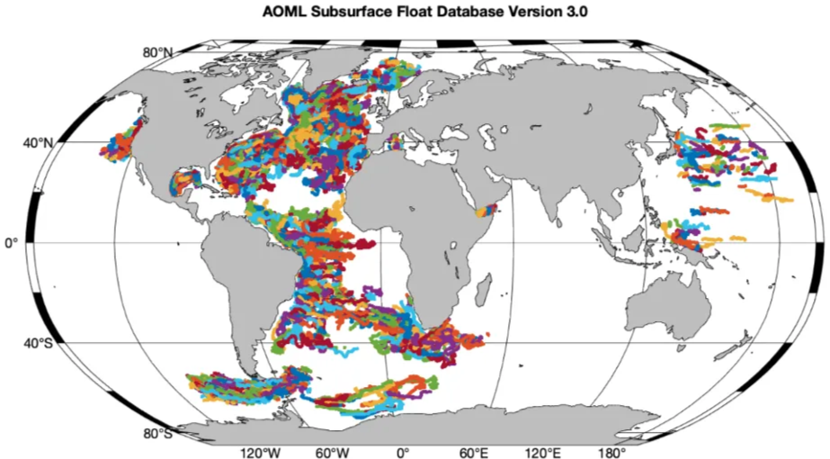
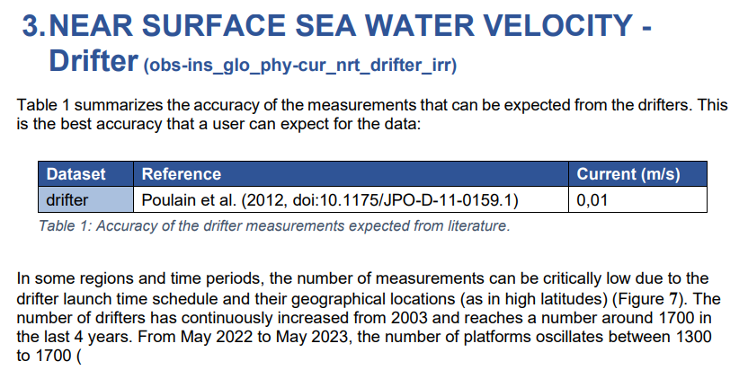
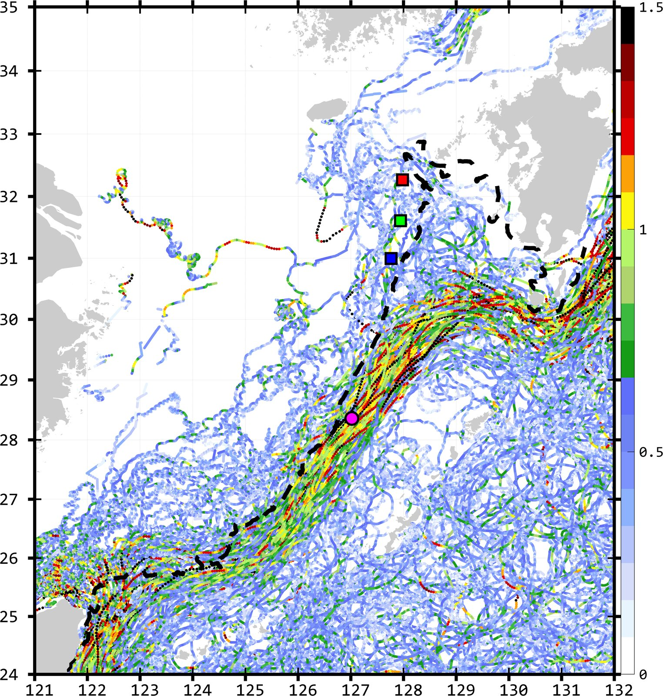
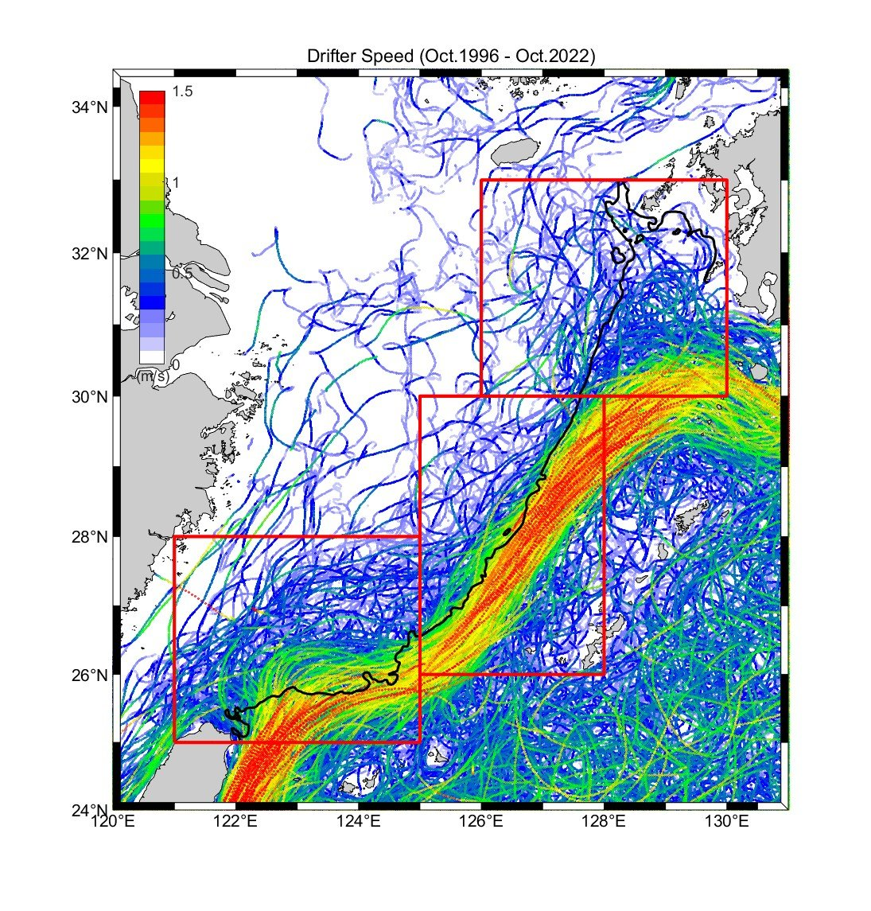
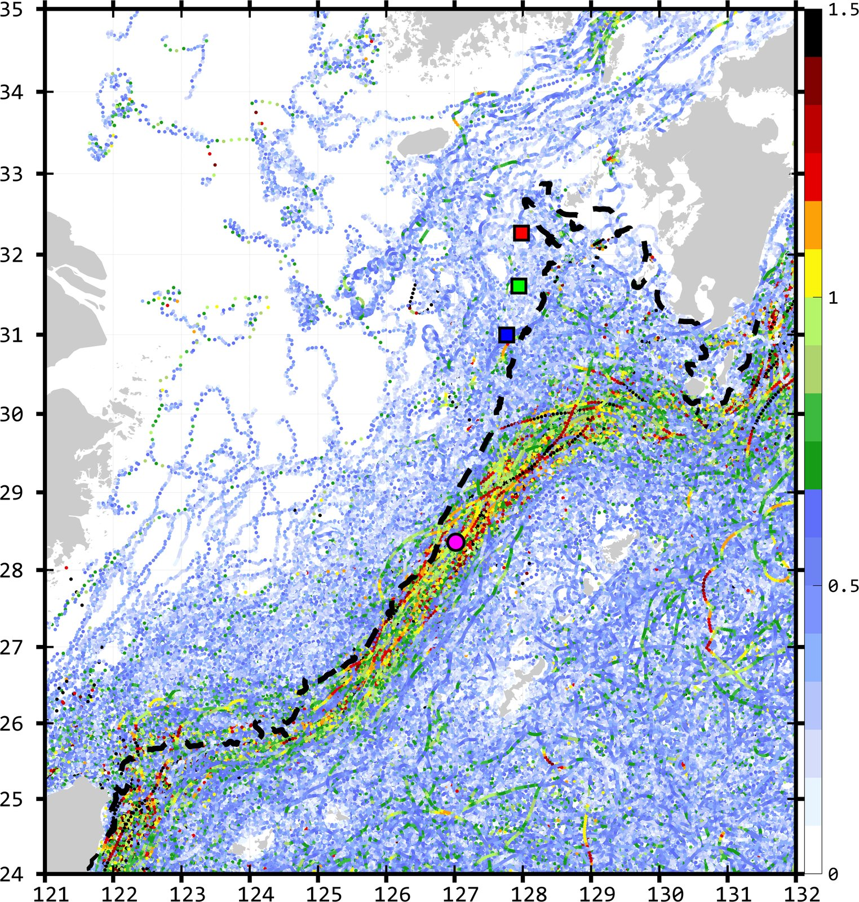
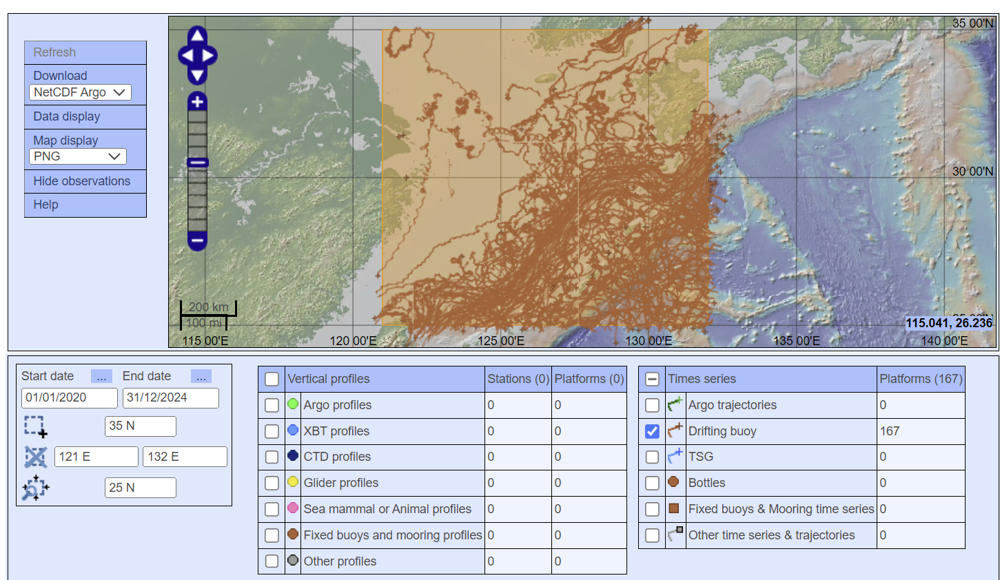
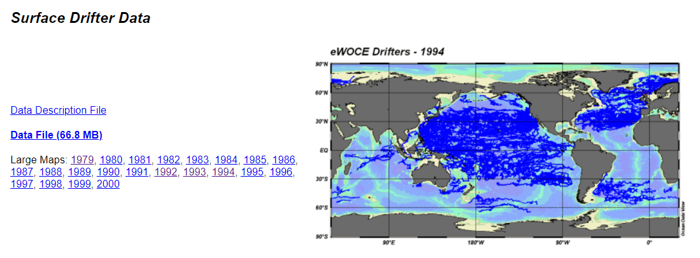

# :material-map-marker-path: Drifter [2026.01.02]

Surface drifter and buoy observations, and velocity fields built from drifter data.
Argo float data are on the [Argo](argo.md) page.

## Surface drifters

-   **Global Drifter Program (GDP)**

    ---

    NOAA AOML's global array of surface drifters

    [:octicons-arrow-right-24: How to download GDP data](gdp-download.md) 
    [:octicons-link-external-24: GDP (NOAA AOML)](https://www.aoml.noaa.gov/phod/gdp/index.php) 
    [:octicons-link-external-24: Lagrangian Drifter Laboratory (UCSD)](https://gdp.ucsd.edu/ldl/) 
    [:octicons-download-24: GDP ERDDAP](https://erddap.aoml.noaa.gov/gdp/erddap/info/index.html?page=1&itemsPerPage=1000)

-   **Near-surface drifter-wind-altimetry synthesis** · 0.25°, daily, 15 m

    ---

    Developed at NOAA AOML. An observation-based synthesis that combines Ekman and geostrophic components, anchored to drifter velocities
    (drifters: GDP; altimetry: AVISO multi-satellite delayed-mode product; winds: ERA-Interim)

    [:octicons-download-24: AOML ftp: decomp](https://www.aoml.noaa.gov/ftp/pub/phod/lumpkin/decomp/)

-   **CMEMS in situ NRT drifter currents**

    ---

    Drifter-based near-surface velocities distributed by CMEMS

    [:octicons-link-external-24: INSITU_GLO_PHY_UV_DISCRETE_NRT_013_048](https://data.marine.copernicus.eu/product/INSITU_GLO_PHY_UV_DISCRETE_NRT_013_048/description) 
    [:octicons-arrow-right-24: Data processing for CMEMS drifters](cmems-drifter-processing.md)

-   **Subsurface float data**

    ---

    Subsurface float trajectories from NOAA AOML

    [:octicons-link-external-24: AOML float trajectories](https://www.aoml.noaa.gov/phod/float_traj/data/index.php)

<figure markdown="span">
  { loading=lazy }
  <figcaption>AOML subsurface float trajectories</figcaption>
</figure>
<figure markdown="span">
  { loading=lazy }
  <figcaption>CMEMS INSITU_GLO_PHY_UV_DISCRETE_NRT_013_048 product page</figcaption>
</figure>

[:octicons-book-24: CMEMS QUID 013-048 (product documentation)](https://data.marine.copernicus.eu/product/INSITU_GLO_PHY_UV_DISCRETE_NRT_013_048/documentation)
[:octicons-book-24: CMEMS PUM 013-048](https://doi.org/10.13155/73192)

??? info "GDP versus CMEMS drifters"
    - **GDP (1- and 6-hourly)**: 2015-01-01 to 2022-10-23 18:00 (map); 1996-10 to 2022-10-23 18:00 (speed distribution)
    - **CMEMS (1- or 3-hourly)**: 2002-01-08 21:00 to 2024-07-31 23:00, retrieved 2024-08-19

    <figure markdown="span">
      { loading=lazy }
      <figcaption>GDP hourly drifters, 2015-01-01 to 2022-10-23</figcaption>
    </figure>
    <figure markdown="span">
      { loading=lazy }
      <figcaption>GDP drifter speed distribution, 1996-10 to 2022-10-23</figcaption>
    </figure>
    <figure markdown="span">
      { loading=lazy }
      <figcaption>CMEMS drifters, 2002-01-08 to 2024-07-31</figcaption>
    </figure>

    The comparison uses the GDP 1-hourly data. The 6-hourly GDP data contain far more drifters than the 1-hourly set,
    so these figures alone do not show that CMEMS holds more data than GDP.

??? info "OSMC drifter wave height (no longer used)"
    [ERDDAP: OSMC flattened observations from GTS](https://erddap.aoml.noaa.gov/gdp/erddap/tabledap/OSMC_RealTime.html)

## CORA drifters (Coriolis)

[:octicons-link-external-24: Coriolis Data Selection](https://www.coriolis.eu.org/Data-Products/Data-selection)

<figure markdown="span">
  { loading=lazy }
  <figcaption>Coriolis Data Selection interface</figcaption>
</figure>

??? info "How to use Coriolis Data Selection"
    1. Set the time range and spatial range in the box at the lower left.
    2. Click the datasets you want in the list at the bottom.
    3. Click "Refresh" at the upper left.
    4. Watch the progress bar on the map and wait until it fills and disappears. The count for each dataset appears at the bottom first,
       so it is worth checking the counts while you wait.
    5. When loading is complete, click "download" at the upper left and enter your e-mail address.
    6. Requests with too long a time range, too large an area, or too many datasets are rejected
       (for drifting buoys, roughly 300 was the limit). Splitting the period into several downloads is recommended.

??? note "Data files"
    CORA drifter extracts retrieved on 2024-08-19 are kept outside the site and will be hosted separately:
    East China Sea `cora_ecs_drf_1970_2000.tgz`, `_2001_2005`, `_2006_2008`, `_2009_2010`, `_2011_2013`, `_2014_2019`, `_2020_2024`;
    East/Japan Sea `cora_es_drf_1950_1998.tgz`, `_1999_2003`, `_2004_2006`, `_2007_2008`, `_2009_2010`, `_2011_2013`, `_2014_2017`, `_2018_2024`;
    CMEMS raw drifter data `cmems_obs-ins_glo_phy-cur_nrt_drifter_irr_ECS.csv`, `cmems_obs-ins_glo_phy-cur_nrt_drifter_irr_ES.csv`.

## WOCE surface drifters

- [WOCE Global Data Resource (NOAA NCEI)](https://www.ncei.noaa.gov/access/metadata/landing-page/bin/iso?id=gov.noaa.nodc:NODC-WOCE-GDR)
- [NCEI Geoportal](https://www.ncei.noaa.gov/metadata/granule/geoportal/#)
- [eWOCE: Surface Drifter Data](https://www.ewoce.org/data/index.html#Surface_Drifter_Data): part of the final WOCE data release (DVD 2), WOCE Report No. 180/02 (2002)

<figure markdown="span">
  { loading=lazy }
  <figcaption>eWOCE surface drifter data</figcaption>
</figure>

## Regional drifters & buoys

=== "Korea: KHOA"

    **바다누리 해양정보 (KHOA)**

    [:octicons-link-external-24: KHOA Ocean Data Portal](https://khoa.go.kr/oceandata/oceaninfo/map.do)

    - According to KHOA (by phone), buoy and surface drifter data served through the portal are given in **KST (Korea Standard Time)**.
    - The SVP drifters available from the portal are **not part of the GDP**.
    - Surface drifter data can only be downloaded one by one at present; there is no bulk download. [as of 2025-05-01]

=== "Japan: JMA"

    **Ocean Data Buoy Observations**

    [:octicons-link-external-24: JMA ocean data buoy](https://www.data.jma.go.jp/kaiyou/db/vessel_obs/data-report/html/buoy/buoy_e.php)

    <figure markdown="span">
      { loading=lazy }
      <figcaption>JMA ocean data buoy observations</figcaption>
    </figure>
