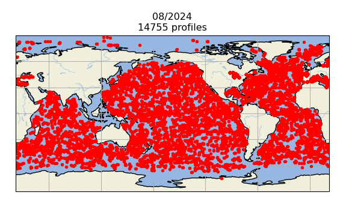

# :material-download-box-outline: EN4 다운로드 안내 [2026.03.28]

EN4(Met Office Hadley Centre)는 두 가지 product로 구성됩니다.

- Observed subsurface ocean temperature and salinity profiles with data quality information
- Objective analyses formed from the profile data with uncertainty estimates

<figure markdown="span">
  { loading=lazy }
  <figcaption>EN4 개요 (Met Office Hadley Centre)</figcaption>
</figure>

## 어떤 파일을 받아야 하나

[EN.4.2.2 다운로드 페이지](https://www.metoffice.gov.uk/hadobs/en4/download-en4-2-2.html)에서 스크롤을 내리면 product가 꽤 많습니다.
가장 신경 쓸 부분은 **Download profiles**와 **Download objective analyses**입니다.
각 현장 관측 profile이 필요하면 전자를, 격자 자료가 필요하면 후자를 다운로드하면 됩니다.

<figure markdown="span">
  { loading=lazy }
  <figcaption>EN.4.2.2 다운로드 페이지: profiles와 objective analyses</figcaption>
</figure>

??? info "Objective analyses 설명"
    The analysis files contain objective analyses produced **using optimal interpolation of the profile data for a particular month and a persistence forecast** background,
    on a regular **1° latitude/longitude grid** with **42 vertical levels**. To reduce storage space, not all latitudes are saved.
    The files also contain the analysis error standard deviation and an "observation influence" analysis, formed by setting all observation values to one and all background values to zero.
    Values close to one indicate that observations closely influenced the analysis, while zero indicates that no observations were available that month at that location.

## 링크

- [:octicons-download-24: EN.4.2.2 다운로드](https://www.metoffice.gov.uk/hadobs/en4/download-en4-2-2.html)
- [:octicons-link-external-24: 이전 버전](https://www.metoffice.gov.uk/hadobs/en4/download.html)
- [:octicons-book-24: Good, S. A., M. J. Martin and N. A. Rayner (2013). EN4: quality controlled ocean temperature and salinity profiles and monthly objective analyses with uncertainty estimates, *J. Geophys. Res. Oceans*, 118, 6704–6716](http://doi.org/10.1002/2013JC009067)

