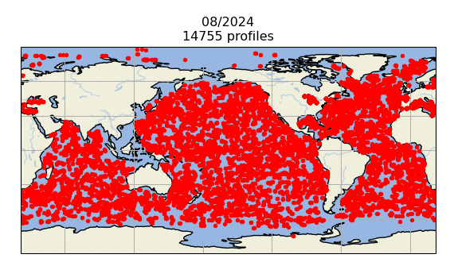

# :material-download-box-outline: EN4 Download Guide [2026.03.28]

EN4 (Met Office Hadley Centre) consists of two products:

- Observed subsurface ocean temperature and salinity profiles with data quality information
- Objective analyses formed from the profile data with uncertainty estimates

<figure markdown="span">
  { loading=lazy }
  <figcaption>EN4 profile distribution for a single month (August 2024, 14,755 profiles)</figcaption>
</figure>

## Which file to download

The [EN.4.2.2 download page](https://www.metoffice.gov.uk/hadobs/en4/download-en4-2-2.html) lists many products.
The two that matter are **Download profiles** and **Download objective analyses**: choose the former when you need the individual in situ profiles, and the latter when you need gridded fields.

<figure markdown="span">
  { loading=lazy }
  <figcaption>EN.4.2.2 download page: profiles vs objective analyses</figcaption>
</figure>

??? info "About the objective analyses"
    The analysis files contain objective analyses produced **using optimal interpolation of the profile data for a particular month and a persistence forecast** background,
    on a regular **1° latitude/longitude grid** with **42 vertical levels**. To reduce storage space, not all latitudes are saved.
    The files also contain the analysis error standard deviation and an "observation influence" analysis, formed by setting all observation values to one and all background values to zero.
    Values close to one indicate that observations closely influenced the analysis, while zero indicates that no observations were available that month at that location.

## Links

- [:octicons-download-24: EN.4.2.2 download](https://www.metoffice.gov.uk/hadobs/en4/download-en4-2-2.html)
- [:octicons-link-external-24: Previous versions](https://www.metoffice.gov.uk/hadobs/en4/download.html)
- [:octicons-book-24: Good, S. A., M. J. Martin and N. A. Rayner (2013). EN4: quality controlled ocean temperature and salinity profiles and monthly objective analyses with uncertainty estimates, *J. Geophys. Res. Oceans*, 118, 6704–6716](http://doi.org/10.1002/2013JC009067)

