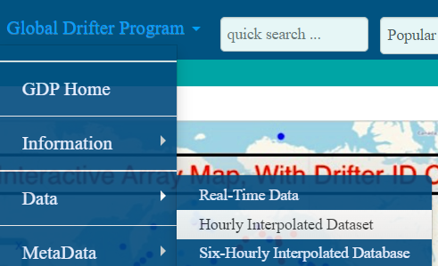
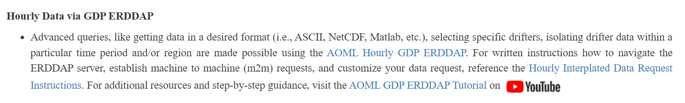
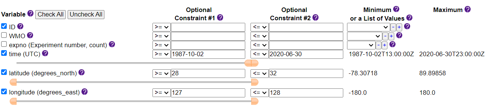
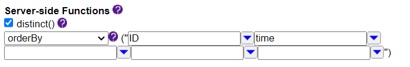
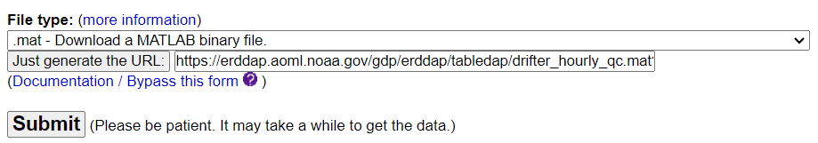

# :material-download-box-outline: GDP 자료 다운로드 방법 <span class="date">[2026.01.02]</span>

Global Drifter Program의 1시간(또는 6시간) 내삽 drifter 자료를 AOML ERDDAP 서버에서 받는 방법과,
받은 자료를 MATLAB에서 읽는 방법입니다.

## 1. Hourly data 페이지 찾기

GDP 홈페이지에서 시작합니다: [GDP (NOAA AOML)](https://www.aoml.noaa.gov/phod/gdp/index.php).
**Hourly Interpolated Data**를 다운받으려면 상단의 툴바를 이용하거나, 아래 링크로 바로 접속하면 됩니다:
[Hourly Interpolated Data](https://www.aoml.noaa.gov/phod/gdp/hourly_data.php).

<figure markdown="span">
  { loading=lazy }
  <figcaption>GDP 홈페이지: hourly data로 가는 상단 툴바</figcaption>
</figure>

스크롤을 내리다 보면 다음과 같은 문단을 찾을 수 있습니다.

<figure markdown="span">
  { loading=lazy }
  <figcaption>ERDDAP 자료 링크와 PDF 안내가 있는 문단</figcaption>
</figure>

- [첫 번째 링크](https://erddap.aoml.noaa.gov/gdp/erddap/tabledap/drifter_hourly_qc.html)를 열면 1시간 내삽 자료의 ERDDAP 다운로드 창이 뜹니다.
- [두 번째 링크](https://www.aoml.noaa.gov/phod/gdp/images/ERDDAP_Hourly_Interpolated_Data.pdf)는 첫 번째 링크에서 자료를 받는 방법을 소개하는 PDF입니다.

!!! tip "6시간 자료"
    6시간 내삽 자료는
    [ERDDAP: Global Drifter Program, 6 Hour Interpolated QC Drifter Data](https://erddap.aoml.noaa.gov/gdp/erddap/tabledap/drifter_6hour_qc.html)를 사용하면 됩니다.

## 2. ERDDAP 양식 작성

PDF를 직접 읽어도 좋지만, 기본적인 다운로드 방법을 여기서 간략히 소개합니다.

<figure markdown="span">
  { loading=lazy }
  <figcaption>1시간 drifter 자료의 ERDDAP 다운로드 양식</figcaption>
</figure>

1. 우선 **Uncheck All**을 클릭하여 옵션을 초기화합니다.
2. 기본적으로 **ID, WMO, time, latitude, longitude, sst, ve, vn, drogue_lost_date, drogue_center_depth** 옵션을 선택한 후, 그 외 필요한 변수는 자유롭게 선택합니다.
3. **time** 옵션에 관측하고자 하는 **기간**을 위 그림과 같이 입력합니다.
4. **latitude, longitude** 옵션에 **연구 지역의 경위도**를 위 그림과 같이 입력합니다.
5. 원하는 옵션을 다 선택한 후 스크롤을 내려 **Server-side Functions**를 확인합니다. 다운받은 자료가 정렬되는 규칙을 정하는 옵션입니다.
   **distinct**를 클릭하고 **orderBy**를 선택한 뒤, **ID, time** 순으로 정렬 순서를 지정합니다 (원하는 대로 바꿔도 됩니다).

    <figure markdown="span">
      { loading=lazy }
      <figcaption>Server-side Functions: distinct와 orderBy (ID, time)</figcaption>
    </figure>

6. 마지막으로 다운받을 **자료 type**을 고릅니다. CSV, **mat**, **NC** 등이 있으며, 본인이 다루기 편한 type을 선택하면 됩니다
   (필자는 mat 또는 NC를 선호합니다). 그리고 **Submit** 버튼을 클릭하면 자료를 다운받을 수 있습니다.

    <figure markdown="span">
      { loading=lazy }
      <figcaption>자료 type 선택 화면. 여기서는 mat을 선택</figcaption>
    </figure>

    **URL** 버튼은 같은 요청을 바로 다운받을 수 있는 URL 주소를 만드는 기능입니다. 다른 사람에게 동일한 자료를 공유할 때 편리합니다.

## 3. MATLAB에서 mat 파일 읽기

다운받은 mat 파일은 구조체(struct)이므로 dot notation으로 사용합니다.

```matlab title="다운받은 mat 파일로 drifter 궤적 그리기"
%% Drifter Trajectory

clc; clear; close all;
load drifter_hourly_qc_7b2b_639d_848a.mat ; % mat 파일 이름 변경하기!!!

d = drifter_hourly_qc; % (구조체 사용에 필요한) dot notation이 편하게끔 변수명 변경.
id = double(unique(string(d.ID))); d.ID = double(string(d.ID));
    % 변수 id는 연구 지역을 통과하는 모든 Drifter의 ID.
d.latitude = double(d.latitude); d.longitude = double(d.longitude); % type 변환

% time : seconds since 1970.01.01
d.time = datetime(1970,01,01,00,00,00) + seconds(d.time); % datetime type으로 변환

figure(1); hold on;
for i = 1:length(id)
    k = d.ID == id(i);
    plot(d.longitude(k), d.latitude(k)) % dot notation
end

clear drifter_hourly_qc;
```

## 자료 인용

!!! quote "논문에 사용할 경우 다음과 같이 인용합니다"
    Elipot, Shane; Sykulski, Adam; Lumpkin, Rick; Centurioni, Luca; Pazos, Mayra (2022).
    Hourly location, current velocity, and temperature collected from Global Drifter Program drifters world-wide. [indicate subset used].
    NOAA National Centers for Environmental Information. Dataset. [https://doi.org/10.25921/x46c-3620](https://doi.org/10.25921/x46c-3620). Accessed [date].

## NOAA NCEI 전체 자료

!!! info "Hourly dataset version 2.00"
    1시간 자료 version 2.00은 NOAA NCEI에서 공식 제공합니다:
    [AOML-GDP-1HR landing page](https://www.ncei.noaa.gov/access/metadata/landing-page/bin/iso?id=gov.noaa.nodc:AOML-GDP-1HR).

    이 페이지에서 "Lineage" 탭을 열고 "Output Datasets" → "data" → "0-data" → "gdp_v2.00.nc" 순으로 들어가면 브라우저로 다운받을 수 있습니다.
    또는 이 [직접 링크](https://www.nodc.noaa.gov/archive/arc0199/0248584/1.1/data/0-data/)에서 NetCDF 파일을 바로 받을 수 있습니다 (약 **12 GB**).

    자료는 변수마다 [contiguous ragged array](https://cfconventions.org/cf-conventions/cf-conventions.html#_contiguous_ragged_array_representation)로 저장된
    NetCDF 파일 하나로 배포되며, 모든 메타데이터가 함께 들어 있습니다.
    사용 예시는 [GitHub의 Jupyter Notebook](https://github.com/Cloud-Drift/gdp-get-started)을 참고하세요.
